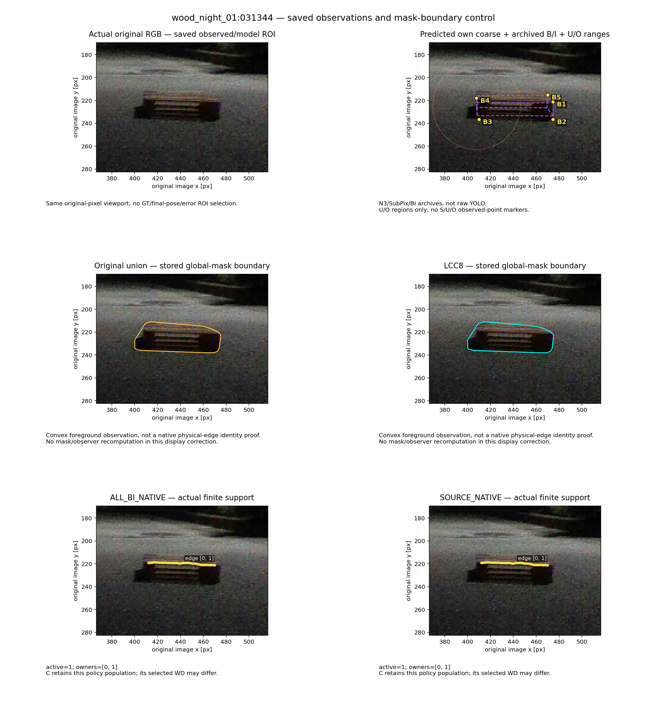
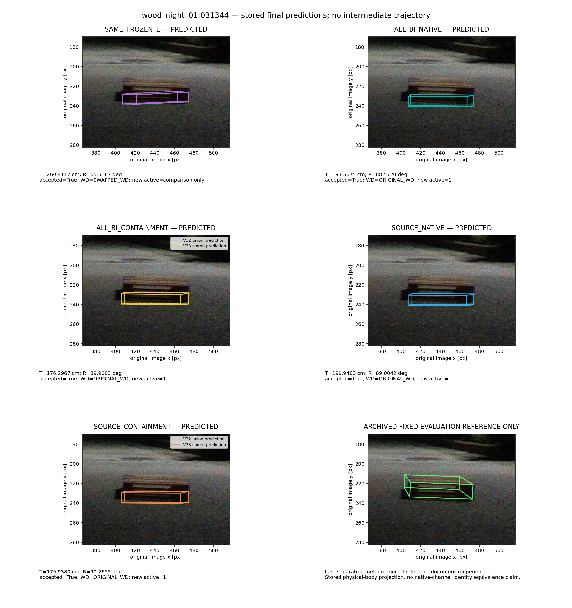
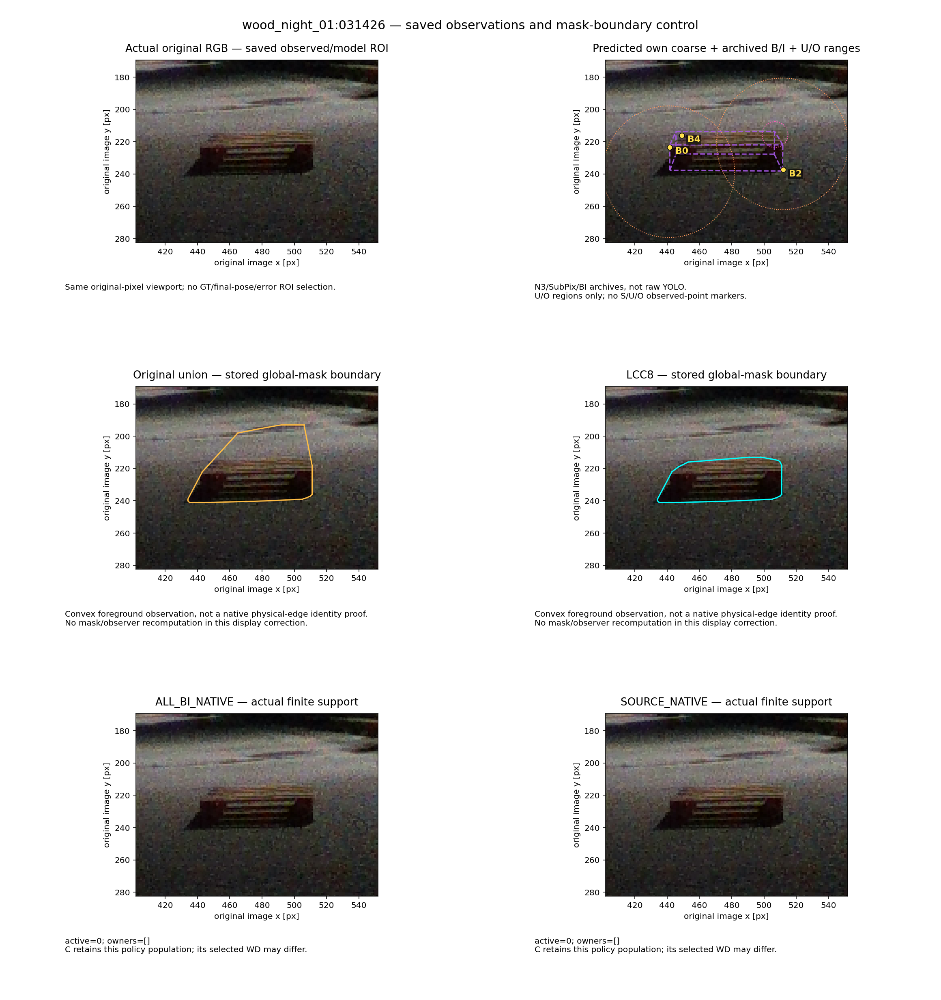
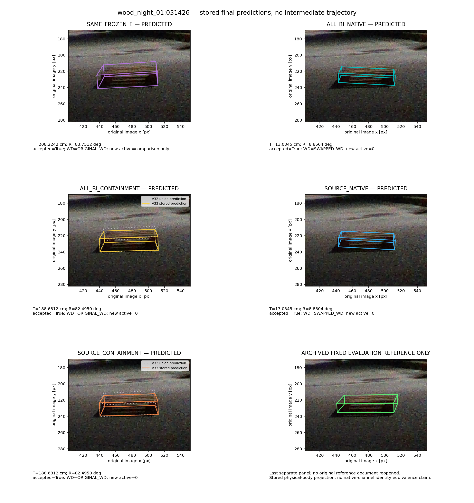
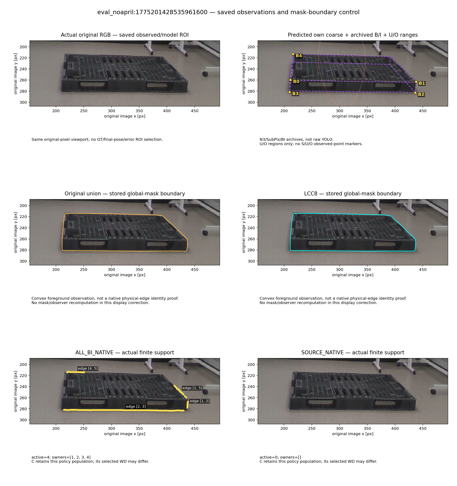
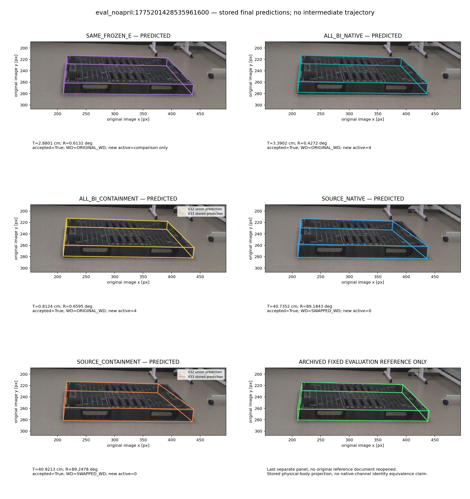

# 고정 세 사례: 설명글 공간을 분리한 확대판

첫 렌더의 설명글 일부가 축 라벨과 겹쳐, 이미지와 설명글을 별도 칸으로 나눴다. 원본 렌더·봉인은 보존했고 좌표·자세·동일 ROI·저장 오차를 바꾸지 않았다. 전수 결과의 성능이나 마스크 의미를 새로 검증하는 그림이 아니다.

보라선은 초기 예측, 노란 점은 N3/SubPix/BI 보정 archive다. S는 영상 점을 그리지 않으며 U/O는 영역만 표시한다. 실제 유한 native 선과 전경 마스크 경계는 별개다. C 패널의 회색 점선은 이전 V32 union 예측, 실선은 V33 LCC 예측으로 중간 최적화 과정이 아니다. 마지막 초록 패널만 기존 저장 평가 참조다.

[원본 전체 프레임·union/LCC 픽셀 비교](../REPORT_KO.md)

## wood_night_01:031344

[원본 전체 mask 비교](../case0/union_LCC_full_canvas.png) · [저장 수치](../case0/PROCESS_DATA.json)

## wood_night_01:031426

[원본 전체 mask 비교](../case1/union_LCC_full_canvas.png) · [저장 수치](../case1/PROCESS_DATA.json)

## eval_noapril:1775201428535961600

[원본 전체 mask 비교](../case2/union_LCC_full_canvas.png) · [저장 수치](../case2/PROCESS_DATA.json)
