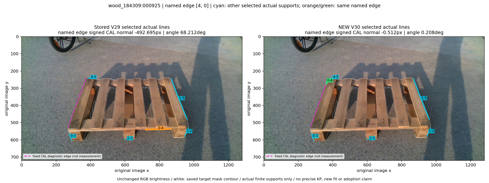
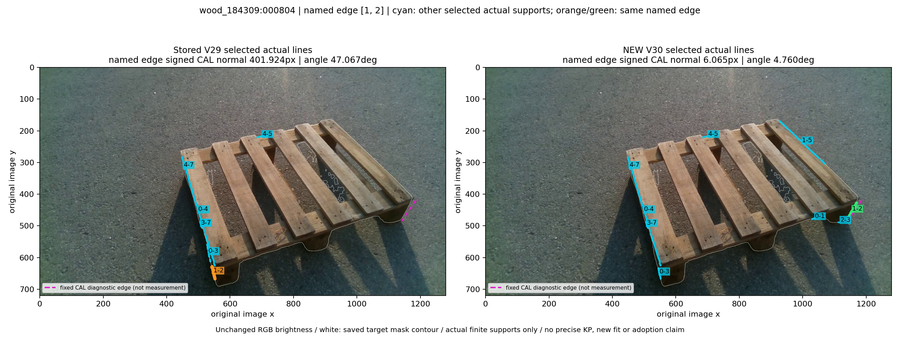
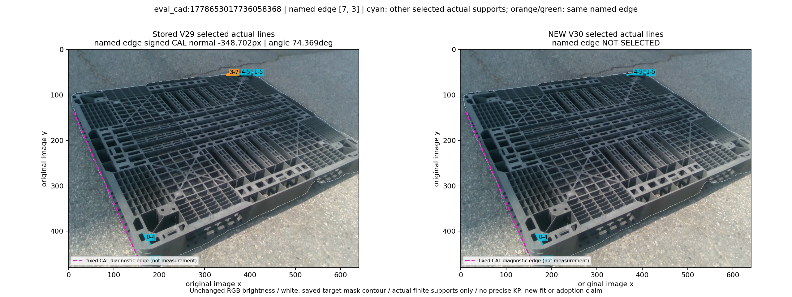

# V30: 원 B/I 점과 실제 선의 대응 gate, 고정 CAL3 사진

기존 실제 선 후보만 다시 순위화했다. 43px는 기존 normal search reach이며, named native 변의 모든 eligible B/I q에서 무한 TLS 선까지 적용한다. 선을 따라 이동하는 거리는 막지 않는다. 초기 S/U 좌표 조회·새 영상 측정·라벨 해독·포즈 적합은 없다. V29 관측·모델은 바꾸지 않았다.

청록은 각 방법이 선택한 다른 실제 선 지지점, 주황/초록은 진단 대상 native 변의 원/새 실제 선이다. 마젠타는 이미 봉인된 **CAL 진단 기준의 해당 변 투영**이며 새 측정이나 순위화 guide가 아니다. 흰 윤곽은 저장 target mask이며 실제 occluder 정답이 아니다. 모든 실제 지지점과 TLS 계수는 원 캐시와 정확히 같음을 대조했다.

| CAL 사례 | unique 후보 원→새 | raw 후보 gate 제외 | 선택 선 원→새 | 해당 변 CAL normal 원→새(px) | 각도 원→새(°) |
|---|---:|---:|---:|---:|---:|
| wood_184309:000925 | 501→177 | 531 | 6→6 | -492.695 → -0.512 | 68.212 → 0.208 |
| wood_184309:000804 | 942→615 | 597 | 7→9 | 401.924 → 6.065 | 47.067 → 4.760 |
| eval_cad:1778653017736058368 | 126→111 | 17 | 5→4 | -348.702 → 미선택 | 74.369 → 미선택 |

## wood_184309:000925

## wood_184309:000804

## eval_cad:1778653017736058368

두 목재 사례는 같은 native 변에서 기준에 가까운 새 실제 선을 선택했다. CAD 사례는 문제가 된 변을 **미선택**으로 남겼으며 정밀 복구 성공으로 계산하지 않는다. 세 사례 모두 전체 후보0/전체 선택0은 아니고 joint 대안8개를 보존했다. raw gate 제외 수에는 같은 물리 지지의 여러 원 후보가 포함되므로 unique 후보 감소와 다르다. 모든 새 선택선의 original q/source/양끝 법선 거리와 미선택 장부는 [원 재순위 RESULTS](../observed_bi_line_association_CAL_cases_v4_30/RESULTS.json)에 있다.

원래 큰 CAL 잔차로 선택된 3개 진단 사례이므로 모집단 대표 성능을 뜻하지 않는다. gate 통과나 이 그림만으로 native 정체의 정확성·전체192 개선·관측 독립성·방법 채택을 주장하지 않는다. 별도 CAL46 population/noise 및 uniform 전체 평가가 필요하며 V29 σ/γ는 새 선택 집단의 검증 모델로 재사용하지 않는다.
