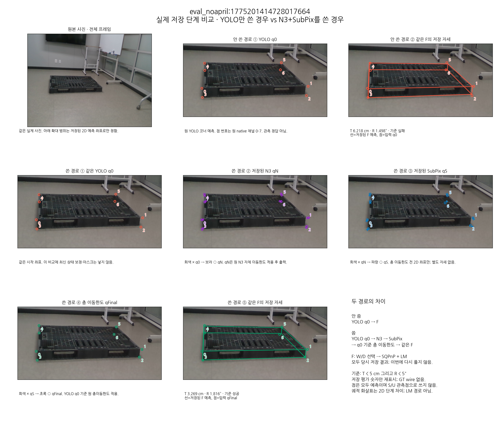
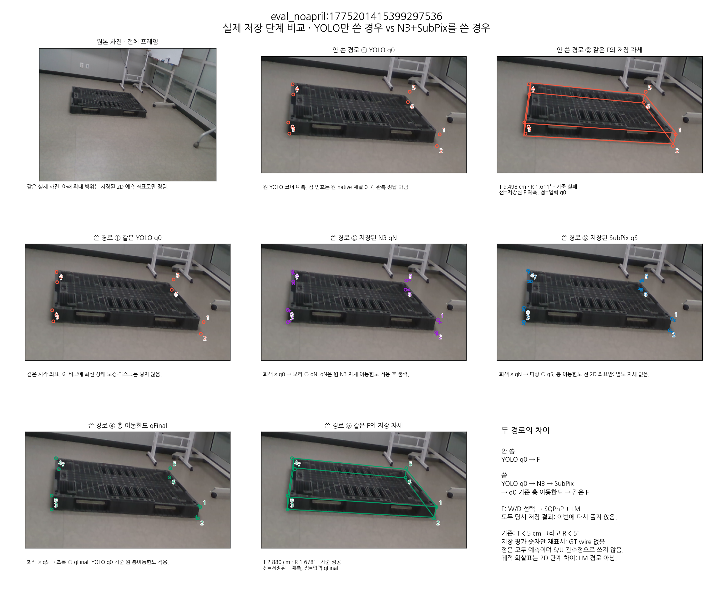
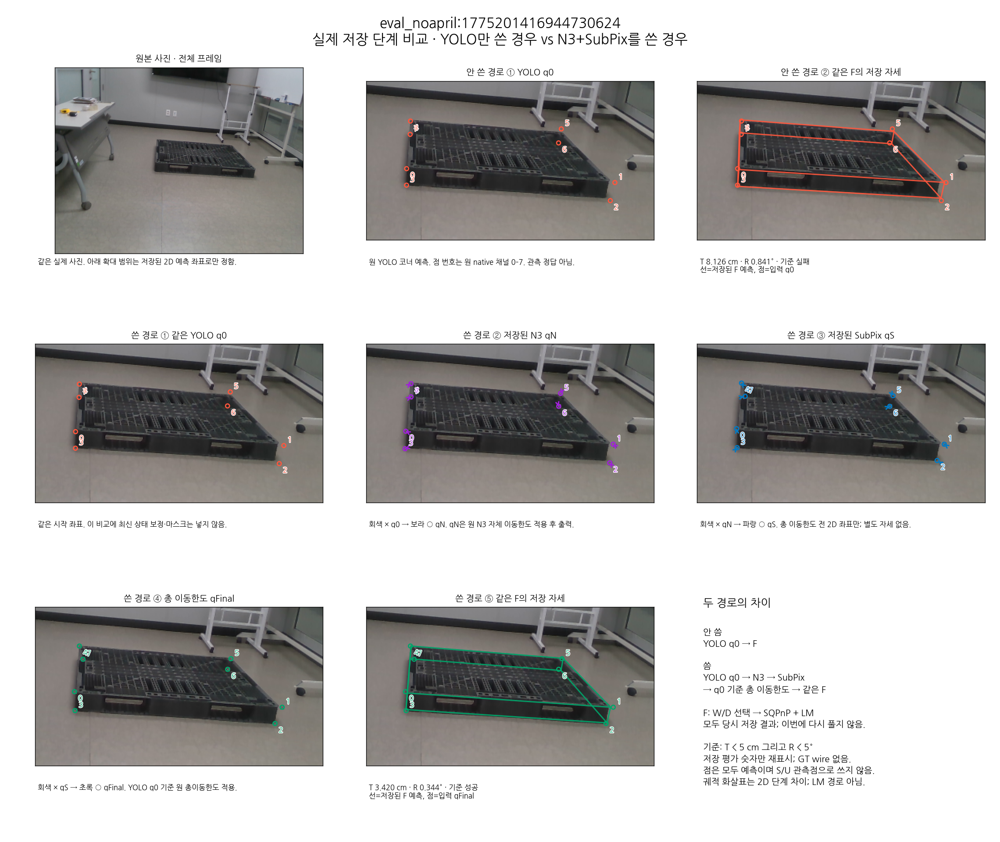
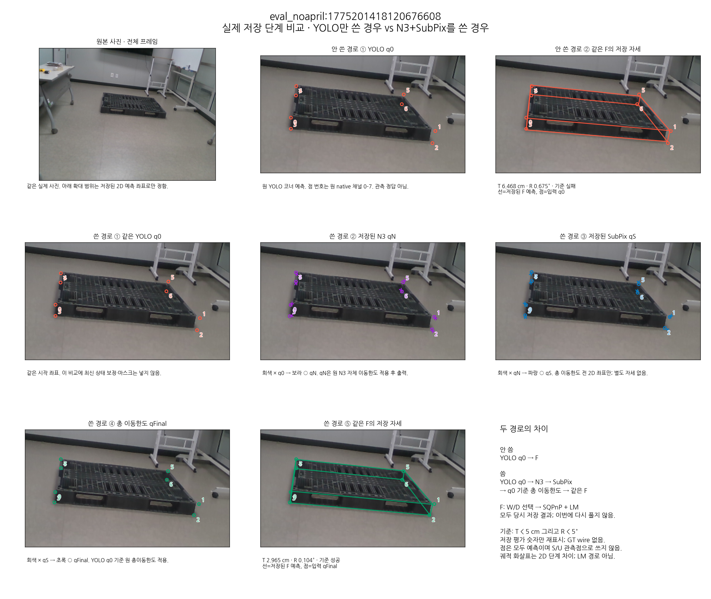
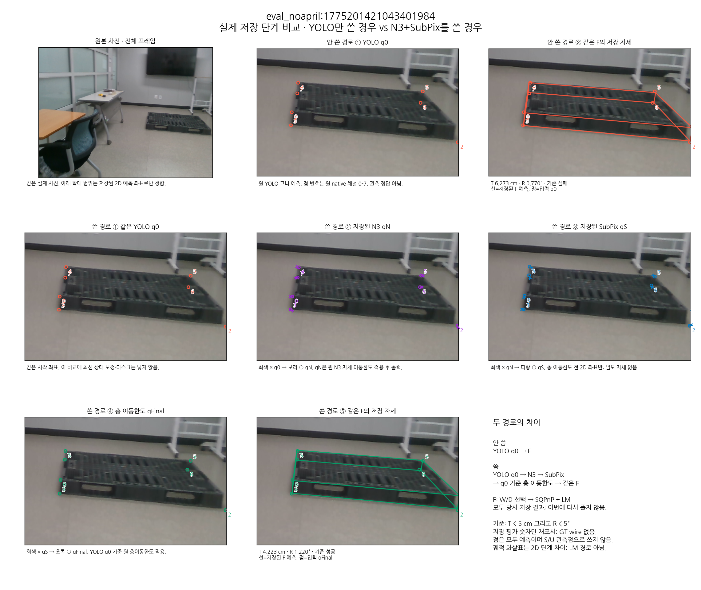
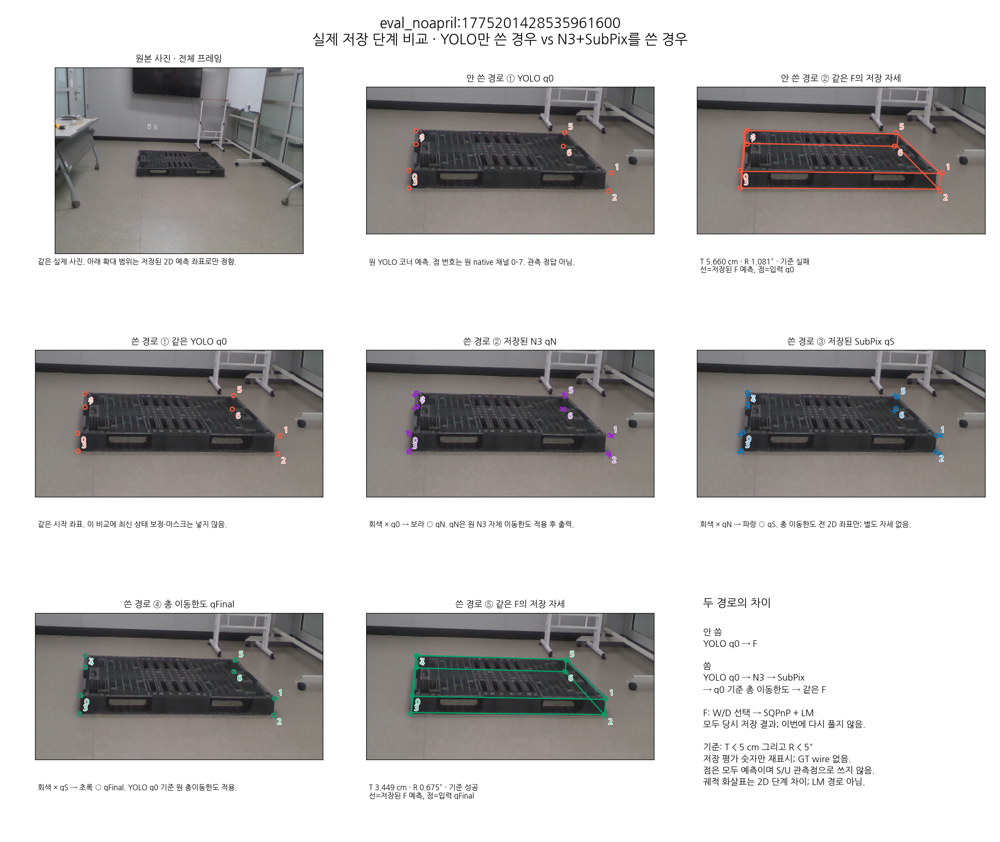
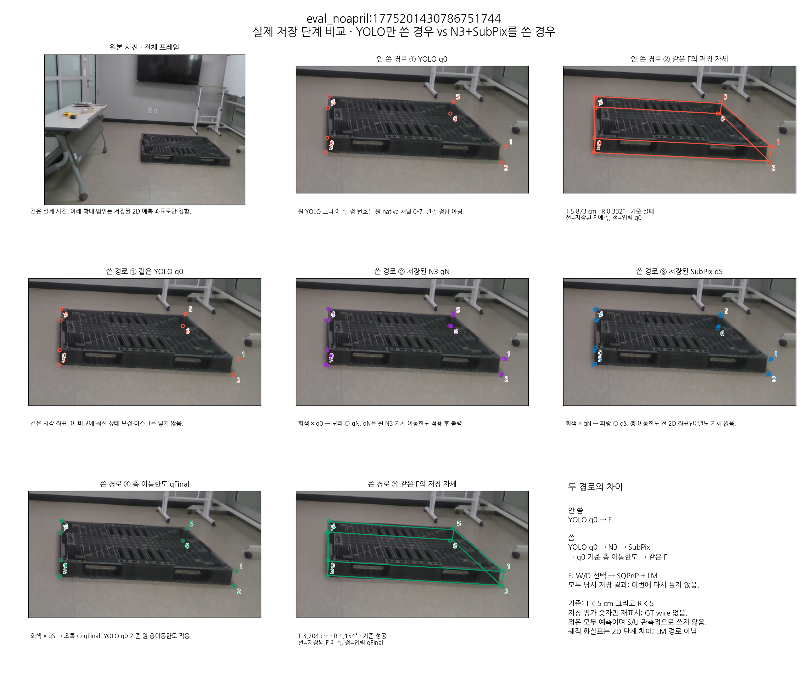
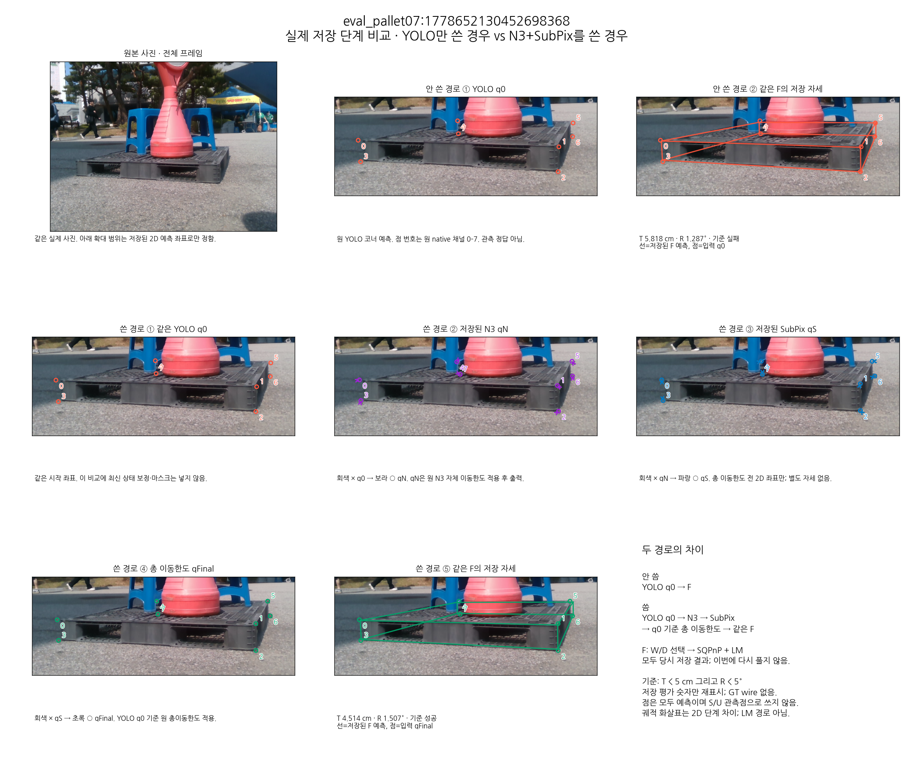
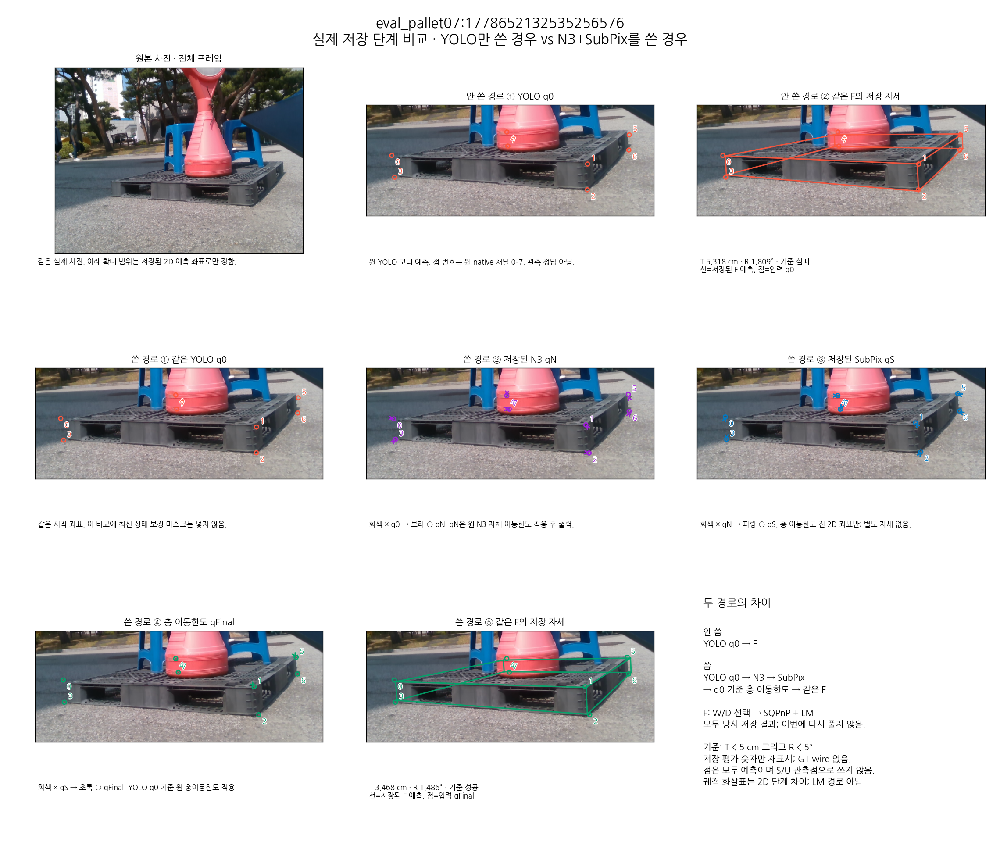
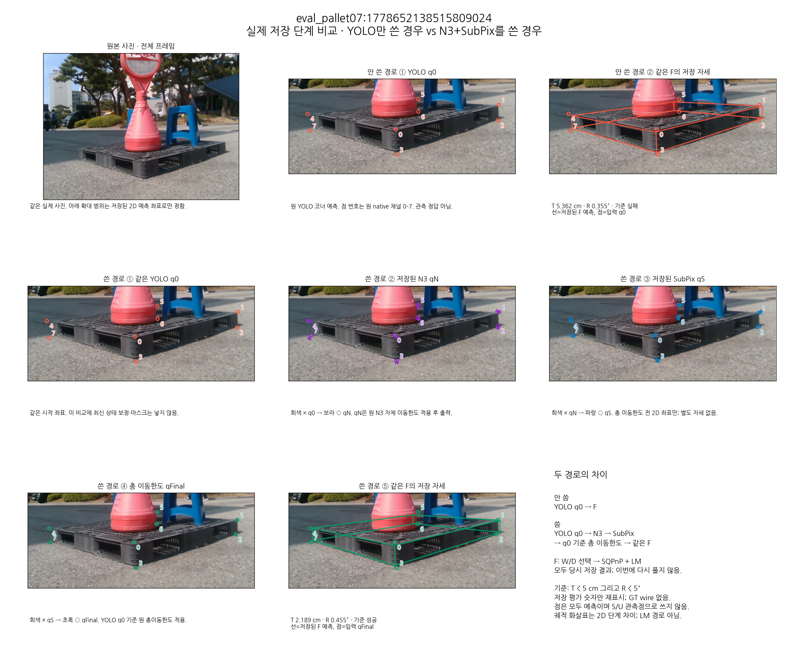

# YOLO만 쓴 경우와 N3+SubPix를 쓴 경우: 달라진 10장

기존 TEST49 저장 평가에서 성공은 30/49 → 40/49다. 정확히 10장이 실패에서 성공으로 바뀌었고 역방향 손실은 0장이다. 기준은 기존의 **T < 5 cm 및 R < 5°**이며, 이 갤러리는 그 10장의 사후 설명이다.

각 그림의 윗줄은 원 YOLO 좌표 → 같은 F의 저장 자세, 아랫줄은 YOLO → N3(자체 이동한도 후) → SubPix → YOLO 기준 총 이동한도 → 같은 F의 저장 자세다. 모든 점은 당시 저장된 예측이다. SubPix 직후의 별도 자세나 LM 중간 궤적은 저장되지 않아 만들지 않았다.

F는 동일한 예측 기반 W/D 선택 및 SQPnP+LM이다. 이번에는 사진과 저장 좌표·자세를 그렸으며 새 추론·SubPix·PnP·정답 조회는 0회다. 정답 wire/정답 기반 ROI도 없다.

## eval_noapril:1775201414728017664

[원본 전체 사진](case00/source_rgb.png) · [전체 과정 확대 PNG](case00/process.png)

## eval_noapril:1775201415399297536

[원본 전체 사진](case01/source_rgb.png) · [전체 과정 확대 PNG](case01/process.png)

## eval_noapril:1775201416944730624

[원본 전체 사진](case02/source_rgb.png) · [전체 과정 확대 PNG](case02/process.png)

## eval_noapril:1775201418120676608

[원본 전체 사진](case03/source_rgb.png) · [전체 과정 확대 PNG](case03/process.png)

## eval_noapril:1775201421043401984

[원본 전체 사진](case04/source_rgb.png) · [전체 과정 확대 PNG](case04/process.png)

## eval_noapril:1775201428535961600

[원본 전체 사진](case05/source_rgb.png) · [전체 과정 확대 PNG](case05/process.png)

## eval_noapril:1775201430786751744

[원본 전체 사진](case06/source_rgb.png) · [전체 과정 확대 PNG](case06/process.png)

## eval_pallet07:1778652130452698368

[원본 전체 사진](case07/source_rgb.png) · [전체 과정 확대 PNG](case07/process.png)

## eval_pallet07:1778652132535256576

[원본 전체 사진](case08/source_rgb.png) · [전체 과정 확대 PNG](case08/process.png)

## eval_pallet07:1778652138515809024

[원본 전체 사진](case09/source_rgb.png) · [전체 과정 확대 PNG](case09/process.png)

