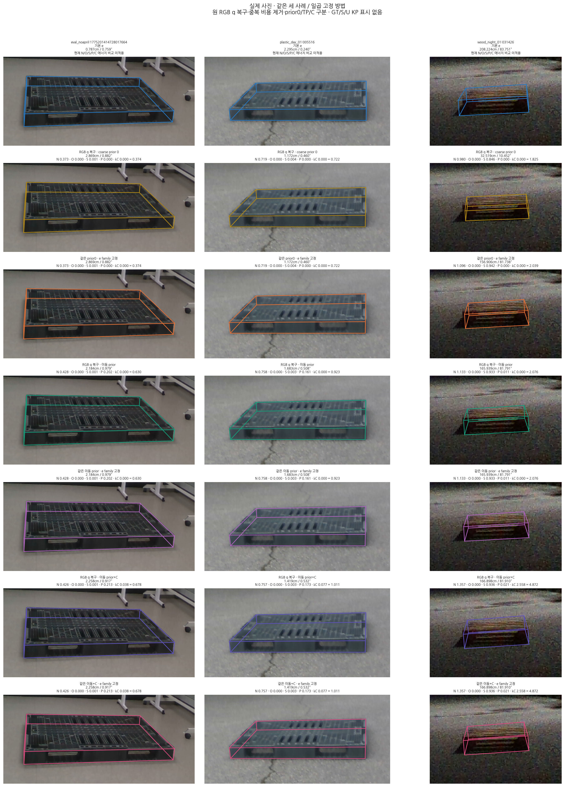
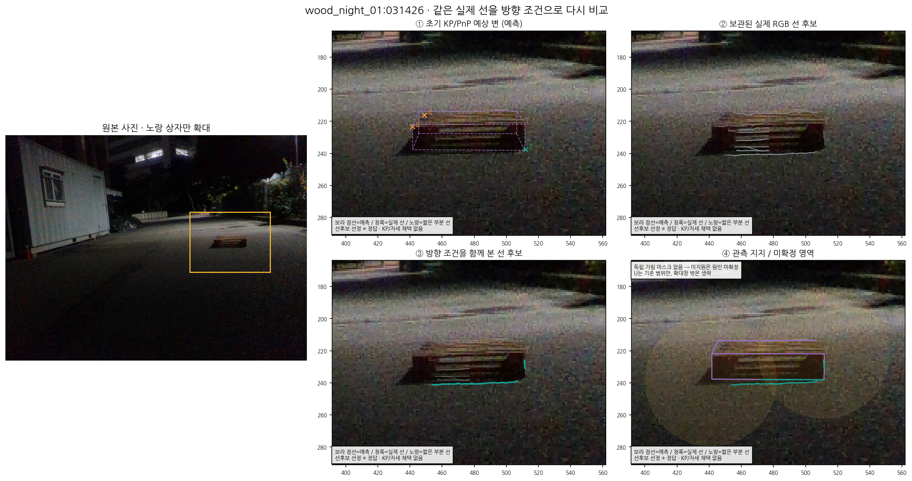
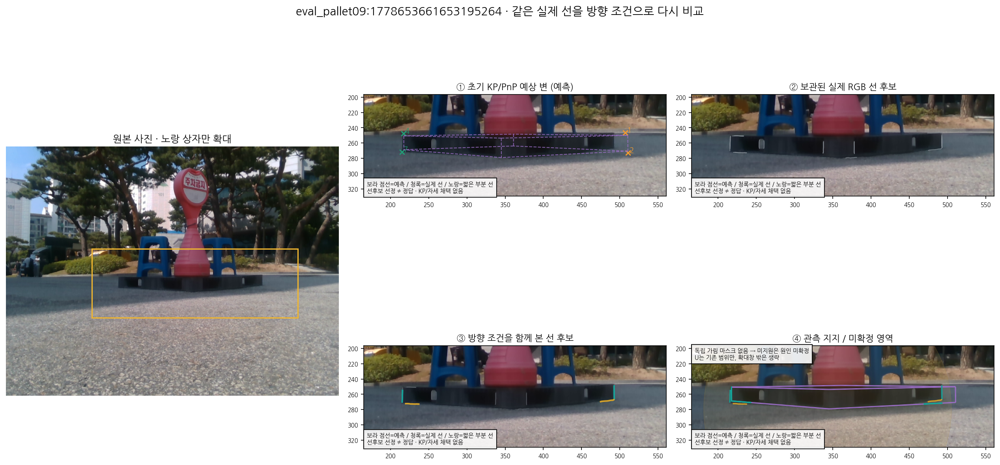

# 팔레트 자세 추정 개선 실험: 진행·결과·재개 지점

기록일: 2026-10-15. 이 문서는 완료된 전체 평가와 진행 중인 관측 실험을 구분한 저장소 공유용 보고서다. **기본 방법은 `SAME_FROZEN_E`로 유지한다. 전체 192장 모두 위치 오차 5cm 이하라는 목표는 아직 달성하지 못했다.**

기본 e는 최초 TEST49에서 49/49장 모두 5cm·5° 이내였지만, 추가 143장까지 같은 방법을 적용하면 위치 5cm 이내는 66/143장이다. 최신 완료 실험 v26도 최초 49장 성능을 모두 보존하지 못해 채택하지 않았다. v29는 구현과 제한된 실제 CAL 검증을 마쳤으나 CAL 관측 32/46장에서 중단되었으며, 새 잡음 모델 적합이나 전체 성능 평가 결과는 없다.

## 1. 사용자 요청과 진행 순서

1. 실제 실패 사진에서 초기 키포인트부터 보정·PnP까지 과정을 보이면서 최초 49장의 큰 위치 오차를 해결한다.
2. 최초 49장 결과를 확인한 뒤 나머지 clean/moderate 데이터에도 같은 절차를 적용한다. 기존 severe 제외 조건은 유지한다.
3. 추가 143장 실패도 계속 개선하되 최초 49장 전체 5cm 이내 성능을 희생한 방법을 기본값으로 채택하지 않는다.
4. 초기 키포인트/PnP의 3D 기하를 실제 선 탐색에 활용하고, 잘못 연결된 평행선·둥근 모서리·가림을 실제 사진으로 확인한다.
5. 현재까지의 코드·이미지·정보·보고서를 보존·공유한 뒤 남은 실험을 재개한다. 이 문서는 이 저장 시점의 결과와 미완료 범위를 기록한다.

## 2. 데이터와 평가 계약

| 구분 | 장수 | 용도 |
|---|---:|---|
| CAL | 46 | 잡음·기존 prior 등의 교정 및 진단. primary 성능 집계와 분리 |
| 최초 TEST | 49 | 최초 개선 대상. 반복 연구에 사용한 탐색적 평가 집단 |
| 추가 REMAINDER | 143 | 최초 49장 이후 적용한 추가 집단 |
| PRIMARY | 192 | TEST49 + REMAINDER143 |
| 전체 실행 원장 | 238 | CAL46 + PRIMARY192 |
| 포함된 severe | 0 | 기존 severe 제외 조건 유지 |

CAL의 native/body 좌표 정렬을 요구하는 교정에는 기존 고정 정렬과 호환되는 44장을 사용하며, 나머지 2장은 전체 CAL 원장에 남긴다. 수치가 불리한 프레임, fallback 또는 native 대응 표지를 이유로 평가 집단에서 제거하지 않는다. 프레임마다 가장 좋은 방법·정답 기반 WD를 고르는 라우팅도 하지 않는다.

위치 오차 T는 동일한 기준 중심 위치의 거리(cm), 회전 오차 R은 기존 C2 대칭 규약을 적용한 각도(°)다. 아래 `동시 성공`은 T≤5cm 및 R≤5°를 모두 만족한 수다. 추가 143장의 기준 자세는 저장된 annotation/PnP에서 유도한 명목 기준이다. 독립 계측으로 확정한 진실이라고 표현하지 않는다. 이 집단과 최초 TEST는 이미 연구 중 진단에 사용했으므로 새 독립 holdout 성능으로 주장하지 않는다.

집계의 직접 근거는 [V9 전체 JSON](../nonsevere_v1/remainder_after_test49_v1/repair_campaign_20261015_v1/PROGRESS_V9_V26.json), [V9 HTML](../nonsevere_v1/remainder_after_test49_v1/repair_campaign_20261015_v1/RESULTS_V9_V26.html), [집계 봉인](../nonsevere_v1/remainder_after_test49_v1/repair_campaign_20261015_v1/PROGRESS_V9_V26_SEAL.json)이다. V9는 기존 23방법을 그대로 보존하고 v26의 6방법을 추가하여 29방법×4집단=116개 행을 담는다. 아래에는 기본 e와 최신 v26 여섯 대조군을 모두 제시한다.

## 3. S/B/I/O/T와 U가 뜻하는 것

| 상태 | 의미 | 측정·출력에서의 취급 |
|---|---|---|
| S | 초기 3D 기하상 자체 가림 | S 키포인트의 RGB/2D 관측을 조회하지 않는다. 결과 그림에는 모델 투영만 표시한다. coarse-S prior를 쓰는 대조군의 3D 기하 벌점과는 구분한다. |
| B | 보이는 외곽 모서리 역할 | 실제 TARGET_BACKGROUND 외곽선과 그 지지를 검증한다. 한 선만 있으면 정밀 교점으로 승격하지 않는다. |
| I | 보이는 내부 모서리 역할 | TARGET_TARGET 내부 crease와 실제 지지를 사용한다. B 외곽선과 같은 것으로 취급하지 않는다. |
| O | 외부 가림으로 추정된 상태 | 관측되지 않은 정확한 이미지 점 대신 기존 불확실 영역/유계 prior를 사용한다. 원형 영역 자체가 실제 가림 물체의 마스크라는 뜻은 아니다. |
| T | 화면 밖 또는 잘림 | 허용 영역과 기존 기하·canvas 제약을 사용한다. 정밀 이미지 점 측정으로 쓰지 않는다. |
| U | 불확실하여 판정을 보류한 상태 | 영역만 사용한다. U를 정밀 점·선의 로컬 관측으로 바꾸지 않는다. |

초기 B/I 역할은 기하에서 정해지는 역할이고, RGB 가시성 분류 자체와 동일하지 않다. S 우선 gate, 독립 잘림 증거, 실제 RGB 판정, 불확실성 보류를 분리한다. `target mask=0`만으로 다른 물체에 의한 가림을 확정하지 않는다. 독립 occluder mask가 없는 현재 두 사례에서는 해당 빈 구간을 unknown으로 남긴다.

## 4. 최신 완료 평가: 기본 e와 v26의 모든 대조군

v26은 partial 처리 이전에 보관된 RGB/unknown q를 정확한 source·공분산·신뢰도와 함께 복구하고, 같은 owner의 기존 normal·tangent 비용 중복을 제거한다. 실제 backbone fallback partial은 유지한다. 새 적용 집단에 맞는 CAL 선 잡음 모델 1개를 별도로 적합했다. 기존 TCAL/O/S/coarse-prior 모델은 재적합하지 않았다.

표의 약어는 다음과 같다. `noP`는 coarse pose prior 가중치 0, `TP`는 기존 6D 공분산의 위치 marginal을 사용하는 가중치 1의 prior, `C`는 관측 foreground가 전체 모델 hull 안에 들어오도록 외부만 벌점화한 한쪽 포함 항(λ=1)이다. `e-WD`는 e가 예측했던 WD family label만 고정하는 대조군이며 e의 수치 자세를 prior나 fallback으로 삽입하지 않는다. e-WD label에는 과거 whole-mask 선택의 영향이 남아 있다. v26 새 방법들은 옛 대칭 whole-mask 비용을 동률 선택에도 사용하지 않는다.

각 방법은 같은 전체 집단에 균일하게 적용했다. **아래 방법 가운데 최초 TEST49 전체 5cm 이내를 보존한 새 방법은 없다.**

### 최초 TEST49

| 방법 | T≤5cm | 동시 성공 | T 평균 / 최대(cm) | R 평균 / 최대(°) | fallback |
|---|---:|---:|---:|---:|---:|
| 기본 e | 49/49 | 49/49 | 1.2994 / 4.3389 | 1.1103 / 3.9496 | 0 |
| v26 noP | 41/49 | 39/49 | 4.2276 / 40.7352 | 13.9509 / 89.4565 | 0 |
| v26 noP + e-WD | 45/49 | 42/49 | 2.2769 / 13.3171 | 1.8006 / 6.2638 | 0 |
| v26 TP | 45/49 | 44/49 | 2.0371 / 12.8530 | 6.8472 / 89.4553 | 0 |
| v26 TP + e-WD | 45/49 | 44/49 | 2.0797 / 13.7168 | 1.6362 / 7.3849 | 0 |
| v26 TP+C | 45/49 | 44/49 | 2.0356 / 13.0443 | 6.6288 / 89.4823 | 0 |
| v26 TP+C + e-WD | 45/49 | 44/49 | 2.0632 / 13.2956 | 1.4083 / 5.3674 | 0 |

### 추가 REMAINDER143

| 방법 | T≤5cm | 동시 성공 | T 평균 / 최대(cm) | R 평균 / 최대(°) | fallback |
|---|---:|---:|---:|---:|---:|
| 기본 e | 66/143 | 65/143 | 18.5025 / 260.4117 | 17.0756 / 159.1366 | 4 |
| v26 noP | 74/143 | 70/143 | 16.5267 / 202.0769 | 11.6465 / 89.7200 | 0 |
| v26 noP + e-WD | 69/143 | 65/143 | 15.9612 / 159.2688 | 16.5960 / 90.0516 | 0 |
| v26 TP | 75/143 | 71/143 | 14.1099 / 178.9632 | 13.3412 / 165.1894 | 0 |
| v26 TP + e-WD | 70/143 | 67/143 | 14.3511 / 170.1073 | 17.4066 / 165.1894 | 0 |
| v26 TP+C | 75/143 | 70/143 | 13.9009 / 177.0944 | 12.6270 / 90.0314 | 0 |
| v26 TP+C + e-WD | 71/143 | 67/143 | 14.3244 / 167.1669 | 16.4261 / 89.3456 | 0 |

### 합계 PRIMARY192

| 방법 | T≤5cm | 동시 성공 | T 평균 / 최대(cm) | R 평균 / 최대(°) | fallback |
|---|---:|---:|---:|---:|---:|
| 기본 e | 115/192 | 114/192 | 14.1121 / 260.4117 | 13.0011 / 159.1366 | 4 |
| v26 noP | 115/192 | 109/192 | 13.3879 / 202.0769 | 12.2346 / 89.7200 | 0 |
| v26 noP + e-WD | 114/192 | 107/192 | 12.4689 / 159.2688 | 12.8201 / 90.0516 | 0 |
| v26 TP | 120/192 | 115/192 | 11.0288 / 178.9632 | 11.6839 / 165.1894 | 0 |
| v26 TP + e-WD | 115/192 | 111/192 | 11.2193 / 170.1073 | 13.3819 / 165.1894 | 0 |
| v26 TP+C | 120/192 | 114/192 | 10.8728 / 177.0944 | 11.0962 / 90.0314 | 0 |
| v26 TP+C + e-WD | 116/192 | 111/192 | 11.1952 / 167.1669 | 12.5934 / 89.3456 | 0 |

v26 TP+C의 PRIMARY 위치 5cm 이내 수는 120/192로 e의 115/192보다 많지만, 최초 TEST는 45/49로 낮아지고 최대 위치 오차도 여전히 177.0944cm다. 따라서 목표 달성이나 기본값 변경의 근거로 삼지 않는다. 평균 목적함수 감소, hard guard 통과, 위치·회전 정확도 향상은 서로 같은 명제가 아니다.

### CAL46은 별도 집계

| 방법 | T≤5cm | 동시 성공 | T 평균 / 최대(cm) |
|---|---:|---:|---:|
| 기본 e | 38/46 | 37/46 | 5.3790 / 51.9778 |
| v26 noP | 37/46 | 36/46 | 5.4127 / 56.5805 |
| v26 noP + e-WD | 35/46 | 34/46 | 6.7984 / 56.5805 |
| v26 TP | 38/46 | 37/46 | 3.0015 / 17.4408 |
| v26 TP + e-WD | 36/46 | 35/46 | 4.4224 / 35.4058 |
| v26 TP+C | 38/46 | 38/46 | 2.9473 / 17.5652 |
| v26 TP+C + e-WD | 36/46 | 36/46 | 4.4111 / 35.4976 |

[v26 독립 선택 자세 감사](../nonsevere_v1/statewise_joint_ot_20261014_v2/nonsevere_v4_fix/boundary_recovery_v1/prepartial_RGB_preservation_eval_v4_26/independent_root_audit_v1/AUDIT.json)는 238행, 새 6방법의 선택 자세 1,428개에 대해 58,251개 검사/실패 0, 비용 최대 차이 1.42×10⁻¹⁴를 기록한다. 이 검사는 선택 자세의 비용·제약·기록 일치와 저장 후보 최소 비교를 확인한 것이며 전역 최적해나 실제 정확도 보증은 아니다.

### 실제 과정 이미지

[v26 세 고정 사례·7방법·14단계 HTML](../nonsevere_v1/statewise_joint_ot_20261014_v2/nonsevere_v4_fix/boundary_recovery_v1/prepartial_RGB_process_v4_26/index.html)과 [사용자 지정 wood 031426의 별도 v25 과정](../nonsevere_v1/statewise_joint_ot_20261014_v2/nonsevere_v4_fix/boundary_recovery_v1/user_requested_031426_process_v4_25_v1/index.html)을 보존했다. 과정 패널은 저장 관측과 독립 최종 결과 비교이며 optimizer의 중간 궤적을 만들어 낸 것이 아니다.

## 5. v28/v28b: 두 실제 사진에서 기하 유도 선 탐색 확인

사용자가 지적한 목재 `wood_night_01:031426`과 검은 팔레트 `eval_pallet09:1778653661653195264`를 먼저 확인했다. 당시의 초기 키포인트/PnP와 당시 마스크를 사용했고, 현재 개선 결과나 정답 자세를 골라 guide로 넣지 않았다. 모델에서 예측한 선 방향은 탐색 guide이고 실제 RGB 픽셀에서 추출한 TLS 선과 구분했다.

- v28은 기존 12px 탐색이 놓친 선을 확인하고, 비교 폭을 43px로 맞춘 기존 방식과 기하 guide 방식을 실제 RGB에서 비교했다. S/U 로컬 점 조회는 하지 않았다.
- v28b는 같은 cached 실제 선을 새 RGB 재조회 없이 방향 순서로 다시 평가했다. 팔레트09에서 위쪽 수평선을 아래쪽 모서리로 잘못 연결한 후보는, 실제 오른쪽 수직선의 지지가 예상 진행 방향과 반대라 제외했다.
- 원래 전체 span 비율 0.535329가 기존 0.55에 조금 못 미쳤던 아래 선의 실제 18개 지지점은 `PARTIAL_LINE_PROPOSAL`로 별도 보존했다. 없는 RGB gradient/lattice provenance를 채워 넣거나 완전한 17c 관측·새 키포인트라고 표시하지 않았다.
- 팔레트09의 아래쪽 후보는 선택되었지만 가상 교점은 최종 키포인트/PnP로 채택하지 않았다. 목재 사례도 모순된 교점을 제거한 뒤 선 가설 3개만 남겼고 정밀 모서리를 확정하지 않았다.

둥근 모서리 진단에서는 가까운 원 지지점을 11px 제외한 뒤 직선 지지로 재적합한 거리와, 제외 전 원래 실제 지지점까지의 거리를 나누어 해석해야 한다. 예를 들어 팔레트09 B2의 원 지지 간격은 약 0.393/1.364px지만 제외 후 간격은 11.604/11.376px다. 후자의 finite11 실패만으로 원래 사진에 선 지지가 없었다고 결론낼 수 없다. 기존 cap12 실패와 미채택 상태는 그대로 보존했다.

[v28b 확대 과정 HTML](../nonsevere_v1/statewise_joint_ot_20261014_v2/nonsevere_v4_fix/boundary_recovery_v1/joint_geometry_guided_line_cases_v4_28_v3/index.html) · [과정 원장](../nonsevere_v1/statewise_joint_ot_20261014_v2/nonsevere_v4_fix/boundary_recovery_v1/joint_geometry_guided_line_cases_v4_28_v3/PROCESS_DATA.json) · [root 최종 검증](../nonsevere_v1/remainder_after_test49_v1/repair_campaign_20261015_v1/ROOT_GEOMETRY_VISIBILITY_LINE_VERIFICATION_V28_V28B.json)

해당 단계의 확인 기록은 focused 테스트 60개, 실제 v2 QA 772개 검사, cached v3 QA 692개 검사/실패 0이다. 서로 다른 단계와 재사용된 검사가 포함되므로 독립 샘플 수로 더하지 않는다. 이 두 사진 실험에서 새 PnP·CAL 적합·위치 정확도 평가는 없었으며, 전체 192장 개선을 증명한 결과도 아니다.

## 6. v29 구현: 실제 선 관측을 자세 추정에 연결하는 준비

v28의 한계를 해결하기 위해 새 관측 generation과 소비자·CAL 경로를 별도 구현했다. 기존 버전은 변경하지 않았다.

1. 고정된 native 후보 중 기존 규칙의 다양한 6개와 양 WD coarse pose를 guide로 사용한다. e의 수치 자세·정답·오차·승자 결과로 guide를 고르지 않는다.
2. 매 guide에서 실제 RGB NMS·TLS를 수행하고 실제 lattice/subpixel/gradient/context/지지점·계수를 보관한다. 새 partial도 실제 provenance를 갖는다. 모든 대안은 원장에 남기되 deterministic joint graph가 선택한 물리 변당 선 1개만 비용에 쓴다.
3. 새 선이 소유하는 B/I 방향의 q 법선 정보를 교체하여 같은 방향을 이중 계산하지 않는다. 한 방향이면 선택된 **실제 선의 접선**으로 원 q의 접선 정보만 남기고, 비평행 두 선의 finite·순서 검증이 충분할 때만 q의 2D 비용을 없앤다. 반대편 B/I endpoint는 named 3D edge의 모델 제약 owner이지 새 이미지 점이 아니다.
4. 새 owner가 없으면 v26의 관측 상태를 보존한다. nonfallback RGB/unknown partial은 저장된 정확한 full q로 복구하고, 진짜 fallback partial은 기존 normal+T4를 유지한다. S/O/T/U를 새 정밀 점 owner로 만들지 않는다.
5. `ALL_BI_REPLACE`와 `RGB_NONFALLBACK_PRESERVE` 두 source 정책을 분리한다. 두 번째 정책은 nonfallback q를 유지하고 새 edge owner에서 제외한다. 공유 물리 edge는 한 번만 계산한다.
6. 선택된 actual-line 축과 source 정책이 달라졌으므로, 두 정책 각각 새 CAL line normal/angle 모델과 접선 γ 모델을 적합해야 한다. 옛 모델의 이름만 바꾸어 재사용하지 않는다. 선과 q의 상관이 없어졌거나 새 독립 정보가 생겼다고 주장하지 않는다.
7. 기본 e + 두 정책 각각 native/C의 총 5방법을 같은 238장에 적용하도록 사전 선언했다. O/S 유계 prior·기존 OT/U/canvas/depth 제약·고정 시작점 정책은 보존하고, C는 한쪽 foreground 포함 항을 한 번만 더한다.

주요 구현: [새 실제 edge 관측](../../../../scripts/research/pallet_visibility_curriculum_20261013_v1/image_edge_observations_v4_29.py), [bounded-memory 관측 runner](../../../../scripts/research/pallet_visibility_curriculum_20261013_v1/observe_geometry_guided_edges_v4_29b.py), [AUTH](../../../../scripts/research/pallet_visibility_curriculum_20261013_v1/geometry_guided_edge_authentication_v4_29.py), [native 문제](../../../../scripts/research/pallet_visibility_curriculum_20261013_v1/geometry_guided_edge_problem_v4_29.py), [CAL metadata 준비기](../../../../scripts/research/pallet_visibility_curriculum_20261013_v1/prepare_geometry_guided_native_evidence_v4_29.py), [CAL 적합기](../../../../scripts/research/pallet_visibility_curriculum_20261013_v1/calibrate_geometry_guided_edge_noise_v4_29.py), [5방법 평가기](../../../../scripts/research/pallet_visibility_curriculum_20261013_v1/evaluate_geometry_guided_edges_v4_29.py), [독립 감사](../../../../scripts/research/pallet_visibility_curriculum_20261013_v1/audit_geometry_guided_edges_v4_29.py).

사전 계약: [v29 중앙 사전 선언](../nonsevere_v1/statewise_joint_ot_20261014_v2/nonsevere_v4_fix/boundary_recovery_v1/geometry_guided_edges_plan_v4_29/PREDECLARATION.json) · [새 noise 계획 V2](../nonsevere_v1/statewise_joint_ot_20261014_v2/nonsevere_v4_fix/boundary_recovery_v1/CAL_geometry_guided_edge_noise_plan_v4_29_v2/PLAN.json)

### v29에서 실제로 완료된 검증의 범위

| 기록 | 결과 | 의미와 한계 |
|---|---|---|
| consumer focused tests | 40 PASS: core10 + AUTH16 + CAL writer8 + controller6 | 합성 계약·미분·API·source/owner 검증. 전체 성능 평가 아님 |
| root combined focused | 39 PASS, 그 안에 독립 scalar/native 재구성 10개 포함 | 앞 40개와 일부 테스트를 공유함. 40+39개의 독립 검증으로 합산하지 않음 |
| 실제 CAL 1장 engineering smoke | 132개 검사, 실패 0 | 양 WD×두 source 정책의 비용·제약·유한차분 일치. 위치 정확도나 CAL 적합 결과 아님 |

근거: [consumer 구현 영수증](../nonsevere_v1/statewise_joint_ot_20261014_v2/nonsevere_v4_fix/boundary_recovery_v1/geometry_guided_native_consumer_v4_29_checks/IMPLEMENTATION_RECEIPT_V1.json), [root39와 감사 범위](../nonsevere_v1/statewise_joint_ot_20261014_v2/nonsevere_v4_fix/boundary_recovery_v1/geometry_guided_edge_root_checks_v4_29/BEFORE_PRIMARY_EXECUTION_V2.json), [실제 CAL 132개 검사](../nonsevere_v1/statewise_joint_ot_20261014_v2/nonsevere_v4_fix/boundary_recovery_v1/geometry_guided_independent_actual_smoke_v4_29/RESULT.json). 132개 검사에는 임시 engineering 값 normal variance component=2px², sine variance component=0.001, γ=0.2를 사용했다. 이는 **CAL에서 적합한 값도 실제 배포값도 아니다.**

### 저장 시점의 실제 통합 검증

최초 [VALIDATION.json](VALIDATION.json)은 current 연구 source 3개 디렉터리의 Python 511개를 AST 검사하여 문법 오류 0개를 기록한다. 기존 v29 focused 테스트를 파일 중복 없이 모은 92개는 모두 통과했다. 메모리 사용을 줄이려는 새 graph scheduling adapter 초안의 11개 테스트를 포함한 첫 실행은 **98 PASS / 5 FAIL, 총 103개**였으며 실패 기록을 그대로 보존했다.

이후 [VALIDATION_V2.json](VALIDATION_V2.json)에 좁은 수정과 재검증을 별도로 기록했다. 초안의 LRU 제거 중 `KeyError`는 touching getter를 거치지 않는 직접 제거로 수정했다. Poison 좌표를 deepcopy하던 fixture 3개는 허용 필드 snapshot과 제외 필드 identity 확인으로, 필수 keyword 인자를 빠뜨린 fixture는 실제 producer 호출과 같은 명시 인자로 수정했다. **수정된 초안 테스트 11개는 11 PASS / 0 FAIL**이다. 기존 canonical 92개는 source가 그대로인 V1 결과를 재사용했다. 따라서 현재 고유 103개가 각각 통과한 근거가 있지만, 103개를 수정 후 한 번에 재실행했다고 주장하지 않는다. 이전 40/39개 영수증과 이 수를 더하지도 않는다.

수정한 초안 2개 파일의 AST도 통과했다. 원래 producer·core·AUTH·CAL 준비기·controller·noise 소스와 보호 파일 6개의 해시는 기존 값과 같다. **adapter는 아직 실제 관측 작업에 연결되지 않은 opt-in 초안**이며 합성 동치 검증을 통과한 상태다. 새 uniform 관측·자세 평가를 수행하거나 메모리 개선을 실제 전체 집단에서 입증한 결과는 아니다. 이 검증에서 새 실제 RGB/NN 추론·CAL 기준 수치 읽기·실제 CAL 적합·pose 평가를 하지 않았다.

AST 검사 이후 추가되는 packaging source는 이 검사 시점에 포함되지 않을 수 있으며 root가 별도로 확인한다.

## 7. 현재 중단 지점과 보존 상태

문서 저장 시점에 v29b CAL 관측은 **32/46장**까지 완료되었다. `row_spool`에 완료 행 32개가 남아 있으며 전체 CAL 관측 봉인은 아직 없다. 이 관측 단계는 실제 RGB 선을 읽었지만 새 CAL 기준 자세 수치 decode·새 noise 적합·새 pose 적합·새 primary 성능 평가는 수행하지 않았다. 계획·source·그림 준비와 성능 완료를 구분한다.

최초 관측 runner는 큰 선 대안을 부모 메모리에 계속 쌓아 10행 후 안전하게 중단했다. v29b는 같은 producer·같은 입력·같은 관측 규칙으로 완료 10행을 정확히 재사용하고, 행별 spool 및 worker 수로 제한한 pending 작업으로 메모리 보유 방식을 바꾸었다. 이후 호스트 재시작이 확인되어 관측 worker와 로컬 HTTP 서버가 종료되었다. **재시작 원인은 확인하지 않았으며 메모리 문제라고 단정하지 않는다.** 현재 완료 32행과 기존 중단 증거는 보존한다.

근거: [32/46 마지막 진행 기록](../nonsevere_v1/statewise_joint_ot_20261014_v2/nonsevere_v4_fix/boundary_recovery_v1/geometry_guided_edge_observations_v4_29b/CAL_LIVE_PROGRESS.json), [v29→v29b 운영 변경 기록](../nonsevere_v1/statewise_joint_ot_20261014_v2/nonsevere_v4_fix/boundary_recovery_v1/geometry_guided_edge_observations_v4_29b/ORCHESTRATION_CHANGE_RECEIPT.json), [재시작 및 partial CAL 보존 기록](HOST_RESTART_AND_PARTIAL_CAL.json).

## 8. 재개 순서와 완료 조건

1. 고정 source·입력·기존 32 spool 행의 SHA를 확인하고, 완료 행을 재측정하지 않은 채 나머지 CAL 14장의 실제 관측을 끝낸다. 이후 REST192도 동일한 관측 함수·규칙으로 수행한다.
2. CAL46 관측을 봉인한 뒤 정책별 실제 활성 edge·선 접선 metadata를 준비·봉인한다. 기준 자세 수치 접근보다 먼저 선택 축·owner·source 정책을 고정한다.
3. 별도 GO 뒤 CAL44 호환 기준만으로 두 line noise 모델과 두 γ 모델을 새로 적합하고 full+4LOGO·없는/단일 session 집단의 한계를 남긴다. 옛 모델 대체·성능 기준 재선택은 하지 않는다.
4. 실제 exporter→AUTH→문제 구성의 연결과 비용·gradient·hard guard smoke를 확인한다.
5. 같은 전체 238장×5방법의 예측을 모두 봉인한 뒤 독립 감사, 기존 고정 reference의 채점, PRIMARY192 및 최초 TEST49 보존 여부를 확인한다. 성능이 나쁜 프레임·fallback도 유지한다.
6. 실제 과정 그림과 수치 원장을 함께 검토한다. 최초 49장 전체 5cm 이내와 전체 목표를 충족하지 못하면 기본 e를 유지한다.

현재 source audit·합성 테스트·두 사진의 연결 개선만으로 실제 자세 개선이 완료되었다고 말할 수 없다. 남은 핵심은 새 관측과 일치하는 CAL 불확실성, 같은 관측을 쓰는 uniform 전체 평가다.

## 9. 저장소와 증거 찾아보기

- [최신 완료 수치 전체 V9](../nonsevere_v1/remainder_after_test49_v1/repair_campaign_20261015_v1/PROGRESS_V9_V26.json)
- [V9 전체 29방법 HTML](../nonsevere_v1/remainder_after_test49_v1/repair_campaign_20261015_v1/RESULTS_V9_V26.html)
- [v26 실제 과정](../nonsevere_v1/statewise_joint_ot_20261014_v2/nonsevere_v4_fix/boundary_recovery_v1/prepartial_RGB_process_v4_26/index.html)
- [사용자 지정031426 과정](../nonsevere_v1/statewise_joint_ot_20261014_v2/nonsevere_v4_fix/boundary_recovery_v1/user_requested_031426_process_v4_25_v1/index.html)
- [v28 원래 두 사진](../nonsevere_v1/statewise_joint_ot_20261014_v2/nonsevere_v4_fix/boundary_recovery_v1/joint_geometry_guided_line_cases_v4_28_v2/index.html)
- [v28b cached 방향·확대 과정](../nonsevere_v1/statewise_joint_ot_20261014_v2/nonsevere_v4_fix/boundary_recovery_v1/joint_geometry_guided_line_cases_v4_28_v3/index.html)
- [v29b 관측 준비 봉인](../nonsevere_v1/statewise_joint_ot_20261014_v2/nonsevere_v4_fix/boundary_recovery_v1/geometry_guided_edge_observations_v4_29b/PREPARATION_SEAL.json)
- [v29b 완료행 재사용 봉인](../nonsevere_v1/statewise_joint_ot_20261014_v2/nonsevere_v4_fix/boundary_recovery_v1/geometry_guided_edge_observations_v4_29b/REUSE_SEAL.json)

코드·보고서·이미지 링크는 저장소 상대 경로다. **[전체 원시 자료 11분할 다운로드·SHA 검증](DOWNLOADS.md)** 에서 26,344개 파일의 바이트 보존 snapshot, 파일별 manifest, 모든 archive 멤버 검산과 runtime 재대조 원장을 확인할 수 있다. 현재 실험 단계와 게시 시점을 구분하며, v29 전체 평가가 완료되었다고 주장하지 않는다.
