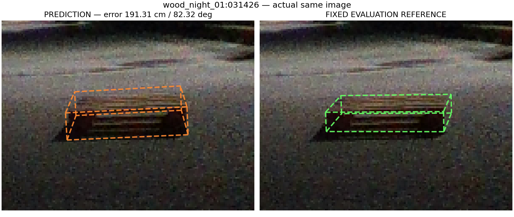

# V33 결과: 가장 큰 연결 영역을 사용한 전경 포함 비용 대조

**192장 전체를 5cm 이내로 만드는 목표와 원 TEST49 유지 목표를 달성하지 못했다. 새 기본 방법은 채택하지 않고 기존 e를 유지한다.** V33 RGB q 보존+C는 위치≤5cm **120/192**, 위치≤5cm·회전≤5° 동시 **117/192**다. 이 수는 V32와 같다. 평균 위치 오차는 15.0995→15.0860cm, 최대는 191.3134→188.6812cm로 작게 줄었지만, 기존 TEST49에서는 위치 43/49·공동 42/49로 e의 49/49를 보존하지 못한다.

이 문서는 전체 예측·독립 감사·고정 참조 점수·점수 재집계가 봉인된 뒤 작성했다. [점수만의 독립 재집계](../nonsevere_v1/statewise_joint_ot_20261014_v2/nonsevere_v4_fix/boundary_recovery_v1/independent_largest_component_global_outline_score_review_v4_33/AUDIT.json)는 19,207검사/0실패이며, [선택 자세 수치 감사](../nonsevere_v1/statewise_joint_ot_20261014_v2/nonsevere_v4_fix/boundary_recovery_v1/largest_component_global_outline_pose_eval_v4_33/independent_root_audit_v1/AUDIT.json)는 238행·299,822검사/0실패다. 후자는 계산과 제약의 일치 검사이지 정확한 물리 자세나 전역 최적을 증명하는 검사가 아니다.

## 바뀐 관측과 유지한 수학

기존 mask 전경 전체의 union 대신 면적이 가장 큰 **8-연결 영역 하나**를 고른다. 동률이면 OpenCV의 가장 낮은 양의 label을 쓰며, 구멍 채우기·팽창·침식·임계값 탐색은 하지 않는다. 이후 외곽 표본 생성은 기존 V13, 전경 포함 비용 C와 계수는 C25 그대로다. CAL·TEST·추가143에 같은 규칙을 적용했다.

원 native 점/선·CAL32 분산/접선 계수·fresh B/I PnP·시작점 선택·O/S 비용·hardguard는 바꾸지 않았다. positive worker 입력 7개 중 `regularizers.outline_observation`만 교체했다. e는 비교행이며 수치 worker의 후보·prior·시작값·fallback에 들어가지 않는다. 초기 자세를 만들 때의 새 B/I PnP와 같은 방법의 자기 coarse fallback을 사용하고, 별도 봉인한 e는 부모가 최종 비교행으로 합친다. 과거 e-origin bank 정정 이력과 구분되는 clean V32 경로를 유지한다.

원 union과 다른 관측은 CAL 2/46장, 주 평가 9/192장이며 unsupported는 모두 0이다. 모든238행에서 원 union 관측을 exact 복사·검사했다. [독립 CAL 픽셀 감사](../nonsevere_v1/statewise_joint_ot_20261014_v2/nonsevere_v4_fix/boundary_recovery_v1/largest_component_global_outline_observations_v4_33/independent_mask_outline_audit_v1/AUDIT.json) 1,378검사와 [독립 REST 픽셀 감사](../nonsevere_v1/statewise_joint_ot_20261014_v2/nonsevere_v4_fix/boundary_recovery_v1/largest_component_global_outline_observations_v4_33/independent_REST_mask_outline_audit_v1/AUDIT.json) 5,769검사가 모두 통과했다. native 두 방법 **476개 전체 출력**과 e **238개 전체 출력**은 V32와 정확히 같고, 같은 방법의 점수도 같다.

**이 감사들은 가장 큰 영역이 실제 팔레트인지 보증하지 않는다.** SAM quality 0.968 같은 값은 물체 정체의 정답 확률이 아니다. C 관측은 전경 convex hull에서 얻은 envelope 표본이며, 영상에서 검출한 실제 물리 모서리와 다르다. 작은 분리 잡음을 빼는 효과와, 끊겨 보이는 실제 팔레트 조각을 버릴 가능성이 함께 있다. target mask 밖이라는 사실만으로 다른 물체의 가림을 확정하지 않으며 generic instance 후보도 확정 occluder mask로 연결하지 않았다.

S는 영상 점·국소 질의·2D 비용 없이 모델/PnP 투영과 기존 coarse 유도 bounded S 항만 유지한다. U는 대략적인 범위만 쓴다. severe는 이 집합에 0장이며 CAL46(원 compatible44)은 주 평가192장에 합치지 않는다.

## 전체 분모를 유지한 점수

위치는 3D 모델 중심의 거리, 회전은 기존 봉인 평가식이다. 공동은 **위치≤5cm 및 회전≤5°**를 모두 만족한 수다. 평균과 최대는 성공한 장만이 아닌 표의 전체 분모를 사용한다. 빈 관측·fallback·자세 없음도 제외하지 않는다. 이번 새 네 방법은 전체238장에서 accepted=True였으나, 이는 제약을 통과한 저장 해라는 뜻이며 정확도 성공을 뜻하지 않는다. 고정 e의 fallback은 주 평가 4장, CAL 1장이다.

### 주 평가 192장

| 방법 | 분모 | 위치≤5cm | 위치·회전 공동 | 평균 위치 cm | 최대 위치 cm | 평균 회전 ° | 최대 회전 ° | fallback |
|---|---:|---:|---:|---:|---:|---:|---:|---:|
| 고정 e | 192 | 115 | 114 | 14.1121 | 260.4117 | 13.0011 | 159.1366 | 4 |
| 전체 B/I · native | 192 | 109 | 101 | 13.5696 | 193.5675 | 15.9484 | 93.6587 | 0 |
| 전체 B/I · C | 192 | 100 | 99 | 17.2766 | 188.6812 | 14.8332 | 103.5222 | 0 |
| RGB q 보존 · native | 192 | 117 | 110 | 13.2684 | 199.9483 | 13.5656 | 89.8693 | 0 |
| RGB q 보존 · C | 192 | 120 | 117 | 15.0860 | 188.6812 | 13.1123 | 103.5222 | 0 |

### 기존 TEST 49장

| 방법 | 분모 | 위치≤5cm | 위치·회전 공동 | 평균 위치 cm | 최대 위치 cm | 평균 회전 ° | 최대 회전 ° | fallback |
|---|---:|---:|---:|---:|---:|---:|---:|---:|
| 고정 e | 49 | 49 | 49 | 1.2994 | 4.3389 | 1.1103 | 3.9496 | 0 |
| 전체 B/I · native | 49 | 43 | 41 | 2.8729 | 26.3749 | 10.5640 | 89.4905 | 0 |
| 전체 B/I · C | 49 | 43 | 43 | 2.7684 | 27.2124 | 5.0219 | 89.7525 | 0 |
| RGB q 보존 · native | 49 | 41 | 39 | 4.0000 | 40.7352 | 12.1509 | 89.4899 | 0 |
| RGB q 보존 · C | 49 | 43 | 42 | 3.2851 | 40.9213 | 5.0941 | 89.2478 | 0 |

### severe 제외 추가 143장

| 방법 | 분모 | 위치≤5cm | 위치·회전 공동 | 평균 위치 cm | 최대 위치 cm | 평균 회전 ° | 최대 회전 ° | fallback |
|---|---:|---:|---:|---:|---:|---:|---:|---:|
| 고정 e | 143 | 66 | 65 | 18.5025 | 260.4117 | 17.0756 | 159.1366 | 4 |
| 전체 B/I · native | 143 | 66 | 60 | 17.2349 | 193.5675 | 17.7934 | 93.6587 | 0 |
| 전체 B/I · C | 143 | 57 | 56 | 22.2479 | 188.6812 | 18.1952 | 103.5222 | 0 |
| RGB q 보존 · native | 143 | 76 | 71 | 16.4444 | 199.9483 | 14.0503 | 89.8693 | 0 |
| RGB q 보존 · C | 143 | 77 | 75 | 19.1297 | 188.6812 | 15.8598 | 103.5222 | 0 |

### 별도 CAL 46장

| 방법 | 분모 | 위치≤5cm | 위치·회전 공동 | 평균 위치 cm | 최대 위치 cm | 평균 회전 ° | 최대 회전 ° | fallback |
|---|---:|---:|---:|---:|---:|---:|---:|---:|
| 고정 e | 46 | 38 | 37 | 5.3790 | 51.9778 | 10.5986 | 89.6578 | 1 |
| 전체 B/I · native | 46 | 37 | 35 | 5.0986 | 50.5821 | 9.6990 | 86.8123 | 0 |
| 전체 B/I · C | 46 | 34 | 34 | 6.9655 | 52.4551 | 11.5869 | 89.9873 | 0 |
| RGB q 보존 · native | 46 | 38 | 35 | 5.6613 | 56.5803 | 11.3777 | 86.5719 | 0 |
| RGB q 보존 · C | 46 | 35 | 34 | 6.7773 | 56.5804 | 11.3910 | 88.7187 | 0 |

원49의 e 대비 위치 성공 퇴행은 전체 B/I native 6건, 전체 B/I C 6건, RGB q 보존 native 8건, RGB q 보존 C 6건이다. 공동 기준 퇴행은 각각 8·6·10·7건이다. 전체 ID와 값은 [재집계 JSON](../nonsevere_v1/statewise_joint_ot_20261014_v2/nonsevere_v4_fix/boundary_recovery_v1/independent_largest_component_global_outline_score_review_v4_33/AUDIT.json)에 그대로 남겼다.

## V32 union과 V33 LCC의 같은 방법 비교

| 동일 정책·방법 | V32 위치/공동 | V33 위치/공동 | V32 평균 → V33 평균 cm | V32 최대 → V33 최대 cm |
|---|---:|---:|---:|---:|
| 고정 e | 115 / 114 | 115 / 114 | 14.1121 → 14.1121 | 260.4117 → 260.4117 |
| 전체 B/I · native | 109 / 101 | 109 / 101 | 13.5696 → 13.5696 | 193.5675 → 193.5675 |
| 전체 B/I · C | 100 / 99 | 100 / 99 | 17.4136 → 17.2766 | 191.3134 → 188.6812 |
| RGB q 보존 · native | 117 / 110 | 117 / 110 | 13.2684 → 13.2684 | 199.9483 → 199.9483 |
| RGB q 보존 · C | 120 / 117 | 120 / 117 | 15.0995 → 15.0860 | 191.3134 → 188.6812 |

C 두 방법 모두 주 평가192장의 5cm 및 공동 통과 수는 늘지 않았다. 일부 오차는 줄고 일부는 늘었다. CAL RGB q 보존+C의 공동 수는 33→34로 늘었지만, CAL 결과를 주 평가 성능 향상으로 합산하지 않는다. 원 TEST49의 수치도 모든 방법에서 V32와 같다. 이런 사후 비교로 사례별 방법·계수·mask 규칙을 골라 적용하지 않는다.

### 같은192장의 고정 과거 baseline

[동일 ID·참조 및 metric 기록 검증](HISTORICAL_BASELINE_SCORE_RECOUNT_V1.json)에서 현재 TEST49+추가143 순서와 과거 두 baseline의192행이 같음을 확인했다. N3는 raw YOLO 단독이 아닌 **N3+SUBPIX 초기 PnP** 저장 예측이며, PoseFix RAW는 statewise 보정을 적용하지 않은 저장 예측이다.

| 고정 과거 방법 | 위치≤5cm /192 | 공동 /192 | 평균 위치 cm | 최대 위치 cm |
|---|---:|---:|---:|---:|
| N3 + SUBPIX | 112 | 108 | 11.3058 | 174.7580 |
| PoseFix RAW | 85 | 80 | 13.8357 | 185.7835 |

과거 `<5`와 현재 `≤5`의 경계에 정확히 놓인 사례는 두 baseline 모두 0개여서 통과 수가 같다. 과거 accepted/fallback flag는 없어 fallback 0이라고 주장하지 않는다. V33 RGB q 보존+C는 N3보다 통과 수가 많지만 평균·최대 위치 오차는 더 크다. 한 지표의 증가를 전체적인 우월성으로 해석하지 않는다. e 역시 정답이 아니라 동결된 비교 예측이다.

## 117장과 평균15cm가 함께 나오는 이유

**117은 공동 통과 수이며 위치만≤5cm인 수는120**이다. 봉인된 V32 RGB q 보존+C에서 그120장의 평균 위치 오차는 1.89018cm, 나머지72장은 37.11509cm였다. `(120×1.89018 + 72×37.11509)/192 = 15.09952cm`다. 잘 맞은 장의 평균과 전체 평균은 다르다. V33은 같은120/117을 유지하면서 전체 평균만 15.08605cm로 조금 줄었다.

사용자가 요청한 `wood_night_01:031426`의 **V32 191.3134cm** 그림은 아래와 같다. 주황은 저장 예측, 초록은 이미 보관된 고정 참조의 투영이며 원본 사진과 같은 기존 ROI에 표시했다. 새 참조 fit·영상 특징 탐색·PnP는 하지 않았다. 이 그림은 V33 결과 그림이 아니다.

[그림 출처·실행 후 기록](../show_191cm_case_20261015_v1/PROVENANCE.json)은 첫 표시 뒤 소스를 저장한 사후 설명임을 명시한다. 사전 선언한 새 실험으로 표현하지 않는다. 191cm는 영상 선 사이의 픽셀 간격이 아니라 3D 모델 중심 거리 오차다. ROOT가 저장 자료에서 확인한 깊이 차이만 약1.849m이므로 2D 외곽이 일부 겹쳐도 깊이가 맞는 것은 아니다.

같은 사례에서 V33 C 결과는 188.6812cm·82.4950°로, 113px의 분리 mask 조각을 제거했지만 큰 자세 오류가 남았다. 고정한 다른 두 사례 `wood_night_01:031344`, `eval_noapril:1775201428535961600`의 mask는 원래 단일 영역이라 union과 LCC가 같다. 사례별 오차를 보고 mask 규칙이나 방법을 바꿔 적용하지 않았다.

## 실제 과정·닫힌 진단과 공개 범위

[V32 C 표본·최종 hull 진단](../nonsevere_v1/statewise_joint_ot_20261014_v2/nonsevere_v4_fix/boundary_recovery_v1/clean_fresh_BI_containment_pixel_diagnosis_v4_32_r2/REPORT_KO.md)과 [출처 보충](../nonsevere_v1/statewise_joint_ot_20261014_v2/nonsevere_v4_fix/boundary_recovery_v1/clean_fresh_BI_containment_pixel_diagnosis_v4_32_r2/PROVENANCE_ADDENDUM_KO_V2.md)은 V9에 넣지 않았던 닫힌 사후 자료다. 초기 schema 실패와 정정된 출처도 구분해 보존한다. 그림의 점은 C의 전경 envelope 표본이며 관측 KP나 새 물리 모서리 검출점이 아니다.

[V33 같은 세 사례의 실제 저장 과정](../nonsevere_v1/statewise_joint_ot_20261014_v2/nonsevere_v4_fix/boundary_recovery_v1/largest_component_global_outline_process_v4_33_v1/REPORT_KO.md)은 원본 RGB·mask union/LCC·원래 관측선·서로 다른 방법의 저장 최종 자세를 보여준다. optimizer 중간 자세를 새로 만들거나 연속 변화처럼 표현하지 않는다. 실제 PNG·PROCESS 자료는 해당 RENDER_SEAL의 asset 해시 및 별도 owner/QA 기록과 함께 묶는다.

[최종 자세 compact 봉인](../nonsevere_v1/statewise_joint_ot_20261014_v2/nonsevere_v4_fix/boundary_recovery_v1/largest_component_global_outline_compact_pose_archive_v4_33_v1/SEAL.json)은 원 PRED 저널을 한 번 읽으며 압축 바이트 SHA를 확인해 **238×5=1,190개** 저장 자세·top WD·accepted/가용 여부·선택 scalar만 복사했다. 새 자세 계산은 없고 seed/start/전체 plan/trajectory를 포함하지 않는다.

[중앙 선언](../nonsevere_v1/statewise_joint_ot_20261014_v2/nonsevere_v4_fix/boundary_recovery_v1/largest_component_global_outline_method_plan_v4_33/PREDECLARATION.json)·관측/controller·독립 감사/scorer/재집계·소스와 테스트·설계/owner/peer/ROOT GO·작은 protocol/index/seal을 보존한다. 현재 source closure 317개 중 공개 Git HEAD와 같은307개는 재사용 기록을 남기고, 없는10개 및 그 뒤 추가한 V33 소스는 보충한다. 원 파일 해시를 지키고 중복 전체 snapshot은 제외하며, 바뀐 과거 소스만 SHA별 한 개를 historical로 남긴다. 보호 사용자 파일6개는 바꾸지 않는다.

main 공개 묶음에 원 INPUTS/E_COMPARISON/PREDICTIONS/OBSERVATIONS 저널·mask NPZ·행별 spool은 넣지 않는다. [최초 원시 증거 Release](https://github.com/CanelE452/pallet-6d-pose/releases/tag/visibility-curriculum-snapshot-20261015-v1)가 이후의 V32/V33 raw archive도 포함한다고 주장하지 않는다. 최종 파일·바이트·로컬 링크·봉인 검증은 별도 closed manifest에 기록하며 ROOT가 복사·commit·push한다.

반복 사용한 TEST와 추가143의 탐색 결과다. 추가143 참조는 annotation/PnP 유도값으로 독립 물리 계측이 아니며, signed axes/intrinsics 불확실성도 남는다. 성공한 사례만 선별하거나 사후 진단을 새 holdout 일반화 증거로 쓰지 않았다.
