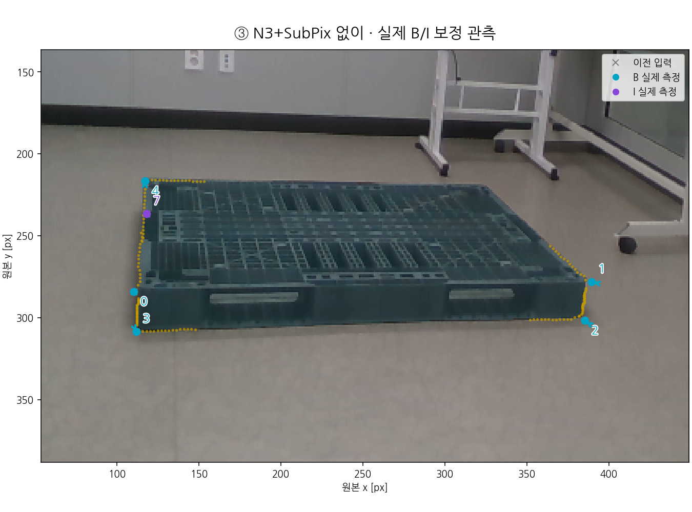
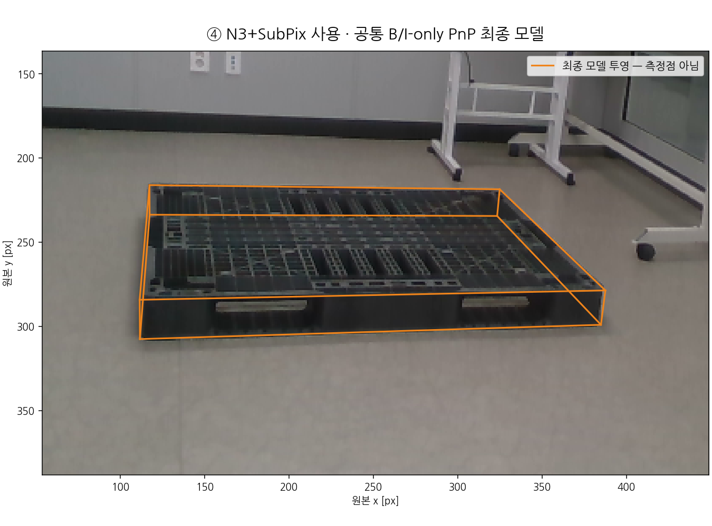

# V11 공개 기록: V33 전체 결과와 양쪽 B/I 처리 10장

이 묶음은 사용자가 요청한 지금까지의 관련 코드·실제 이미지·저장 값·보고서를 추가 공개한다. **V33은 전체192장 5cm 이내와 원49 유지 목표를 달성하지 못해 기본 e를 유지한다.** 별도로 사용자가 고른10장에는 YOLO와 N3+SUBPIX 양쪽 모두 B/I 처리를 실제 적용했다. 이10장 결과는 전체49/192의 새 성능이 아니다.

## 양쪽 B/I 처리를 실제 적용한 결과

처리 전 비교는 YOLO native+F 공동30/49, N3+SUBPIX+F40/49였다. 같은49장을 짝지으면 실제 gain10·loss0이고, 이번10장은 그 gain을 사후 선택한 것이다. 따라서 선택집단의 처리 전 점수는 YOLO0/10, N3+SUBPIX10/10이다. 각 팔의 좌표와 자기 초기 자세로 상태·S 자기차폐·mask·B/I 영상 측정을 새로 계산하고, 같은 B/I-only solver에 넣었다.

| 방법 | 공동 통과 /10 | 평균 T cm | 최대 T cm | 평균 R ° | 최대 R ° |
|---|---:|---:|---:|---:|---:|
| YOLO 원본+F | 0 | 6.4614 | 9.4984 | 1.0259 | 1.8092 |
| YOLO + B/I 처리 | 7 | 3.9925 | 5.3621 | 0.7046 | 1.8531 |
| N3+SUBPIX+F | 10 | 3.4082 | 4.5136 | 1.0439 | 1.8156 |
| N3+SUBPIX + B/I 처리 | 10 | 2.1831 | 3.5690 | 0.7594 | 1.6138 |

공동 기준은 기존의 **위치<5cm 및 회전<5°**다. 모든팔의 회전은10장 전부5° 미만이다. YOLO는7장이 새로 통과하고3장은 여전히 위치가5cm를 넘었다. N3+SUBPIX는10장 통과를 유지했다. N3 쪽에서도 한 장은 위치가3.420→3.569cm로 늘었으므로 모든 사례가 좋아졌다는 뜻은 아니다. PnP 제약 수용은 YOLO9/10·N3 10/10이며, 평가 통과7/10·10/10과 구분한다. RAW 마지막 사례의 거부/fallback도 자기 초기 자세5.362cm로 분모에 남겼다.

B/I 실제 측정은 RAW61점·N3 63점이다. 저장 이동량>1e-8px인 점은 **RAW44점(B42+I2), N3 45점(B43+I2)**이며 평균 이동량은 전체 B/I를 포함해1.5897/1.0085px다. exact >0 장부의 N3 47점에는2.842e-14px 잔차2개가 있어 원 장부를 보존하고 별도 설명했다. 표시 기준은 점·관측·PnP·점수를 바꾸지 않는다. 'source corrected' flag와 실제 좌표 이동 수를 혼동하지 않는다.

이번은 기존 state 모델을 각 팔에 같은 규칙으로 적용한 **B/I-only 비교**다. raw 팔의 state calibration coverage를 새로 검증하지 않았고 새 CAL fit도 없다. full V33의 S/O/U/C·유한 선 요인을 포함한 전체 방법을 다시 돌린 결과가 아니다. inference용 JSON과 평가 참조를 분리해 모든10×4 예측 봉인 뒤에만 참조를 열었다. 원 baseline F의 T/R/성공 여부60개 값은 기존 봉인 점수와 정확히 같다.

### 그림을 바로 보기

[10장 × 4단계 × 양쪽 = 80개 PNG Markdown 갤러리](CASE_GALLERY_KO_V1.md)에서 전부 볼 수 있다. 청록/보라 원은 실제 B/I 측정, 회색 ×는 이전 입력, 주황 선은 모델 투영이다. S는 모델/PnP 역할이며 영상점으로 표시하지 않고 O/T/U도 PnP점에 넣지 않았다. 아래는 첫 사례의 실제 측정과 최종 모델이다.

| | YOLO | N3+SUBPIX |
|---|---|---|
| 실제 B/I 이동 |  |  |
| PnP 모델 |  |  |

- [새 양쪽 처리 원 HTML](../nonsevere_v1/statewise_joint_ot_20261014_v2/nonsevere_v4_fix/boundary_recovery_v1/new_gain10_paired_BI_process_v1/index.html) · [그림 설명](../nonsevere_v1/statewise_joint_ot_20261014_v2/nonsevere_v4_fix/boundary_recovery_v1/new_gain10_paired_BI_process_v1/REPORT_KO.md) · [원본/링크/수치 QA](../nonsevere_v1/statewise_joint_ot_20261014_v2/nonsevere_v4_fix/boundary_recovery_v1/new_gain10_paired_BI_process_v1/OWNER_COMPLETION_AND_VISUAL_QA_V1.json)
- [새 점수·10장 표·해석](../nonsevere_v1/statewise_joint_ot_20261014_v2/nonsevere_v4_fix/boundary_recovery_v1/new_gain10_paired_BI_v2/POSTSCORE_REPORT_KO_V1.md) · [SCORE.json](../nonsevere_v1/statewise_joint_ot_20261014_v2/nonsevere_v4_fix/boundary_recovery_v1/new_gain10_paired_BI_v2/SCORE.json) · [점수 봉인](../nonsevere_v1/statewise_joint_ot_20261014_v2/nonsevere_v4_fix/boundary_recovery_v1/new_gain10_paired_BI_v2/SCORE_SEAL.json)
- [각팔 상태·B/I 이동량](../nonsevere_v1/statewise_joint_ot_20261014_v2/nonsevere_v4_fix/boundary_recovery_v1/new_gain10_paired_BI_v2/STATE_AND_BI_MOVEMENT_SUMMARY_V1.json) · [1e-8 표시 기준 보충](../nonsevere_v1/statewise_joint_ot_20261014_v2/nonsevere_v4_fix/boundary_recovery_v1/new_gain10_paired_BI_v2/MOVEMENT_THRESHOLD_EXPLANATION_V1.json) · [ROOT 독립 계약 검사](../nonsevere_v1/statewise_joint_ot_20261014_v2/nonsevere_v4_fix/boundary_recovery_v1/new_gain10_paired_BI_v2/ROOT_CONTRACT_CHECKS_V1.json)
- [가벼운 두팔 입력](../nonsevere_v1/statewise_joint_ot_20261014_v2/nonsevere_v4_fix/boundary_recovery_v1/raw_ns_BI_gain10_input_v1/INPUTS.json) · [입력 봉인](../nonsevere_v1/statewise_joint_ot_20261014_v2/nonsevere_v4_fix/boundary_recovery_v1/raw_ns_BI_gain10_input_v1/INPUT_SEAL.json) · [추론과 분리한 scorer 참조 바인딩](../nonsevere_v1/statewise_joint_ot_20261014_v2/nonsevere_v4_fix/boundary_recovery_v1/raw_ns_BI_gain10_input_v1/SCORING_REFERENCE_MANIFEST.json)
- [실제 실행 v2 protocol](../nonsevere_v1/statewise_joint_ot_20261014_v2/nonsevere_v4_fix/boundary_recovery_v1/new_gain10_paired_BI_v2/PROTOCOL.json) · [관측 봉인](../nonsevere_v1/statewise_joint_ot_20261014_v2/nonsevere_v4_fix/boundary_recovery_v1/new_gain10_paired_BI_v2/OBSERVATION_SEAL.json) · [예측 봉인](../nonsevere_v1/statewise_joint_ot_20261014_v2/nonsevere_v4_fix/boundary_recovery_v1/new_gain10_paired_BI_v2/PREDICTION_SEAL.json) · [완료 owner](../nonsevere_v1/statewise_joint_ot_20261014_v2/nonsevere_v4_fix/boundary_recovery_v1/new_gain10_paired_BI_v2/OWNER_EXECUTION_RECEIPT_V2.json)
- [v1 초기 key schema 실패 보존](../nonsevere_v1/statewise_joint_ot_20261014_v2/nonsevere_v4_fix/boundary_recovery_v1/new_gain10_paired_BI_v1/FAILED_ATTEMPT_V1.json): 첫 state/mask forward 전에 중단됐고, 원형 보존 뒤 새 v2에서 입력키를 바로잡았다.

HTML은 저장소를 clone한 뒤 파일/로컬 정적 서버에서 열 수 있다. GitHub HTML 원문 자체가 실행 갤러리인 것처럼 안내하지 않으며, 공개 읽기의 주경로는 위 Markdown·PNG다. localhost 주소를 공개 URL로 사용하지 않는다.

## 원 YOLO → N3 → SUBPIX의 실제 저장 과정

[동일49의 pair metric·gain/loss 전체 목록](../nonsevere_v1/statewise_joint_ot_20261014_v2/nonsevere_v4_fix/boundary_recovery_v1/raw_yolo_vs_N3_subpix_TEST49_paired_v1/REPORT_KO.md) · [기존40개 stage 배열의 실제 과정 갤러리](../nonsevere_v1/statewise_joint_ot_20261014_v2/nonsevere_v4_fix/boundary_recovery_v1/raw_yolo_N3_subpix_gain10_process_v1/REPORT_KO.md) · [기존 단계 HTML](../nonsevere_v1/statewise_joint_ot_20261014_v2/nonsevere_v4_fix/boundary_recovery_v1/raw_yolo_N3_subpix_gain10_process_v1/index.html) · [10장 두 sheet](../raw_n3_subpix_gain10_contact_v1/REPORT_KO.md).

여기 N3+SUBPIX는 YOLO→N3_DIM_SYM→SubPix→YOLO-anchor cap→같은 F의 전체 경로다. SubPix 단독 효과나 literal PoseFix 모델이라고 부르지 않는다. 원49에서 mean T는4.1397→3.3630cm지만 max T는15.1047→19.9569cm로 커졌다. gain10만 보여서 전체 지표가 모두 좋아진 것처럼 해석하지 않는다.

## V33 전체192 결과와 실제 고정 사례

[수치 전체 보고서: 기존 V10 최종본, 변경 없음](../publication_followup_20261015_v10/REPORT_KO_FINAL_V1.md) · [V33 확대판 display_v2](../nonsevere_v1/statewise_joint_ot_20261014_v2/nonsevere_v4_fix/boundary_recovery_v1/largest_component_global_outline_process_v4_33_v1/display_v2/REPORT_KO.md) · [원 전체 mask/과정 그림](../nonsevere_v1/statewise_joint_ot_20261014_v2/nonsevere_v4_fix/boundary_recovery_v1/largest_component_global_outline_process_v4_33_v1/REPORT_KO.md) · [독립 점수 재집계](../nonsevere_v1/statewise_joint_ot_20261014_v2/nonsevere_v4_fix/boundary_recovery_v1/independent_largest_component_global_outline_score_review_v4_33/REPORT_KO.md).

V33 RGB q 보존+C는 위치≤5cm **120/192**, 공동 **117/192**, 평균15.0860cm·최대188.6812cm다. 기존 V32의120/117과 같고 평균15.0995cm·최대191.3134cm보다 작게 줄었다. 원49는43/42로 e49/49를 유지하지 못했다. 원 native 두 방법476개와 e238개 전체 출력은 정확히 같았다. accepted는 제약 통과이며 정확도 성공이 아니다.

가장 큰8-연결 mask 하나를 고르는 규칙만 바꾸고 native32/noise/freshPnP/guard/O/S/C25 수학은 유지했다. CAL2/46장·주평가9/192장의 mask가 달랐다. 픽셀 선택·수치 계산 감사는 semantic 팔레트/가림의 정답이나 물리 자세 정확도를 보증하지 않는다. 전경 convex hull 표본은 실제 검출 모서리와 다르고 SAM quality 값은 물체 정체 정답 확률이 아니다. S 영상 국소 질의는 없으며 U는 대략적인 범위다. 독립 다른 물체 mask를 확정 occluder로 붙이지 않았다.

'117장인데 평균15cm'는 공동 통과 수와 전체 평균이 다른 뜻이기 때문이다. V32의 위치 통과120장 평균1.89018cm와 나머지72장 평균37.11509cm를 합치면 전체192 평균15.09952cm다. [실제191cm 사례 원본·같은 ROI](../show_191cm_case_20261015_v1/REPORT_KO.md)에서 주황은 저장 예측, 초록은 보관 참조이며 2D 겹침은3D 깊이 정확도가 아니다. 그 그림은 사후 표시 뒤 소스/출처를 기록했으며 사전 선언 실험으로 꾸미지 않았다.

[V32 미공개 C 표본/최종 hull 진단](../nonsevere_v1/statewise_joint_ot_20261014_v2/nonsevere_v4_fix/boundary_recovery_v1/clean_fresh_BI_containment_pixel_diagnosis_v4_32_r2/REPORT_KO.md)과 [출처 보충](../nonsevere_v1/statewise_joint_ot_20261014_v2/nonsevere_v4_fix/boundary_recovery_v1/clean_fresh_BI_containment_pixel_diagnosis_v4_32_r2/PROVENANCE_ADDENDUM_KO_V2.md)도 포함한다. [최종1190개 compact 자세](../nonsevere_v1/statewise_joint_ot_20261014_v2/nonsevere_v4_fix/boundary_recovery_v1/largest_component_global_outline_compact_pose_archive_v4_33_v1/SEAL.json)는 원 저장 pose/WD/status/scalar만 복사한 것이며 seed/start/전체 plan/trajectory가 아니다.

## 파일·코드·대용량 증거의 공개 범위

이번 main 묶음에는 위 모든 닫힌 PNG/HTML/보고서/QA·중소 결과·새 소스/테스트/설계/owner/peer/ROOT 기록을 포함한다. 공개 HEAD에 이미 같은 바이트가 있는 의존 코드는 재사용 근거를 남기고, 없는 현재 코드를 보충한다. 변경된 과거 소스·실패 시도도 historical로 보존하되 동일 코드 snapshot 중복은 제외한다. 보호 사용자 파일6개는 바꾸거나 복사하지 않는다.

새 gain10은 명시적 작은 raw 예외로 두팔 입력, PRED/OBS gzip과20개 mask NPZ까지 main에 보관한다. 이 실험의 중복 per-frame dump40개와 전체 V29~V33의 큰 INPUTS/E/PRED/OBS/spool은 별도 후속 raw Release 범위다. 기존 결과/소스/점수/이미지를 덮어쓰지 않았고 모든 행·fallback을 보존한다.

[최초 raw snapshot Release](https://github.com/CanelE452/pallet-6d-pose/releases/tag/visibility-curriculum-snapshot-20261015-v1)는 최초 cutoff까지의 자료이며, 나중의 V32/V33와 이번 새 자료까지 이미 들어있다고 주장하지 않는다. 그 이후 전체 raw 차이는 별도 inventory·정확 hash·복원 가능한 archive로 추가 공개한다. 후속 raw manifest/업로드·독립 검증은 별도 receipt/commit으로 연결하며, 아직 완료되지 않은 업로드를 완료라고 표시하지 않는다.

같은 TEST49를 반복 사용한 탐색이다. 추가143 참조는 annotation/PnP 유도값이며 독립 물리 계측이 아니고, signed axes/intrinsics 불확실성도 남는다. 사후 선택10장의 결과로 전체 성능이나 기본값 채택을 선언하지 않는다.
