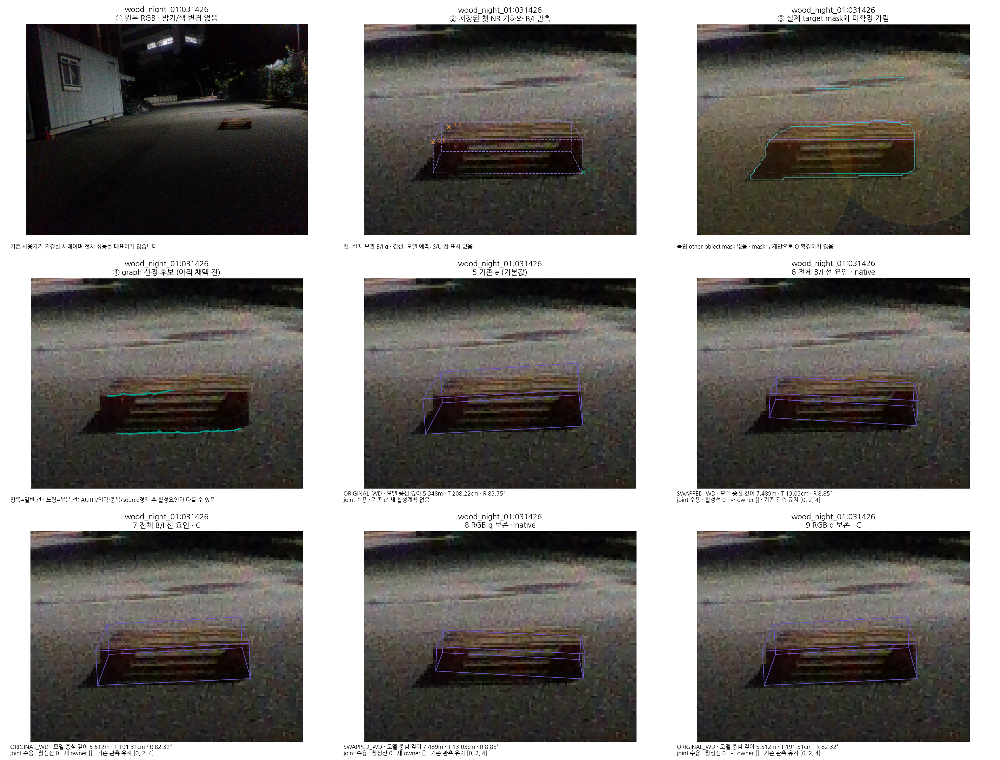
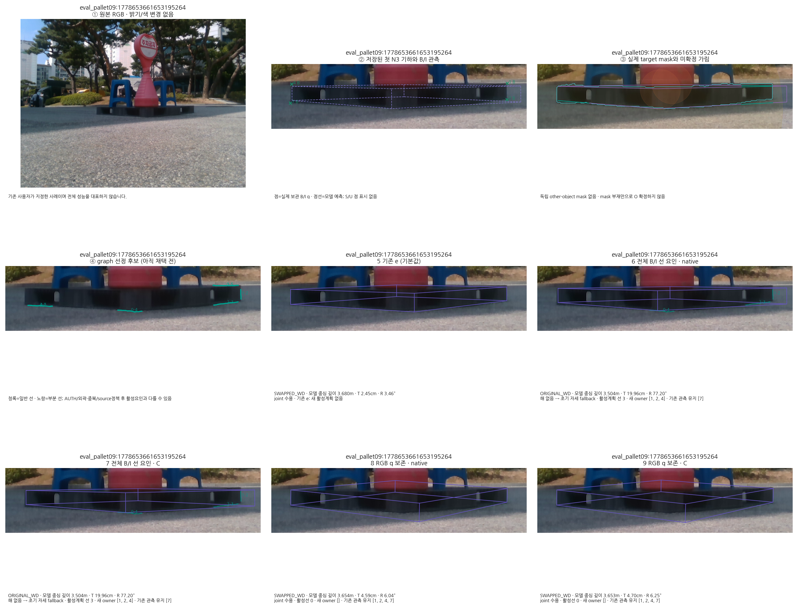

# 후속 공개 V3: V29 전체 평가와 V30 CAL 검증

이 문서는 [컷오프 기록](CUTOFF.json)의 작성 시각까지 완료된 자료만 묶는다. V29는 전체 238장 예측·고정 평가·독립 계산 감사가 끝났지만 성능이 악화되어 **채택하지 않는다**. V30은 CAL46의 새 선 선택과 정책별 보정·첫 CAL 실행 검증까지 완료했으며, 이 컷오프에서는 주 평가192장의 V30 자세 오차 결과가 완료되지 않았다. 기본값은 `SAME_FROZEN_E`다.

## V29: 기존 49장의 성공을 보존하지 못함

CAL46은 보정용으로 분리하고, 주 평가는 TEST49와 추가143을 합친 192장이다. severe는 0장이며 관측 부족·fallback·대응 불일치 사례를 빼지 않았다.

| 동일하게 적용한 방법 | TEST49 중심 ≤5cm | 추가143 중심 ≤5cm | 주 평가192 중심 ≤5cm | 주 평가192 평균/최대 중심 오차(cm) |
|---|---:|---:|---:|---:|
| 기존 e | 49 | 66 | 115 | 14.1121 / 260.4117 |
| 전체 B/I · native | 31 | 59 | 90 | 23.7236 / 556.5813 |
| 전체 B/I · containment | 31 | 56 | 87 | 27.7777 / 251.6978 |
| RGB q 보존 · native | 39 | 72 | 111 | 18.4852 / 372.2829 |
| RGB q 보존 · containment | 39 | 77 | 116 | 21.9928 / 377.7799 |

RGB q 보존·containment의 중심 성공 수가 e보다 한 장 많아도, 기존49 보존·동시 성공·평균·최대 오차를 만족하지 못했다. 목표 달성을 선언하지 않는다. [정식 V29 결과 보고서](../nonsevere_v1/statewise_joint_ot_20261014_v2/nonsevere_v4_fix/boundary_recovery_v1/geometry_guided_edge_eval_v4_29/REPORT_KO.md), [33개 동일 방법의 V10 비교표](../nonsevere_v1/remainder_after_test49_v1/repair_campaign_20261015_v1/RESULTS_V10_V29.html), [고정 점수 봉인](../nonsevere_v1/statewise_joint_ot_20261014_v2/nonsevere_v4_fix/boundary_recovery_v1/geometry_guided_edge_eval_v4_29/SCORE_SEAL.json)을 함께 공개한다.

[실제 두 사례의 9단계 보고서](../nonsevere_v1/statewise_joint_ot_20261014_v2/nonsevere_v4_fix/boundary_recovery_v1/geometry_guided_process_v4_29_v1/REPORT_KO.md)는 공통 관측과 다섯 독립 최종 결과를 구분한다. 목재 031426의 새 활성 선은 0개라 native 개선을 새 선의 효과로 주장할 수 없다. 의자 사례의 전체 B/I 방법은 해가 없어 초기 자세로 fallback했다. 두 사례를 전체 성능의 대표로 사용하지 않았다.

## V30: 잘못된 native 변 연결을 제한한 별도 모집단

V30은 실제 무한 TLS 선과 같은 native 변의 원래 B/I 관측 양끝점 사이 법선 거리를 기존 43px 범위로 검사한다. 양끝이 B/I이면 둘 다 검사하며, 선 방향 이동에 새 12px 코너 제한을 붙이지 않았다. 원 V29의 실제 RGB 후보·마스크·점 좌표·공분산·상태를 바꾸지 않고 저장 후보를 다시 순위화한다. [앞서 공개한 실제 CAL 세 사례](../publication_followup_20261015_v2/REPORT_KO.md)는 새 선 선택과 미선택을 구분한다.

선택 모집단이 달라졌으므로 V29 모델을 새 모델처럼 이름만 바꾸지 않았다. 새 CAL46 선택을 봉인한 뒤 두 source 정책마다 선의 법선·각도 오차와 실제 선택선 접선 방향의 q 오차를 별도로 적합했다. 전체 모델과 4회 session 제외 모델을 합친 20개 모델·60개 시작점이 모두 수렴했다. 전체 ALL 정책의 σ는 법선 약 11.07px·sine 약 0.06338, 접선 γ 약 1.54013이고, SOURCE 정책은 약 13.30px·0.07199·2.29509다. 이 수치는 CAL 모집단의 기술적 보정값이며 독립 정보·native 대응 정답·전체 자세 정확도를 보장하지 않는다.

[모델 봉인](../nonsevere_v1/statewise_joint_ot_20261014_v2/nonsevere_v4_fix/boundary_recovery_v1/CAL_geometry_guided_edge_noise_v4_30/MODEL_SEAL.json), [저장 CAL 오차 독립 재계산](../nonsevere_v1/statewise_joint_ot_20261014_v2/nonsevere_v4_fix/boundary_recovery_v1/CAL_geometry_guided_edge_noise_v4_30_checks/SAVED_CAL_MODEL_REPLAY_V1.json)은 9,342검사·실패 0, 최대 차 약 2.84e−14다. 첫 CAL의 실제 runtime 연결 검사는 53/0, 별도 native 비용·지지 검사 293/0이었다. 이 검사들은 서로 다른 범위이며 합산해 독립 정확도 검증 수로 표현하지 않는다. V30 전체192 결과나 개선 채택을 뜻하지 않는다.

S의 영상 점·국소 질의·2D 점 비용은 없고 기존 coarse-derived bounded S 항은 계속 남아 있다. U는 범위만 사용한다. target mask 부재는 외부 가림의 확정 근거가 아니다. 기존 고정 참조를 사용했으며 추가143 참조는 파생 annotation/PnP 참조 계약으로, 독립 계측 GT를 주장하지 않는다.

## 이번 공개 범위

[복사 manifest](COPIED_MANIFEST.json)는 포함 파일의 크기·SHA와 기존 게시 소스의 갱신 전·후 SHA를 기록한다. [검증 영수증](VALIDATION.json)은 복사 동일성·소형 문서 링크·AST·결과표 대조를 기록한다. 이전 봉인 보고서·그림은 덮지 않았고 최신 direct Python 소스와 테스트는 copy-only로 갱신했다.

큰 INPUTS/PREDICTIONS/OBSERVATIONS 압축 저널, 원시 graph·프레임별 후보 bank, code snapshots, 진행 중인 V30 OBS/REST와 임시 파일은 포함하지 않았다. 독립 likelihood 재계산용 소형 CAL_ERRORS와 선택 해 비용 증거만 예외로 포함했다. 따라서 이번 main 자료만으로 원시 측정부터 전체 실험을 재현할 수 있다고 주장하지 않는다. [최초 전체 Release](../publication_20261015_v1/PUBLICATION_COMPLETE_KO.md)는 CAL32/46 시점의 불변 스냅샷이며 이후 raw238 자료가 그 압축본에 들어 있다고 해석하면 안 된다.

남은 순서는 V30의 동일한 추가192 후보 선택 완료, 전체238 예측 봉인, 독립 감사, 고정 기준 점수, 전체192와 기존49 보존 비교다. 현재 단계에서 기본값 변경이나 목표 달성을 선언하지 않는다.
