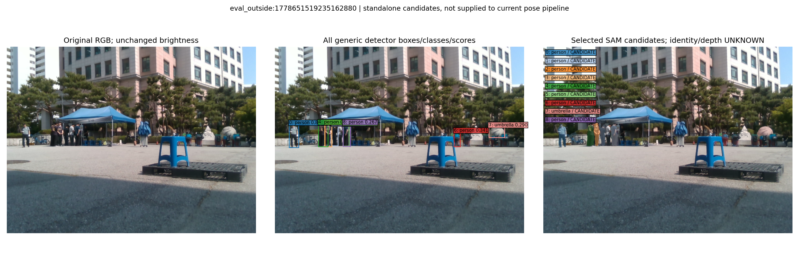

# 후속 공개 V6: 실제 SAM 후보와 V32 선 출처 진단

[V5 후보 자세 출처 정정](../publication_followup_20261015_v5/REPORT_KO.md)은 계속 유효하다. 기존 e의 수치 자세를 후보로 가져오는 경로를 제거하는 V32 순수 모듈을 검토했고, 실제 저장 CAL3에서 허용된 선을 다시 선택했다. **새 V32 전체 자세·잡음 적합·192장 정확도 평가는 아직 없다.** 기본값은 `SAME_FROZEN_E`이며 목표는 미달이다.

## 실제 다른 물체 마스크 공급 진단

일반 COCO80 YOLO26n 검출 box를 MobileSAM에 넣는 공급기를 같은 설정(conf0.25/imgsz640/max20)으로 CAL46 전수에 적용했다. KP·S/U/O 점 prompt, GT, 평가 오차로 사례를 고르는 경로는 없다. 프레임당 SAM image encoder는 최대1회이며 검출 box마다 세 분할 대안과 점수를 모두 남겼다. 46행·모든 빈 결과를 보존했다. 이는 로컬 CPU 실제 실행이고 Jetson FPS 추정 근거가 아니다.

| CAL46 진단 | 결과 |
|---|---:|
| 후보가 나온 영상 / 검출 없음 | 27 / 19 |
| detector forward / SAM encoder / box decoder | 46 / 27 / 67 |
| 저장한 분할 대안 | 201 |
| target 겹침 의심 / 미겹침 후보 | 22 / 45 |
| other-object·앞가림 확정 / 현재 pose 방법에 공급 | 0 / 0 |

`CANDIDATE`는 파렛트와 겹치지 않는다는 진단이며, 그 물체가 파렛트보다 앞에 있다는 뜻이 아니다. `suspected_target`도 진단 표기다. [전체46장 실제 그림과 결과](../nonsevere_v1/statewise_joint_ot_20261014_v2/nonsevere_v4_fix/boundary_recovery_v1/generic_instance_mask_candidates_CAL46_v1/REPORT_KO.md), [1,849개 검사·실패0 영수증](../nonsevere_v1/statewise_joint_ot_20261014_v2/nonsevere_v4_fix/boundary_recovery_v1/generic_instance_mask_population_CAL_checks_v1/ACTUAL_EXECUTION_QA_V1.json), [구체적 누락 사진 설명](../nonsevere_v1/statewise_joint_ot_20261014_v2/nonsevere_v4_fix/boundary_recovery_v1/generic_instance_mask_population_CAL_checks_v1/ACTUAL_FINDINGS_KO_V1.md)을 공개한다. 최초 CAL3 별도 실행도 [그림](../nonsevere_v1/statewise_joint_ot_20261014_v2/nonsevere_v4_fix/boundary_recovery_v1/generic_instance_mask_candidates_CAL3_v1/REPORT_KO.md)과 222/0 검사로 남겼으며 중복 세 사례의 예측은 전수 실행과 일치했다.

파렛트 자체를 bench로 검출해 거의 같은 마스크를 내거나, 정작 필요한 파란 스툴을 못 찾는 문제가 있었다. 아래 CAL 사진에서는 파렛트 위 스툴을 놓치고 배경 사람·우산만 검출했다. 배경 물체 마스크가 많아도 가려진 선을 해결했다고 볼 수 없다. 검출되지 않은 스툴을 “가림 없음”으로 처리하면 안 된다.

그래서 이 공급기를 가림 hard veto로 연결하지 않았다. 동일 CAL 사진의 종류에 의존하지 않는 MobileSAM 전역 grid 분할은 별도 소스·선언을 준비하는 단계이며, 이번 공개 시점의 실제 AMG 결과는 없다. 최초 CAL3 실행의 임시 runtime 설정이 `/tmp/Ultralytics`로 저장된 운영상 차이도 영수증에 남겼다. CAL46 실행은 새 출력 폴더의 설정 디렉터리를 미리 만들어 해당 차이를 해소했으며 검출·분할 수학은 그대로다.

## e 후보 출처를 차단한 선 선택

원 raw chain의 실제 질의가 초기 기하에서 나온 `FROZEN17C_ORIGINAL_MODEL_SEED` 또는 실제 관측 B/I 양 끝점의 `MEASURED_BI_ENDPOINT_DIRECTION`일 때만 허용했다. cached 자세의 가이드와 physical VP 질의는 제외하고, 그래프 점수에도 외부 pose guide를 넘기지 않는다. 원 q·covariance·TLS·픽셀·raw index는 이동하거나 새로 만들지 않았다. [질의별 측정 상한/가지치기 소스 조사](../nonsevere_v1/statewise_joint_ot_20261014_v2/nonsevere_v4_fix/boundary_recovery_v1/initial_only_raw_query_source_audit_v4_32/AUDIT_V1.json)는 원 raw 질의 생성이 extra cached 질의와 전역 quota를 공유하지 않음을 조사한 범위다.

| 동일한 고정 CAL 사례 | 허용 후 유일 선 후보 | 최종 선택 선 |
|---|---:|---:|
| wood_184309:000925 | 75 | 6 |
| wood_184309:000804 | 275 | 8 |
| eval_cad:1778653017736058368 | 5 | 3 |

[실제 저장 선 진단](../nonsevere_v1/statewise_joint_ot_20261014_v2/nonsevere_v4_fix/boundary_recovery_v1/initial_only_observed_ray_CAL_cases_v4_32/REPORT_KO.md)과 [독립 식 재현333/0](../nonsevere_v1/statewise_joint_ot_20261014_v2/nonsevere_v4_fix/boundary_recovery_v1/initial_only_observed_ray_CAL_actual_checks_v4_32/AUDIT_V1.json)을 공개한다. 후자는 원 raw ref·원 q 앵커·고정 방향·법선43px 범위의 계산 검사다. 실제 물리 모서리 대응의 정답, 그래프 전역 최적, 새로운 pose 정확도를 보장하지 않는다. 선 선택 수와 최종 pose 비용에 활성화되는 선 수 역시 구분해야 한다.

## 새 자세 경로와 공개 범위

V32 새 후보 생성기는 관측 B/I의 full 및 고정3/4점 부분집합 SQPnP와 출처가 확인된 초기 coarse만 받는다. 원 과거 후보 목록·e·old initialization 인자는 없다. 초기 coarse가 유효하지 않으면 행을 유지하고 pose 없음으로 남긴다. 새 core/auth/noise, clean family/start/refine adapter, positive physics factory, 전체238 관측 운영 소스까지 순수·소스 검토를 마쳤다. 각각의 봉인·독립 검토와 초기 합성 fixture 실패 기록도 보존했다. 개별 합성검사 통과를 실제 전체 성능 개선으로 합산하거나 해석하지 않는다.

다음 단계는 새 모집단의 CAL46 잡음 모델을 별도로 적합하고, 새 B/I PnP 후보와 모든 기존 기하 제약을 연결해 TEST49+추가143 전체에 동일하게 평가하는 것이다. S는 영상/2D 관측을 만들지 않고 모델/PnP 투영만, U는 대략적인 영역만 사용한다. severe는0이며, 빈 결과·fallback·대응 불일치를 제외하지 않는다. e는 별도 비교 행으로만 보존한다.

[복사 manifest](COPIED_MANIFEST.json)와 [검증 영수증](VALIDATION.json)에 이번 공개 파일을 기록한다. 닫힌 실제 CAL 마스크 NPZ·PNG·보고서·소형 결과·소스/테스트를 추가한다. 진행 중인 AMG·전체32 pose solver/controller·중앙선언은 이번 복사 대상이 아니다. 큰 원 raw238 저널/spool/code snapshots와 모델 checkpoint도 이번 main에 넣지 않았다. 따라서 이번 main만으로 raw 픽셀부터 전체 실험을 완전히 재현한다고 주장하지 않는다. 원 사용자 수정6개와 기존 봉인은 보존했다.

기존 봉인 CAL3 보고서의 마지막 빈 줄은 원 바이트 보존을 위해 유지했다. Git whitespace 검사에서 이 항목만 예외로 둔 [검사 기록](VALIDATION_GIT_WHITESPACE_EXCEPTION_V1.json)을 남겼다.
