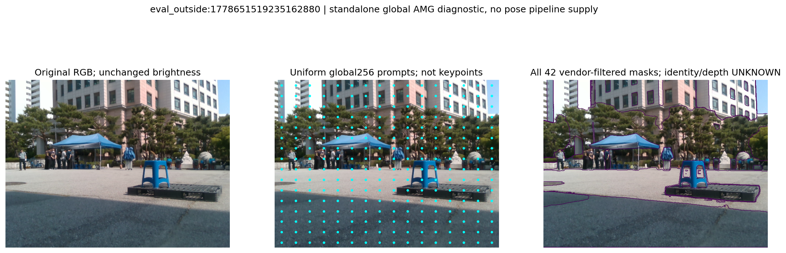
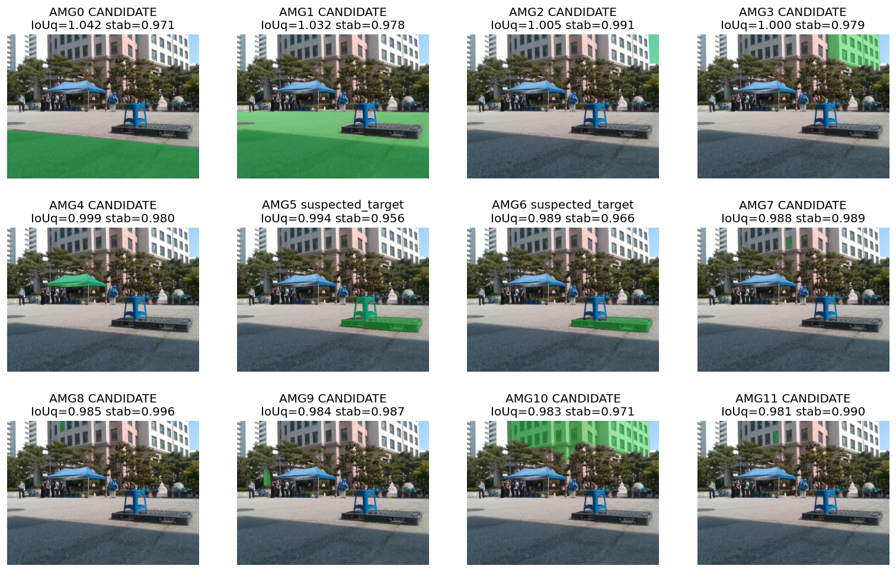

# 후속 공개 V7: 전역 분할 한계와 독립 후보 경로의 CAL46 완료

[V5의 e 후보 출처 정정](../publication_followup_20261015_v5/REPORT_KO.md)은 계속 유효하다. 기존 e는 정답이 아니라 비교할 예측값이며, V32의 수치 후보·시작점·fallback으로 넣지 않는다. [V6의 실제 CAL46 detector→SAM 진단](../publication_followup_20261015_v6/REPORT_KO.md)에 이어 전역 AMG 결과와 검토가 끝난 V32 solver·선언·CAL 운영 코드를 추가한다. **새 V32 전체 자세 정확도는 아직 평가하지 않았다. 기본값은 SAME_FROZEN_E이며 목표는 미달이다.**

## 실제 사진에서 확인한 전역 MobileSAM의 한계

일반 검출기가 파렛트 위 파란 스툴을 놓친 같은 CAL 사진에, detector box 없이 MobileSAM 전역 16×16 균일 grid를 적용했다. 이 한 장은 앞선 누락을 보고 고른 진단 사례이며 대표 성능 표본이 아니다. 특정 KP·S/U/O 좌표·수동 ROI·GT를 prompt로 사용하지 않았다. 로컬 CPU 한 개에서 44.292초가 걸렸으며 Jetson FPS를 나타내지 않는다.

vendor의 고정 quality/stability/NMS 필터를 통과한 42개 mask를 모두 보존했다. 원래 768개의 raw multimask 슬롯 전체를 저장한 것은 아니다. 스툴을 단독으로 분리한 mask는 확인하지 못했다. AMG5는 스툴과 파렛트가 합쳐진 영역이고, AMG6는 주로 파렛트 영역이었다. 이 둘의 target overlap IoU 0.69804·0.97654는 저장 target mask와의 비교이며 물체 정답이나 깊이 정확도가 아니다.

[전체 사진·갤러리와 한계](../nonsevere_v1/statewise_joint_ot_20261014_v2/nonsevere_v4_fix/boundary_recovery_v1/class_agnostic_AMG_case_checks_v1/ACTUAL_FINDINGS_KO_V1.md), [저장 결과 568개 검사·실패0](../nonsevere_v1/statewise_joint_ot_20261014_v2/nonsevere_v4_fix/boundary_recovery_v1/class_agnostic_AMG_case_checks_v1/ACTUAL_EXECUTION_QA_V1.json), [원 실행 결과](../nonsevere_v1/statewise_joint_ot_20261014_v2/nonsevere_v4_fix/boundary_recovery_v1/class_agnostic_AMG_CAL_case_v1/RESULT.json)를 함께 공개한다. target과 안 겹치는 40개 CANDIDATE도 실제 앞가림의 확정이 아니다. target과 겹치는 두 후보의 차집합 역시 독립적인 다른 물체 mask로 취급하지 않았다. 이번 진단의 pose consumer 공급은0이며 grid·threshold 변경이나 추가 추론도 하지 않았다.

## 기존 e 후보를 제외한 실제 CAL46 선 선택

중앙 선언을 봉인한 뒤 실제 저장 raw 관측에서 CAL46을 다시 선택했다. 허용 질의는 초기 coarse 모델의 ORIGINAL 질의와 실제 관측 B/I 양 끝점 방향이며, 과거 cached 자세의 가이드·physical VP·외부 pose guide는 쓰지 않는다. 원 q·TLS·raw pixel index는 유지한다. CAL46의 캐시 선택과 최종 검증이 정상 종료됐고 현재 source284·input1237·보호6개와 원 parent63·CAL53 hash closure를 확인했다.

| CAL46 봉인 결과 | 값 |
|---|---:|
| 유지한 canonical 행 | 46 |
| 누락 / 중복 / 초과 | 0 / 0 / 0 |
| 선택된 선 / 선이 0개인 행 | 227 / 0 |
| 새 전체 pose 정확도 점수 | 아직 없음 |

[CAL46 요약](../nonsevere_v1/statewise_joint_ot_20261014_v2/nonsevere_v4_fix/boundary_recovery_v1/initial_only_observed_ray_observations_v4_32/CAL_SUMMARY.json), [행 목록](../nonsevere_v1/statewise_joint_ot_20261014_v2/nonsevere_v4_fix/boundary_recovery_v1/initial_only_observed_ray_observations_v4_32/CAL_ROW_INDEX.json), [owner 완료 영수증](../nonsevere_v1/statewise_joint_ot_20261014_v2/nonsevere_v4_fix/boundary_recovery_v1/initial_only_observed_ray_observations_v4_32/CAL_OWNER_COMPLETION_RECEIPT_V32_V1.json), [중앙 선언](../nonsevere_v1/statewise_joint_ot_20261014_v2/nonsevere_v4_fix/boundary_recovery_v1/initial_only_observed_ray_method_plan_v4_32/PREDECLARATION.json)을 공개한다. 선택 선 수는 최종 pose 비용의 활성 선 수와 다르며, 선택 완료가 물리적 모서리 대응이나 자세 정확도의 정답을 보장하지 않는다.

## 공개한 방법과 다음 검증

새 순수 solver는 관측 B/I로 새로 만든 SQPnP 후보와 출처를 검증한 초기 coarse를 사용한다. ALL_BI/SOURCE 각각의 native 및 containment 네 방법을 같은 입력 규칙으로 실행한다. e 비교 행은 수치 worker 밖에서 합친다. S는 영상 점을 추론하지 않고 모델/PnP 투영만 사용하며, U는 대략적인 영역 제약만 준다. invalid 초기값·빈 결과·fallback·대응 불일치도 행에서 제외하지 않는다.

solver 합성 통합10개, 중앙 선언18개, positive CAL metadata 운영36개, 새 CAL noise controller29개 검사가 통과했고 각각 독립 검토와 봉인을 보존했다. 이 숫자는 소스별 검사이며 실제 정확도 개선률로 해석하지 않는다. 중앙 선언 V1의 audit SHA 자료형 처리 오류와 초기 합성 fixture 오류도 별도 기록으로 남겼다. 현재 원 자료를 바꾸거나 과거 모델로 대체하지 않는다.

CAL46의 새 선 모집단으로 잡음 모델을 다시 적합하고, 나머지 TEST49+추가143에도 같은 선 선택을 적용한다. 이후 새 후보 경로·기하 제약·선 비용을 연결한 전체238 예측을 봉인한 다음 CAL46과 주 평가192의 오차를 따로 계산한다. severe는0이며, 주 평가는 모든192장과 기존49장 유지 조건을 함께 확인한다. 어느 방법도 아직 새 기본값으로 채택하지 않았다.

[복사 manifest](COPIED_MANIFEST.json)와 [로컬 검증](VALIDATION.json)에 공개 범위를 남겼다. 실제 AMG42 NPZ·5개 PNG·MD 보고서·QA, 닫힌 source/test/선언/CAL46 완료 metadata를 담았다. 진행 중인 REST192·새 noise 적합 결과·미검토 projector/controller는 이번 복사 대상이 아니다. 큰 raw 관측 저널·spool·반복 code snapshot·checkpoint도 main에 추가하지 않아 main만으로 모든 raw 픽셀 계산을 재현한다고 주장하지 않는다. 기존 대용량 snapshot은 [최초 Release](https://github.com/CanelE452/pallet-6d-pose/releases/tag/visibility-curriculum-snapshot-20261015-v1)에 있으며 이후 V30–V32의 전체 raw 자료를 포함하지 않는다. 원 사용자 수정6개와 기존 보고서·봉인은 유지했다.
