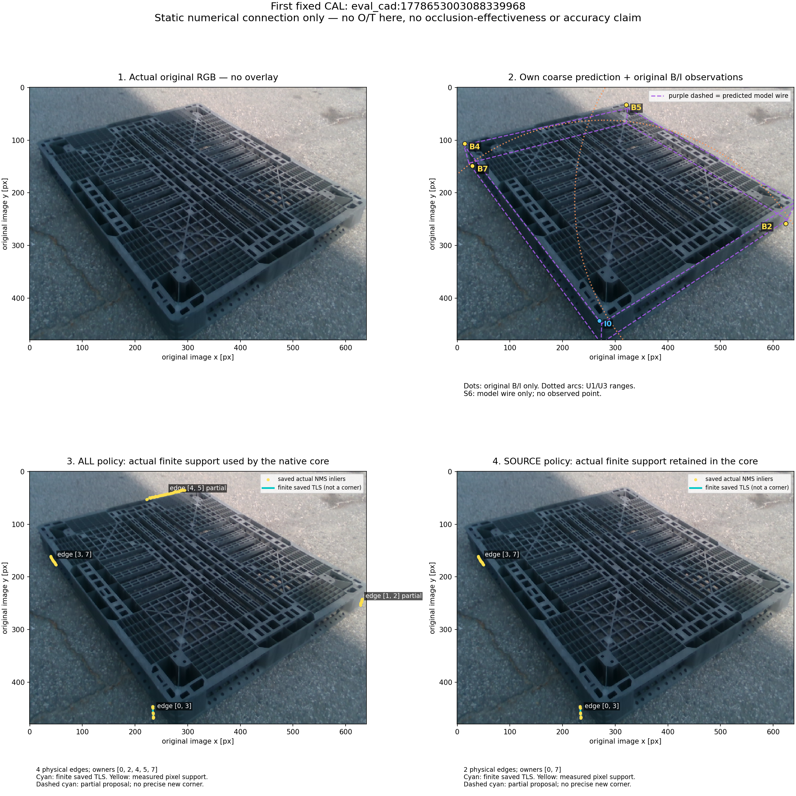
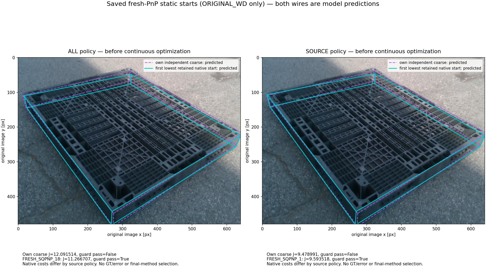

# 후속 공개 V8: 새 CAL 모델과 독립 입력 경로의 정지 연결 검증

[V7의 CAL46 선 선택·전역 분할 한계](../publication_followup_20261015_v7/REPORT_KO.md)에 이어, 검증과 봉인이 끝난 V32 CAL 모델·positive 입력 경계·정지 PnP 연결을 공개한다. **전체 V32 자세 정확도 결과는 아직 없다. 기본값은 SAME_FROZEN_E이고 목표는 미달이다.** 진행 중인 R2 예측이나 그 입력·출력은 이 묶음에 넣지 않았다.

## 첫 CAL 실제 영상에서 확인한 연결

`eval_cad:1778653003088339968`은 고정 CAL 목록의 첫 사례다. 오차나 GT로 고르지 않았다. 상태는 `I0, U1, B2, U3, B4, B5, S6, B7`이며 외부 O/T가 없다. 아래는 수치 연결 진단이지 가림 효과나 정확도 개선의 증거가 아니다.

보라색 점선은 초기 독립 coarse의 모델 예측이다. B/I 점은 보관된 영상 관측이고 U1/U3는 넓은 타원 범위만 표시했다. U 중심과 S6 관측점은 그리지 않았다. 청록색 유한 TLS와 노란 실제 표본은 새 정밀 KP나 GT가 아니다. ALL 비용은 4개 물리변·5개 owner, SOURCE는 원 RGB 관측을 보존하면서 2개 물리변·2개 owner를 사용했다. 첫 표시본에서 설명상자가 지지를 가린 문제는 첫 봉인을 남긴 뒤 `display_v2`로 고쳤고 수치는 바꾸지 않았다.

두 wire 모두 예측이며 ORIGINAL_WD의 저장된 정지 시작 자세를 그렸다. SOURCE의 coarse 비용이 더 낮아도 hardguard를 통과하지 않는다. 이 그림은 앞선 smoke가 만든 시작 자세를 재사용했으며, 그림 생성 중 새 PnP·추론은0이다. 연속 최적화나 최종 방법 선택 결과가 아니다. [그림 설명·전체 원본·provenance](../nonsevere_v1/statewise_joint_ot_20261014_v2/nonsevere_v4_fix/boundary_recovery_v1/clean_fresh_BI_actual_runtime_process_CAL_v4_32_v1/LATEST_REPORT_V2.md), [실제 smoke 봉인](../nonsevere_v1/statewise_joint_ot_20261014_v2/nonsevere_v4_fix/boundary_recovery_v1/clean_fresh_BI_actual_runtime_smoke_v4_32/SEAL.json)을 보존했다.

관측 B/I와 독립 coarse에서 fresh SQPnP를 32회 호출했고, 두 W/D별로 fresh22+자체 coarse1인 23후보를 만들었다. 과거 e 숫자·cached bank는 수치 worker에 전달하지 않았다. 원 B/I q·source·covariance·weight와 full guard archive를 보존했다. 이 정지 smoke에서 기존 evaluator/refiner wrapper·연속 optimizer 호출은0이다.

## 새 CAL 잡음 모델과 독립 수치 검산

CAL inventory46과 기존 compatible44를 유지해 두 source 정책 각각 full+4LOGO의 선·접선 모델을 적합했다. 20모델·60시작점이 모두 수렴 성공했고 unavailable이나 과거 모델 재명명은 없었다. per-chain floor는 한 번만 더하며 접선축은 선택된 실제 측정선에 고정한다.

| CAL full 모델 | ALL_BI_REPLACE | RGB_NONFALLBACK_PRESERVE |
|---|---:|---:|
| 선 법선 σ [px] | 11.31520056 | 13.24079049 |
| 선 sin-angle σ | 0.06294295 | 0.07494542 |
| 접선 γ | 1.63247672 | 2.27050695 |

이 σ/γ는 새 선택 모집단의 CAL 비용 계수이며 물리변 정체·독립 coverage·정확도의 보증이 아니다. [모델·full+4LOGO 봉인](../nonsevere_v1/statewise_joint_ot_20261014_v2/nonsevere_v4_fix/boundary_recovery_v1/CAL_geometry_guided_edge_noise_v4_32/MODEL_SEAL.json), [적합 owner](../nonsevere_v1/statewise_joint_ot_20261014_v2/nonsevere_v4_fix/boundary_recovery_v1/geometry_guided_edge_noise_execution_v4_32_checks/FIT_POSTCHECK_RECEIPT_V1.json), [runtime export](../nonsevere_v1/statewise_joint_ot_20261014_v2/nonsevere_v4_fix/boundary_recovery_v1/geometry_guided_edge_noise_execution_v4_32_checks/RUNTIME_PARAMETER_EXPORT_V1.json)을 함께 둔다.

저장 CAL errors만 사용한 독립 재현은 **11,021개 검사·실패0**, 최대 차이 2.84217e-14이었다. [독립 saved-model 재현](../nonsevere_v1/statewise_joint_ot_20261014_v2/nonsevere_v4_fix/boundary_recovery_v1/CAL_geometry_guided_edge_noise_v4_32_checks/SAVED_CAL_MODEL_REPLAY_V1.json)은 새 fit이나 참조 재개방을 하지 않았다.

첫 CAL의 저장 입력·시작점·자세·비용은 별도 native scalar 식으로 다시 확인했다. **1,179는 검사 수이며 정확도 성공 장수가 아니다.** 자체 coarse와 시작점 16개 중8개가 현재 제약을 만족했다는 것도 정답 여부를 뜻하지 않는다. native scalar 최대 차이 2.27374e-13, gradient 성분 최대 차이 5.0234e-07였다. [독립 native 결과와 범위](../nonsevere_v1/statewise_joint_ot_20261014_v2/nonsevere_v4_fix/boundary_recovery_v1/clean_native_runtime_equation_audit_v4_32/ACTUAL_FINDINGS_KO_V1.md)는 O/S/C·전체 selector·물리 대응·전역 최적이나 전체 정확도를 인증하지 않는다.

## 관측 완료와 새 컨트롤러의 준비 범위

CAL46+TEST49+REMAINDER143의 저장 raw 관측에 같은 initial-only 선택 규칙을 적용해 canonical238을 봉인했다. CAL227선·REST913선은 선택된 제안 수이며 최종 비용의 활성 선 수와 같지 않다. zero-selected 한 행도 남겼다. [전체 관측 완료 영수증](../nonsevere_v1/statewise_joint_ot_20261014_v2/nonsevere_v4_fix/boundary_recovery_v1/initial_only_observed_ray_observations_v4_32/POPULATION_OWNER_COMPLETION_RECEIPT_V32_V2.json), [최종 봉인](../nonsevere_v1/statewise_joint_ot_20261014_v2/nonsevere_v4_fix/boundary_recovery_v1/initial_only_observed_ray_observations_v4_32/OBSERVATION_SEAL.json)을 공개한다. 이는 전체 pose 정확도 평가의 완료가 아니다.

positive projector는 수치 worker에 명시한 양성 필드만 넘긴다. e는 부모 비교 stream에만 남기고 baseline·옛 proposals·initializations·외부 guide를 전달하지 않는다. native 원점 이동 `native_t`, 모델 중심 `R_cf @ mean(XYZ) + native_t`, 물리 회전 `R_cf @ Q`를 구분한다.

최초 컨트롤러 `v4_32`의 전체 입력 준비는 ndarray의 저장용 digest 직렬화에서 18행 뒤 실패했다. [실패 영수증](../nonsevere_v1/statewise_joint_ot_20261014_v2/nonsevere_v4_fix/boundary_recovery_v1/clean_fresh_BI_pose_eval_v4_32/OWNER_PREPARATION_FAILURE_RECEIPT_V1.json)을 남기고 별도 R2에서 `G._digest(C.finite(packet))`로 고쳤다. 수치 helper28개의 AST와 그 외 변경 범위는 독립 검사로 확인했고 모델·관측은 다시 적합하거나 관측하지 않았다. 원 실패 출력은 덮어쓰지 않는다. [R2 소스 검토](../nonsevere_v1/statewise_joint_ot_20261014_v2/nonsevere_v4_fix/boundary_recovery_v1/clean_fresh_BI_pose_controller_peer_review_v4_32_r2/SOURCE_REVIEW_V1.json), [입력 경계 검토](../nonsevere_v1/statewise_joint_ot_20261014_v2/nonsevere_v4_fix/boundary_recovery_v1/clean_fresh_BI_input_projection_peer_review_v4_32/SOURCE_REVIEW_V1.json)를 보존한다. R2 전체 예측은 별도 진행 중이며 이 공개에는 그 live 폴더를 전부 제외한다.

새 all238 auditor와 스코어러는 소스·합성 검토만 닫혔다. auditor21개, scorer20개 검사가 통과했지만 실제 전체 감사·채점은 아직 수행하지 않았다. [auditor 검토](../nonsevere_v1/statewise_joint_ot_20261014_v2/nonsevere_v4_fix/boundary_recovery_v1/clean_fresh_BI_pose_audit_root_review_v4_32/SOURCE_REVIEW_V1.json), [scorer ROOT 검토](../nonsevere_v1/statewise_joint_ot_20261014_v2/nonsevere_v4_fix/boundary_recovery_v1/clean_fresh_BI_score_root_review_v4_32/SOURCE_REVIEW_V1.json), [scorer 독립 검토](../nonsevere_v1/statewise_joint_ot_20261014_v2/nonsevere_v4_fix/boundary_recovery_v1/clean_fresh_BI_score_peer_review_v4_32/SOURCE_REVIEW_V1.json)를 공개한다. 향후 완전한238×5 예측과 독립 감사 실패0이 봉인된 뒤 별도 승인으로만 고정 참조를 읽는다. 자세 없는 행은 전체 분모에 실패로 남고 유한 fallback은 채점한다. headline은 `≤5cm·≤5°`이며 예전 strict `<5` boolean은 별도로 표시한다. 점수로 기본 방법을 바꾸거나 행을 누락하지 않는다.

## 공개 범위와 재현 한계

[정확한 경로·크기·SHA manifest](COPIED_MANIFEST_V2.json), [검증](VALIDATION_V2.json), [게시 파일 목록](FILES_TO_PUBLISH_V2.txt), [필요한 force-add 목록](FORCE_ADD_FILES_V2.txt)을 제공한다. 패키징은 commit·push·index 변경을 하지 않았으며 사용자 보호6개를 보존했다. V1–V7에 이미 공개한 동일 파일은 재선정하지 않았다.

최초 package 검증의 세 링크 실패와 그 전 manifest 형식 진단은 원 파일로 남겼다. 최종 공개 범위·검증은 V2 manifest/validation을 따른다.

이 묶음은 작은 CAL 모델 자산·완료 metadata·영수증·검토된 코드·그림을 담는다. 큰 raw OBS/CAL/REST 저널·spool·반복 code snapshot, live R2 output·positive INPUTS·E_COMPARISON·PRED 및 새 전체 점수는 포함하지 않는다. 작은 CAL saved-error 두 gzip은 모델 봉인의 자산으로 포함하며 원시 RGB/OBS 저널과 구분한다. 원본 CAL RGB 한 장은 승인된 설명그림 provenance로 바이트 그대로 포함했다. main만으로 전체 raw 재실행을 할 수 있다고 주장하지 않는다. [최초 대용량 Release](https://github.com/CanelE452/pallet-6d-pose/releases/tag/visibility-curriculum-snapshot-20261015-v1)는 이후 V32 raw를 포함하지 않는다. 새 정확도·목표달성·기본 채택을 선언하지 않는다.
