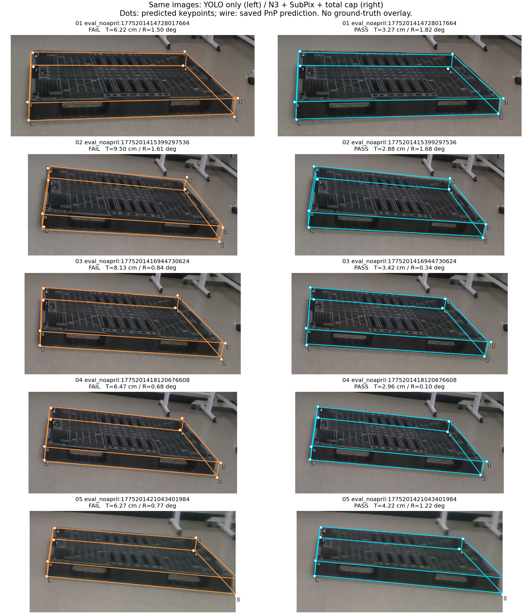
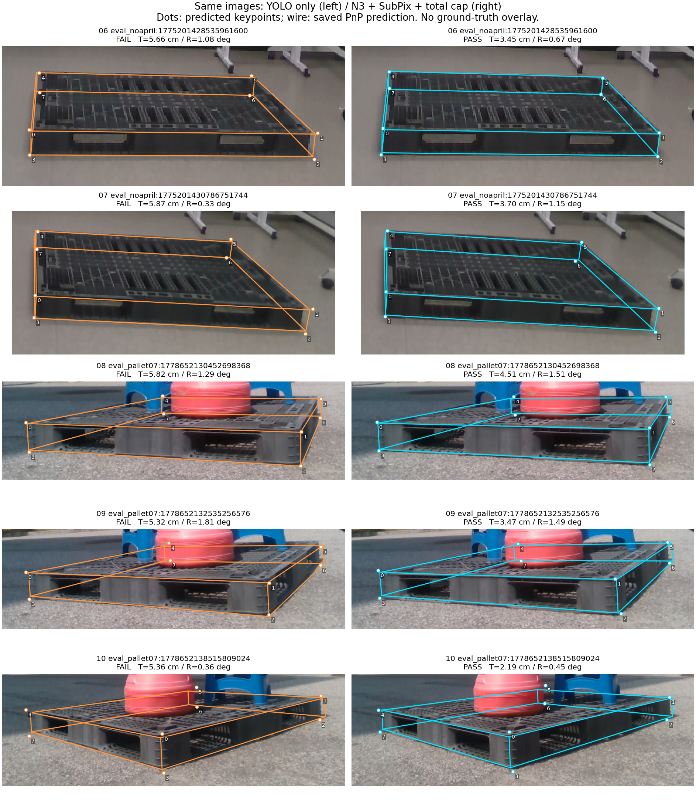

# 원 YOLO와 N3+SubPix의 실제 개선 10장

동일 TEST49 중 개선 10장, 퇴행 0장이다. 각 행 왼쪽은 원 YOLO, 오른쪽은 N3+SubPix+총 이동 제한 후의 결과다. 점은 저장된 예측 KP, 선은 저장된 PnP 자세이며 정답 오버레이가 아니다. 현재 상태별 후처리를 적용한 비교는 아니다.

전체49의 나머지 실패도 원 비교에 포함돼 있다. 이 그림은 개선된 10장만 설명하며, 모든 사진이나 최대오차가 좋아졌다는 뜻은 아니다.
