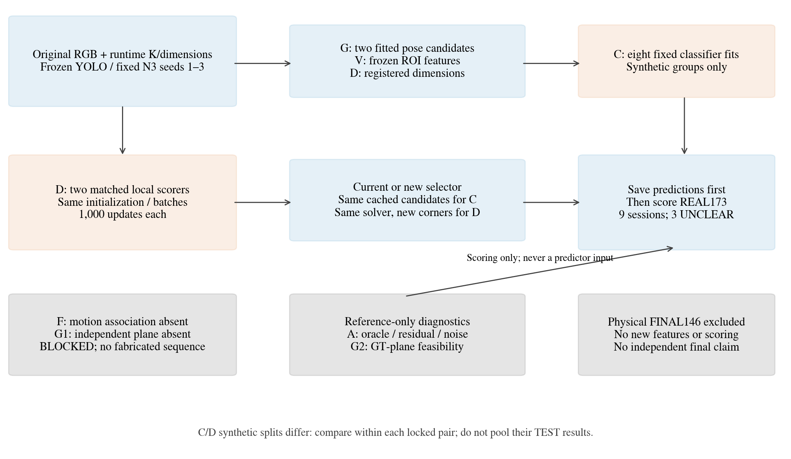
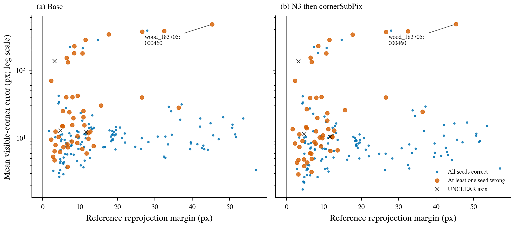
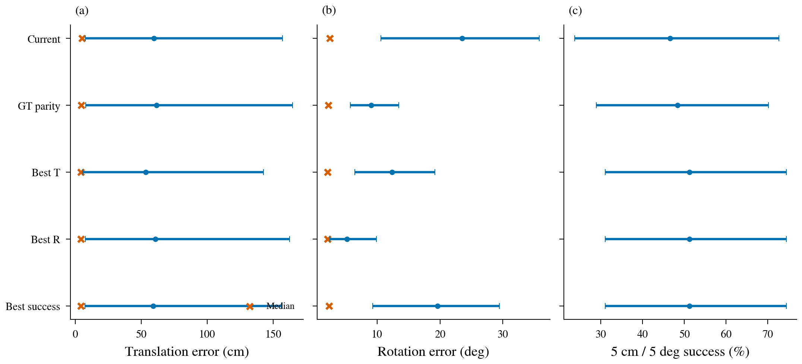
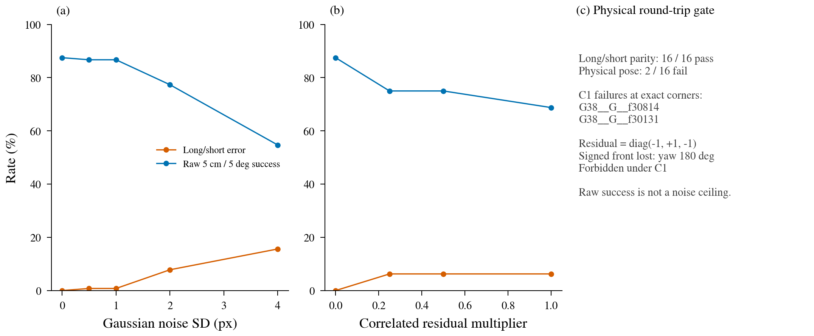
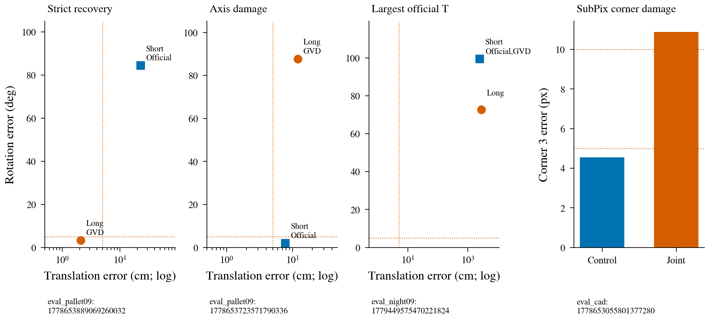
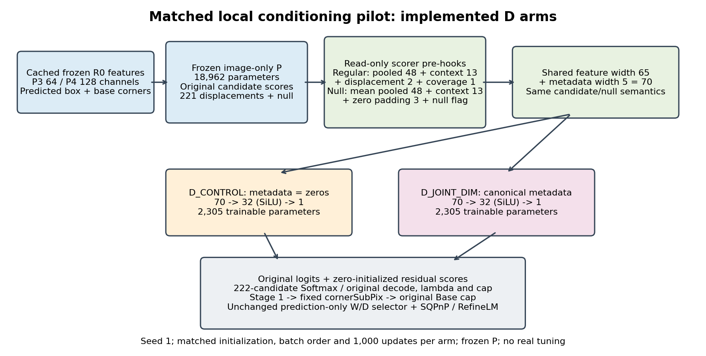
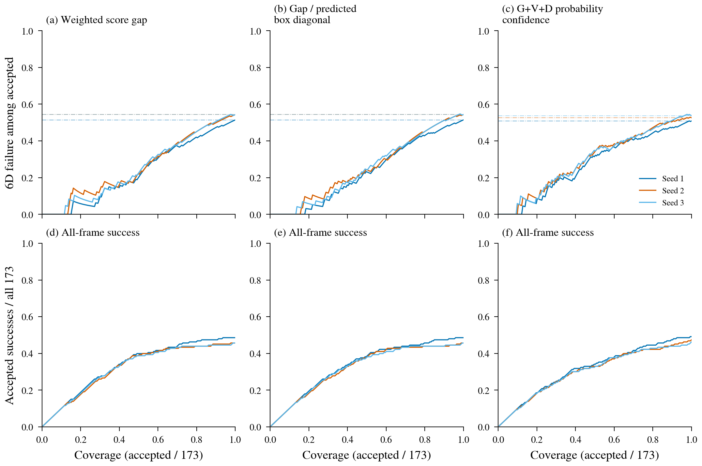
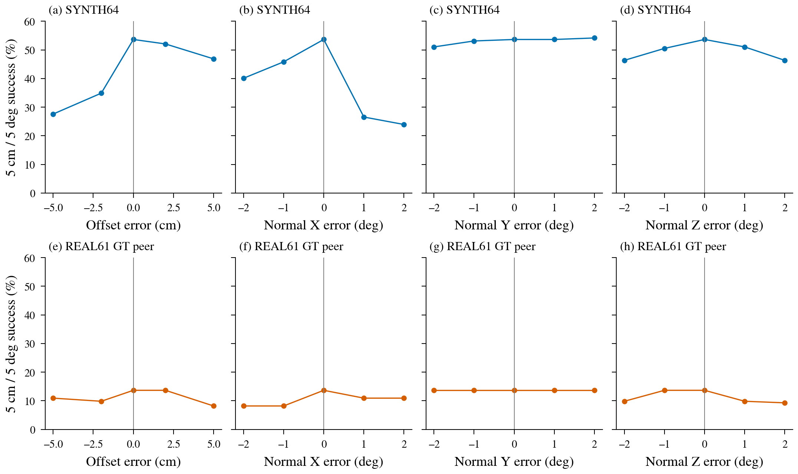
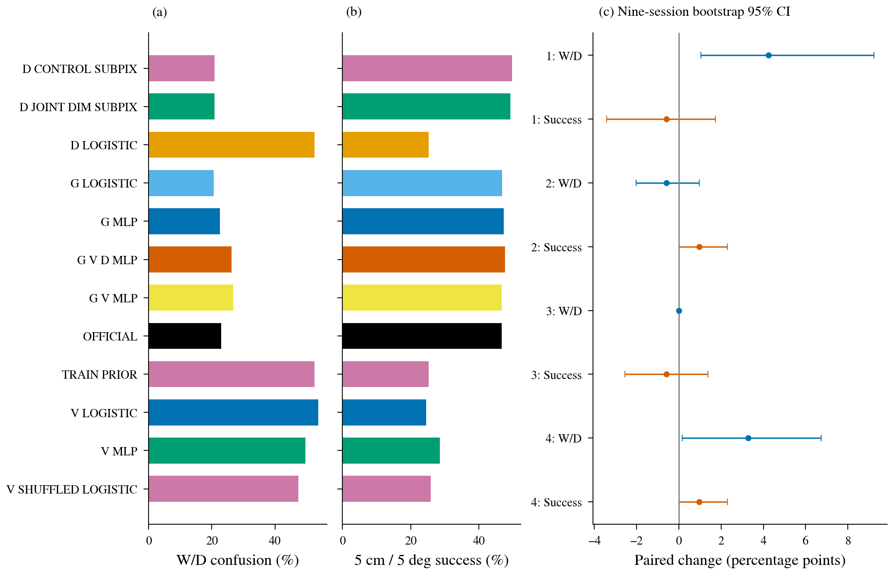

허용된 REAL173에서 치수 입력은 반응했지만 영상·치수 융합의 일관된 6D 개선은 확인되지 않았고, C1 자세 복원 오류와 실사 전이 실패가 드러났다.

# W/D·치수·대칭: 실행 결과와 다음 판단

이 보고서는 새 실험 namespace의 실제 산출물을 연결한다. 원고, LaTeX, PDF, 기존 데이터·checkpoint·실험 폴더는 수정하지 않았다. [확인] 기존 N3 seed 1·2·3을 고정했고, 허용된 작은 분류기 8개와 국소 scorer 2개만 새로 fitting했다. 원 팔레트 검출기나 N3는 재학습하지 않았다([PLAN_LOCK.json](PLAN_LOCK.json), [D_TRAINING_RECEIPT.json](D_TRAINING_RECEIPT.json)).

## 먼저 확인해야 할 불리한 결과와 범위

- [확인] 새 실사 평가는 **319장 전체가 아닌 REAL173/9세션**이다. 물리 데이터 계약의 FINAL146은 현재 aggregate manifest의 DEV 표기와 충돌하므로 새 특징 추출·선택·채점에서 제외했다. RECT245와의 허용 교집합은 110장이다. 가림 Severe 63장은 REAL173 주분모에 남긴다. 과거 319/245장 주장은 기존 공개 집계만 연결했고 재검산했다고 부르지 않는다([INPUT_CONTRACT.json](INPUT_CONTRACT.json): allowed 173, protected 146, intersection 110; [CLAIM_AUDIT.md](CLAIM_AUDIT.md)).
- [확인] SYNTH 고정 16장의 정확 코너에서 long/short 이름은 16/16 맞지만, **C1 영상 2/16의 물리 자세가 180° 틀린다**. `G38__G__f30814`, `G38__G__f30131`에서 signed front 복원의 잔여 변환은 `diag(-1,+1,-1)`이다. 좌표 fitting 잔차는 각각 2.22e−16, 4.44e−16 m인데 C1에서 허용되지 않는 yaw 180°가 남는다. 이 결과를 단순 키포인트 노이즈 한계나 정당한 대칭으로 해석하지 않는다([A3_PHYSICAL_ROUNDTRIP_AUDIT.json](A3_PHYSICAL_ROUNDTRIP_AUDIT.json): `IMPLEMENTATION_OR_CONTRACT_ISSUE`).
- [확인] 원 공식 YOLO N3→SubPix의 REAL173 평균 위치 오차는 **59.54 cm**, 중앙값·P90과 매우 다른 큰 꼬리를 포함한다. 가장 큰 원행은 `eval_night09:1779449575470221824`, seed3 **2484.86 cm**다. 나쁜 영상·seed를 제거하지 않았다([A2_ORACLE_ROWS.jsonl.gz](A2_ORACLE_ROWS.jsonl.gz), [A2_ORACLE_METRICS.json](A2_ORACLE_METRICS.json)).
- [확인] D의 동일 seed1 국소 보정은 SubPix 뒤 성공률이 **86/173→85/173**으로 감소했다. 코너 평균 오차가 감소한 영상은 107장, 증가한 영상은 58장이고, `eval_cad:1778653055801377280` corner3은 **4.554→10.882 px**로 손상됐다([D_REPAIRED_RESULTS.json](D_REPAIRED_RESULTS.json), [D_VERIFICATION.json](D_VERIFICATION.json)).
- [확인] D 최초 자세 평가의 `K` list→OpenCV adapter 오류는 그대로 보존했다. 동일 checkpoint·동일 코너를 유지하고 array 변환만 복구한 `D_REPAIRED_*`가 과학적 결과다. 최초 모든 미산출을 방법 성능 악화로 세지 않는다([D_REPAIR_LOCK.json](D_REPAIR_LOCK.json), [D_VERIFICATION.json](D_VERIFICATION.json)).
- [확인] C와 D의 합성 split은 같지 않다. D TRAIN 16,000장 중 C VAL 253장·TEST 271장에 노출됐다. **각 작업 내부의 고정 짝 대조**를 해석하고, C/D 합성 TEST를 합쳐 독립 비교하지 않는다. REAL173은 두 작업 모두 fitting·선택에 쓰지 않았다([D_CROSS_TASK_EXPOSURE.json](D_CROSS_TASK_EXPOSURE.json)).

- [확인] V_LOGISTIC은 합성 TEST 정확도84.961%에서 실사 직접 정확도45.882%로 전이 실패했다. 기하에 V를 추가한 주대비도 기존 W/D confusion이+4.239pp 악화했다. 작은 GVD 성공 증분만 남겨 영상 효과가 확인됐다고 주장하지 않는다([C_RESULTS.json](C_RESULTS.json), [PAIRED.json](PAIRED.json)).

## 정보 흐름과 평가 계약

[확인] C는 runtime 기하 G(공식 양 후보의 94차원씩, 총188), 동결된 YOLO ROI 공간 특징 V, 등록 치수 D를 이용하는 selector이다. 양 후보 및 코너는 그대로 둔다. D는 동일 초기화·동일 batch 순서·동일 파라미터 2,305개의 국소 후보 scorer 두 arm을 각각 1,000회 업데이트하므로 코너가 바뀌며 같은 solver로 자세를 다시 구한다([BC_INPUT_CONTRACT.json](BC_INPUT_CONTRACT.json), [D_CONTRACT.json](D_CONTRACT.json), [D_VERIFICATION.json](D_VERIFICATION.json)). GT 참조, reference margin, 참조 고도·거리, GT plane은 predictor 입력이 아니다.

[확인] 주분모는 REAL173이며 long/short 참조가 UNCLEAR인 3장은 직접 분류 정확도에서만 제외해 170장을 쓴다. **기존 W/D confusion은 `R>45° AND |yaw|≥60°`이며 전체173장 분모**다. 직접 축 선택 오류율과 서로 바꾸어 쓰지 않는다. 성공은 산출된 자세가 `T<5 cm AND R<5°`인 비율이며 미산출을 성공으로 세지 않는다. 회전·ADDsym은 기존 proper 대칭만 쓴다. 정사각형 C4에서는 long/short가 NA이고 90°가 허용되며, 직사각형 W/D 90°는 대칭이 아니다([geometry_analysis.py](../../../scripts/research/pallet_wd_info_fast_20261011/geometry_analysis.py), [paired.py](../../../scripts/research/pallet_wd_info_fast_20261011/paired.py)).

[확인] 주 불확실성은 같은 영상의 모든 seed와 후보를 묶은 **9개 실제 세션 paired cluster bootstrap 10,000회, seed20260917**로 계산한다. 영상 가중 효과와 세션 동일 가중 효과를 분리한다. 4개의 사전 대비×2개 지표=8개 가설의 원 p와 Holm p를 보고한다. 기존 원고의 통계 family를 바꾸지 않는다. 반복 사용된 개발 참조라 독립 확증이 아니다([PLAN_LOCK.json](PLAN_LOCK.json), [paired.py](../../../scripts/research/pallet_wd_info_fast_20261011/paired.py)).

## A: 선택 오류만 해결하면 충분한가

[확인] reference margin은 동일 수동 코너에서 대안 가설과 참조 가설의 평균 재투영 오차 차이(px)다. 공식 score gap은 penalty가 섞인 score 차이이므로 같은 픽셀량이 아니다. 허용173장의 reference margin 중앙값은 **10.932 px**, 평균±SD **16.482±13.782 px**다. 사용자가 제시한 245장 median9.4 px·44% 등은 모집단이 달라 이 수치로 대체하지 않는다([A1_PAIRED_MARGIN_RESIDUAL.json](A1_PAIRED_MARGIN_RESIDUAL.json), [CLAIM_AUDIT.md](CLAIM_AUDIT.md)).

[확인] 각 점은 영상 하나이며 seed 평균을 쓴다. 세 seed 중 하나라도 직접 축을 잘못 고르면 원으로 표시하고 UNCLEAR는 ×로 남긴다. y축은 화면 안 수동·visible 코너의 **고정 camera-facing 인덱스** 평균 잔차(log축)이며 대칭 최솟값 pooled median과 다르다. 수백 px 이상 사례도 모두 보인다. reference margin은 분석용 GT 진단이며 선택 confidence로 사용하지 않았다([A1_PAIRED_MARGIN_RESIDUAL_ROWS.jsonl.gz](A1_PAIRED_MARGIN_RESIDUAL_ROWS.jsonl.gz): 173×4경로×3seed=2,076행).

| YOLO N3→SubPix, REAL173 | T 평균 cm | R 평균 ° | 5cm·5° % | 기존 W/D confusion % | 직접 축 오류 %/170 |
|---|---:|---:|---:|---:|---:|
| 공식 선택 | 59.537 | 23.527 | 46.628 | 22.929 | 25.882 |
| GT parity 진단 | 61.488 | 9.071 | 48.362 | 5.010 | 0.000 |
| 사후 최저 T 후보 | 53.322 | 12.394 | 51.252 | 9.634 | 15.098 |
| 사후 최저 R 후보 | 60.650 | 5.224 | 51.252 | 0.000 | 4.706 |
| 사후 성공 후보 | 58.973 | 19.635 | 51.252 | 18.304 | 21.765 |

[확인] 표는 영상 내 3seed 평균 후173영상 평균이다. UNCLEAR의 GT parity는 공식 선택을 유지했다. 사후 최저 후보는 배포할 수 없는 oracle이다. 선택만 맞히면 회전은 크게 줄지만 GT parity의 평균 T는 **더 커지고**, 최선의 두 후보를 사후 선택해도 성공은 51.252%다. 따라서 선택 오류와 코너/참조/solver 문제가 함께 남아 있다([A2_ORACLE_METRICS.json](A2_ORACLE_METRICS.json): 4,152 양후보행, 20,760 oracle행, 새 PnP0).

오차 막대는 9세션 bootstrap 평균 CI95, ×는 중앙값이다. 큰 T 꼬리로 넓어진 CI도 축에서 자르지 않았다.

[확인] A3는 고정 hash SYNTH16, correlated residual α={0,.25,.5,1}와 Gaussian σ={0,.5,1,2,4}px×8draw를 사전 설정대로 실행했다. 새 RGB를 생성하지 않았다. Gaussian4px에서 직접 축 오류15.625%, raw 성공54.688%이며 정확 코너에서도 raw 성공87.5%에 그친다. **정확 코너의 2개 C1 복원 실패가 있으므로 raw R/성공을 노이즈의 유일 원인이나 이론적 상한으로 해석하는 단계는 중단**한다. width/depth의 절대 축 이름은 yaw180°에 불변이므로 직접 long/short label 검산과 구분한다([A3_GEOMETRY_DIAGNOSTIC.json](A3_GEOMETRY_DIAGNOSTIC.json): 실제 OpenCV solve2960+LM2960=5,920; [A3_PHYSICAL_ROUNDTRIP_AUDIT.json](A3_PHYSICAL_ROUNDTRIP_AUDIT.json): 추가 PnP0).

## B: 치수 반응과 대칭 감독

[확인] 기존 symmetry 정답 선택 함수를 그대로 재생했다. 고유 usable TRAIN에서 nonidentity 정답 선택은 YOLO **125/55,915=0.224%**, DOPE **134/44,063=0.304%**, ResNet18 **0/55,806=0%**다. C2 내부 비율도 각각125/36,664=0.341%,134/29,017=0.462%,0/36,571=0%에 그쳤고 C4 TRAIN은0이다. identity-first exact tie가 부풀린 빈도는0이다([B2_SYMMETRY.json](B2_SYMMETRY.json)).

[확인] YOLO seed1·2·3의 96,000 optimizer 노출 중 nonidentity는 각각217·218·208회였다. 이 감독은 주로 허용 C2의180° relabel이며, 직사각형90° W/D 선택 자체를 가르치는 target 변경과 동일하지 않다. [추정] 작은 변경 빈도가 기존 N3의 W/D 약한 증분을 설명할 후보지만, 이것만으로 인과 효과를 확정할 수 없다.

<!-- FINAL_B1_RESULTS -->
[확인] B1은 기존 N3 seed1의 입력 치수만 correct/mean/normalized-zero/TRAIN-shuffle로 바꾸고, 모든 조건에서 PnP 치수는 올바른 등록값으로 고정했다. 새로운 fitting이나 backbone 추론은0이며 OpenCV solve/refine 실제3,114회다. normalized-zero는 TRAIN-mean과 동일하다고 가정하지 않았다([B1_RESULTS.json](B1_RESULTS.json)).

| 기존 N3 입력 치수, REAL173 | 평균 코너 이동 px | 확률 L1 평균 | 후보 argmax 변경/1384 | W/D 선택 변경 | 5cm·5° % |
|---|---:|---:|---:|---:|---:|
| CORRECT | 0.000000 | 0.00000 | 0 | 0 | 44.509 |
| TRAIN_MEAN | 1.097657 | 0.16746 | 479 | 0 | 43.353 |
| NORMALIZED_ZERO | 1.085352 | 0.16359 | 471 | 0 | 43.931 |
| TRAIN_SHUFFLE | 1.078834 | 0.15551 | 435 | 0 | 42.775 |

[확인] 기존 N3는 치수에 **반응한다**. 그러나 네 조건의 직접 축 오류는 모두43/170이고 W/D 선택 변경0이다. correct 성공77/173와 mean75/173,zero76/173,shuffle74/173의 차이는 작으며 치수의 안정적인 6D 이득으로 확정하지 않는다. 상태는 `SENSITIVE_BUT_BENEFIT_UNRESOLVED`다.
<!-- END_FINAL_B1_RESULTS -->

## C: 동결 영상 특징이 실제로 추가 정보를 주는가

<!-- FINAL_C_RESULTS -->
[확인] **8fit 모두 완료**했다. C용 TRAIN4096/VAL1024/TEST1024의 renderer/scenario group 분리를 유지했고 실사 GT로 fitting·early stopping·threshold를 고르지 않았다. V는 동결 P3/P4의 예측 ROI2×2 공간 pooling(768차원)이다. 기존 P3/P4 cache를 predictor에 썼고, 누락된 현재 YOLO confidence 계약 확인을 위해 기존6144 합성 RGB를 실제 1회씩 동결 재추론했다. points/box/P3/P4 parity 최대 차이0, 동결 파라미터 no-grad를 확인했다. 새 합성 이미지 생성은0이다([C_EXTRACTION_RECEIPT.json](C_EXTRACTION_RECEIPT.json), [C_FITS.json](C_FITS.json)).

[확인] 모든 작은 분류기·shuffle·prior·공식 선택을 같은 REAL173/seed1·2·3으로 보고한다. 성공·기존W/D는173분모, 직접 축 분류170분모다. 각 행의 연속 통계는 seed 평균을 영상 내에 묶어 계산했다. 전체52집계의 평균·분산·SD·중앙값·P90·P95·최대값·95% CI는 [METRICS.json](METRICS.json)에 있다.

| Selector | 직접 축 오류 % | Balanced accuracy % | 기존 W/D % | 5cm·5° % | T 평균±SD cm | T P90 cm | R 평균±SD ° | R P90 ° | ADDsym AUC |
|---|---:|---:|---:|---:|---:|---:|---:|---:|---:|
| OFFICIAL | 25.882 | 74.321 | 22.929 | 46.628 | 59.54±261.53 | 52.06 | 23.53±34.68 | 87.76 | 0.4643 |
| TRAIN_PRIOR | 51.765 | 50.000 | 52.601 | 25.241 | 67.31±279.04 | 66.68 | 48.62±40.93 | 88.46 | 0.2578 |
| D_LOGISTIC | 51.765 | 50.000 | 52.601 | 25.241 | 67.31±279.04 | 66.68 | 48.62±40.93 | 88.46 | 0.2578 |
| G_LOGISTIC | 22.549 | 77.555 | 20.617 | 46.821 | 58.96±261.56 | 38.50 | 21.63±33.28 | 86.40 | 0.4657 |
| V_LOGISTIC | 54.118 | 46.355 | 53.757 | 24.470 | 68.47±273.07 | 61.40 | 49.54±41.11 | 88.75 | 0.2483 |
| V_MLP | 49.412 | 50.693 | 49.711 | 28.516 | 66.42±262.46 | 58.04 | 45.32±41.44 | 88.60 | 0.2922 |
| G_MLP | 25.686 | 74.580 | 22.543 | 47.206 | 60.74±262.54 | 53.55 | 23.59±35.12 | 87.77 | 0.4693 |
| G_V_MLP | 29.412 | 70.843 | 26.782 | 46.628 | 61.16±256.37 | 58.04 | 26.52±36.88 | 87.84 | 0.4590 |
| G_V_D_MLP | 28.824 | 71.425 | 26.204 | 47.592 | 60.53±256.14 | 53.55 | 25.79±36.82 | 87.84 | 0.4651 |
| V_SHUFFLED_LOGISTIC | 52.353 | 47.686 | 47.399 | 25.819 | 61.09±244.61 | 47.83 | 44.12±41.54 | 88.18 | 0.2584 |

[확인] 영상만 쓴 V_LOGISTIC의 합성 TEST 직접 분류 정확도는 **84.961%**, shuffle은51.465%여서 해당 합성 자료의 영상 특징에 분류 정보가 있다. 하지만 REAL173의 V_LOGISTIC balanced accuracy는46.355%, 직접 정확도45.882%, 성공24.470%로 **실사 전이가 실패**했다. G_MLP에 V를 추가하면 직접 축 오류25.686→29.412%, 기존W/D22.543→26.782%로 악화했고 성공47.206→46.628%다. 현재 파일럿에서 영상 특징의 실사 추가 가치는 확인되지 않았다([C_RESULTS.json](C_RESULTS.json), [C_SYNTH_TEST_RESULTS.json](C_SYNTH_TEST_RESULTS.json)).

[확인] 동일 크기의 G+V+D는 G+V 대비 성공+.963pp와 기존W/D−.578pp의 작은 개선 방향이지만, 공식 선택 대비 성공+.963pp와 기존W/D+3.276pp의 **TRADEOFF**다. 치수의 연결 위치에 따라 반응·방향은 다르며 운영 우위를 확정할 증거가 없다. 전체8개 Holm p는 모두.3536 이상이고 임의 practical 합격선을 만들지 않았다.

[확인] C 합성 TEST1024는 이번 C 분류기 fitting과 group 분리됐지만, 원 N3 TRAIN 노출926장과 겹치며 실제 renderer group은1개다. 전체 파이프라인의 독립 최종 test나 다양한 환경 일반화로 부르지 않는다. A3 signed-front 복원 이슈의 영향을 별도 명시한 채 raw 합성 결과를 보존한다([BC_INPUT_CONTRACT.json](BC_INPUT_CONTRACT.json), [C_SYNTH_TEST_RESULTS.json](C_SYNTH_TEST_RESULTS.json): `independent_final_test=false`).

| Selector | Clean68 성공 % | Moderate42 성공 % | Severe63 성공 % |
|---|---:|---:|---:|
| OFFICIAL | 79.412 | 53.968 | 6.349 |
| TRAIN_PRIOR | 41.176 | 27.778 | 6.349 |
| D_LOGISTIC | 41.176 | 27.778 | 6.349 |
| G_LOGISTIC | 80.392 | 53.175 | 6.349 |
| V_LOGISTIC | 27.941 | 41.270 | 9.524 |
| V_MLP | 35.294 | 40.476 | 13.228 |
| G_MLP | 80.392 | 53.968 | 6.878 |
| G_V_MLP | 78.431 | 50.794 | 9.524 |
| G_V_D_MLP | 79.412 | 53.175 | 9.524 |
| V_SHUFFLED_LOGISTIC | 40.686 | 28.571 | 7.937 |

[확인] Severe를 포함한 모든 grade를 동일 방법으로 남겼다. material·session·reference-margin·고도 하위군은 [C_RESULTS.json](C_RESULTS.json)의 descriptive 수치이며 실사로 모델이나 threshold를 다시 고르지 않았다.

[확인] 사례 그림은 **고정 seed1**에서 strict 회복 중 최대 R 감소, 직접 축 손상 중 최대 R 증가, 전체 공식 선택 중 최대 T, 모든 D good5→bad10 코너 손상을 정해진 기준으로 보여준다. 공개 범위는 실제 두 후보의 파생 T/R 수치이며 RGB·참조 좌표를 포함하지 않는다. 회복 `eval_pallet09:1778653889069260032`는 T22.811/R84.413→T2.081/R3.304로 성공을 회복했다. 축 손상 `eval_pallet09:1778653723571790336`는 R1.954→87.719로 악화하며 두 경로 모두 T>5cm라 strict는 모두 실패다. 가장 큰 T 사례도 양 방법에서 해결되지 않는다. 모든 전환 ID는 [CHANGED_SELECTIONS.csv](CHANGED_SELECTIONS.csv), 자세 수치는 [FIGURE_CASES.json](FIGURE_CASES.json)에 남겼다.
<!-- END_FINAL_C_RESULTS -->

## D: 치수·영상 국소 결합의 실제 이득

[확인] 두 arm은 같은 frozen feature, 222개 기존 후보, 정답, 초기화, minibatch, optimizer, 1,000updates를 쓴다. CONTROL의 치수 슬롯은 명시적 null이고 JOINT에만 등록 치수를 넣는다. 전체 2,000update,16000고유 TRAIN노출, 동결 파라미터/gradient 불변을 확인했다. synthetic calibration1004에서 고정 후보 temperature{.5,1,2,4}로 양 arm 모두1.0이 선택됐고 λ=1, 영상 대각선1% 마지막 cap은 고정했다. 실사로 고르지 않았다([D_TRAINING_RECEIPT.json](D_TRAINING_RECEIPT.json), [D_CALIBRATION.json](D_CALIBRATION.json), [D_METHOD_KO.md](D_METHOD_KO.md)).

| REAL173, seed1 | T 평균±SD cm | T 중앙값/P90 cm | R 평균±SD ° | R 중앙값/P90 ° | 성공/173 | 직접 축 오류/170 |
|---|---:|---:|---:|---:|---:|---:|
| CONTROL | 59.35±265.91 | 5.87/43.87 | 22.29±35.22 | 2.45/87.65 | 81 | 42 |
| JOINT_DIM | 58.97±264.82 | 5.57/43.55 | 21.34±34.63 | 2.38/87.68 | 77 | 40 |
| CONTROL→SubPix | 58.48±257.61 | 4.61/51.06 | 21.82±34.93 | 2.43/87.62 | 86 | 41 |
| JOINT_DIM→SubPix | 58.36±257.03 | 4.67/51.28 | 21.79±34.94 | 2.33/87.68 | 85 | 41 |

[확인] Stage1 직접 축 오류42→40의 감소가 실제 strict 성공81→77로 이어지지 않았다. SubPix 경로의 paired 원효과는 −1/173=**−0.578 percentage point**다. 작은 평균 오차 변화로 strict 악화와 코너 손상을 가리지 않는다. D 결과 파일의 `confusion_rate`는 직접 축 오류율이며, 주대비의 기존 W/D confusion과 다르다([D_REPAIRED_RESULTS.json](D_REPAIRED_RESULTS.json)).

[확인] mean/shuffle 치수에 대한 probability·coordinate·선택 변화는 모든346원행을 남겼다. 최종 개입 비교는 올바른 PnP 치수를 고정한 채 scorer 입력만 바꾼 것이다. 반응은 실제 성공 개선과 별개다([D_REPAIRED_SENSITIVITY.json](D_REPAIRED_SENSITIVITY.json), [D_ALL_PAIRED_TRANSITIONS.csv](D_ALL_PAIRED_TRANSITIONS.csv)).

## E: 보류가 위험과 처리율을 어떻게 바꾸는가

[확인] 두 기존 후보를 유지하고, score gap과 **예측 box diagonal**로 정규화한 gap의 전체 threshold 곡선을 계산했다. 낮은 confidence에서 재투영 winner로 fallback하지 않고 보류한다. 원영상/GT 크기나 GT margin은 confidence 입력이 아니다. 그림의 파선은 균일 random rejection의 기대 risk이며 새로운 seed 실험이나 안전 보장이 아니다([E_RISK_COVERAGE.json](E_RISK_COVERAGE.json):4경로×3seed×2confidence=24곡선).

| N3→SubPix raw gap, seed | 전체173의 실패율 % | 139장/80.35% 처리 때 accepted 실패율 % | 87장/50.29% 처리 때 accepted 실패율 % | 87장 처리 때 성공/전체173 % | AURC |
|---|---:|---:|---:|---:|---:|
| 1 | 51.445 | 41.727 | 20.690 | 39.884 | .23220 |
| 2 | 54.335 | 45.324 | 21.839 | 39.306 | .25739 |
| 3 | 54.335 | 45.324 | 22.989 | 38.728 | .25320 |

[확인] 절반가량 보류하면 accepted set의 위험은 줄지만, 전체 성공 output도46–49%에서39%안팎으로 줄었다. 처리율·미산출·UNCLEAR·성공/전체분모를 같이 공개한다. 정규화 gap의 AURC는 seed1·2·3 각각.23058/.25350/.25058이며 직접 축 오류 검출 ROC-AUC는 .74621/.75769/.73796이다. AURC·직접 축 ROC·ADDsym AUC는 다른 지표다. 이 실사 곡선으로 운영 threshold를 선택하지 않았다([E_RISK_COVERAGE.json](E_RISK_COVERAGE.json)).

<!-- FINAL_C2_RESULTS -->
[확인] classifier confidence=`|2p_long−1|`의8arm+TRAINprior×3seed **27별도 곡선**과 synthetic VAL-only threshold의 실사 전이를 추가했다. 대표 G+V+D는 사전 주대비 arm이며 좋은 classifier를 사후 고른 것이 아니다. seed1 AURC **.27349**, 직접 축 오류 검출 ROC-AUC **.67094**로 기존 raw-gap seed1(.23220/.73088)보다 좋지 않다([E_PROBABILITY_RISK.json](E_PROBABILITY_RISK.json)).

| 실사 설명용 seed1 고정 coverage | 실제 처리율 % | 공식 gap accepted 실패 % | GVD accepted 실패 % | 공식 gap 성공/전체 % | GVD 성공/전체 % |
|---|---:|---:|---:|---:|---:|
| 95% | 95.376 | 49.091 | 49.091 | 48.555 | 48.555 |
| 90% | 90.173 | 47.436 | 47.436 | 47.399 | 47.399 |
| 80% | 80.347 | 41.727 | 44.604 | 46.821 | 44.509 |
| 50% | 50.289 | 20.690 | 32.184 | 39.884 | 34.104 |

| GVD synthetic VAL 목표 처리율 % | VAL 실제 % | REAL 실제 % | REAL accepted 실패 % | REAL 성공/전체 % |
|---|---:|---:|---:|---:|
| 95 | 95.020 | 89.595 | 47.097 | 47.399 |
| 90 | 90.039 | 82.659 | 44.755 | 45.665 |
| 80 | 80.078 | 65.318 | 38.938 | 39.884 |
| 50 | 50.000 | 26.012 | 15.556 | 21.965 |

[확인] VAL50% threshold를 실사에 옮기면 실제26.012%만 처리하고 전체 성공 output은21.965%다. confidence는 probability calibration이나 환경 전이 후 안전 보장과 동일하지 않다. 이 threshold들은 VAL에서만 산출했으며 REAL risk를 맞추도록 재선택하지 않았다.
<!-- END_FINAL_C2_RESULTS -->

## F/G: 실제 추가 관측을 쓸 수 있는가

[확인] 기존 continuous8910프레임/4세션 timestamp binding은 PASS이고 중복29·역행0이었다. 하지만 독립 metric motion, 물체 association, no-face-switch 근거가 없다. 별도 incoming day/night 자료를 임의 정렬해 접근 시퀀스로 만들지 않았다. 정사각형 temporal index는 실제 timestamp가 아니다. F는 **BLOCKED_CONTRACT**다. flip감소나 정확도 개선 숫자를 만들지 않았다([F_G_INPUT_AUDIT.json](F_G_INPUT_AUDIT.json)).

[확인] nominal camera extrinsic은 측정값이 아니며, 평가 정답과 독립적인 바닥 normal·offset 기록은0이다. floor contact도 미확인이라 적용조건 UNKNOWN으로 남긴다. G1은 **BLOCKED_CALIBRATION**이다. 기존 S3의 다른 영상 GT median plane은 LOO였어도 GT 기반 사후 가능성 진단이다.

[확인] G2는 source-verified S3 selector의 score를 그대로 두고, 기존 두 후보 pose만 재사용했다. SYNTH hash64장과 기존 REAL GT-peer eligible61장,3seed에서 offset{−5,−2,0,2,5}cm 및 각 camera 축 normal{−2,−1,0,1,2}°를 OFAT로 계산했다. plane식은 `nᵀX−offset=0`이며 normal은 카메라 원점 기준 회전, offset 고정이다. 실제 센서 오차 범위를 주장하거나 좋은 조건으로 threshold를 바꾸지 않는다. SYNTH 성공23.958–54.167%, REAL GT-peer 성공8.197–13.661%의 변동을 모두 남겼다. **모두 FEASIBILITY_ONLY**, 새 PnP0이며 real 배포 성능은 미확인이다([G2_PLANE_SENSITIVITY.json](G2_PLANE_SENSITIVITY.json)).

[확인] 특정 Metric3D 설정의 기존 depth gate는231장 median abs-relative17.179%로5% gate를 미통과했고 `FAIL_STOP_S4`를 유지했다. 허용173과의 교집합85장만 기존 depth와 후보 front-depth 차이를 연결했다. 그85장의 abs-relative median13.121%,P90125.176%와 signed bias를 원행에 남겼다. 새 모델/추론/affine calibration/S4 정책 평가는0이다. 오차17.2%와 W/D 차이18%만 비교해 모든 monocular depth가 불가능하다고 결론 내리지 않는다([G3_DEPTH_GATE_REUSE.json](G3_DEPTH_GATE_REUSE.json), [G3_DEPTH_BIAS_ROWS.jsonl.gz](G3_DEPTH_BIAS_ROWS.jsonl.gz)).

## 검산·재현·상태

[확인] 원본 workspace의449개 기존 변경 상태와 tracked diff bytes를 보존했고,24개 역사 artifact의 SHA가 전후 일치했다([SOURCE_PRESERVATION.json](SOURCE_PRESERVATION.json)).

[확인] A2 240개 평균을 독립 `math.fsum`으로 확인한 최대 차이는1.421e−14, D400개 통계 검산의 최대 차이는5.684e−14다. 원행 수·allowed ID·UNCLEAR 분모·보류 분모·plane zero변경 불변·기존 source SHA 불변을 확인했다. A3 long/short parity PASS와 물리 C1 gate FAIL은 따로 보존한다([GEOMETRY_VERIFICATION.json](GEOMETRY_VERIFICATION.json), [D_VERIFICATION.json](D_VERIFICATION.json)).

[확인] 그림은 원 RGB·참조 좌표 없이 공개 가능한 파생 숫자만 렌더했다. 새 분석 PNG8개는300dpi, 별도 D 방법 그림은160dpi이며 모두 영어 label이다. 또한 대형 특징/새 checkpoint는 게시하지 않는다([FIGURE_INPUTS.json](FIGURE_INPUTS.json), [FIGURE_RECEIPT.json](FIGURE_RECEIPT.json)). 실행 가능한 자료가 없는 F/G를 실패 성능0으로 합치지 않는다. 실제 실행/재사용/차단 전체 상태와 비용·재현은 [EXPERIMENT_STATUS.csv](EXPERIMENT_STATUS.csv), [COMPUTE_RECEIPT.json](COMPUTE_RECEIPT.json), [REPRODUCE.md](REPRODUCE.md)에 연결한다.

## 최종 질문에 대한 답과 다음 판단

| 질문 | 실제 근거에 따른 답 |
|---|---|
| 무엇을 실행·재사용·차단했는가? | A2/E/G2/G3는 기존 캐시와 허용173만 채점. A3 고정16 노이즈를 실제 계산. B2 정답 선택 재생. D2fit 완료. C8fit/B1/C2 최종 검증 완료. F/G1/S4는 입력·calibration·기존 gate로 차단. |
| 치수가 안 쓰이는가, 반응하는가, 이득이 있는가? | D mean/shuffle 입력에 반응하지만 CONTROL 대비 strict 이득은 관찰되지 않았다. B1도 반응하지만 축 선택 변경0·작은 성공 차이여서 안정적인 이득은 미확인이다. |
| 대칭 감독이 정답을 얼마나 바꿨나? | YOLO/DOPE usable TRAIN의0.224/0.304%, ResNet0%. C2 180° 감독은 직사각형90° W/D label과 다르다. |
| 영상 특징의 추가 가치가 확인됐나? | 합성 V정보는 확인됐으나 실사 전이 실패. GV는 G보다W/D악화·strict감소, Holm유의증분없음. |
| 축 선택이 6D 성공 개선으로 이어졌나? | 사후GTparity는 R를 줄였지만 T평균은 증가하고 strict는46.63→48.36%. D직접축42→40도strict81→77로 악화했다. |
| 보류하면 무엇을 잃나? | raw-gap halfcoverage에서 accepted 실패20.69–22.99%로 감소하나 출력 성공/전체는38.73–39.88%에 그친다. 실사에서threshold선택·안전 보장 안 함. |
| 시간/바닥 정보는 실제 사용할 수 있나? | 독립motion·association·plane계약 부재. 기존GTplane진단만 가능. 새인력주석을 임의로 요구하지 않았다. |
| 다음 판단과 최소 반증은? | 먼저 C1 signed-front 복원 계약을 바로잡고, 새selector운영을 보류. GT분기보정없이 canonical↔camera-facing↔physical의 C1/C2/C4 round-trip모두 통과하는 최소 회귀증거가 필요. 독립센서보정을 확보하기 전 GTplane이득을배포이득으로주장하지 않는다. |

<!-- FINAL_PRIMARY_RESULTS -->

[확인] 그림(c)의1=GV−G,2=GVD−GV,3=D_JOINT_DIM→SubPix−CONTROL→SubPix,4=GVD−공식 선택이다. D의 **SubPix 경로는 실행 전 주대비로 고정**됐으며 Stage1은 별도 descriptive다. effect는 after−before(pp), W/D는 감소가 개선이고 성공은 증가가 개선이다. 동일9세션의10000draw를 모든 주대비에 사용했다([PAIRED.json](PAIRED.json), [BOOTSTRAP_LOCK.json](BOOTSTRAP_LOCK.json)).

| 사전 대비 | 지표 | 영상 가중 Δpp [95%CI] | 세션 동일 가중 Δpp | 원 p | Holm p |
|---|---|---:|---:|---:|---:|
| G_V_MLP − G_MLP | W/D confusion | +4.239 [+1.035,+9.226] | +5.933 | 0.04420 | 0.35356 |
| G_V_MLP − G_MLP | 5cm·5° | -0.578 [-3.425,+1.720] | -1.231 | 0.68303 | 1.00000 |
| G_V_D_MLP − G_V_MLP | W/D confusion | -0.578 [-2.024,+0.958] | -0.460 | 0.48015 | 1.00000 |
| G_V_D_MLP − G_V_MLP | 5cm·5° | +0.963 [+0.000,+2.299] | +1.152 | 0.18308 | 1.00000 |
| D_JOINT_DIM_SUBPIX − D_CONTROL_SUBPIX | W/D confusion | +0.000 [+0.000,+0.000] | +0.000 | 1.00000 | 1.00000 |
| D_JOINT_DIM_SUBPIX − D_CONTROL_SUBPIX | 5cm·5° | -0.578 [-2.551,+1.370] | -0.643 | 0.66263 | 1.00000 |
| G_V_D_MLP − OFFICIAL | W/D confusion | +3.276 [+0.165,+6.742] | +3.461 | 0.05629 | 0.39406 |
| G_V_D_MLP − OFFICIAL | 5cm·5° | +0.963 [+0.000,+2.292] | +0.919 | 0.17088 | 1.00000 |

[확인] 이 p는 중심을 맞춘 paired bootstrap의 정확 integer tie/plus-one 정의이며, percentile CI를 역산해 p를 만들지 않았다. 양방향 CI와 p는 완전히 동일한 반전검정이 아니므로 CI의 끝점만 보고 확증 판정을 내리지 않는다. corrected family에서는 확증할 유의성이 없고, 이것을 효과0이라고 단정하지 않는다.

[확인] 최종 독립 검산은10,726중복 제거 원행·52집계·8주가설을 다시 계산했다. 3,276통계 비교 최대 차이는1.455e−11, CI차이5.684e−14, ADDsym AUC차이2.220e−16이었다. 원행 join34,600건, 보호 FINAL 채점0, Severe63 보존, 최초D adapter 실패행 집계 제외를 확인했다([FINAL_AGGREGATE_VERIFICATION_APPROVED.json](FINAL_AGGREGATE_VERIFICATION_APPROVED.json): PASS).

[확인] 총 실제 OpenCV solve/refine는**48,277/50,000**(A3 5,920/B1 3,114/C 30,748/D 8,495; 실패 호출 포함), classifier8fit, corrector2fit×1000updates다. 동결 YOLO 합성 재추론6144장과 N3cachedfeature6144forward를 기록했다. measured GPU active phase 합계4.401분/45분, peak allocated373,743,616bytes이며 새 REAL 고비용 RGB특징은0이다. CPU peak memory 미계측 범위도 그대로 명시한다([COMPUTE_RECEIPT.json](COMPUTE_RECEIPT.json)).

[확인] D repair lock의 “three frames” 표현은 실제로 **같은 첫 영상의 세 route 예측**이었음을 별도 검산 파일에 정정했다. 원 lock SHA를 보존하고 silently rewrite하지 않았다([D_VERIFICATION.json](D_VERIFICATION.json): distinct_frames1, predictions3).

[추정] 다음 행동은 **현재 좌표 복원 계약 수정→독립 관측 확보**다. C1 signed-front round-trip를 GT분기 없이 통과시키는 최소 회귀증거가 먼저 필요하다. 분류기8개를 추가 탐색하거나 실패 D의 설정을 반복 변경하지 않는다. GVD의 작은 strict 증분만으로 운영 selector를 교체하지 않고 현재 공식 경로를 유지한다. 영상 추가 가치를 다시 판단하려면 사전 고정된 selector가 독립 환경에서 기하 대비 W/D·strict·꼬리를 함께 개선하고 손상/처리율을 공개하는 최소 검증이 필요하다. 실제 plane/motion을 쓰려면 평가 GT와 독립적인 측정·연결 계약부터 확보한다.
<!-- END_FINAL_PRIMARY_RESULTS -->

[확인] 최신 source·privacy 검산은 [FINAL_AGGREGATE_VERIFICATION_APPROVED.json](FINAL_AGGREGATE_VERIFICATION_APPROVED.json)이며, 이전 검산 시도의 경고 기록도 보존했다. C의 실제 학습 코드 SHA는 [C_IO_PREFIT_LOCK.json](C_IO_PREFIT_LOCK.json)의 `c706a276…`이다. 구버전→최신 버전의 전체 AST 비교, 후보 이름을 보존한 순서 교환, C4/C2 90° 차이와 probability 재계산은 [C_B1_VERIFICATION.json](C_B1_VERIFICATION.json), [C_B1_EXECUTION_SOURCE_VERIFICATION.json](C_B1_EXECUTION_SOURCE_VERIFICATION.json)에 있다.

| 자료 | 새 작업에서의 범위·역할 | 참조·과거 노출과 해석 |
|---|---|---|
| REAL319 | 허용173/9세션만 새 분석, 물리 FINAL146 보호 | 기존 수동2D PnP 개발 참조; 반복 연구 노출, 독립 확증 아님 |
| RECT245 | 허용 교집합110만 새 집계 | 319의 개발 결과 후 선택된 하위집합; 별도 확증 아님 |
| SQUARE118 | 새 fitting/축 선택 NA, 직사각형과 합산0 | 별도 수동 PnP·단일세션·C4; long/short 의미 없음 |
| C SYNTH | TRAIN4096/VAL1024/TEST1024 | 고정 그룹 분리; VAL923/TEST926은 기존 N3 TRAIN 노출; 전체 파이프라인 독립 TEST 아님 |
| D SYNTH | 기존 순서의 첫1000×batch16, 고유16000 TRAIN | 두 arm 내부 짝 계약 동일; C VAL253/TEST271에 교차노출, C/D 통합 TEST 불가 |

[확인] ID·session·K·canonical 등록 치수·현재 R0 cache/hook·참조·checkpoint 연결은 [INPUT_CONTRACT.json](INPUT_CONTRACT.json), [BC_INPUT_CONTRACT.json](BC_INPUT_CONTRACT.json), [D_CONTRACT.json](D_CONTRACT.json)으로 고정했다. 동결 R0 SHA는 `970a0913b38ed4c9e3662837abccbf9d91b8b0858deafae854c1055e477644f7`, 동결 OLD_P seed1 SHA는 `bfbc2c9e8d2c8dfae4937d5ad7b4a7e10dcaab7180db106ae135895a5b08b033`이다. 두 비교의 runtime 치수·K·pose solver·실패 정책을 유지하고, C는 코너/후보 불변, D는 변경된 코너를 같은 solver로 평가했다.

[확인] 기존 N0/N1/N2/N3의 seed 짝 절제도 허용173장의 per-ID 저장파일2076개만 읽어 재집계했다. native 좌표와 B1 correct의 최대 차이7.06e−5px, 추가 fitting/forward/solver0, 보호ID cache 읽기0이었다. 다음 값은 각 corner의 동일 seed 짝 거리부터 영상 내3seed 평균을 낸 뒤1384corner에서 계산했다([B1_ABLATION_REUSE.json](B1_ABLATION_REUSE.json)).

| 서로 다른 학습 checkpoint의 짝 차이 | 중앙값 px | P90 px |
|---|---:|---:|
| N2−N0 | .99839 | 2.96135 |
| N3−N1 | .98753 | 3.04427 |
| N1−N0 | .51292 | 1.26736 |
| N3−N2 | .42281 | 1.07163 |

[확인] N3의 seed 쌍 차이 중앙값은1.2024/1.2056/1.2615px였다. 이것은 학습 checkpoint 간 차이이며 동일 N3 checkpoint의 metadata 개입 효과와 구분한다. 모집단·집계가 다른 legacy319의 seed차이 USER_CLAIM을 이 값으로 검증했다고 하지 않는다. 그 크기 비교만으로 치수나 대칭의 효과가0이라고 결론 내리지 않는다. 이 재사용은 좌표 분석만 수행했으며 새6D 절제는 실행하지 않았다.
