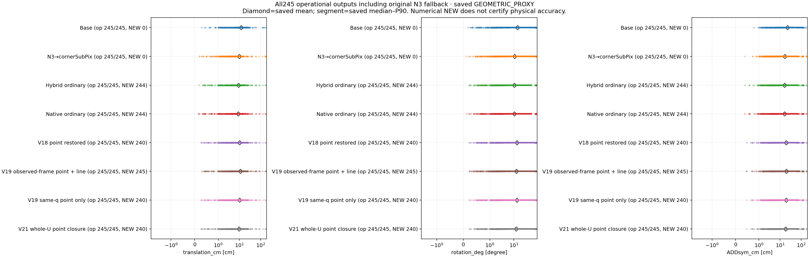
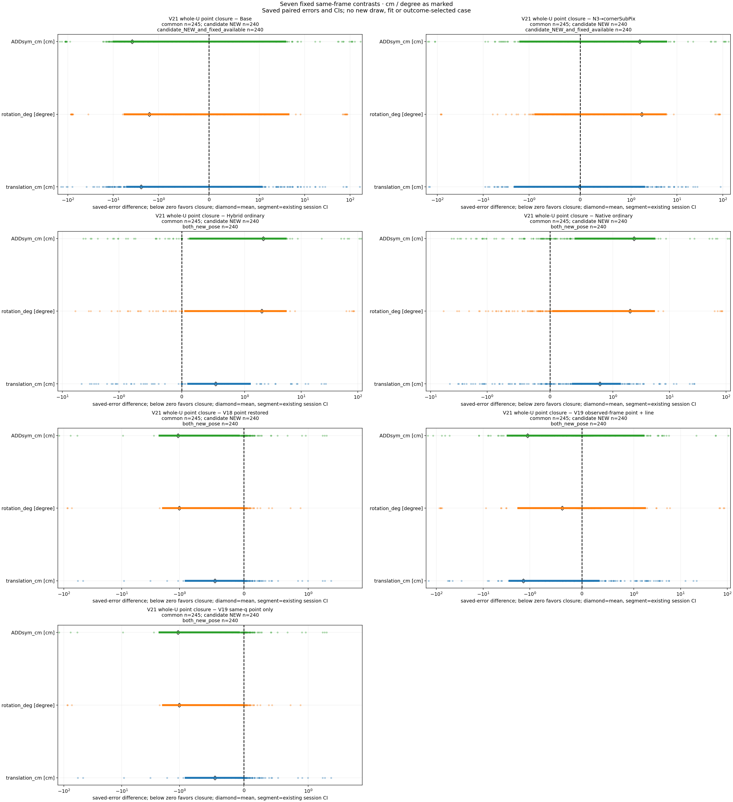
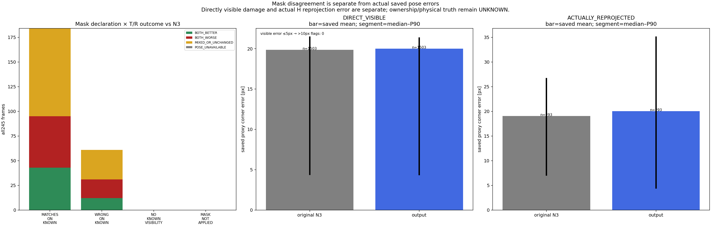
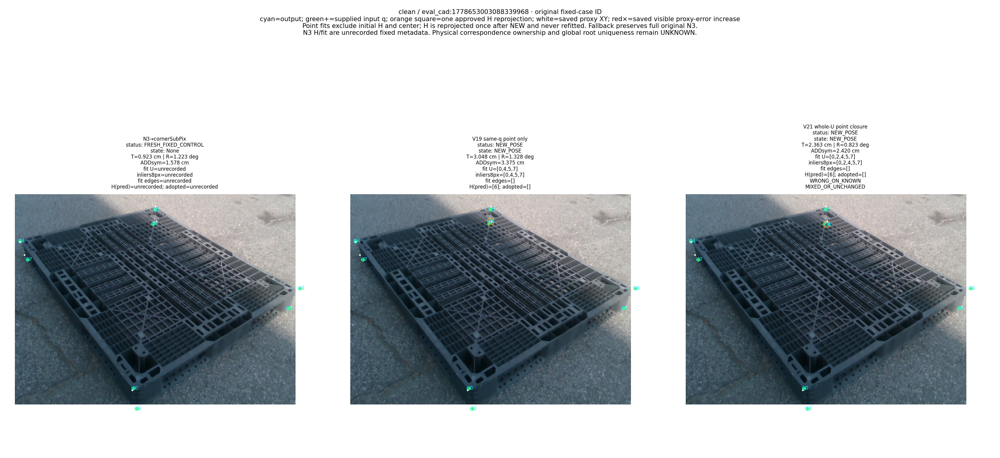
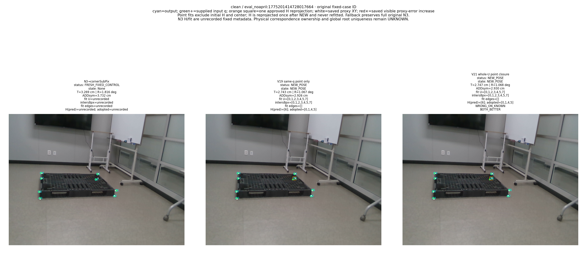
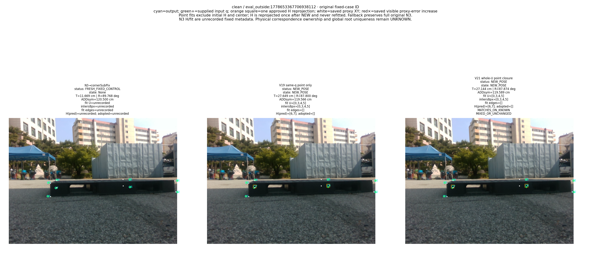
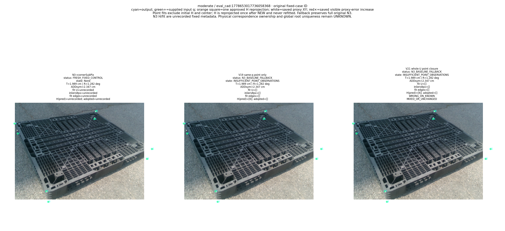
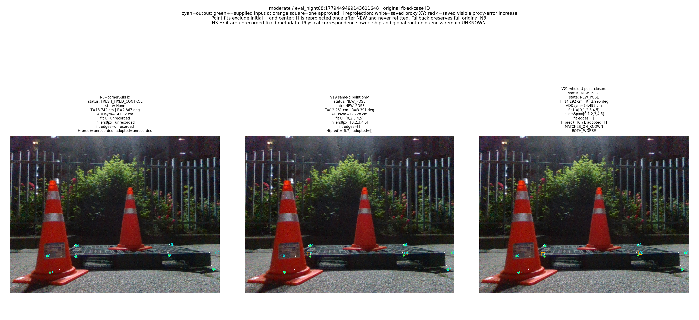
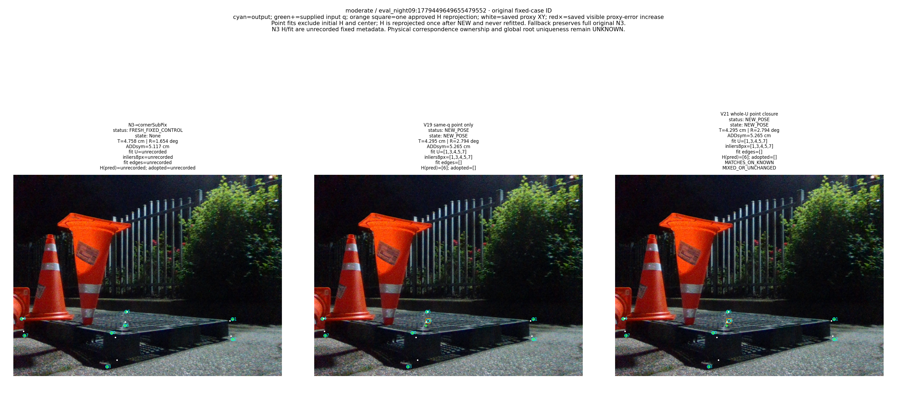

# 가림 판단이 일부 틀려도 다른 유효 대응점으로 자세를 구하고 자기 가림 코너를 재투영했을 때, 기존 단순 대조보다 실제 위치·회전이 좋아졌는가?

**현재 비교 기준에서는 아직 아닙니다.** **현재 known DEV 245장 GEOMETRIC_PROXY 평가 참조 기준**에서 V21 whole-U 점 경로의 전체 평균은 T=9.74569629977874cm, R=12.622491923772069deg, ADDsym=18.58021566159127cm다. N3 대비 T/R 동시 개선=False, 이전 같은 q 점 경로 대비=True, native ordinary 대비=False다. **독립 실측 자세 개선까지 검증한 결과는 아니다.** 목표 성공과 saved arithmetic PASS는 구분한다.

경계 교점 q 자체의 정의가 임의 한 ray 교점을 3D 코너로 넣는 구현은 아니다. 서로 다른 incident edge 두 TLS line의 교점만 해당 native corner q를 만든다. 학습 head의 실제 wire/query 목표와 virtual cuboid corner는 구분하며 실사 physical edge/corner ownership은 UNKNOWN이다. query 의미에서 inherited edge ID, 8px proxy 정합, rank6가 실제 올바른 대응을 독립 인증하지 않는다.

## 무엇을 이미 고쳤고 무엇이 남았나

별도 head 감독에서 **실제 대응이 존재했던2,164 query를 수치광선교차 실패만으로 no_match로 감독한 오류**는 POS/NONE/IGNORE 계약으로 수정했다. 원 감사 시점 수정 후 재학습은0이었고, 이후 별도 승인으로 수정 감독3×3000=9000 학습을 완료했다. 원 pre-fix IMAGE_ROLE0/319는 현재245 성능이 아니다. main N3를 바꾼 오류가 아니며 이번 새 학습은0이다. [실제 감독 수정 기록](../pallet_kp_corrected_supervision_20261010_v1/RESULT_KO.md).

V18의161 extra veto 제거는 서로 다른 cost의 viable 해까지 ambiguity로 막던 결정정책 복원이다. 실제 numerical tie1과 관측/기하 부족4는 유지했다. 원 V16 전체198134007검사 중564FAIL은 모두 선 경로이며 원 FAIL로 보존한다. point-only 실패 predicate0은 전체 point 산술검사 횟수나 물리 정확성 인증을 뜻하지 않는다.

LOO는 H∪{k}를 실제 fit에서 제외하고 native²−candidate²의 strict gain과 기존8px를 검사한다. q/H는 ordinary hybrid·V18 restored·V19 line/point·V21 closure 다섯 hybrid 후단에서 동일하다. Native ordinary는 원 native N3 q이고 fixed Base/N3의 H/fit은 unrecorded다. 승인 NEW에서만 H를 최종 fit/관측에서 제외하고 최종 자세로 한 번 재투영하며 다시 fit하지 않는다. fallback은 원 all8 N3 산출이다. 마스크가 완벽하지 않아도 충분한 유효 관측과 실제 배치가 남으면 풀어야 한다.

V21은 원 raw4/refit/cache 후보와 count→SSE→dimension→start 결정 규칙을 유지하면서 live whole-U ordinary 후보를 고정적으로 추가했다. 성능을 보고 threshold·seed·학습·case를 바꾼 반복은 아니다. 동일 q의 pixel SSE 비악화가 proxy T/R 비악화를 보장하지 않는 부분은 실제 V22 routing 진단으로 구분했다. [전체245 routing 및 frame IDs](../pallet_consensus_routing_20261011_v22/audit_labels_ready/SUMMARY.json).

| 확인할 코드 | 실제 역할 |
| --- | --- |
| [V2 observations.py](../../../scripts/research/pallet_boundary_corner_refiner_20261010_v2/observations.py#L147) | 각 native corner의 서로 다른 incident TLS line 교점 q |
| [V4 selection.py](../../../scripts/research/pallet_cornerwise_independent_20261010_v4/selection.py#L130) | H∪k 제외한 held-out native/candidate 비교와 strict gain |
| [V21 solver.py](../../../scripts/research/pallet_whole_u_closure_20261011_v21/solver.py#L149) | 고정 whole-U ordinary coverage 추가·원 count/SSE 순위·실제fit guard |
| [V21 pipeline.py](../../../scripts/research/pallet_whole_u_closure_20261011_v21/pipeline.py#L82) | 동일 q/H·승인 NEW의 최종H 투영·원 fallback 보존 |
| [V21 evaluate.py](../../../scripts/research/pallet_whole_u_closure_20261011_v21/evaluate.py) | full245 proxy 오류와 공통집합·고정13session bootstrap |

## 전체245·Clean153·Moderate92

원319는 Clean153+Moderate92+Severe74이며, 현재 Severe74는 원 요청 범위에서 제외했다. 아래 NEW/fallback 분모와 평균은 모든245/153/92를 유지한다. Tcm/Rdeg/ADDsym cm 각각 평균·모집단SD(ddof0)·중앙값·P90이며, 표본분산/SD(ddof1)·최대·공통NEW·전체189CI는 [FULL_AUDIT_KO.md](FULL_AUDIT_KO.md)에 있다. fixed controls는 NEW가 아니다.

| 층 | 방법 | NEW | fallback | T평균 | T SD0 | T중앙 | T P90 | R평균 | R SD0 | R중앙 | R P90 | ADD평균 | ADD SD0 | ADD중앙 | ADD P90 |
| --- | --- | --- | --- | --- | --- | --- | --- | --- | --- | --- | --- | --- | --- | --- | --- |
| combined | Base | 0 | 0 | 12.188351368308584 | 23.159896047350692 | 6.010803220063387 | 23.191871672208148 | 14.232844378136992 | 29.118879063903037 | 1.839738412238616 | 82.81063875160255 | 22.431945806117554 | 38.72796479251019 | 6.405062242563096 | 110.03653211262429 |
| combined | N3→cornerSubPix | 0 | 0 | 9.754548028679153 | 23.94964018212377 | 3.5973495042103814 | 15.085014302122275 | 10.914841863166323 | 25.738406674272355 | 1.6659926895050734 | 76.09532476401336 | 17.028646667097725 | 35.96539450075627 | 3.9369354820060027 | 68.43149389306842 |
| combined | Hybrid ordinary | 244 | 1 | 9.207153885736464 | 20.25164686372 | 3.833791005398134 | 18.961934042295727 | 10.613463948751368 | 25.212431830952884 | 1.6895907031155688 | 54.711582265606815 | 16.43968649819084 | 33.974184871781915 | 4.01117015219868 | 66.939841321056 |
| combined | Native ordinary | 244 | 1 | 8.951574173959987 | 20.087170118303078 | 3.833791005398134 | 18.961934042295727 | 10.61763914609911 | 25.211910641293503 | 1.6251166578679208 | 54.711582265606815 | 16.21154786029048 | 33.921249255625696 | 4.030611805010867 | 66.939841321056 |
| combined | V18 결정 복원 점 | 240 | 5 | 10.19473418899381 | 20.837455351730483 | 4.022035860009537 | 23.89893802504458 | 13.639332540977922 | 28.55557317507577 | 1.8407813566013058 | 82.4214587475194 | 19.646391027436795 | 36.50287175587624 | 4.252522316050203 | 74.0688172324972 |
| combined | V19 관측선 | 245 | 0 | 11.127270098939297 | 23.654334636349784 | 4.075487426777011 | 23.326045661123015 | 12.999761480600135 | 27.928185290431845 | 1.8116524647678964 | 82.46496091493763 | 19.702729530699724 | 37.386479444295794 | 4.554736029677354 | 79.0513622208983 |
| combined | V19 같은 q 점 | 240 | 5 | 10.19473418899381 | 20.837455351730483 | 4.022035860009537 | 23.89893802504458 | 13.639332540977922 | 28.55557317507577 | 1.8407813566013058 | 82.4214587475194 | 19.646391027436795 | 36.50287175587624 | 4.252522316050203 | 74.0688172324972 |
| combined | V21 whole-U 점 | 240 | 5 | 9.74569629977874 | 20.38013492572575 | 3.9556227987545074 | 23.03176836530042 | 12.622491923772069 | 27.42804097371084 | 1.8216563780872383 | 80.74584084264255 | 18.58021566159127 | 35.557134413709036 | 4.222356513679502 | 71.69264766574959 |
| easy | Base | 0 | 0 | 12.846348362759484 | 28.02293851916571 | 4.668213987688899 | 19.836603231600556 | 10.628204608338502 | 24.75064780623126 | 1.715555635657884 | 50.873618630439076 | 17.93860487754294 | 35.50482376174502 | 5.5161632734927135 | 53.33233728654386 |
| easy | N3→cornerSubPix | 0 | 0 | 10.107072506393136 | 29.224961964283242 | 2.6918845473520725 | 12.762645595341315 | 7.584578376689015 | 20.801391397665313 | 1.5416520299079417 | 5.923153455782191 | 12.915132447282565 | 33.5141024873849 | 2.966195228583507 | 14.83116901630595 |
| easy | Hybrid ordinary | 153 | 0 | 8.429226656804744 | 23.097837148151864 | 2.7737384667261553 | 13.132737807431784 | 6.468994812647887 | 18.62899941483908 | 1.4446440987210218 | 5.6585114616544905 | 11.008250749784743 | 27.94633833381599 | 3.0995737745137397 | 14.578469398220822 |
| easy | Native ordinary | 153 | 0 | 8.283471071855557 | 23.1274136653163 | 2.7636728929599297 | 13.132737807431784 | 6.466523899060526 | 18.62800525788539 | 1.3906174634895643 | 5.6585114616544905 | 10.884012479374642 | 27.976150093087636 | 3.001498132178273 | 14.578469398220822 |
| easy | V18 결정 복원 점 | 152 | 1 | 9.29150872342711 | 23.604000950697962 | 3.004470549016578 | 16.159344551876078 | 8.177492819401836 | 21.666124280195575 | 1.662679586451505 | 7.681457945490692 | 12.58663177800136 | 29.330461708612006 | 3.358459163043675 | 20.9003199195624 |
| easy | V19 관측선 | 153 | 0 | 10.367104455604135 | 26.80464405563565 | 3.3654395691986743 | 14.70183694831296 | 8.571860104230232 | 22.305743038255812 | 1.6344908812418553 | 7.814294111832614 | 13.36132396775967 | 31.17572160540527 | 3.6755268041290075 | 19.27362799837066 |
| easy | V19 같은 q 점 | 152 | 1 | 9.29150872342711 | 23.604000950697962 | 3.004470549016578 | 16.159344551876078 | 8.177492819401836 | 21.666124280195575 | 1.662679586451505 | 7.681457945490692 | 12.58663177800136 | 29.330461708612006 | 3.358459163043675 | 20.9003199195624 |
| easy | V21 whole-U 점 | 152 | 1 | 8.869345500074164 | 23.169206572424216 | 3.0193003568491745 | 15.470481318620445 | 7.592946508486327 | 20.653796701498813 | 1.5404225406292353 | 6.925378733633307 | 12.031140823243735 | 28.767066628488077 | 3.318847720610227 | 16.93773049252526 |
| medium | Base | 0 | 0 | 11.094073757971767 | 10.978371464687656 | 7.851389680650634 | 26.036088792108245 | 20.227517038780135 | 34.37590306761442 | 1.9987798847057285 | 86.1592126325831 | 29.904567132986195 | 42.52461055172781 | 8.14224175976533 | 116.22280336782391 |
| medium | N3→cornerSubPix | 0 | 0 | 9.168284495089601 | 10.321305377110395 | 5.220474363250011 | 23.637317402450154 | 16.45321483524272 | 31.550933849510084 | 1.981300412332817 | 85.51015694788309 | 23.86959966309468 | 38.753207412074005 | 5.436086461145542 | 112.13137378003826 |
| medium | Hybrid ordinary | 91 | 1 | 10.500880690372911 | 14.221859165788828 | 4.9173006906801975 | 24.174339477890623 | 17.50589631640172 | 32.24275170267528 | 2.014381648042667 | 85.91110941584948 | 25.472400297170555 | 40.55023289523427 | 5.47287559827952 | 113.53662428837377 |
| medium | Native ordinary | 91 | 1 | 10.062658680720613 | 13.528568584776659 | 4.805310042326136 | 24.03199182662523 | 17.521124285195885 | 32.23883491256851 | 2.0379616688347344 | 85.91110941584948 | 25.0714708307266 | 40.45897149860737 | 5.461603234484565 | 113.54220078104109 |
| medium | V18 결정 복원 점 | 88 | 4 | 11.696837408903642 | 15.037168501101196 | 6.159331862182418 | 25.056568678498838 | 22.722609469251196 | 35.47839029226706 | 2.427880773734963 | 86.89031463609365 | 31.387077605302242 | 43.55446549683696 | 6.8776635018589225 | 116.02546691042821 |
| medium | V19 관측선 | 92 | 0 | 12.391458614485815 | 17.105808052460876 | 5.795510572588487 | 24.70954344431566 | 20.363553986954425 | 34.100697324350854 | 2.2188543304078143 | 86.80516945898695 | 30.248762695154383 | 43.906900345436384 | 6.27926862634191 | 117.25417753759004 |
| medium | V19 같은 q 점 | 88 | 4 | 11.696837408903642 | 15.037168501101196 | 6.159331862182418 | 25.056568678498838 | 22.722609469251196 | 35.47839029226706 | 2.427880773734963 | 86.89031463609365 | 31.387077605302242 | 43.55446549683696 | 6.8776635018589225 | 116.02546691042821 |
| medium | V21 whole-U 점 | 88 | 4 | 11.203105781896125 | 14.489709444135807 | 5.128027399976373 | 24.209954581315028 | 20.98684462527988 | 34.37949284259765 | 2.448319655210295 | 86.40124522747433 | 29.47161186014749 | 42.43488013697756 | 6.605717988656707 | 114.77363988243636 |

현재 primary 전체 상태: {"denominator":245,"operational":245,"NEW":240,"fallback":5,"failure":0,"states":{"NEW_POSE":240,"N3_BASELINE_FALLBACK":5}}. 큰 오차를 완전 실패로 빼거나 NEW만 전체평균인 것처럼 쓰지 않았다.

## 같은 frame에서 T/R/ADD 차이와 CI

앞−뒤 음수는 개선이다. 아래는 combined/common_operational이다. 모든 CI가0을 가로지른다고 일반화하지 않고 각 저장 CI를 그대로 표시한다. 후보NEW·양측NEW·층별63 paired groups/189CI의 서로 다른 분모와 frame IDs는 전체 부록에서 확인한다.

| 층 | 차이 | scope | 지표 | 공통 n | 평균차 | 95% CI | 유효 resamples | 빈 resamples | 단위 |
| --- | --- | --- | --- | --- | --- | --- | --- | --- | --- |
| combined | HYBRID_POINT_CONSENSUS_WHOLE_U_CLOSURE_minus_BASE | common_operational | translation_cm | 245 | -2.4426550685298474 | [-4.935357950313867,1.1140104549415606] | 10000 | 0 | cm |
| combined | HYBRID_POINT_CONSENSUS_WHOLE_U_CLOSURE_minus_BASE | common_operational | rotation_deg | 245 | -1.6103524543649224 | [-5.602499655698845,4.409873788012355] | 10000 | 0 | degree |
| combined | HYBRID_POINT_CONSENSUS_WHOLE_U_CLOSURE_minus_BASE | common_operational | ADDsym_cm | 245 | -3.851730144526288 | [-9.823914233966144,3.7389333291575615] | 10000 | 0 | cm |
| combined | HYBRID_POINT_CONSENSUS_WHOLE_U_CLOSURE_minus_N3_SUBPIX | common_operational | translation_cm | 245 | -0.008851728900417107 | [-2.0561988771664557,1.9225483899705236] | 10000 | 0 | cm |
| combined | HYBRID_POINT_CONSENSUS_WHOLE_U_CLOSURE_minus_N3_SUBPIX | common_operational | rotation_deg | 245 | 1.7076500606057454 | [-0.8762295972396853,5.67902417122921] | 10000 | 0 | degree |
| combined | HYBRID_POINT_CONSENSUS_WHOLE_U_CLOSURE_minus_N3_SUBPIX | common_operational | ADDsym_cm | 245 | 1.551568994493541 | [-1.5593763994082201,5.809433627695063] | 10000 | 0 | cm |
| combined | HYBRID_POINT_CONSENSUS_WHOLE_U_CLOSURE_minus_HYBRID_STANDARD_PNP | common_operational | translation_cm | 245 | 0.5385424140422741 | [0.10376910149726222,1.2410276657223507] | 10000 | 0 | cm |
| combined | HYBRID_POINT_CONSENSUS_WHOLE_U_CLOSURE_minus_HYBRID_STANDARD_PNP | common_operational | rotation_deg | 245 | 2.009027975020701 | [0.05645028751776822,5.337208608434177] | 10000 | 0 | degree |
| combined | HYBRID_POINT_CONSENSUS_WHOLE_U_CLOSURE_minus_HYBRID_STANDARD_PNP | common_operational | ADDsym_cm | 245 | 2.1405291634004207 | [0.1351650757918298,5.314425680898893] | 10000 | 0 | cm |
| combined | HYBRID_POINT_CONSENSUS_WHOLE_U_CLOSURE_minus_NATIVE_STANDARD_PNP | common_operational | translation_cm | 245 | 0.794122125818752 | [0.36599872107931586,1.3323699176637405] | 10000 | 0 | cm |
| combined | HYBRID_POINT_CONSENSUS_WHOLE_U_CLOSURE_minus_NATIVE_STANDARD_PNP | common_operational | rotation_deg | 245 | 2.0048527776729586 | [0.05356376677428736,5.349310555547125] | 10000 | 0 | degree |
| combined | HYBRID_POINT_CONSENSUS_WHOLE_U_CLOSURE_minus_NATIVE_STANDARD_PNP | common_operational | ADDsym_cm | 245 | 2.3686678013007865 | [0.4068334231840637,5.371868551703413] | 10000 | 0 | cm |
| combined | HYBRID_POINT_CONSENSUS_WHOLE_U_CLOSURE_minus_HYBRID_POINT_CONSENSUS_RESTORED | common_operational | translation_cm | 245 | -0.4490378892150717 | [-0.9060474437639369,-0.008684034419797357] | 10000 | 0 | cm |
| combined | HYBRID_POINT_CONSENSUS_WHOLE_U_CLOSURE_minus_HYBRID_POINT_CONSENSUS_RESTORED | common_operational | rotation_deg | 245 | -1.0168406172058515 | [-1.936343300313042,-0.012448649846798865] | 10000 | 0 | degree |
| combined | HYBRID_POINT_CONSENSUS_WHOLE_U_CLOSURE_minus_HYBRID_POINT_CONSENSUS_RESTORED | common_operational | ADDsym_cm | 245 | -1.0661753658455284 | [-2.2197495242343317,-0.07891065091609867] | 10000 | 0 | cm |
| combined | HYBRID_POINT_CONSENSUS_WHOLE_U_CLOSURE_minus_HYBRID_OBSERVED_FRAME_FACTOR_SUBSET_CONSENSUS | common_operational | translation_cm | 245 | -1.381573799160559 | [-2.7150766141408442,0.3230970225462669] | 10000 | 0 | cm |
| combined | HYBRID_POINT_CONSENSUS_WHOLE_U_CLOSURE_minus_HYBRID_OBSERVED_FRAME_FACTOR_SUBSET_CONSENSUS | common_operational | rotation_deg | 245 | -0.377269556828066 | [-1.7699581454351738,1.738747242895996] | 10000 | 0 | degree |
| combined | HYBRID_POINT_CONSENSUS_WHOLE_U_CLOSURE_minus_HYBRID_OBSERVED_FRAME_FACTOR_SUBSET_CONSENSUS | common_operational | ADDsym_cm | 245 | -1.1225138691084569 | [-3.015455402805053,1.6211385395895883] | 10000 | 0 | cm |
| combined | HYBRID_POINT_CONSENSUS_WHOLE_U_CLOSURE_minus_HYBRID_OBSERVED_FRAME_POINT_ONLY | common_operational | translation_cm | 245 | -0.4490378892150717 | [-0.9060474437639369,-0.008684034419797357] | 10000 | 0 | cm |
| combined | HYBRID_POINT_CONSENSUS_WHOLE_U_CLOSURE_minus_HYBRID_OBSERVED_FRAME_POINT_ONLY | common_operational | rotation_deg | 245 | -1.0168406172058515 | [-1.936343300313042,-0.012448649846798865] | 10000 | 0 | degree |
| combined | HYBRID_POINT_CONSENSUS_WHOLE_U_CLOSURE_minus_HYBRID_OBSERVED_FRAME_POINT_ONLY | common_operational | ADDsym_cm | 245 | -1.0661753658455284 | [-2.2197495242343317,-0.07891065091609867] | 10000 | 0 | cm |

## 마스크 오류와 남은 올바른 관측

UNKNOWN/UNANNOTATED는 새 의미상 known mask 비교에서 제외한다. 기존 legacy mask audit은 별도 보존한다. CORRECT_WITHIN8PX는 저장 GEOMETRIC_PROXY의 수치 품질이며 physical truth가 아니다. DIRECT_VISIBLE와 proxy≤8px의 교집합도 독립 physical ownership 인증이 아니다.

| 마스크 상태 | N3 대비 실제 T/R | n | NEW | fallback |
| --- | --- | --- | --- | --- |
| WRONG_ON_KNOWN | BOTH_BETTER | 12 | 12 | 0 |
| WRONG_ON_KNOWN | BOTH_WORSE | 19 | 19 | 0 |
| WRONG_ON_KNOWN | MIXED_OR_UNCHANGED | 30 | 28 | 2 |
| WRONG_ON_KNOWN | POSE_UNAVAILABLE | 0 | 0 | 0 |
| MATCHES_ON_KNOWN | BOTH_BETTER | 43 | 43 | 0 |
| MATCHES_ON_KNOWN | BOTH_WORSE | 52 | 52 | 0 |
| MATCHES_ON_KNOWN | MIXED_OR_UNCHANGED | 89 | 86 | 3 |
| MATCHES_ON_KNOWN | POSE_UNAVAILABLE | 0 | 0 | 0 |
| MASK_NOT_APPLIED | BOTH_BETTER | 0 | 0 | 0 |
| MASK_NOT_APPLIED | BOTH_WORSE | 0 | 0 | 0 |
| MASK_NOT_APPLIED | MIXED_OR_UNCHANGED | 0 | 0 | 0 |
| MASK_NOT_APPLIED | POSE_UNAVAILABLE | 0 | 0 | 0 |
| NO_KNOWN_VISIBILITY | BOTH_BETTER | 0 | 0 | 0 |
| NO_KNOWN_VISIBILITY | BOTH_WORSE | 0 | 0 | 0 |
| NO_KNOWN_VISIBILITY | MIXED_OR_UNCHANGED | 0 | 0 | 0 |
| NO_KNOWN_VISIBILITY | POSE_UNAVAILABLE | 0 | 0 | 0 |

eligible/solver_used/승인 fit/승인 final inlier의 전체 ID·GOOD/BAD/UNKNOWN·DIRECT_VISIBLE proxy GOOD 수, 잘못 남긴 head q, 실제 fit 배치·저장 rank/spectrum은 [FULL_AUDIT_KO.md](FULL_AUDIT_KO.md)에 모두 전사했다. rank6/weak 통과와 전역 유일해·정확한 semantic 대응은 별개다.

## 직접 가시점 손상과 H

직접 손상은 저장 N3≤5px→output>10px flag다. SELF_OCCLUDED와 실제 H재투영에 이 flag가 없는 None을 새 측정0으로 해석하지 않는다. H 점의 오차 개선만으로 R,t 개선이라고 결론내리지 않는다.

| 집합 | 단계 | 코너 | 직접 손상 flag | n | 평균 px | 표본SD | 중앙값 | P90 |
| --- | --- | --- | --- | --- | --- | --- | --- | --- |
| DIRECT_VISIBLE | N3 | 1503 | 0 | 1503 | 19.853023651037 | 59.84006114853046 | 4.4280440607544715 | 21.434210641657124 |
| DIRECT_VISIBLE | input | 1503 | 0 | 1503 | 19.83352887417372 | 59.846125321110705 | 4.401487285451598 | 21.32859221313023 |
| DIRECT_VISIBLE | output | 1503 | 0 | 1503 | 19.989966422265926 | 60.822090247953525 | 4.400291370331489 | 21.32859221313023 |
| SELF_OCCLUDED | N3 | 335 | None | 335 | 19.65428204564917 | 51.30622600442482 | 7.06713621098236 | 26.523561830776252 |
| SELF_OCCLUDED | input | 335 | None | 335 | 19.65428204564917 | 51.30622600442482 | 7.06713621098236 | 26.523561830776252 |
| SELF_OCCLUDED | output | 335 | None | 335 | 19.88791278152176 | 53.43775597666201 | 4.576360624682459 | 30.028663963681158 |
| ACTUALLY_REPROJECTED | N3 | 293 | None | 293 | 19.031876714653993 | 46.11641825020251 | 7.06713621098236 | 26.605056812052325 |
| ACTUALLY_REPROJECTED | input | 293 | None | 293 | 19.031876714653993 | 46.11641825020251 | 7.06713621098236 | 26.605056812052325 |
| ACTUALLY_REPROJECTED | output | 293 | None | 293 | 20.051182899307225 | 54.653888319179345 | 4.456278245022988 | 35.03411844239292 |

## 고정 합성 stress9: 자연 solver의 별도 검사

잘못 제외한 GOOD와 남긴 BAD를 독립적으로 조합하고 같은 실제 solver를 호출한 고정9fixture다. synthetic analytic truth는 원 실사 독립 물리 GT가 아니다. contract PASS는 모든 fixture의 NEW나 실사 자세 성공을 뜻하지 않는다. fallback을 공급하지 않아 typed 부족/퇴화도 그대로 남겼다.

| fixture | 잘못 제외GOOD H | 남긴BAD | 남은GOOD | NEW | state | 실제fit | 최종inliers | synthetic T/R/ADD | 계약오류 |
| --- | --- | --- | --- | --- | --- | --- | --- | --- | --- |
| BASE_CORRECT_8 | [] | [] | 8 | True | NEW_POSE | [0,1,2,3,4,5,6,7] | [0,1,2,3,4,5,6,7] | {"translation_cm":0.04360692915712735,"rotation_deg":0.044846337909414696,"ADDsym_cm":0.05832198840890839,"ADDsym_sample_count":8,"reference":"ANALYTIC_SYNTHETIC_CUBOID_Rt","units":{"translation":"cm","rotation":"degree","ADDsym":"cm"}} | [] |
| GOOD_WRONGLY_REMOVED_1 | [7] | [] | 7 | True | NEW_POSE | [0,1,2,3,4,5,6] | [0,1,2,3,4,5,6] | {"translation_cm":0.1066387300326981,"rotation_deg":0.056823179932063664,"ADDsym_cm":0.1180681631320201,"ADDsym_sample_count":8,"reference":"ANALYTIC_SYNTHETIC_CUBOID_Rt","units":{"translation":"cm","rotation":"degree","ADDsym":"cm"}} | [] |
| GOOD_WRONGLY_REMOVED_2 | [6,7] | [] | 6 | True | NEW_POSE | [0,1,2,3,4,5] | [0,1,2,3,4,5] | {"translation_cm":0.11287108213681205,"rotation_deg":0.07848831373162696,"ADDsym_cm":0.13112889118465756,"ADDsym_sample_count":8,"reference":"ANALYTIC_SYNTHETIC_CUBOID_Rt","units":{"translation":"cm","rotation":"degree","ADDsym":"cm"}} | [] |
| BAD_RETAINED_1 | [] | [2] | 7 | True | NEW_POSE | [0,1,3,4,5,6,7] | [0,1,3,4,5,6,7] | {"translation_cm":0.21718499103856836,"rotation_deg":0.045611201648706766,"ADDsym_cm":0.22118983182364277,"ADDsym_sample_count":8,"reference":"ANALYTIC_SYNTHETIC_CUBOID_Rt","units":{"translation":"cm","rotation":"degree","ADDsym":"cm"}} | [] |
| BAD_RETAINED_2 | [] | [2,5] | 6 | True | NEW_POSE | [0,1,3,4,6,7] | [0,1,3,4,6,7] | {"translation_cm":0.15013256572333944,"rotation_deg":0.03873984633372943,"ADDsym_cm":0.15438089518235337,"ADDsym_sample_count":8,"reference":"ANALYTIC_SYNTHETIC_CUBOID_Rt","units":{"translation":"cm","rotation":"degree","ADDsym":"cm"}} | [] |
| BOTH_ERRORS_1 | [7] | [2] | 6 | True | NEW_POSE | [0,1,3,4,5,6] | [0,1,3,4,5,6] | {"translation_cm":0.3293312682936413,"rotation_deg":0.06924185698363422,"ADDsym_cm":0.3354798230463075,"ADDsym_sample_count":8,"reference":"ANALYTIC_SYNTHETIC_CUBOID_Rt","units":{"translation":"cm","rotation":"degree","ADDsym":"cm"}} | [] |
| BOTH_ERRORS_2 | [6,7] | [2,5] | 4 | True | NEW_POSE | [0,1,3,4] | [0,1,3,4] | {"translation_cm":0.34588091844040153,"rotation_deg":0.07467000334977071,"ADDsym_cm":0.3522602859045829,"ADDsym_sample_count":8,"reference":"ANALYTIC_SYNTHETIC_CUBOID_Rt","units":{"translation":"cm","rotation":"degree","ADDsym":"cm"}} | [] |
| INSUFFICIENT_U3 | [3,4,5,6,7] | [] | 3 | False | INSUFFICIENT_POINT_OBSERVATIONS | [] | [] | None | [] |
| IMAGE_COLLINEAR_U4 | [4,5,6,7] | [0,1,2,3] | 0 | False | DEGENERATE_POINT_OBSERVATIONS | [] | [] | None | [] |

## V22: 후보 coverage와 실제 출력 routing

아래 membership/readout은 이미 저장된 자세·error에서 독립 전사/진단한 값이다. routing조건부 평균은 새 전체 성능·새CI가 아니다. accepted와 selected winner, stored best와 승인 NEW를 구분한다.

| routing | frame n |
| --- | --- |
| CLOSURE_SELECTED_STORED_BEST | 185 |
| NO_STANDARD_CLOSURE_ATTEMPT | 1 |
| ALL_STANDARD_CANDIDATES_REJECTED | 59 |

| ordinary branch 판정 | frame n |
| --- | --- |
| ORDINARY_BRANCH_ADMITTED | 181 |
| NO_ORDINARY_STORED_BEST | 1 |
| ORDINARY_BRANCH_REJECTED | 63 |

첫 V22 실행은 exit137로 종료됐으며 원 PROTOCOL/STARTED/exit note를 보존했다. full actual_pose packet을 오래 보유하는 source 메모리 배치를 바꾼 ready는4개 AST영역 역변환 동일성으로 분리했다. 실제 exit137 원인은 확정하지 않으며 새 pose·ranking·gate·summary 식·threshold를 바꾼 수정이 아니다.

## 실제150회 전체 경로 시간

detector→N3/cornerSubPix→initial N3·Base feature pose→고정 IMAGE_ROLE/CAL→corner H∪k LOO→hybrid point/native roots/cache→whole-U 후보·실제 refit/guard→H재투영·metadata 모두 t0–t1 내부다. 모델 로딩·26기존 RGB decode·post-return parity·로그·resources는 제외했다. warm20+measured130, 13session×5repeat 고정패널이다. 첫 predict detector2/나머지149×1과 N3/head150을 실제 계수한다. saved geometry replay elapsed나 단계 평균의 합산은 latency가 아니다.

V21 runtime original status=COMPLETE, statistics_official=True, independent passed=True. V19의150행 cleanup 실패/overallFalse/비공식4374.615ms는 원 기록으로 보존하고 V21의 시간으로 대체하지 않는다.

| 단계 | n | 평균 ms | 표본분산 | 표본SD | 중앙값 | P90 | 최대 |
| --- | --- | --- | --- | --- | --- | --- | --- |
| full | 130 | 565.082049676923 | 68148.25043813194 | 261.0521986847304 | 631.8759924999999 | 891.4437262 | 981.6888 |
| detector | 130 | 11.677550007692307 | 5.68398531523934 | 2.384111011517572 | 10.843359 | 14.999350600000001 | 21.828451 |
| N3_correction | 130 | 4.141809823076923 | 0.3245047123247204 | 0.5696531508951043 | 3.8798085 | 4.9920612 | 6.708938 |
| initial_pose | 130 | 1.4123372076923078 | 0.023037295544537928 | 0.15178041884425647 | 1.3467205 | 1.6547028000000004 | 1.916743 |
| boundary_observation | 130 | 7.851611553846154 | 1.4827731862259699 | 1.217691745158014 | 7.534011 | 9.3377298 | 11.651713 |
| hybrid_selection_and_point_consensus | 130 | 536.0959608615385 | 67899.07787243763 | 260.5745150095029 | 599.956359 | 860.8365847 | 950.958601 |
| final_pose_reprojection_and_metadata | 130 | 0.14627106153846153 | 0.006462863199096959 | 0.08039193491325457 | 0.110268 | 0.22847600000000015 | 0.54616 |
| return | 130 | 3.756509161538461 | 3.3790460267938887 | 1.8382181662669663 | 3.919392 | 5.4571216000000025 | 10.599479 |

## 고정6사례·실제9PNG

3Clean+3Moderate를 결과에 따라 다시 고르지 않았다. ROOT가9PNG/18panel을 실제 열어 가독성을 확인했다. N3의 H(pred)=[] 또는 unrecorded는 실제 가림 없음이나 빈 fit 인증이 아니다. 실제 q·fit·H·NEW/fallback·정밀 raw값은 그대로이며 caption 반올림은 표시만이다. 시각 확인은 physical pose 인증이 아니다.

## 검산 범위와 다음 최소 확인

전체 기하 26418452 checks/FAIL 0, saved 통계783분포/6264필드/63paired/189CI, routing 47580 checks/FAIL 0다. 전체 core 산술과 따로 생성한 proxy pool/diagnostic readout의 검산 범위를 혼동하지 않는다.

현재 남은 문제는 후보 coverage·실제 semantic 대응/배치·pixel objective와 proxy pose의 관계다. 원 관측이 맞아도 imperfect mask 뒤 유효 대응과 관측가능성이 충분하면 풀어야 한다. 저장된 routing별 같은-q ordinary 대비 frame IDs/fit BAD·UNKNOWN·직접가시 GOOD를 먼저 대조해야 하며 현재 수치만으로 head나 가림분류기의 새 학습 필요성을 증명하지 않는다. 기존 무가림 robust 대조는 별도 역사 자료다. P0 외부 가림·비가림 distractor·저대비 네 통제 변형은 별도 미검증이다.

| 역사 대조(전체245) | NEW | fallback | T평균 cm | R평균 deg | ADD평균 cm |
| --- | --- | --- | --- | --- | --- |
| 고정 N3 baseline | None | None | 9.754548 | 10.914842 | 17.028647 |
| V3 N3_BASIN_NO_MASK_ROBUST | 229 | 16 | 9.65211 | 11.01512 | 16.93721 |
| V7 N3_INDEPENDENT_ROBUST_NO_MASK | 244 | 1 | 11.59638 | 13.89985 | 20.51034 |

위 no-mask 값은 [게시된 V3](../pallet_cornerwise_refiner_20261010_v3/RESULT_KO.md) 및 [게시된 V7](../pallet_three_head_observation_20261010_v7/RESULT_KO.md)의 별도 기존 알고리즘·q/model controls다. 현재 V21과 backend·q가 같은 masked/no-mask 인과 대조가 아니며, 이 두 역사값 또는 이번 평균으로 학습 head나 가림분류기의 필요성을 증명하지 않는다.

참조 R,t는 원 annotation XY+K+등록 cuboid에서 재구성한 GEOMETRIC_PROXY다. N3 pose를 정답으로 직접 되먹인 값은 아니지만 annotation에는 unknown/manual_click/pnp_projected가 섞여 전점 독립 사람 클릭·실측 GT가 아니다. N3-phase는 번호 정렬에 조건부다. sourceCAL virtual/native348corner 차이도 실사 ownership 인증이 아니다.

전체 부록: [FULL_AUDIT_KO.md](FULL_AUDIT_KO.md). [실제 METRICS](evaluation/METRICS.json) · [독립 통계](statistics_check/STATISTICS_CHECKS.json) · [V22 진단](../pallet_consensus_routing_20261011_v22/audit_labels_ready/CHECKS.json) · [실제 그림 검토](render/ROOT_VISUAL_REVIEW.json). main 변경·새 학습·새RGB·force push를 수행했다는 주장은 없다. 이 report 생성은 공개 복원/portable replay 또는 새 원격 commit 완료 receipt가 아니다.
