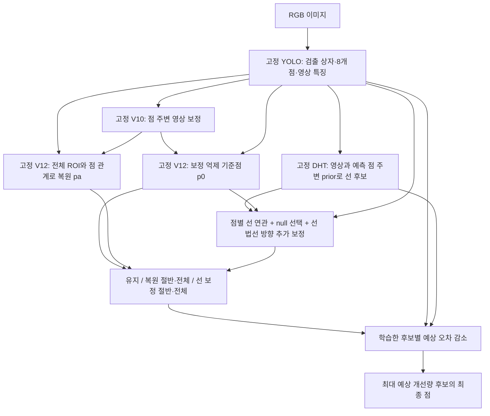

# 최종 후보: 점 유지·복원·선 보정의 학습한 선택

사용자 요청: 최종 아키텍처를 설계·구현하고 기존 방법과 동일 평가 데이터에서 비교한다. 이 문서는 평가 전에 정한 구조다. '최종 후보'는 구현을 완료한 비교 대상이며, 성능 검증을 통과했다는 뜻은 아니다.

## 모듈과 아키텍처 변경 범위

YOLO 내부 구조는 유지한다. YOLO 이후의 보정·복원·선 후보와 평가기를 하나의 추론 그래프로 묶었으므로 전체 예측 아키텍처는 변경된다. 기존 부모 네트워크는 고정하고 최종 평가기만 새로 학습한다. 이번 실행은 YOLO부터 전부 공동 학습하는 실험이 아니다.

`scripts/research/pallet_final_fusion_v14/network14.py`의 `FinalPointLineNetwork`는 YOLO의 관측 특징만 입력으로 받고 위 경로 전체를 실행한다. GT, 조건 이름, 가림 마스크를 받지 않는다. 평가 때 후보를 미리 캐시해서 반복 계산을 줄였으며, 통합 추론과 캐시 평가의 동일성을 별도로 검증한다.

## 후보 생성과 선택

기준점 `p0`는 기존 V12 learned_gate, 복원점 `pa`는 V12 gated_amodal 출력이다. 선 보정 `dl`은 V11 lines_joint의 추가 refiner를 `p0` 주변에서 실행해 얻는다.

후보는 `p0`, `(p0+pa)/2`, `pa`, `p0+dl/2`, `p0+dl`의 다섯 개다. 선 후보는 기존 복원 이동량과 다른 방향을 제안할 수 있다. 점들을 연결해 선 GT를 만들거나 점을 예측 선 위로 무조건 투영하지 않는다. DHT는 영상 특징과 예측 점 주변 prior를 읽으므로 점과 완전히 독립적인 관측도 아니다.

평가기 입력은 각 후보의 주변3×3 영상 특징, 기준 후보와의 특징 차이, 부모 복원기의 전체 ROI 점 문맥, 좌표·이동량·분기 가중치, 점 ID, 후보 ID, 점별 선 연관 요약이다. 선 연관에는 null 경로가 있다. 평가기는 각 후보의 기준 대비 오차 감소를 예측한다. 기준 점수는 정확히0이며 최대 점수 후보를 고르고 동점이면 기준점을 유지한다.

추론에 학습한 선택 연산이 포함되지만 GT 기반 필터나 self-training은 아니다. 평가기는 합성 GT의 실제 후보 오차 감소를 SmoothL1과 후보 선호 손실로 학습한다. 이 값은 보정된 확률이나 성공 보장이 아니다.

## V13 실패를 반영한 학습 분리

V13은 복원기가 이미 학습한 이미지에서 얻은 오차로 평가기를 학습했다. V14의 최종 후보는 부모 보정·복원기 학습에 포함되지 않은 기존 calibration253장을 평가기 학습으로 전환한다. 따라서 이253장은 이제 평가 데이터가 아니다. 원본 ID와 이미지 SHA를 사용해 합성 train/calibration/synth_val 중복을 검사한다. 원본 YOLO 사전학습에서 이 이미지가 제외됐다는 보장은 별도다.

동일253장 규모의 기존 학습 이미지 대조군도 만들고 두 그룹을 모두 동일 YOLO 설정으로 새로 추론한다. 각 그룹에 원본, 중앙 가림20/40%, 잘림20/40%, 코너 가림의6조건을 생성한다. 변형 위치는 예측 상자·점과 고정 SHA로 정하고 GT를 사용하지 않는다.

- insample_fusion: 기존 부모 학습 이미지253장으로 평가기를 학습한다.
- heldout_points: 분리된253장으로 학습하되 선 후보와 선 요약을 제외한다.
- heldout_fusion: 분리된253장과 다섯 후보를 모두 사용한다. 사전에 지정한 최종 후보다.

각3개 시드·2000업데이트·batch16·AdamW3e-4. 두 heldout 대조군의 초기화와 batch 순서는 정확히 같다. 이미지 수와 업데이트 수는 맞추지만 검출 성공 관측 수가 다를 수 있다. 평가기 용량은 동일한 텐서 구조이며 선 없는 대조군의 활성 입력은 적다. V13과는 후보·특징·학습 자료가 함께 바뀌므로 V13 대비 변화 하나만으로 원인을 특정하지 않는다.

## 비교와 채택 기준

합성505장 및 실제297장/9세션/수동 클릭1251점의 기존 평가 모집단을 유지한다. 기존 YOLO, V10 점 보정·방향성 융합, V11 추가 점 보정·DHT 공동학습, V12 억제·복원, V13 후보 평가와 비교한다. 각 방법은 같은 검출 입력·실패·GT ID를 사용한다. 기존 방법 간 과거 학습량이 같다고 주장하지 않는다.

전체 프레임 점 오차, 검출 실패 포함 정규화 오차, 가려진 점·화면 밖 점 오차, PCK5/10, P90, 큰 악화 건수를 보고한다. 실제는9세션을 묶은 대응 bootstrap, 합성은 이미지 단위 bootstrap을 쓴다. 잘림 경계의 reflect100 padding은 기존 방법과 동일하게 유지한다.

사전 기준은 세 시드 모두 원본 및 약한 잘림에서 V12 억제 기준보다1% 넘게 악화하지 않고, 코너 가림·심한 잘림에서 기존 복원 이득의80% 이상을 유지하는 것이다. 선의 추가 이득은 같은 학습 자료의 점 대조군보다 세 시드 각각1% 이상 좋아지고 세션95% 구간 상한이0 미만일 때 해당 조건에서만 인정한다. 같은 최종 모델에 선을 끄거나 다른 이미지의 선을 넣는 추가 진단도 보고한다.

실제 평가 성적에 따라 체크포인트·임계값·배포 모델을 바꾸지 않는다. 재사용 DEV와 인공 스트레스의 결과이며 자연 가림 일반화, 수동 GT의 무오차, 최종6D 성능을 보장하지 않는다.

결과·HTML·체크포인트·감사 기록: `data/pallet/results/pallet_final_fusion_v14/`.
