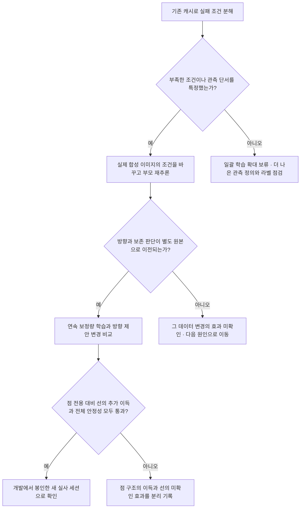

# 다음 실험: 원인 구분부터 구조 변경까지

> **V44 두 검증 완료: 현재 고정 특징·선 후보 보정 연구 계열 종료.** [결과·그림](04_failure_analysis/pallet_fresh_decision_v44.md).

사용자는 반복적인 소형 변형 실험 대신 새 장면의 고정 모델 검증과 학습 밖 예측 감독의 점/선 대조를 요청했고, 두 검증을 수행했다. 아래 과거 실험의 “다음” 항목을 현재 실행 지시로 해석하지 않는다.

- 고정 V41의 작은 평균효과는 새 장면에서 재현됐다. 그러나 매시드1%와 모든조건보존을 만족하지 못했다.
- 부모가 보지 못한 새fit으로 학습한 점+선 보정은 전체평균8.674px로 기준9.058px보다 좋아졌다. 점대조8.767px보다 선 자체의 추가 이득은 CI가0을 포함했고,쉬운잘림층 약1px피해가 남았다.
- 사전 종료 기준에 따라 **같은 고정 특징·후보 위에서 gate/문턱/가중치를 바꾸는 후속 실험을 더 실행하지 않는다.** 결과를 보고 기준을 완화하거나 .1/.3 등의 진단 문턱을 채택하지 않는다.
- 모든 선 융합의 원천적 불가능을 판정한 것은 아니다. 새로운 선 관측이나 학습 표현을 만드는 연구는 별도 가설·평가·예산을 가진 새 과제로 취급한다. 현재 운영 모델을 교체하지 않는다.

새 데이터는 같은 CAD의 독립 장면 그룹이다. 실사/새 CAD 일반화는 평가하지 않았다. 부모 미학습 감독은 새원본을 생성해 확보했으며 동일데이터 OOF 재학습과 다르다. 기존/새 감독 차이에 원본 분포 효과가 포함됨을 유지한다.

## V43 당시 제안 — 새 장면·부모 미학습 예측 대조는 V44에서 완료

> **최신 실행: V43 개선 가능한 유효 후보 학습 검증 완료.** [보고서](04_failure_analysis/pallet_useful_constraint_v43.md). 15분류기·신경망 업데이트0. 목표 수정으로 순위는 개선됐지만 해로운 보정까지 통과해 주판정은 모두 기권했다.

현재 판단: 단순 문턱 조정·양성 비중 증가를 반복할 근거는 부족하다. 아래는 **미실행 범위**다.

1. **효용 감독을 학습 밖 예측으로 구성한다.** 현재 상류 후보·직접 회귀는 학습 그룹을 이미 보았다. 그룹 OOF로 후보와 복귀점을 생성한 감독과 현재 감독을 동일 입력·모델로 비교해, 학습/확인 효용 차이를 줄이는지 확인한다. OOF 분할에서 어느 상류 모델까지 재학습하는지 명시한다. 기존 봉인 실사셋으로 튜닝하지 않는다.
2. **개선 가능성과 피해 크기를 분리한다.** 유효하며1px초과 개선하는 이진 감독은 순위를 높였지만 선택 피해를 억제하지 못했다. 기대 개선량·기대 피해량과 유효성의 관계를 학습 밖 그룹에서 검사한다. 단순 utility head 반복으로 부르지 않도록 V27/V37/V43 대비 변경점과 대조를 사전 고정한다. 기존 후보 자체의 상한도 함께 보며 GT최선 결과는 배포 성능으로 세지 않는다.
3. **새 그룹에서 모델·기준을 고정 검증한다.** V41 작은 실제 효과의 재현과 새 효용 모델의 좋은 점 보존·가림·잘림 개선을 별도 확인한다. 재사용check에서 더 좋은 문턱을 골라 독립 개선이라고 부르지 않는다. 후보 순위와 실제 보정이 함께 확인된 후 신경망 통합을 등록한다.

V43의 .10/.30/.50은 전체 고정격자 중 표시한 진단이다. .30 평균10.390px를 최종 모델로 선택하지 않았다. PCGrad는 현재 고정 특징/효용 감독의 일반화 문제를 직접 해결하는 것으로 검증되지 않았다.

## V42 당시 우선순위 — 개선 후보 목표·비중 대조는 V43에서 완료

> **최신 실행: V42 목표점 제약 유효성 검증 완료.** [보고서](04_failure_analysis/pallet_constraint_validity_v42.md). 18분류기·신경망 업데이트 0. 정밀도는 통과했지만 기존 직접 회귀보다 추가 점 성능이 좋아지지는 않았다.

현재 판단: 유효성 분류는 구성 요소의 가능성을 보였지만 성능 개선 모듈로 채택하지 않는다. 다음은 **미실행 범위**다.

1. **새 그룹에서 기존 효과를 고정 검증한다.** V41 직접 회귀의 약 .5% 효과가 새 합성 장면에서도 재현되는지 모델과 기준을 고정해 확인한다. 재사용 8그룹을 다시 기준 선택에 사용하지 않는다. 새 CAD 일반화는 같은 CAD의 새 장면과 구분한다.
2. **유효하고 개선 가능한 후보를 왜 놓치는지 분리한다.** GT 유효 후보의 개선 기회 78/72/67개가 실제 통과 후 15/11/6개로 줄었다. 큰 오류 조건의 점·역할별 recall, 확률 보정, fit/calibration/check 분포를 구분한다. 재사용 check를 보고 문턱만 낮춰 얻은 결과를 새 검증으로 세지 않는다. 유효성 3px 기준도 기존 점 오차보다 느슨할 수 있으므로 유효성 확률과 예상 피해·이득은 별개로 취급한다.
3. **후보 보존과 유용한 방향 전달이 함께 통과해야 통합한다.** GT 유효 후보 중 최선 10.148px는 실제 달성 성능이 아니다. 실제 입력에서 후보 누락과 순위 손실을 줄이고 가림/잘림/좋은 점 보존이 새 그룹·3시드에서 함께 확인될 때 신경망 통합 실험을 등록한다. 기존 봉인 실사셋으로 튜닝하지 않는다.

현재 실험은 고정 특징 HGB 분류기다. 공동 신경망 손실의 gradient 충돌을 조정하는 PCGrad를 적용한 실험이 아니며, 이번 후보 누락·효용 차이를 gradient surgery로 해결할 수 있다는 증거도 없다.

## V41 당시 우선순위 — 제약 유효성 분류는 V42에서 완료

> **최신 실행: V41 물리 제약 계산·잔차 검증 완료.** [보고서](04_failure_analysis/pallet_constraint_residual_v41.md). 27HGB모델·신경망0. GT선조건이득과실제선의제약오류를분리했다.

현재 판단: 강한 계산+잔차 모듈은 실제입력 기준으로 실패했다. 실제 물리법선후보+직접회귀의작은3시드효과는보존하되 새데이터확인전채택하지않는다. 아래는미실행범위다.

1. **작은 실제 효과를 독립 그룹에서 확인:** 실제직접회귀10.410px의0.39/.61/.52%효과와조건보존이새합성장면에서도재현되는지현재모델/기준을고정해확인한다. 기존재사용8그룹으로하이퍼파라미터를계속고르지않는다. 같은CAD확인과새CAD일반화는별도로표현한다.
2. **점 어려움과 제약 유효성을 분리:** 실제잔차선택피해45건중34건은선택역할의GT가시지원이없었다. 학습할대상은단순선분유무/점어려움이아니라해당역할·목표에유효한물리제약인지다. GT품질거절조차10.423px로효과가작아분류만개선하면8.772px를달성한다고예상하지않는다. coverage/정밀도/선택손실을같이확인해야한다.
3. **새관측의효과가확인될때만통합:** 정확GT물리선8.772px는조건부진단이며배포모델성능아니다. 실제입력에서큰오류보정과좋은점보존이함께검증될때새신경망실험을등록한다. 기존봉인실사셋튜닝은금지한다.

## V40 당시 우선순위 — 제약 전달 개입은 V41에서 완료

> **최신 실행: V40 선분·끝점 대응 검증 완료.** [보고서](04_failure_analysis/pallet_segment_correspondence_v40.md). 30HGB모델·신경망0. 실제 선분 추가의 안정성 실패. 정확한 물리 직선의 부분 효과는 있고 가시 구간 끝점의 추가 이득은 미확인이다.

현재 판단: **단순 선분/끝점 특징 추가 모듈을 채택하지 않는다.** 아래는 미실행 범위이며 새 장기학습을 바로 시작할 근거로 삼지 않는다.

1. **끝점의 의미를 구분해야 한다.** V40의 가시 지원 양끝은 접합점이 아니며 큰 오류의 목표 꼭짓점과 중앙54~56px 차이가 났다. 실제 모서리 접합점·가림 종단·화면 절단을 구분할 관측/감독이 가능한지 먼저 확인한다. 현재 GT끝점 실패로 모든 endpoint 구조를 부정할 수 없다.
2. **물리 제약 전달과 예측 정밀도를 분리한다.** 정확한 물리 직선의 제약을 직접 계산하는 진단은 현재 회귀보다 좋았지만 비배포 GT조건이었다. 기존V30/V35투영을 반복하는 것만으로 해결되지 않는다. 실제 역할/방향 신뢰도를 가진 제약에서 어떤 이동성분이 관측 가능한지와 좋은 점 피해를 함께 검증해야 한다.
3. **새 장면 그룹의 검사에 통과할 때만 통합한다.** 현재 동일2CAD/재사용8그룹으로 안정적 실사 향상을 주장하지 않는다. 실제 입력만으로 보정 방향·크기와 선택 피해율이 개선되고 가림/잘림/3시드 기준을 통과할 때 별도 신경망 구조 실험을 등록한다. 기존 봉인 실사셋 튜닝은 금지한다.

## V39 당시 우선순위 — 선분 대응 정보 개입은 V40에서 완료

> **최신 실행: V39 큰 오류 방향·크기 식별 검증 완료.** [보고서](04_failure_analysis/pallet_hard_direction_v39.md). 48HGB모델·신경망0. 큰 오류 식별 신호는 있으나 방향 예측의 그룹 간 전달과 실제10.463→10.484px 안정성은 실패했다.

현재 다음 판단 — 아래는 **미실행 제안**이다.

1. **새로운 관측 정보의 효과를 먼저 분리:** 같은 점·선 특징의 비중이나 gate만 재조정하지 않는다. 목표 꼭짓점과 실제 가시 선 구간/끝점의 대응을 알려주는 관측을 추가했을 때 법선 부호·크기 예측이 좋아지는지 대조한다. GT 대응은 비배포 진단으로 따로 두고 실제 예측 대응과 비교해야 한다. 단순 점 번호 혼동만으로 대부분의 큰 오류를 설명할 근거는 없었다.
2. **관측 가능한 방향과 복원을 구분:** 하나의 선으로 알 수 없는 접선 방향은 별도 영상 문맥이나 다른 시점/시간 정보가 필요하다. 먼저 데이터 확보 가능성을 확인한다. 두 독립 방향이 있어도 실제 예측 오차가 남을 수 있으므로 관측 수만으로 성공을 판정하지 않는다.
3. **새 그룹에서 방향 개선이 확인될 때만 구조 학습:** 기존 재사용8그룹으로 설계를 계속 선택하지 않는다. 새로운 합성 장면 그룹을 정하고 점 보존·가림·잘림·3시드 기준을 먼저 고정한다. 실제 방향 예측과 선택된 사례의 피해율이 함께 개선될 때 신경망 통합으로 진행한다. 기존 실사 봉인셋을 튜닝에 사용하지 않는다.

V39은 가중치 부족만의 설명과 완벽한 어려움 선택만의 해법을 지지하지 않았다. 기존 특징의 표현 한계, 장면 분포 차이, 작은 학습 집합의 기여는 아직 완전히 분리되지 않았다. PCGrad는 이 고정 특징 진단의 일반화 실패를 직접 해결하는 수단으로 검증되지 않았다.

## V38 당시 우선순위 — 큰 오류 방향 검사는 V39에서 완료

> **최신 실행: V38 점 위치의 선 보정 불확실성 검증 완료.** [보고서](04_failure_analysis/pallet_line_uncertainty_v38.md).36HGB모델,신경망0. 순위신호는있지만보정1/3/0점·10.463→10.487px로실제개선/안정성실패.

현재 다음 판단(미실행):

1. **큰 점 오류의 보정 부호·크기 식별 가능성:** 현재 고정특징에서 실제로1px넘게개선가능한297~332점중예측방향/크기가양의이득을준것은27~51점뿐이다. 쉬운점다수에대한평균성능과어려운점의식별가능성을분리해확인한다. 단순새freehead/방향loss 반복은기존V27/V37과차이가부족하다.
2. **실제 선택되는 사례의 오차 검증:** 전체후보/점의90%경험적범위는선택된4점모두에서실패했다. 새모델의선택규칙을고정하고별도그룹에서선택조건부오차를검증할수있어야한다. 현4calibration그룹과upstream16그룹이력으로강한보장을주지않는다. 모든보정을거절하는결과는개선으로세지않는다.
3. **두관계가성립한뒤기하복원학습:** 좋은점보존과가림/잘림보정의동시성과3시드일관성을검증한다. 현재불확실성모듈이나PCGrad를그대로추가해해결된다고보지않는다.

V38정답보정중심oracle9.360px와정확반폭oracle10.161px는원인구분용이며실사용성능이아니다. 아직새장기아키텍처학습근거는확보하지못했다.

## V37 당시 우선순위 — 목표 점 불확실성 검사는 V38에서 완료

> **최신 실행: V37 개선 선 후보의 점 보정 효용 검증 완료.** [보고서](04_failure_analysis/pallet_line_utility_v37.md). 144개 회귀식/신경망0업데이트. 후보 point-GT oracle 이득이 격자보다 늘지 않았고 실제 선택·직접 법선 회귀·픽셀 이득 목표도 안정성 실패.

현재 다음 판단(미실행):

1. **목표 점에서의 제약 불확실성 진단:** 선 support 위치·길이·방향오차와 목표까지 연장거리를 입력으로, 점 법선 잔차의 크기/불확실성을 학습밖 합성그룹에서 맞출 수 있는지 먼저 검사한다. 물리선 분류 점수와 다른 목표다. GT역할 대응을 아는 단계와 실제 예측역할을 분리한다.
2. **관계가 검증될 때만 제한된 복원 경로:** 같은 점/영상 특징 대조와, 검증된 역할·offset 및 여러 비평행 선의 불확실성 전달을 비교한다. 기존 V30 투영이나 기존 gain gate를 단순 반복하지 않는다. 좋은 점 보존/미관측 접선은 별도 판정한다.
3. **PCGrad는 별도 요인:** V36 선MLP의 좌표/품질 크기 불균형 개선 후보지만, V37의 먼 목표까지 연장 오차·점 보정 정보 부족·선택 실패를 자동으로 해결할 근거는 없다.

V37의 추가 목표대조는 픽셀이득12.043→10.711px로 완화했지만 V34기준10.463px 미달이었다. 원래 점보다 좋아지는 사용 가능한 정보가 확인되기 전 새 장기학습을 반복하지 않는다.

## V36 당시 우선순위 — 후보 잔차 효용 검사는 V37에서 완료

> **최신 실행: V36 연속 좌표·후보 선택·인코더 적응21모델42k 완료.** [전체 결과](04_failure_analysis/pallet_continuous_lines_v36.md). 합성 선택선 정확도는 개선됐으나 실제 점의 기하 의존성과 전체 성능 안정성은 실패했다.

현재 후속(미실행):

1. **개선된 후보의 점 잔차 효용 확인:** V36 선 후보를 고정하고 V35 역할·offset·관측가능성 진단을 다시 적용한다. 물리 support 거리 개선이 점 역할별 attainable gain으로 이어졌는지, 원래 격자 후보 대비 새 정보가 생겼는지 본다. GT oracle은 실사용 결과와 분리한다.
2. **그 검사가 통과할 때 제한된 기하 전달 대조:** 같은 영상 특징만 쓰는 대조와 역할/offset이 검증된 법선·비평행 제약 경로를 비교한다. 기존V30의 단순 투영/이득모델을 새 해법으로 반복하지 않는다. 관측되지 않는 접선 성분과 좋은 원래 점 보존을 따로 확인한다.
3. **선MLP 좌표/품질 균형은 별도 문제:** V36 최종일부배치에서품질gradientnorm이5.4~9.5배였다. 분리head/균형/PCGrad가후보좌표를개선하는지는미검증이며, 점융합의기하무반응을자동으로해결한다고보지않는다.

추가 인코더 적응까지도 geometry donor 변화가 작았다. 다음에 비슷한 자유 head 학습부터 반복할 근거는 부족하다. 작은 후보 효용 검사를 선행한다.

## V35 당시 우선순위 — 연속좌표/후보 학습은 V36에서 완료

> **최신 검증: V35 역할·offset·선 좌표 정밀도 진단 완료.** [상세 결과](04_failure_analysis/pallet_role_offset_v35.md). 정답선의 부분 이득은 있으나 예측선 전달 실패. 전체격자GT최선도 연속정답보다 나빠서 후보와 좌표 표현을 분리해 개선해야 한다.

현재 후속(아직 미실행):

1. **선 좌표의 연속 보정:** 같은 특징/물리 감독으로 정수24×48bin 대조와 bin 주변 연속 θ/ρ 또는 관측 support 선 맞춤을 비교한다. 실제 물리 선 거리와 점 잔차를 따로 검사한다. V35 전체격자GT최선은 물리 support 거리 기준의 진단이며 실사용/최적점 오차가 아니다.
2. **후보·역할 선택의 오류를 분리:** 예측top4GT최선과 전체격자GT최선의 격차를 줄이는 대조를 한다. 정답 역할을 아는 결과와 GT없는 선택은 반드시 별도로 보고한다. 현재 confidence선택은 크게 악화된다.
3. **관측 방향과 좋은 점 보존:** 비평행 방향이 충분할 때 여러 선을 쓰는 대조와 기존 좋은 점 보존을 확인한다. V35 여러 정답선 평균 개선도 그룹구간이0을 포함했다. 안정적인 실사 성능은 미검증이며 단순 법선 투영/게이트/PCGrad를 해결책으로 반복하지 않는다.

## V34 당시 우선순위 — 역할/offset 진단은 V35에서 완료

> **최신 검증: V34 반복 학습·선 위치 개입 완료.** [전체 결과](04_failure_analysis/pallet_line_validation_v34.md). 24모델48,000업데이트. 수정 후 반복 가중치/trace/예측 정확 일치. 선 분기의 부분 이득은 재현되지만 명시적 geometry 효용과 전체 안정성은 미통과다.

현재 우선순위(아래 후속은 아직 미실행):

1. **역할·offset과 관측 가능성 확인:** 작은 분리 합성 집합에서 실제 물리 경계와 가상 cuboid 점 사이 대응을 검수한다. 대응이 확인된 GT 선과 예측 선을 나눠 법선 잔차가 설명되는지 본다. 손으로 찍은 실사GT를 원하는 수치에 맞게 수정하지 않는다.
2. **성립한 관계만 점 보정에 전달:** 1이 통과할 때 제한된 기하 보정 경로와 현재 자유 좌표 head를 같은 예산으로 비교한다. 접선 성분/관측 불가능점은 별도로 남기고 좋은 부모 점 보존을 독립적으로 평가한다. V30에도 법선 제한이 있었으므로 단순 투영 반복이 아니라 검수한 역할·offset 관계의 추가 효용을 검증한다.
3. **기하 경로가 확인된 뒤 학습 충돌 대조:** 지속적인 점/선 gradient 충돌을 측정한 경우에만 전용 trunk/PCGrad를 비교한다. V34 재현 오류는 동등 연산 구현으로 수정했으며 gradient surgery를 사용하지 않았다. 특징 위치를 거의 쓰지 않는 현상 자체가 gradient 충돌의 증거는 아니다.

V34 잘림20 점+선13.674px는 전역15.937px보다 좋지만 기준12.372px보다 나쁘다. Geometry donor 오차 변화+0.00027px의 구간은0을 포함하고, 영상 특징 donor는+0.16986px 악화됐다. 자유 head/gate를 계속 늘리기보다 대응을 아는 기하의 잔차 설명력을 먼저 확인한다.

## V33 당시 우선순위 — 아래1·2는 V34에서 완료

> **최신 실행: V33 점별 선 support/끝점 대응6대조·18모델·36,000업데이트 완료.** [전체 결과](04_failure_analysis/pallet_correspondence_v33.md). Query15.004px는 pooled14.714px보다 나쁘고 안정성 미통과. 선만14.090px의 부분 효과는 있었으나 기준점12.372px보다 나쁘다.

현재 다음 순서(아직 실행하지 않음):

1. **결정적 반복 학습 확인.** 같은 초기값/배치의 pooled 반복이 V32와 달랐고, 초기 약1e-8 손실 차이가 최종 차이로 커졌다. 실행 전체의 결정성을 고정하고 같은 선 단독 설정을 반복해 변동을 수치화한다. 단일 CUDA grid_sample backward는 결정적 모드에서 실행됐지만 전체 학습 반복까지 확인한 것은 아니다.
2. **선 단독의 기하 효용 검사.** 점/영상 특징을 유지하고 선 위치를 이동·교체했을 때 보정 방향이 어떻게 변하는지 확인한다. V33 query는 선 끄기에 민감하지만 다른 세션 맵 교체에는 둔감했다. 이것만으로 정확한 선 위치를 활용한다고 부르지 않는다.
3. **끝점 대응 검수 후 한 요인만 재도입.** 실제 체인 끝점과 가상 cuboid 점의 역할·offset을 검수한다. 선 단독보다 전체 융합이 나빠진 원인을 모르는 상태에서 gate/PCGrad를 추가하지 않는다. 고정1배치 gradient cosine은 양수였고 지속적 충돌 여부는 미확인이다.

아래 V32의 점별 대응 제안은 V33에서 실행했다. 이후의 ‘최신/현재/다음’은 당시 기록이다.

## V32 당시 우선순위

> **최신 실행: V32 실제 가시 경계/끝점 감독·융합 검증 완료.** [전체 결과](04_failure_analysis/pallet_visible_geometry_v32.md).3시드15모델·30,000업데이트. 새 점 대조16.331→실제 경계 융합14.343px로 잘림20의 부분 개선은 확인했으나 기준점12.372px보다 나쁘고 전체 안정성은 실패했다.

현재 실행할 가치가 높은 순서는 다음과 같다. 이 후속은 아직 실행하지 않았다.

1. **경계의 정확도와 점 보정 효용을 분리:** 같은 물리 감독/예산 아래 전역 pooled 특징 대조와 점 역할별 선 support 구간·끝점 대응 대조를 비교한다. 기준점/강한 복원점 둘 다 query에 남기고 법선 거리·방향·가시 구간을 보존한다. 끝점/선 제거 재학습과 다른 세션 특징 교체로 고유 기여를 확인한다.
2. **기존 부모의 이득 보존을 별도 검증:** 정확한 원래 점을 보존하면서 강한 점 복원의 가림/큰 잘림 이득을 유지하는지3시드·모든 조건을 본다. 정보를 입력에 남겼다는 것만으로 보존을 달성했다고 부르지 않는다.
3. **최적화 충돌이 실제 원인인지 측정:** 보조 감독은 렌더 경계 F1을 높이지만 학습 점 오차도 늘었다. 공유 trunk의 점/경계 손실 gradient 내적과 전용 trunk 분리 대조를 먼저 확인한다. 충돌이 재현될 때 PCGrad를 추가하며 역할 대응/관측 정보 부족을 gradient surgery로 해결한다고 가정하지 않는다.

V32에서 물리 감독만15.297px 대비 융합14.343px의 추가 효과는 있었다. 그러나 Hough만 끄기14.359px, 끝점만 끄기15.537px여서 현재는 끝점 쪽 기여가 더 크다. 역할 정의는 근접 평행 CAD 체인과 가상 cuboid 경계의 관계이며 실제 의미 라벨이 아니다. 새 자산/자연 가림·잘림 실사 검증과 이 대응 검수도 남는다.

## 이전 단계의 제안과 실행 이력

아래의 ‘최신/미실행/다음’은 각 실험 당시의 기록이다. 현재 우선순위는 맨 위 V34 이후 항목을 따른다.

> **최신 실행: V31 점 선택/선 추가 이득 분리·새 부모 미학습 원본 대조 완료.** [전체 결과](04_failure_analysis/pallet_separated_gain_v31.md).3시드·27,000업데이트·21체크포인트. 선 적용률0, 점 선택만과 동일한 잘림20 15.629px로 안정성/추가 이득 미통과. 하한 제거도15.842px로 개선하지 못했다.

**현재 다음 우선순위:** 동일 관측 특징에서 선택기·손실만 다시 바꾸기보다 실제 가시 경계/끝점·점 역할 대응, 남아 있는 면의 관측 근거가 학습 원본 밖에서도 후보 우열을 구별하게 하는지 검증한다. V31은 점 선택의 별도 원본 일반화와 선 후보 이득의 학습집합 내 판별이 모두 부족했다. 새 감독의 효과는 미검증이며, 아래 V30의 분리 학습 제안은 이제 실행 완료다.

> **최신 실행: V30 상태 없는 방향별 적응형 학습 완료.** [기존 강한 점 부모를 고정한 법선 부분 보정·이득 모델](04_failure_analysis/pallet_directional_adaptive_v30.md)12개를 학습했다. 잘림20의 대응 점 대조 대비 세 시드 추가 개선은 확인됐지만, 좋은 원래 점과 큰 잘림의 기존 이득 보존은 아직 실패했다. 상태에 따라 분기를 고정 배정하는 실험이 아니다.

다음에는 **원래 점/강한 점 부모 선택 → 선택한 부모 대비 선의 순수 추가 이득·이동량 → 불확실할 때 추가 보정을 하지 않는 판단**을 분리해서 대조해야 한다. 현재처럼 부모 이득과 선 이득을 한 숫자로 예측하고, 같은 출력을 순위 분류에도 쓰는 구조의 과신을 점검한다. 새 손실 이름만 바꾸기보다 실제 부모 미학습 원본의 잔차 및 입력 관측으로 숫자의 신뢰성을 검증해야 한다. 이 후속 재학습은 V30에 포함하지 않았다.

> **최신 범위: V29 학습·검증 완료.** [점/점 가이드 선/점 독립 선과 점별 선택기](04_failure_analysis/pallet_adaptive_experts_v29.md)24모델을 학습했다. 새 DHT 본체 학습과 점 좌표 없는 선 교차 디코더, 새 전문가 미세학습 원본과 분리한 선택기 학습은 이제 실행 완료다. 아래 V27 이하의 ‘미실행’은 당시 상태다.

V29에서 독립 선은 지목한 사례3을6.18px로 개선했다. 원본과 코너 가림의 선 분기도 점 분기보다 좋았지만, 큰 잘림의 선 후보와 적응형 선택은 안정화되지 않았다. 다음 대조는 **기존 강한 점 복원기 보존 → 새 독립 선 후보의 관측 경계/역할/교차각 근거 보강 → 점 대비 선 우열의 학습집합 내 판별부터 확인 → 합성/실사 전문가 순위 변화 검증**이다. 상태만으로 분기를 고정 배정하면 GT 상태를 알아도 큰 잘림이 악화된다. 물리 가시 경계/끝점 GT, 초기 사전학습까지 완전 분리한 데이터, 새 자연 가림/봉인 실사 검증은 남아 있다.

> **최신 범위: V27 새 구조 학습·검증 완료.** [방향별 후보 효용/이동량/역할 구조](04_failure_analysis/pallet_direction_utility_v27.md)를4대조×3시드×2000학습했다. 선 후보에 비평행 두 선 교점 경로를 넣었다. 전체 안정성·선 고유 이득의 동시 통과는 없었다. 아래 V26의 ‘효용 모델 학습 미실행’은 V27에서 갱신됐다. 물리적 가시 경계/끝점 감독과 DHT 본체 재학습은 여전히 미포함이다.

V27은 후보 GT 최적 선택8.781px 대비 실제16.118px였고, 새 선 경로의 평균 기여가 약0.03px에 머물렀다. 다음 대조는 **부모 학습 원본과 분리된 합성 잔차 생성 → 실사와 다른 정확도/필요 방향 분포의 실제 관측 대조 → 효용 학습 자체를 점 오차 최적화와 분리해 시드별 성립 여부 확인**이다. 이번에는 이 후속을 새로 실행하지 않았으며 운영 모델을 교체하지 않는다.

> **최신 범위: V26 진단 완료.** [실제 카메라180렌더·360관측과 점/선 신뢰도 진단](04_failure_analysis/pallet_camera_trust_v26.md)을 실행했다. 검출172/360, 고정3시드 추론이며 새 학습은 없다. 아래 V25 당시의 ‘카메라 렌더 미실행’ 상태는 V26에서 갱신됐다. 물리적 가시 경계/끝점 GT 감독, 방향별 효용 모델 학습, 봉인된 새 실사 평가는 여전히 미실행이다.

V26에서 정확한 선도 접선 오차를 충분히 없애지 못했고, 현재 선 후보의 GT 최적 선택은 실사 잘림20% 지원557점 기준12.371→10.967px였다. 단순 게이트 추가를 반복하기보다 **실제 가시 역할 GT 확보 → 비평행 선/끝점을 포함한 후보의 방향별 효용 감독 → 같은 예산의 점 전용 대조와 보존 검증**이 다음 실행 범위다. 상세 조건과 한계는 V26 결과에 있다. 이미 V10의 방향 행렬/null 및 이후 게이트 대조가 있으므로 이를 새 구조로 제안하지 않는다.

> **V24 시점의 사전 계획 / 2026-09-10 V25 실행 업데이트.** 아래1→2→3 중 조건 분해, 반대쪽 실제 잘림, 고정 적용률 및 점/선 방향 보정 비교를 [V25](04_failure_analysis/pallet_observation_v25.md)에서 실행했다.7대조·21모델·42,000업데이트 완료, 전체 안정성 통과 없음. 실제 카메라 이동 렌더링·가시 경계/끝점 정답 감독·새 실사 봉인 평가는 아직 실행하지 않았다. 아래는 당시 계획과 아직 남은 범위를 함께 보존한 기록이다.

V25에서 반대쪽 잘림으로도 합성의 필요한 안쪽 이동 비율은40.23%→39.48%로 거의 같았다. 실사의 약79%와 차이가 남았다. 따라서 다음 우선순위는 같은 잘림 증강 반복이 아니라 **카메라/남은 면의 실제 관측 차이와 필요한 방향을 바꾸는 요인**을 특정하는 것이다. 선+픽셀의 추가 효과는 약한 잘림0.59~0.97%로 작았고 전체 보존 실패를 해결하지 못했다.

[현재 결론과 그림](STATUS_AND_NEXT_STEPS.md) · [기존 실험 색인](README.md)

## 왜 이 순서인가

작은 집합에서는 지금 모듈도 학습된다. 그러나 실사 약한 잘림의 방향 판별은 AUROC0.431이고, 선 특징을 새로 넣은 효과도 안정적이지 않았다. 정확한 합성 사례 확대·손실 비중·문맥 제거·PCGrad·RGB 해상도·실루엣 감독도 이미 시험했다. 따라서 다음에는 **어떤 관측 조건에서 배운 규칙이 달라지는지 찾고, 그 조건을 실제 이미지에서 바꾸는 실험**이 먼저다.

## 1단계 — 학습 없이 실패 조건 표를 만든다

**목적:** ‘잘림20%라서 안 된다’를 더 구체적인 관측 상태와 부모 보정의 차이로 분해한다.

사용할 자료는 V23의 실제 합성 부모 추론, V24의 방향 점수, 기존 실사 원본·수동 GT·조건별 변형이다. 새 추론이 꼭 필요한 관측만 별도로 기록한다.

| 구분 축 | 우선 계산할 것 | 주의할 점 |
|---|---|---|
| 관측 크기 | box 크기, 기준점의 화면 밖 거리/box diagonal, 남은 ROI 비율 | 기준점과 실제 GT 위치의 차이를 섞지 않음 |
| 구도 | 가로/세로 투영비, 보이는 면의 면적비, 정면/사선 proxy | proxy를 보정된 실제 yaw 정답이라고 부르지 않음 |
| 선의 단서 | 긴 경계·짧은 높이선·끝점이 실제 입력에 남는지 | 화면 안의 샘플이라는 이유로 실제 가시 파렛트 선으로 취급하지 않음 |
| 보정 방향 | GT 잔차와 제안 벡터의 내적, 필요 안쪽/바깥쪽 이동 | GT는 사후 분석용이며 추론 규칙으로 사용하지 않음 |
| 기존 통제 | 점ID, 5px 오차 구간, 촬영 세션 | 공통 지원에서 빠진 점 수와 전체 모집단 성능을 함께 공개 |

**산출물:** 조건별 점 수·기준 오차·전체 보정 오차·방향 오류율·GT최적 적용률의 차이, 고정 표본 원본 갤러리, 공통 지원 범위, 계산 출처 해시.

**다음으로 진행할 근거:** 여러 원본·시드에서 일관되게 다른 조건을 특정하고, 그 조건을 합성 생성 또는 관측 정의로 바꿀 수 있어야 한다. 표본 몇 개의 인상이나 실사 조건별 최적 적용률만으로 학습 정책을 만들지 않는다. 이 분석만으로 단독 원인을 확정하지 않는다.

## 2단계 — 실제 입력이 일치하는 합성 조건 대조

**V23과 달라야 하는 점:** 새 원본 수를 늘리는 대신, 1단계에서 특정한 조건의 범위를 바꾼다. V23은 정확한 사례를 더 확보했지만 같은 오류 구간 안의 보정 방향 차이가 남았다.

- 같은 장면의 카메라·잘림 위치·남은 면/끝점 상태를 바꾸되 **이미지를 실제로 생성하거나 변형**한다. 원본·변형 모두에서 YOLO와 점·DHT·보정 부모를 다시 추론한다.
- GT 가까이 기준점만 옮기고 영상·문맥은 그대로 두는 가상 잔차와 구별한다. 기준점·특징·선·제안 벡터·라벨 좌표의 대응을 감사한다.
- 동일 장면의 변형은 모두 같은 split에 넣는다. 학습 전에 원본/장면 그룹을 나누고 이미지 해시 중복도 확인한다.
- 합성 학습 GT로 방향·정확도 구성의 부족을 확인하되, 실사 GT의 최적 비율을 복사해 가중치를 맞추지 않는다. 실사DEV는 재사용 여부를 명시한다.
- 정확한 점뿐 아니라 큰 오류·가림·큰 잘림 사례도 보존한다. 개선을 위해 어려운 평가점을 제외하지 않는다.

| 대조 | 변경하는 것 | 유지할 것 |
|---|---|---|
| A | 기존 합성 관측 | 기존 연속 적용률 구조·손실·총 업데이트 |
| B | 특정 조건을 보강한 실제 합성 관측 | 같은 구조·손실·총 업데이트·시드 |
| C | B에서 추가 선 토큰 제거 | B의 관측·배치·목표·예산 |

처음에는 사전 고정한 소규모 합성 파일럿으로 입력 무결성과 효과 크기를 확인한다. 유효한 신호가 있을 때 같은 기준으로3시드와 실사DEV를 평가한다. 단일 시드나 학습 오차만 좋아진 것을 진입 근거로 과대평가하지 않는다.

**판정할 것:** 새로운 조건에서 방향 판별뿐 아니라 정확한 점 보존·큰 오류 복원이 동시에 개선되는가? B가A보다 좋아도 B와C가 같으면 데이터 또는 점 구조의 개선으로 기록한다. 선의 고유 개선이라고 부르지 않는다.

## 3단계 — 필요할 때 방향 제안까지 학습 범위에 넣는다

V18에서 2차원 보정 벡터 학습은 이미 수행했다. 다음에 의미가 있으려면 **새 관측 조건/감독 아래에서 방향 제안과 적용률을 어떻게 함께 학습할지**가 달라야 한다.

| 후보 | 역할 | 확인할 질문 |
|---|---|---|
| 고정 V18 벡터 + 연속 적용률 | 반드시 남길 대조군 | 데이터 변경만으로 현재 구조의 보존 판단이 좋아지는가? |
| 방향도 갱신하는 2D residual | 고정 방향의 제약을 푸는 대조 | 실제 필요한 안쪽 이동을 만들면서 기존 정확한 점을 유지하는가? |
| 같은 residual + 선의 실제 관측 근거 | 추가 선 정보의 가치 분리 | 점 특징만 있을 때보다 세 시드에서 더 좋아지는가? |

실제 가시 경계·끝점 근거를 도입한다면, 기존V17의 실루엣 마스크와 무엇이 다른지 명시한다. 물체 실루엣은 내부 면 경계의 가시성 정답이 아니다. 해당 정보를 만들 수 있는 데이터·렌더러 라벨이 있는지 먼저 확인해야 하며, 현재 확보됐다고 가정하지 않는다.

보정은 초기 출력이 기존 점과 일치하도록 설계하고 GT는 합성 감독에만 사용한다. **방향 분류 점수 = 적정 이동량**으로 두지 않는다. `p0=(0,0), GT=(1,0), d=(10,0)`이면 방향은 맞아도 전체 보정은 과하다. 보정량과 방향의 목적을 명시적으로 연결해야 한다.

## 모든 단계에서 같은 판정표를 유지한다

| 항목 | 기록/판정 |
|---|---|
| 쉬운 조건 보존 | 원본·약한 잘림에서 점 기준 대비 악화와 개별 큰 악화 건수를 확인 |
| 어려운 조건 이득 | 코너 가림·큰 잘림에서 기존 큰 복원 이득을 유지하는지 확인 |
| 선의 추가 가치 | 같은 데이터·배치·예산·구조에서 추가 선 토큰의 유무를 비교 |
| 방향 정보 | AUROC와 세션 구간을 보되, 점 오차와 별도로 기록 |
| 모집단 | 원래 ID·GT 유효점·검출 실패·분모 고정; 공통 지원 분석은 별도 표 |
| 반복성 | 고정 최종 체크포인트,3시드, 실제 세션을 묶은 쌍대 비교 |
| GT 품질 | 클릭 출처·ID·잘림 좌표 검산과 물리적 주석 오차를 구별 |
| 최종 확인 | 새 세션을 확보하면 개발 중 선택에 쓰지 않도록 봉인 |

V22~V24와 비교할 기본 기준은 원본·잘림10/20/30%의 점 기준 대비 악화≤1%, 코너 가림·잘림40%의 V18 전체 보정 이득≥90%를 **각 시드**에 요구하는 것이다. 추가 선 이득은 각 시드≥1% 개선과 실제9세션 쌍대95%구간 상한<0였다. 다른 기준을 선택하면 결과를 보기 전에 변경 이유와 함께 등록한다. 새 세션 수에 맞게 통계 단위도 정한다.

## 지금은 우선순위가 낮은 반복

- 동일 조건의 PCGrad 재실행, 손실 이름만 변경, 더 오래 학습하기.
- 기존24→96 RGB 또는 같은 실루엣 마스크를 다시 붙이기.
- 합성 원본 개수만 추가하기, 전역적으로 보정량을 더 작게 만들기.
- 실제 AUROC가0.5 아래였다는 이유로 출력을 뒤집거나, 실사 GT로 조건별 게이트를 고르기.
- 새 실사 평가 없이 재사용DEV의 최선 시드만 최종 성능으로 발표하기.

이는 해당 방법이 원리적으로 불가능하다는 뜻이 아니다. **현재 증거에서 추가 비용 대비 무엇을 더 알 수 있는지**에 따른 우선순위다. 단계별 결과가 바뀌면 가설과 설계도 갱신한다.
