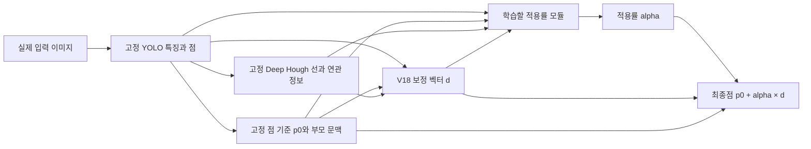

# 점·선 융합 연구: 현재 결론과 다음 실험

> **V44 · 2026-09-11. 새 24그룹600관측·24회귀모델 두 검증 완료. V41 작은 효과는 새 장면 재현. 새 점+선 평균8.674px지만 점 대조8.767px 대비 추가 이득 불확실·쉬운 잘림 피해 지속. 현재 고정 특징 보정 실험 계열 종료.**
>
> 선 예측의 부분 개선과 점 융합의 안정적 개선은 별개다. 운영 모델을 교체하지 않는다.

[전체 실험 색인](README.md) · [다음 실험 실행 순서](NEXT_EXPERIMENTS.md) · [노트 전체 목차](../README.md)

**과거 V30 우선순위 기록 — 현재 종료 판정은 V44를 따른다:** [가장 유망한 방향과 추가 산술 진단](V30_RESEARCH_PRIORITY.md). 저장 예측에서 점 선택 손실과 예상 이득의 기하적 범위 위반을 확인했다. 점 선택과 그 점에 대한 선의 추가 이득 판단을 분리하는 것이 다음 우선순위다. 새 학습 효과를 확인한 결과는 아니다.

## 최신 검증 — V44 새 장면 두 검증과 종료 판정

[V44 전체 결과·새 원본·선/점 사례](04_failure_analysis/pallet_fresh_decision_v44.md). 같은2CAD의 새 외관/조명/구도24그룹을 실제 렌더링했다. 원본240장·파생600관측을 12새fit/4별도확인/8새최종check로 고정했다. 검출210/300·85/100·137/200,최종1096점이다. 모든 부모가 새fit도 보지 않았으며, 기존/새감독×점/점+선×3시드×xy2회귀=24HGB1440라운드·신경망0. 새원본 감독이므로 동일데이터OOF의 순수효과로 해석하지 않는다.

**보존할 근거:** 고정V41 작은 평균효과는 새 장면에서 재현됐다. V34 9.058→V41 9.025px,세시드 .19/.61/.30%,차이95%구간[-.0508,-.0129]px. 다만매시드1%성능기준미달·crop40쉬운층한시드1.24%악화로전체안정성실패다.

**새감독 평균효과와 선의 추가효과는 별개:** 새점특징8.767/새점+선8.674px. 새점+선은기준대비3.92/4.84/3.97%개선·CI0미만이지만,점대조대비선추가효과 .43/.96/1.79%,CI[-.1798,+.0026]px로0포함이다. 새감독vs기존감독비교의CI도0을포함하므로감독출처만이해법이라고단정하지않는다.

**피해는 여전히 남음:** seed3crop20쉬운135점3.011→4.018px,crop40쉬운105점3.087→4.152px. crop40화면밖64점씩에서는점대조가점+선보다세시드모두좋았다. 잘림이면선이항상우세하다는해석도지지하지않는다.

**판정: 현재 고정 특징·선 후보를 사용하는 보정 연구 계열을 종료한다.** 이 계열의 gate/문턱/가중치 수정 실험을 자동으로 이어가지 않는다. 모든DeepHough융합의원천적불가능증명은아니다. 다른관측/표현을개발하는연구는새가설·새범위의별도과제로다룬다. 운영모델교체없음.

기존436관측의새특징/V41출력차이0,현재GPU의고정신경망forward약3e-5px이내재현,새GT독립투영·데이터분리·24모델·24점배열·4교란재학습감사PASS. GPU드라이버불일치는공식동일버전라이브러리의프로세스별지정으로우회했고시스템설치/재부팅없음.

## 이전 검증 — V43 개선 가능한 유효 선 학습

[V43 전체 결과·후보 회복/가림 개선/쉬운 점 피해 사례](04_failure_analysis/pallet_useful_constraint_v43.md). 같은 V41 후보·복귀점을 고정하고 유효성/1px 초과 유효 개선 후보 목표 × 기본/4배 비중과 기하 대조를 비교했다. 15 HGB 분류기 900라운드·신경망 0. 같은 12fit/4calibration/8재사용check와 상류16그룹 이력이다.

**목표 수정은 순위에 효과가 있었다:** 유용 후보 check AP는 matched 유효성 기본 .044~.055 → 개선 가능성 기본 .217~.334 / 4배 .224~.341. 주대조 useful AUROC .861~.871. 기존 V42 유효성 점수의 useful AUROC .544~.590보다 높지만, V42의 유효성 자체 AUROC .93과는 평가 목표가 다르다. 영상 특징 추가의 일관된 이득은 없었다.

**실제 적용은 주판정 실패:** cal4에서 제약 정밀도90%·최소변화10점/2그룹·조건별1%보존·양의 이득을 동시에 만족하는 문턱이 없어 주판정은 세 시드 모두 1.1기권했다. 실제 변화0/0/0점, 복귀10.410px 유지다. 일부 잔차 순위 대조만 특정 시드 적용, 세 번째 시드는 모든 대조 기권. 보존을 추가 향상으로 세지 않는다.

**문턱만 낮추면 피해도 늘었다:** 고정 .10 진단에서 GT 유효 개선 기회 V42 15/11/6 →45/39/39점, 큰 오류 기회1/0/1→12/19/17점. 그러나 실제1px초과 피해82/42/55점, 평균10.498px로 악화했다. 고정 .30의10.390px도 채택 성능이 아니며 전체격자와 조건을 함께 보고했다.

**남은 원인:** 학습 AP≈1과 확인 .22~.34의 차이, 높은 점수 구간에서의 피해, 이진 개선 여부가 피해 크기를 표현하지 못하는 문제가 남았다. 학습에 이미 맞춘 상류 후보/복귀점의 효용 정답과 실제 학습 밖 후보 간 분포 차이도 가능한 원인이며 기여도를 확정하지 않았다. 가중치만 바꾸는 것으로 해결되지 않았다.

다음은 학습 밖 그룹에서 만든 후보·복귀점을 이용한 효용 감독과 피해/이득 분리, 새 그룹 고정 검증이다. 이 상류 OOF 재학습·독립 렌더는 미실행이다. 새 신경망 구조를 채택하지 않는다. 아래 V42의 개선 후보 누락·목표/비중 대조는 V43에서 완료했다.

## 이전 검증 — V42 목표점별 물리 제약 유효성

[V42 전체 결과·통과/피해/누락 사례](04_failure_analysis/pallet_constraint_validity_v42.md). V41 실제 3후보·직접 회귀·잔차와 V39 점 어려움 선택기를 고정했다. 가시성/물리 정렬/목표점 제약 3목표 × 기하/영상+기하 × 3시드, 18 HGB 분류기 1080라운드다. 같은 12학습/4기준선택/8재사용확인 그룹·2 CAD이며 신경망 업데이트와 새 실사 평가는 없다.

**분류는 부분 성공:** 실제 최종 선택한 점의 제약 precision 96.3/91.6/98.4%로 등록 기준을 통과했다. 제약이 3px 이내로 정확하다는 것과 원래 점을 개선한다는 것은 다르다. 원래 1px 오차인 점은 유효한 제약으로도 나빠질 수 있다.

**추가 점 성능은 실패:** 복귀 기준인 기존 직접 회귀 10.410014→10.408929px, 차이 95% 구간 [-.008859,+.007855]px. 시드별 추가 개선 +.0766/−.0150/−.0301%다. 실제 바뀐 점은 69/57/39개이고 조건 보존은 통과했으나, 등록한 매시드 1% 추가 개선 기준은 실패했다. 원래 점 10.463px 대비 약 .5% 이득은 대부분 기존 직접 회귀의 효과다.

**실패 범위를 좁힘:** 선택점의 기존 오차 중앙값은 1.50~1.57px로 이미 잘 맞던 점이 많았다. GT상 1px 넘게 개선 가능한 유효 후보가 있는 점은 78/72/67개인데 실제 통과 후보에서는 15/11/6개다. 큰 오류점의 통과 후보 중 같은 개선 가능성은 1/0/1개뿐이다. 후보를 통과시키는 단계에서 유용한 제약을 많이 잃었다.

**순위 손실도 남음:** GT 유효성+기존 순위 10.328px, GT 유효 후보 중 점GT 최선 10.148px, 실제 통과 후보 중 점GT 최선 10.377px다. 모두 비배포 진단이다. 순위만 고치는 것보다 어려운 점에 유효한 후보를 보존하는 문제가 먼저 남았다. 이 결과는 선 융합의 원천적 불가능이나 실사 개선을 증명하지 않는다.

새 모듈을 채택하지 않는다. 다음은 독립 그룹에서 기존 작은 효과를 고정 검증하고, 유효하면서 개선 가능한 어려운 후보의 누락 원인·신뢰도·기대 이득을 분리하는 범위다. 이후속 학습/새 렌더는 미실행이다. 아래 V41의 유효성 분류 제안은 V42에서 실행 완료했다.

## 이전 검증 — V41 물리 제약 계산·잔차와 후보 방향

[V41 전체 결과·실제 실패/개선/GT조건 사례](04_failure_analysis/pallet_constraint_residual_v41.md). 기존 V40관측/V34점,3시드. 같은12fit/4cal/8reusedcheck와old16offset. 27HGB모델1620라운드,신경망0. 같은입력에서direct/analytic/residual,기존24후보와물리법선3후보를구분했다.

**조건부 가능성:** 정확GT선+물리법선잔차10.463→8.772px,세시드15.61/16.59/16.26%개선,CI[-3.639,-.254]px. 그러나정답선/가시성을입력한진단이며실사용성능이아니다. 직접회귀9.078px도좋아잔차의점성능추가이득자체는CI가0을포함한다. GT선에서도잘림20/40쉬운층보존은실패했다.

**실제 잔차 구조는 실패:** 계산만16.799/계산+잔차12.564/기존어려움선택제한10.821px. 선택제한후1px초과피해45건중34건은선택역할의GT가시지원없음,8건은물리정렬불량,3건은가까운물리지원이었다. GT물리품질로거절해도10.423px로효과가작다. 잘못된제약을강하게전달하는문제가남았다.

**보존할 작은 실제 효과:** 물리법선후보+직접회귀10.410px,세시드0.39/.61/.52%,차이CI[-.076,-.028]px. 모든확인조건의최대악화약.045%로1%보존기준내지만등록매시드1%성능기준미달이며V40평균10.329px보다나쁘다. 재사용8그룹효과이므로새독립그룹검증전채택하지않는다.

이번강한잔차모듈은채택하지않는다. 다음에는점이어려운지보다해당역할의물리제약이실제로유효한지와작은직접회귀효과의새장면재현이중요하다. 단순gate반복이나GT8.772px의실사용달성주장은금지한다. 새분류기/독립관측/장기아키텍처학습은미실행이다.

## 이전 검증 — V40 실제 선분·끝점 대응 정보

[V40 전체 결과·실제 선분/점/실패 사례](04_failure_analysis/pallet_segment_correspondence_v40.md). 기존 V34/V36both3시드, 같은12fit/4calibration/8reusedcheck. 실제 영상 LSD선분17,952개를 새 관측으로 추가하고 예측대응·GT대응·GT물리직선·GT가시구간·역할교란5대조×전체/큰오류학습을 수행했다. 30HGB모델1800라운드, 신경망0, 새실사평가0.

**실제 대응 추가는 안정성 실패:** 전체 점10.463→10.329px로 평균은 줄지만 시드 개선율−3.54/+0.48/+7.18%, 차이95%구간[-.462,+.247]px. 기존 특징 보정10.290px보다도 나쁘다. 잘림20/40 화면 밖 점은 세 시드 모두 악화했다. 기존 큰 오류 선택기 적용10.420px도 안정성 실패다.

**선 정보와 끝점 정보를 구분:** 큰 오류 법선 MAE 기존15.442/영상선분15.385/GT대응15.313/정확직선14.741/정확가시구간14.761/역할교란15.456px. 정확한 물리 직선/역할의 부분 정보는 있지만 구간 끝점의 추가 효과는 미확인이다. GT대조는 모두 비배포 진단이며 등록 매시드10%효과 기준은 통과하지 못했다.

**새로 좁혀진 원인:** 가시 지원 구간 끝점과 목표 가상 꼭짓점 거리가 큰 오류에서 중앙54~56px였다. 끝점이 실제 접합점이 아니라 가림/잘림 경계일 수 있으므로 의미가 다르다. 정답지원후보에서 정확선 입력회귀12.68~16.79px보다 물리선+기존상수offset의 직접 계산7.44~8.06px가 좋아 제약 전달 손실도 남아 있다. 단, 후자는 GT선/과거16그룹offset 진단이다. 후보방향과 물리선방향이 다를 때 목표에 미관측 접선성분이 섞이는 것도 독립 확인했다.

이번 단순 선분/끝점 추가 모듈은 채택하지 않는다. 물리선의 역할·방향을 맞추고 제약을 전달하는 방식과 실제 접합점/가림 종단 관측은 아직 구분해 검증할 범위다. 기존 투영/gate 반복만으로 해결되거나 융합이 원천적으로 불가능하다는 결론은 모두 지지하지 않는다. 새로운 그룹에서의 안정성 검증과 추가 신경망 학습은 미실행이다.

## 이전 검증 — V39 큰 오류 식별과 보정 방향의 일반화

[V39 전체 결과·실제 점/선/보정 사례](04_failure_analysis/pallet_hard_direction_v39.md). 기존 V36/V34 고정 특징으로 새 HGB 48모델, 2880라운드를 실행했다. 새 학습12·기준 선택4·재사용 확인8그룹, 같은2CAD이며 신경망 업데이트와 새 실사 평가는 없다.

**큰 오류 식별에는 신호가 있다:** 점+선 분류기의 AUROC .929~.931, precision .667~.720. 그러나 한 시드 recall .475로 등록 기준 미통과다. 점만으로 선택한10.868px보다 점+선 선택10.484px가 좋았지만 기존 점10.463px를 안정적으로 넘지 못했다.

**비중보다 보정 일반화가 남았다:** 어려운 점 전용 법선 예측은 학습18.214→11.040px, 확인15.442→16.073px로 반대로 움직였다. 그룹 OOF도17.134px였다. 보정 부호 정확도는 학습 약88%, 확인55~57%였다. 선 기하의 부분 정보(영상+법선16.670→영상+기하16.073px)는 있지만 기존 중심/0보정을 넘지 못한다.

**완벽한 어려움 선택만으로 부족:** GT로 큰 오류만 선택하면10.204px이나 차이95%구간[-.954,+.441]로0을 포함하고 해로운 보정도 남았다. GT로 해로운 보정까지 거절하는9.606px와 후보 최선7.802px는 실사용 수치가 아니다. 큰 오류의 약67~70%는 정답 가시 물리선에서 독립2방향을 확보하지 못하지만 이것만으로 법선 방향 실패를 설명하지는 않는다.

다음에는 현재 특징을 그대로 둔 비중/gate 반복보다, 목표 꼭짓점에 대한 선 구간·끝점의 대응이나 추가 관측이 방향을 구별할 정보를 늘리는지 대조해야 한다. 새로운 장면 그룹과 고정 판정이 필요하다. 이 후속 관측/구조 학습은 아직 실행하지 않았다. 원천적 불가능 판정도 아니다.

## 이전 검증 — V38 목표 점에서의 선 보정 불확실성

[V38 보고서·점/선/1차원 보정 구간 사례](04_failure_analysis/pallet_line_uncertainty_v38.md). 고정 V36grid/both3시드와V34점을 사용했다. 새예측기 학습12그룹·범위보정4그룹·확인8그룹이며36HGB모델2160rounds,신경망0. 기존upstream/offset은과거16그룹학습이력이있어엄밀독립conformal보장은아니다. 새실사평가없음.

**부분적으로 확인된 것:** 영상+기하 scale과 실제보정잔차의Spearman.525/.542/.568. 상수점별구간의반폭20.795/16.143/18.885px를8.849/8.039/8.542px로줄였다. 다만확인셋점별24후보동시적용률87.12/85.00/84.52%로목표90%보다낮고최소85%기준한시드미달. 순위신호를실제선택점의신뢰도로바로쓸수없다.

**실제보정은실패:** 주판정10.463->10.487px,1040점씩3시드중보정1/3/0점. 선택4개모두정답보정량이예측범위밖이었고3개는1px넘게악화. 작은4개표본으로일반위험률을확정하지않지만전역coverage와선택조건부coverage차이는확인했다. 영상불확실성대조10.185px평균개선도한시드악화로안정화아님.

**보정 중심도병목:** 원래후보중1px이상개선가능297/332/303점->예측보정중심에서도양의이득후보가있는27/51/49점->불확실성하한도양수인0/0/0점. 정답보정중심만제공하면9.360px,정확반폭만제공하면10.161px,둘다정답이면7.802px의진단상한. 이는실사용아님. 절대오차손실의mean분기는위치중심예측이며조건부평균보장아님.

**다음:** 큰점오류의법선부호/크기가현재관측특징으로식별되는지와실제선택되는극단사례의잔차를분리검증한다. 전체평균/불확실성순위개선만으로는부족하다. V27/V37방향목표·V38불확실성학습을단순반복하지않는다. 새어려운점식별학습은미실행이며운영모델교체없음. 아래V37후속불확실성실험은V38에서완료했다.

## 이전 검증 — V37 개선 후보가 점 보정 정보를 추가했나

[V37 보고서·선/점 실제 사례](04_failure_analysis/pallet_line_utility_v37.md). 기존 합성600관측/436검출, 확인200관측 중130검출·1040점·지원820점, train16/check8그룹을 유지했다. 새 실사평가 없이 V36고정4후보3시드와 base/V34기준을 비교했다. 일차96회귀식과 후속48회귀식, 신경망 업데이트0이다.

**추가 후보 이득은 실패:** 지원820점에서 물리 선 거리7.571→6.222px지만 직접 점 투영14.788→14.828px다. 전체1040점에서 V34기준10.463px→점GT선택oracle7.802px의 여지는 있으나 격자oracle7.769px보다 좋아지지 않았다. 해당 oracle은 정답으로 후보/거절을 고르며 잘못된 선을 우연히 이용할 수도 있다.

**목표 점까지 연장하면 오차가 달라진다:** 개선 선의 법선 보정량 MAE8.203px vsno-op2.720px. 선거리가개선된1369점×시드 중428개(31.3%)는 점보정량이악화됐다. 화면밖지원102점의 구간밖연장거리 중앙119.79px, 각도×거리항12.30px로 물리offset0.46px보다 컸다. 부호 있는항은서로상쇄될수있어MAE기여율로더하지않는다.

**실제입력선택도실패:** 영상+기하12.043px는영상만13.900px보다좋지만기준10.463px보다나쁘다. 학습구간에서도악화돼목표대조를추가했다. 픽셀이득목표10.711px로완화됐지만기준미달,법선보정량직접학습15.086px. 모든안정성기준실패. 선이전혀정보가없다거나손실목표하나로해결된다는결론둘다지지하지않는다.

**다음:** 보이는구간의선품질보다목표점위치의제약잔차/불확실성을검증해야한다. Support길이·연장거리·θ/ρ오차와역할offset을반영한불확실성이학습밖그룹에서실제보정오차와맞는지먼저확인한다. 그검증전비슷한자유head/단순gain gate장기학습은반복하지않는다. 이불확실성후속학습은미실행이다. 아래V36후속의후보효용진단은V37에서완료했다.

## 이전 학습 — V36 연속 좌표·후보 선택과 인코더 적응

[V36 전체 결과·실제 선/점 사례](04_failure_analysis/pallet_continuous_lines_v36.md). 같은 고정V34 영상/query 특징·8후보에서 격자/좌표만/선택만/둘다4대조×3시드2000학습 후, 기존 선 인코더 고정 여부를 추가3대조×3시드2000으로 검증했다. 총21모델42,000업데이트. 선 예측기는 물리 선GT, 점 head는점GT로 학습하고 점→선 예측기 경사는 차단했다.

**선 예측은 부분 개선:** 같은 합성 확인 지원820점에서 선택선 거리 grid7.571/refine7.249/rank6.037/both6.222px. Both는세시드17.98/12.65/22.34% 개선,8그룹차이95%구간[-2.989,-0.00687]px로 등록한 선택선 기준 통과. 하지만 Best8 좌표 잠재력은 둘다에서1~2%만 개선돼 별도10% 기준 실패. 후보선택과좌표를동시에학습하면항상더좋은것은아니다.

**실사 점은 안정화되지 않음:** 잘림20 grid13.485/refine12.720/rank14.306/both14.394px. 좌표만은세시드9.38/4.56/2.75% 개선,CI[-1.412,-.263]px였으나 기준12.372px보다 나쁘고 전체 보존 실패. 추론 시좌표보정을끄면변화+0.000412px뿐이어서재학습이득전체를정밀좌표활용으로해석하지않는다.

**고정 인코더 가설도 추가 확인:** 선 token/관계 인코더와점head를동일V34초기값에서학습해도후속grid13.377/refine13.469/both13.613px. Refine한시드는8.30%악화,geometry donor변화도+.00636px와-.00017px로구간이0을포함했다. 인코더 고정만 풀면 해결된다는 가설은 지지되지 않는다.

선MLP공유층의좌표/품질gradient20배치/seed에서cos중앙+.03~+.057,음수40~45%,품질norm/좌표norm중앙5.4~9.5였다. 일부충돌/크기불균형은있지만전체실패원인으로확정하지않는다. PCGrad는미실행. 다음에는개선된선후보를고정하고점역할별잔차/관측가능이득이실제로늘었는지먼저확인한다. 새로운자유좌표head나gate의장기학습을바로반복하지않는다. 아래 V35 이후 제안의연속좌표·후보학습은이번에실행완료다.

## 이전 검증 — V35 실제 선·점 대응과 좌표 정밀도

[V35 전체 결과·실제 렌더·개선과 실패 사례](04_failure_analysis/pallet_role_offset_v35.md). 기존 합성600관측/436검출, train16/check8그룹과 같은2CAD. 확인200관측 중130검출·1040점에서 정답 관련 선이 보이는820점을 공통 비교했다. V34고정3시드 추론·24개 train-only offset보정식이며 새 신경망 학습/실사 평가/수동GT 수정은 없다.

**정답 선에는 부분 정보가 있다.** 기준점12.373px→정답 물리 선+상수offset11.499px. 물리 선과 가상 점의 법선 거리 평균1.129→상수보정0.681px지만 중앙값은 거의0이어서 역할/offset 불일치를 모든 실패의 주원인으로 볼 수 없다. 기존V34 점+선은 이 합성 지원점에서9.796px로 단일 정답 선 보정보다 좋다.

**실제 선 후보는 충분히 정확하지 않았다.** 정답 대응을 알려줘도 예측top1+상수offset16.903px. 선 support 거리 오차는 예측top1 7.571px, top4 중GT최선3.955px, 전체1152격자GT최선1.517px다. 점 오차도 연속정답11.499→전체격자GT최선13.126→top4GT최선14.446→예측top1 16.903px였다. 후보 추출과 현재 정수 θ/ρ 격자 근사가 모두 이득을 잃게 한다.

방향별 offset ridge의 외삽 폭주는 학습범위 제한으로 줄였지만17.556px로 실패가 남았다. 여러 정답선+상수offset8.296px는 평균이 좋지만8그룹 차이95%구간[-10.944,+0.999]px로 안정성 근거는 부족하다. 정답 없이 confidence로 역할을 고르는 실제 사용가능 대조는 전체 검출점에서31.752px로 기준13.393px보다 나쁘다.

**다음 우선순위:** 기존 정수 bin 대조와 bin 주변 연속 θ/ρ 보정 또는 실제 support 선 맞춤을 동일 특징/감독에서 비교한다. 후보·역할 추출을 별도 검증하고 관측 가능한 비평행 방향이 있을 때만 여러 제약을 사용한다. 좋은 점 보존도 별도 대조한다. 단순 gate/법선 투영/PCGrad 반복보다 먼저 확인할 구체적인 오차다. 후속 연속 선 모델의 학습은 아직 미실행. 아래 V34 이후 제안 중 역할/offset 진단은 V35에서 완료했다.

## 이전 검증 — V34 반복 학습과 선 위치 개입

[V34 전체 결과·실제 이미지·선 위치 반응](04_failure_analysis/pallet_line_validation_v34.md). Strict 옵션만으로 남던 grid_sample 입력 gradient 변동을 분리하고 수학적으로 동등한 고정-grid 연산으로 수정했다. 처음12모델과 수정12모델을 모두 보존했고, 최종 반복은 두 구조·세 시드에서 가중치/trace/300평가 예측이 정확 일치했다. 수정은 현재 고정 부모 좌표에 한정하며 학습 가능한 좌표나 운영용 속도 최적화까지 검증한 것은 아니다.

점+선의 잘림20 13.674px는 같은 연산의 전역 대조15.937px보다 세 시드15.36/7.76/18.67% 개선됐다. 9세션 차이95%구간[-2.927,-1.628]px. 그러나 기준점12.372px보다 나쁘고, 가림14.145px도 강한 점11.907px의 이득을 보존하지 못했다. 큰 잘림17.996px의 평균 개선과 전체 안정성은 별개다.

**원인 구분:** 점/영상 특징을 고정한 선 token ±4px 이동에 점 이동 중앙값은 약0.00008~0.00026px뿐이었다. 다른 세션의 명시적 geometry만 교체하면 잘림20 화면 밖 오차+0.00027px,95%구간[-0.00204,+0.00203]px. 선에서 읽은 영상 특징만 교체하면+0.16986px,[+0.03575,+0.33774]px로 세 시드 모두 악화됐다. 선 끄기+1.33651px를 전부 정확한 기하의 기여로 부를 수 없다. 현재 검사한 구조는 선 token의 영상 정보에 기여가 있으나 명시적 위치에 따른 보정 관계는 거의 사용하지 않는다. 이전V33 가중치도 같은 경향이다.

**다음 판단:** 자유로운 최종 좌표 head에 gate/PCGrad를 추가하기 전에 작은 분리 합성에서 실제 경계↔가상 점의 역할·offset과 법선 잔차의 설명력을 확인한다. 대응을 아는 선과 예측 선을 분리해 실패 지점을 좁히고, 성립한 관계만 제한된 보정 경로에 넣는 대조가 우선이다. V30의 단순 법선 제한을 새 해결책으로 반복하는 제안은 아니다. 이 후속은 미실행이다. 수동GT 전달/valid/crop/해시는 검사했지만 클릭 오차의 크기를 새로 측정하거나 교정하지 않았다. 재사용 실사297 DEV·특징 수준 개입의 한계를 유지한다.

아래 V33 이하의 미실행/다음 제안은 당시 상태다. V33이 제안한 반복 재현·선 위치 개입은 V34에서 완료했다.

## 이전 학습 — V33 점별 선 구간·끝점 대응

[V33 전체 결과·실제 attention·실패 사례](04_failure_analysis/pallet_correspondence_v33.md): V32 물리 감독/데이터/최종 점 head를 유지하고 두 부모를 각각 query로 사용했다. 관련 역할의 Hough 후보·support 중심/범위·공간 끝점을 직접 참조한다. pooled/query/명시적 기하 제거/선만/끝점만/보조 감독만6대조×3시드, **18모델·36,000업데이트** 완료.

잘림20에서 전역 pooling14.714px → 점별 전체 융합15.004px로 개선하지 못했다. 선만14.090px, 끝점만15.800px였다. Query는 끝점만 대비3시드 모두 개선했지만 pooled를 넘지 못했다. 선만은 pooled 대비6.947/2.048/3.556% 개선,9세션 차이95%구간[-0.861,-0.359]px였으나 이는 추가 탐색 비교다. **선 단독도 기준점12.372px/V30 13.385px에 못 미치고 전체 안정성은 실패했다.**

Query의 선 경로를 끄면16.624px로 악화되지만, 다른 세션 경계맵으로 바꾸면14.994px로 거의 같다. 명시적 위치 관계 제거도14.869px로 원래 query보다 나쁘지 않다. Seed1 잘림20의 donor Hough top4 집합 겹침은13.3%여서 동일한 후보여서 변화가 없었다는 설명만으로는 부족하다. 수신 이미지 특징은 남아 있으므로 순수 선 기하의 효용과 영상 특징 요약/보정 기준값 효과를 구분해야 한다.

코너 가림 query13.596px는 강한 점11.907px의 이득을 보존하지 못했다. 잘림40은18.452px로 강한 점19.382px보다 평균이 좋지만 모든 조건의 동시 안정성은 아니다. 물리 끝점과 가상 cuboid 점의 역할/offset 차이도 남았다.

**재현 한계도 확인했다.** 같은 공통 초기 가중치·배치·손실의 전역 대조는 V32의14.343px와 이번14.714px가 달랐다. 초기 손실은 같고 수십 step 후 약1e-8 차이부터 벌어졌다. 결정적 알고리즘 강제는 꺼져 있었으며, 단일 grid_sample의 결정적 backward는 별도 검사에서 실행됐다. 전체 학습의 결정적 반복 검증은 미실행이다. 공유 trunk의 미리 고른1배치 gradient cosine은 query 평균+0.309로, 이 표본에서는 충돌이 필수 원인이라는 근거가 없었다. PCGrad는 미실행이다.

**다음 우선순위:** 선 단독을 기준으로 결정적 반복 학습의 변동을 확인하고, 실제 선 위치를 옮기거나 교체했을 때 보정 방향이 따라가는지 검증한다. 기하 효용을 확인하기 전에 새 gate를 추가하는 우선순위를 낮춘다. 끝점은 가상 점과의 역할/offset 대응을 검수한 뒤 한 요인으로 재도입한다. 아래 V32 이하 제안은 당시 상태다.

## 이전 학습 — V32 실제 가시 경계·끝점 감독

[V32 전체 결과와 실제 이미지](04_failure_analysis/pallet_visible_geometry_v32.md): 실제2개 CAD에서 가시 직선 체인/물리 끝점을 추출하고, 가상 경계 감독·점 손실만 Hough·점 대조와 비교했다. 첫4대조12모델에 물리 감독만3모델을 추가해 **3시드·15체크포인트·실제30,000업데이트** 완료. 상태를 고정 분류하지 않고 원래 점/강한 복원점을 모두 최종 보정 입력에 남겼다.

실사 잘림20: 새 점 대조16.331→실제 경계 융합14.343px로 세 시드 모두 개선. 가상 경계 감독17.030px보다도 좋다. 물리 감독만15.297px 대비 추가 특징 전달의 이득0.954px,9세션 차이95%구간[-1.471,-0.382]px. 마지막 대조는 첫 결과 이후 추가한 탐색 실험이다. **기준점12.372px/V30 13.385px에는 못 미치며, 코너 가림14.185px로 강한 점11.907px의 이득을 보존하지 못했다.** 잘림40 평균17.550px는 좋아졌으나 전체 안정성 미통과다.

Hough만 끄면 잘림20 14.359px(+0.015), 끝점만 끄면15.537px(+1.194). 서로 다른 촬영 세션의 역할맵으로 바꾸면14.627px(+0.283). 따라서 입력별 경계 정보가 일부 기여하지만, 현재 성능을 순수 Hough 선의 성과로 부르기는 어렵다. 두 경로 제거는 사후 추론 개입이며 각 경로를 제거한 재학습과 다르다. 인접 프레임 donor의 변화가 작다는 것만으로 선이 이미지와 무관하다고 결론 내리지 않는다.

분리 렌더의 micro F1은 가상 감독 대비 물리 감독에서 경계0.393→0.570, 끝점0.218→0.528이었다. 물리 감독만 대조는0.578/0.540으로 분류 자체는 더 좋지만 점 오차는 더 크다. **분류 정확도와 점 보정 효용을 구분해야 한다.** GT는 실제 CAD 체인이지만 역할은 가까운 평행 cuboid 경계에 대한 규칙이며, 실제 끝점과 가상 모서리는 동일하지 않다. 실사 수동 GT는 수정하지 않았다. 새 렌더600요청 중436검출, 동일2자산을 학습/확인에 공유하므로 미지 자산·자연 실사 검증은 아니다.

**다음 우선순위:** 동일 물리 감독을 유지하면서 전역 Hough/끝점 pooling과 점 역할별 선 구간·끝점 대응을 하나의 대조로 비교한다. 좋은 점 부모 보존은 별도 대조로 분리한다. 보조 감독 모델은 학습 점 오차도 늘었으므로 gradient 충돌을 측정하고 경계 전용 trunk 분리와 비교한 뒤 PCGrad 필요성을 판단한다. V32에서는 PCGrad를 실행하지 않았다. 아래의 V31 이하 제안과 미실행 표시는 당시 상태다.

## 이전 학습 — V31 점 선택과 선의 추가 이득 분리

[V31 전체 결과와 실제 이미지](04_failure_analysis/pallet_separated_gain_v31.md): 새281원본을 학습153/하한 진단64/합성 확인64로 분리하고 실제 부모를 재추론했다. 기존/신규 데이터와 공동/분리 구조 대조, 점 선택만 및 같은 수의 일반 방향 대조를3시드로 실행했다. 실제27,000업데이트·21체크포인트 완료.

분리 모델의 실사 선 보정 적용률은0이었다. 점 선택만/분리 선/일반 방향이 모두 잘림20에서15.629px로 같았다. V30의13.385px 및 기준점12.372px보다 나쁘다. 큰 잘림은19.386px로 강한 점 복원기의19.382px를 거의 유지했지만 다른 조건까지 안정화하지 못했다. 하한 제한을 없애도 잘림20은15.842px, 평균 이득만으로 고르면15.900px였다. 단순히 멈춤 기준을 완화하면 해결되는 결과가 아니다.

**가설 수정:** 수치 이득을 이동 거리로 제한하고 순위와 별도 출력으로 나누는 구현은 성립했다. 그러나 선택 능력은 충분히 좋아지지 않았다. 새 학습집합의 점 우열 AUROC0.643 대비 별도 합성 잘림20은0.500, 실사는0.429였다. 선 후보 이득 AUROC는 학습집합에서도0.534, 별도 합성 잘림20은0.487이었다. 조건별 모집단 차이를 포함하므로 차이 전체를 단일 도메인 효과로 단정하지 않는다.

선택한 점을 고정한 현재 선 이동량 후보의 GT 최선도 실사 잘림20에서15.154px에 그친다. 더 좋은 출발점을 택하면 가능한10.886px와 구분해야 한다. 점 선택의 오류를 선 적용 여부만으로 되돌릴 여지가 작아진 경우가 있다. 따라서 **동일 특징으로 게이트/손실만 반복 변경하는 우선순위를 낮추고, 실제 가시 경계·끝점·역할 대응 및 남은 면의 관측 근거가 후보 우열 판별에 추가 정보를 주는지** 먼저 확인해야 한다. 이 정보 보강의 학습 효과는 아직 검증하지 않았다.

새 원본은 부모의 학습 그룹/정확한 이미지와 분리됐지만 역사적인 YOLO 검증 풀 출신이며, 새 asset/scene 또는 완전한 파이프라인 holdout은 아니다. 실사 수동GT는 바꾸지 않았다. 아래 V30의 우선순위 제안은 V31에서 실제 실행한 과거 가설로 읽는다.

## 이전 학습 — V30 상태 없는 점별 방향·이득 적응형

[V30 전체 결과와 실제 이미지](04_failure_analysis/pallet_directional_adaptive_v30.md): V12 기준점과 강한 V25 점 복원기를 고정하고, 두 점을 유지하거나 선 법선 방향으로만 부분 보정하는41,630파라미터 모듈을 학습했다. 상태 분류나 condition 이름을 입력/손실에 넣지 않았다. 네 대조·3시드·24,000업데이트 완료.

실사 잘림20에서 점 방향 대조15.624→선 법선 적응형13.385px. 세 시드8.62/21.79/11.74% 개선, 세션95%구간[-4.636,-0.458]px로 등록한 대응 대조의 추가 이득 기준은 통과했다. 다만 V12 기준12.372px보다 나쁘고, 코너 가림/잘림40의 일부 시드 보존 기준은 실패했다. 전체 안정성+추가 이득 동시 통과는 아니다.

원본5.538→5.257px, 잘림10 10.605→9.988px, 잘림30 13.274→12.141px로 평균은 개선됐다. 큰 잘림은27.771→21.370px지만 고정한 강한 점 부모19.382px보다 나쁘다. 보존 가능한 부모 경로를 남기는 것과 실제로 좋은 부모를 고르는 것을 구분해야 한다.

**남은 실패를 좁힌 근거:** 후보 이득 AUROC는 학습집합0.547, 실사 잘림20 0.509로 여전히 약하다. 원본의 모든 유효점에서 선 경로를 선택했지만, 원본의 실제 선 이동은 평균0.70px이므로 이를 전부 큰 과보정이라고 해석하지 않는다. 대신 예상 추가 이득은3.71px에 비해 실제 평균 이득은0.28px였다. 큰 잘림에서도 예상2.99px 이득과 달리 선택한 선 이동은 그 직전 점 부모 대비 평균0.16px 악화였다. [선택/이동량 추가 분해](../../../data/pallet/results/pallet_directional_adaptive_v30/SELECTION_DIAGNOSIS.json).

지목한3번 사례는 원래 점14.19px보다 나쁜 강한 점 부모를 택하면서59.56~71.24px로 악화됐다. 선이 선택한 부모에서 GT 방향으로 조금 보정해도, 애초에 더 정확한 원래 점을 버린 문제를 해결하지 못했다. 이는 선 후보 자체와 별도로 부모 선택/보정 중단 판단이 중요하다는 직접 사례다.

현재 손실은 원래 기준점 대비 전체 이득을 학습하므로 강한 점 부모의 이득과 선의 추가 이득이 같은 값에 섞인다. 수치 이득 회귀와 후보 순위 분류도 같은 출력에 걸려 있다. 이 구조가 과신의 단독 원인이라고 확정한 것은 아니지만, 다음 대조는 **점 부모 선택과 선의 추가 보정 이득을 분리하고, 후보 순위 점수를 신뢰 가능한 예상 이득으로 취급하지 않는 것**이 우선이다. 수치 이득/불확실성 보정은 부모가 보지 않은 잔차에서 검증해야 한다. V25 부모 잔차의 in-sample 문제는 이번에도 남았다.

## 이전 학습 — V29 독립 전문가와 적응형 선택

[V29 전체 결과·이미지·분석](04_failure_analysis/pallet_adaptive_experts_v29.md): 점/점 가이드 DHT/점 독립 DHT와 선 교차 디코더를 따로 학습하고, 새 전문가 미세학습과 원본이 겹치지 않는 합성 자료로 점별 선택기를 학습했다. 3시드24모델·25,200업데이트 완료, 안정성 미통과.

새 점 가이드 선은 원본4.26px/코너 가림11.82px로 새 점5.44px/16.16px보다 좋았다. 독립 선은 지목한 사례3의 시드1에서6.18px로 YOLO14.19px보다 좋았지만, 세 시드6.18/11.16/23.87px로 안정적이지 않았고 잘림40 전체 평균45.87px로 약했다. 적응형 선택기는 코너 가림16.13px/잘림20 13.57px였고, 좋은 선 후보를 거의 선택하지 않았다. GT 상태를 완벽하게 알아도 큰 잘림에 독립 선을 강제하면 악화된다.

합성의 점/선 전문가 순위가 실사와 달라졌고, 선택기 학습집합에서도 개별 선의 이득을 충분히 골라내지 못했다. 새 점 분기가 기존 강한 가림/큰 잘림 복원기를 그대로 보존하지 않은 한계도 있다. 큰 잘림에는 선 위치/역할 후보와 Hough 표현 범위의 제한까지 남았다.

**실행 완료로 바뀐 범위:** DHT 본체 재학습, 예측 점 좌표 없는 선 교차 디코더, 새 전문가 미세학습 원본과 분리한 선택기 학습. **아직 미실행:** 물리적 가시 경계/끝점 GT 감독, 초기 YOLO/V6 사전학습까지 원본이 완전히 독립인 전체 파이프라인, 기존 강한 점 복원기 보존+새 독립 선 융합, 새 자연 가림/봉인 실사 검증. 아래 V27 이하의 미실행 표현은 당시 시점이다.

## 추가 추론 확인 — V28

[선만 적용한 결과](04_failure_analysis/pallet_line_only_v28.md): 사례3의 점 보정 후보를 제외하고 기존 선 후보·학습 이동량만 사용하면78.80→12.08px로 개선된다. 그러나 전체 가림/큰 잘림에서는 기존 이득을 잃는다. 선으로 무조건 끝까지 이동하면 해당 사례도22.19px로 나빠진다. 현재 DHT는 점 주변 거리맵으로 가이드를 받고, 이후 점별 선 선택도 사용한다. 명시적 점 가이드 gate를 우회한 선 출력은 별도로 확인했으며 이것으로8점 포즈를 새로 학습/디코딩하지 않았다.

## 0. 이전 학습 — 방향별 효용·역할 구조, V27

[V27 결과·그림](04_failure_analysis/pallet_direction_utility_v27.md): 점 유지/벡터/법선/비평행 선 교점의 후보별 효용·이동량을 학습하는 새 모듈을 **4대조×3시드×2000, 총24,000업데이트** 학습했다. 기존 YOLO/DHT/점 보정기는 고정했다. 새 구조 학습과 안정성 검증은 완료했지만 **전체 안정성 통과 모델은 없었다.**

실사 잘림20의 새 점 대조16.480→선+효용+역할16.118px, 시드별0.93%/5.33%/0.18% 개선이다. 그러나 기존 점 기준12.372px보다 나쁘고, 코너 가림 이득90% 유지도 한 시드에서 실패했다. 기존 V25 선 보정16.225px보다 평균이 조금 나아져도 안정적 개선은 아니다.

같은 후보에서 GT로 후보와 이동량을 최적 선택하면8.781px까지 낮아지는 진단 여지가 있지만 실제 모델은 점/x/y 후보에95.65% 가중치를 부여했다. 새 선 경로를 끄면16.118→16.147px로 변화가 약0.03px다. 합성에서는 좋아지고 실사 약한 잘림에서는 악화됐으며, 효용 판별도 일부 시드에서 학습집합부터 약했다. **후보 부족만의 문제가 아니라 효용 학습·잔차 분포 일반화가 함께 남아 있다.**

새 모듈의 학습/검증은 실행 완료다. DHT 본체 재학습·물리적 가시 경계/끝점 감독·부모가 학습하지 않은 원본의 잔차 학습·새 독립 실사 봉인평가는 미실행이다. 이후 섹션은 과거 시점의 기록이며 최신 범위는 이 절과 V27 상세 결과를 우선한다.

## 0-1. 이전 진단 — 정확한 선과 유용한 보정의 차이, V26

[V26 결과·그림](04_failure_analysis/pallet_camera_trust_v26.md)에서 실제 CAD 카메라180렌더·360관측을 실행하고 기존 모델3시드를 평가했다. 검출은172/360이므로 새 렌더의 외관 차이와 검출 실패를 함께 공개했다. 정면 clean에서도 맞는 사례가 있으며, 정면 자체의 보편적 실패나 학습 수량 부족만을 단독 원인으로 확정하지 못했다. 새 학습은 없다.

기존 실사 잘림20%의 선 GT 지원557점/시드에서 점 기준12.371px, 상위 non-null 선 강제 투영14.531px, **GT 최적 상위3개 선 선택10.967px**, 정확한 인접 GT 선 oracle5.245px였다. 마지막 둘은 실현된 추론 성능이 아니다. 강제 투영 역시 null을 무시한 진단이며 기존 모델의 forward가 아니다.

점이 틀리고 선이 맞는 집합도 접선 오차가 크게 남았다. 따라서 **위치 정확도 → 해당 점과의 역할 대응 → 제약 가능한 방향 → 실제 오차 감소**를 구별해야 한다. 현재 association 점수는 보정 효용의 신뢰도로 검증되지 않았다. 방향 행렬/null은 이미 V10에서 썼으므로 재추가를 새 해결책으로 보지 않는다. 다음에 달라져야 할 것은 실제 가시 경계/끝점의 역할 GT와 두 번째 방향 단서, 후보별 보정 효용 감독이다. 안정적 개선은 아직 미해결이다.

## 0-2. 이전 학습 실행 — 관측 조건과 보정 방향, V25

사용자가 요청한1→2→3을 **조건 분해 → 반대쪽 실제 잘림640개·부모 재추론 →7대조×3시드 학습/평가**로 실행했다. 총42,000업데이트, 전체 안정성 통과 대조는 없었다. 실제 카메라 이동이나 가시 경계·끝점 정답 감독까지 수행한 것은 아니다.

| 방법 | 코너 가림 | 잘림20% | 잘림40% |
|---|---:|---:|---:|
| V12 점 기준 | 16.539 | 12.372 | 27.771 |
| 기존 V18 전체 보정 | 12.138 | 16.554 | 20.323 |
| V25 기존 관측·적용률 | 12.972 | 14.670 | 20.395 |
| V25 짝지은 관측·적용률 | 12.973 | 14.613 | 20.428 |
| V25 방향 보정·점 | 11.866 | 16.373 | 19.386 |
| V25 방향 보정·점+선 | 11.867 | 16.333 | 19.363 |
| V25 방향 보정·점+픽셀 미분 | 11.907 | 16.354 | 19.382 |
| V25 방향 보정·점+선+픽셀 미분 | 11.867 | 16.225 | 19.394 |

실사297/9세션·3시드 평균의 대상점 오차px. 전체 대조·검출 실패 포함 지표·판정은 [V25 결과](04_failure_analysis/pallet_observation_v25.md)에 있다. 기존 V18 대비 어려운 조건의 평균은 더 좋아졌지만, 큰 개선 대부분은 점 전용에서도 나타난다.

새로 좁힌 원인은 **필요한 보정 방향의 관측 분포 차이**다. 안쪽 이동이 필요한 비율이 신규 합성 약40%, 실사 약79%였고, 반대쪽 잘림을 만들어도 합성은39.48%였다. 잘리는 쪽을 늘리는 것으로 이 차이가 해결되지 않았다. 방향 변경 경로는 실제로 작동했지만 전체 오차 보존에 실패했다.

선+픽셀은 대응하는 점+픽셀보다 약한 잘림에서 세 시드0.79%/0.59%/0.97% 개선, 세션95%구간[-0.207,-0.048]px의 작은 신호가 있다. 각 시드1%와 전체 안정성 기준은 미달이다. 재사용DEV·다중 비교 보정 없음. **선이 전혀 작동하지 않는다는 결론도, 안정화됐다는 결론도 아니다.**

아래1~9절은 V24까지의 누적 근거이며, 미실행 제안의 최신 상태는 위 V25와 [실행 범위 업데이트](NEXT_EXPERIMENTS.md)를 함께 본다.

## 1. 먼저 볼 세 가지

| 질문 | 지금의 답 | 근거 |
|---|---|---|
| 점과 Hough를 한 모델에서 학습할 수 있는가? | **구현·학습 가능.** YOLO 특징→DHT→점 손실의 학습 경로와 통합 추론을 검증했다. 이것과 성능 향상은 별개다. | [초기 joint](01_hough_and_geometry/pallet_dht_joint.md), [V18](03_correction_and_stability/pallet_vector_v18_results.md) |
| 이전에 크게 좋아진 것은 무엇인가? | **가림·큰 잘림의 복원과 직접 보정 구조.** 점 특징만 쓰는 대응 구조도 비슷하게 좋아져, 큰 이득 전부를 선의 효과로 돌릴 수 없다. | [V12](02_local_and_identity/pallet_observability_v12.md), [V18](03_correction_and_stability/pallet_vector_v18_results.md) |
| 지금 가장 남은 문제는 무엇인가? | **약한 잘림의 보정 방향 판단과 일반화.** 작은 집합은 맞추지만 합성에서 배운 방향 판별이 같은 방식으로 실사에 통하지 않았다. | [V23](04_failure_analysis/pallet_quality_v23_results.md), [V24](04_failure_analysis/pallet_identifiability_v24_results.md) |

## 2. 큰 개선과 남은 악화를 같이 보기

**읽는 법:** 숫자는 오차px이며 작을수록 좋다. 괄호는 V12 점 기준 대비 차이로, 녹색은 개선·빨간색은 악화다. 실제297장·9세션의 재사용 평가, 3시드 평균이다. 코너 가림은 가려진 점280개, 잘림20/40%는 화면 밖 점558/571개를 비교한다. 서로 다른 조건의 대상점 평균을 합쳐 하나의 점수로 만들지 않는다.

| 방법 | 코너 가림 | 잘림20% | 잘림40% | 해석 |
|---|---:|---:|---:|---|
| 기존 YOLO | 16.446 | 12.335 | 27.771 | 원래 검출기 |
| V12 점 기준 | 16.539 | 12.372 | 27.771 | 기존 국소 보정의 악화를 억제한 기준 |
| V18 점 특징→보정 벡터 | 12.077 | 16.779 | 20.292 | 선을 새로 추가하지 않아도 큰 복원 이득 |
| V18 점+선→보정 벡터 | 12.138 | 16.554 | 20.323 | 가림·큰 잘림 개선, 약한 잘림 악화 |
| V22 기존 BCE 적용률 | 12.899 | 14.279 | 20.803 | 약한 잘림 악화를 줄이지만 이득도 일부 감소 |
| V23 정확도별 손실계수 균형 | 13.060 | 14.609 | 20.501 | 새 관측+균형 학습으로도 동시 안정화 실패 |
| V24 방향 점수를 적용률로 사용 | 12.946 | 15.160 | 20.422 | 방향 분류 목표만으로 적절한 이동량을 얻지 못함 |

출처: [V18 전체 결과](../../../data/pallet/results/pallet_vector_v18/SUMMARY.json), [V24 동일 평가의 기존 대조군·새 결과](../../../data/pallet/results/pallet_identifiability_v24/SUMMARY.json). 그림과 표는 결과 JSON에서 가져왔으며 [그림 입력 수치·해시](../../assets/point_line_fusion/FIGURE_DATA.json)를 보존했다.

**중요한 구분:** V16에는 큰 잘림에서 선 구간 특징의 조건부 추가 이득이 있었다. 반면 V18의 큰 이득 대부분을 설명하는 것은 직접 보정 구조였다. “선은 한 번도 도움이 안 됐다”와 “큰 개선은 전부 선 덕분이다”는 모두 기존 결과와 맞지 않는다. [V16의 조건별 효과와 입력 교체 대조](03_correction_and_stability/pallet_line_evidence_v16_results.md)

## 3. 현재 어떤 아키텍처를 검사했는가

V19~V24의 주된 대조는 **고정된 보정 벡터에 얼마만큼 적용할지 학습하는 모듈**이었다. `0 ≤ alpha ≤ 1`이므로 잘못된 방향을 회전시킬 수 없고, 그 방향으로 이동을 줄이거나 멈출 수 있다. V18은 앞서 2차원 벡터 자체를 학습했다. 초기 joint에서는 YOLO와 Hough를 함께 학습한 별도 실험도 수행했다. 최근 결과를 전체 end-to-end 학습 결과라고 부르지 않는다.

추가 선을 제거한 최근 국소 대조도 고정 부모의 선 학습 영향을 일부 공유한다. **새 선 토큰의 추가 가치**를 검사한 것이며 선과 관련된 모든 정보를 없앤 대조는 아니다. 추론에 GT·조건 정답·self-training 필터를 넣지 않았다. [현재 모델 구현](../../../scripts/research/pallet_identifiability_v24/model24.py), [통합 추론](../../../scripts/research/pallet_identifiability_v24/network24.py)

## 4. 원인을 어디까지 좁혔는가

왼쪽은 선 포함 모델의 학습 곡선이다. 음영은 3시드의 최솟값~최댓값이며 신뢰구간이 아니다. 별도48장은 **tiny 학습에서만 제외**됐고, V23 및 전체 방향 분류 학습에는 포함된 원본이다. 오른쪽 검은 점은 개별 시드다. AUROC는 방향의 옳고 그름을 점수로 구분하는 정도이며 점 오차나 선 검출 정확도가 아니다.

| 가설 | 실제 확인한 것 | 현재 판단 |
|---|---|---|
| 기울기가 끊겨서 보정 중단을 배우지 못한다 | V24의 12원본·542유효점에서 선 포함/국소 모두3시드 통과. GT 최적 적용률 대비 추가 오차0.0023~0.0261px. | **작은 집합에서는 학습 가능.** 큰 데이터의 모든 최적화 문제를 배제한 것은 아니다. |
| 정확한 합성 점이 없어서 실패한다 | V23 시드1의 약한 잘림에서 기존210개+신규433개의 기준 오차≤5px 점을 실제 영상 추론으로 확보했다. | “정확한 사례가 전혀 없다”는 설명은 맞지 않는다. 단순 원본 확대도 해결하지 못했다. |
| 학습 비중만 맞추면 해결된다 | V23 손실계수 균형은 확대 대조보다 잘림20%14.849→14.609px로 개선, 잘림40%20.339→20.501px로 악화. | **부분 원인.** 필요한 보정까지 함께 줄이는 문제가 남았다. |
| 점 ID와 오차 크기 구성이 달라서 방향 차이가 생긴다 | V23에서 점ID+5px 오차 구간을 맞춘 약한 잘림557/558점: 기준 합성12.023/실사12.278px, GT 방향으로 향하지 않는 보정32.16%/58.71%. | 단순 구성 차이만으로 설명하기 어렵다. 자세·질감 등 구체적인 발생 원인은 미확정. |
| 방향을 직접 감독하면 실사에서도 구분된다 | V24 선 포함: 약한 잘림 AUROC 합성 학습0.672, 실사0.431. 실사95%구간[0.338,0.550]. | **이 프로브의 실사 일반화 실패.** 통계적으로 완전한 역분류나 정보 부재를 증명한 것은 아니다. |
| 수동 클릭의 작은 오차가 실패의 전부다 | GT를 반경5px 안에서 바꿔도 방향 라벨이 유지되는 실사 점들에서도 AUROC0.467/0.383/0.370. | 5px 이내 오차만으로 전부 설명되지 않는다. 실제 주석 오차 상한·ID의 의미적 정확성은 인증하지 않았다. |
| 선을 넣으면 항상 더 좋아진다 | V24 약한 잘림의 선-국소 AUROC차이 +0.0075/-0.0042/-0.0122. | 안정적인 추가 가치 미확인. 작은 조건부 신호와 구분해야 한다. |

근거: [V23 학습 사례](../../../data/pallet/results/pallet_quality_v23/TRAIN_QUALITY.json), [V23 구성 통제 진단](../../../data/pallet/results/pallet_quality_v23/MATCHED_DIAGNOSIS.json), [V24 작은 집합](../../../data/pallet/results/pallet_identifiability_v24/TINY_COMPLETE.json), [V24 분류·클릭 민감도](../../../data/pallet/results/pallet_identifiability_v24/CLASSIFICATION.json).

## 5. 실제 이미지에서 무슨 일이 일어나는가

**V23의 시드1 사후 선택 사례**다. 왼쪽은 원본과 수동 GT, 가운데는 실제 잘린 입력과 선을 읽는 위치, 오른쪽은 동일 기준점에서 출발하는 보정이다. 필요한 이동은 녹색 방향인데 모델은 반대쪽으로 이동한다. 수정 후49.18px로 기존 BCE60.71px보다는 작지만, 기준점12.68px보다 훨씬 나쁘다.

청록색은 **샘플 위치**이며 attention 중요도·실제 가시 경계의 인증이 아니다. 회색은 입력 밖이다. “수정 전보다 좋아짐”만으로 성공이라고 하면 기준점을 크게 악화시킨 사실을 놓친다. 이 이미지는 전체의 대표 표본이 아니라, 기존 BCE 대비 개선이 가장 컸던 사례를 사후 선택한 것이다. [원본 그림과 사례 목록](../../../data/pallet/results/pallet_quality_v23/GALLERY.json)

## 6. 이미 해 본 것을 다시 제안하지 않기

| 실험 | 결과 | 다음 실험에서 달라야 하는 점 |
|---|---|---|
| 점 근처 선 prior / 점 주변 특징 attention, V8~V9 | 입력 영향은 확인, 안정적인 선 성능 향상 미확인 | 단순한 거리 편향을 반복하지 않고 역할·방향의 어떤 새 관측 단서를 주는지 명시 |
| 경계 역할 보조, V16 | 일부 지표 개선과 복원 성능의 맞교환 | 선 분류 성능과 최종 점 개선을 따로 검증 |
| RGB24 대96 / 가시 실루엣 마스크, V17 | 해상도·마스크만으로 안정화 실패 | 이미 해 본 실험. 내부 면 경계의 실제 가시성·끝점 감독과 실루엣을 구별 |
| 악화 벌점 / 보수적인 적용률, V18~V20 | 쉬운 점을 덜 건드리는 대신 어려운 점의 큰 이득 감소 | 전역적인 보정 축소만으로 성공 판단하지 않음 |
| PCGrad, 초기 coupling 및 V21 | 실제 기울기 변경·부분 효과는 있음, 종합 안정화 실패 | 점/선 손실 간 대조와 V21의 stop/move 그룹 대조는 서로 다름. 동일 실험 반복은 우선순위 낮음 |
| 점 거리 손실 / 부모64D 문맥 제거 / warm start, V22 | 포화 일부 완화, 안정화 실패 | 손실 이름 변경이나 문맥 삭제만으로 해결된다고 가정하지 않음 |
| 실제 부모 추론을 통한 신규 합성 및 균형, V23 | 정확한 사례 확보·부분 효과, 방향 차이 유지 | 단순 신규 원본 확대가 아니라 어떤 조건·방향 조합이 부족한지 먼저 확인 |
| 작은 집합 반복 학습 / 방향 BCE, V24 | 암기 가능, 약한 잘림의 실사 이전 실패 | 학습 가능성 검사를 반복하기보다 조건부 일반화와 적절한 이동량을 연결 |

상세 문서는 [전체 색인](README.md)에 있다. V17의 가시 마스크는 **물체 실루엣**이고 내부 면 경계의 가시성을 완성한 정답이 아니었다. 또한 마스크 해독 오류는 당시 수정·재학습했고 무효 실행과 유효 결과를 분리했다. 이 차이를 무시한 “마스크를 다시 붙이자”는 계획은 반복이다. [V17 검증·한계](03_correction_and_stability/pallet_detail_v17_results.md)

## 7. 무엇을 먼저 해야 개선 가능성을 확인할 수 있는가

**아래는 V24 종료 시점의 제안이다.** V25에서 조건 분해·반대쪽 잘림·방향 보정 대조를 실행했으며, 카메라 변경·가시 경계/끝점 GT·새 실사 평가는 남아 있다. 개선을 보장하는 해결책이 아니다.

| 우선순위 | 할 일 | 통과하면 할 일 | 실패하면 내릴 판단 |
|---|---|---|---|
| 1 · 캐시 진단 | 잘림 비율 대신 관측 상태별로 방향 오류를 분해: 화면 밖 거리/박스 크기, 잘린 면, 짧은 높이선·끝점이 남는지, 정면·사선 proxy. 점ID·오차 크기도 함께 통제. | 부족한 합성 조건과 추가로 필요한 영상 단서를 지정 | 단순 데이터 개수·잘림 비율만 바꾸는 학습 보류 |
| 2 · 실제 입력을 바꾸는 합성 실험 | 같은 장면의 여러 카메라/잘림 상태를 생성하고 부모 전체를 재추론. 필요한 안쪽/바깥쪽 이동이 같은 조건 안에 함께 있는지 검증 | 조건별 방향 판단이 별도 합성 및 재사용 실사DEV로 이전되는지3시드 검사 | 해당 데이터 변경의 이전 효과가 없다는 판단; 무작정 장기 학습하지 않음 |
| 3 · 조건부 아키텍처 비교 | 먼저 위 데이터에서 고정 벡터+연속 적용률 대조. 그다음 방향 제안도 학습하는 잔차 구조와, 실제 가시 경계/끝점 근거를 추가한 구조를 분리 | 점만 쓸 때보다 선의 추가 이득과 전체 안정성을 모두 검증 | 방향 점수만 적용률로 쓰는 방식이나 효과 없는 선 분기를 채택하지 않음 |
| 검증 준비 · 병행 | 새 촬영 세션과 자연 가림/잘림을 포함한 확인용 데이터를 확보·봉인하고 GT 재검토 절차 정의 | 개발 중 선택에 쓰지 않은 세션에서 최종 확인 | 기존 재사용DEV 결과를 배포·최종 일반화로 부르지 않음 |

구체적인 대조·중단 조건은 [다음 실험 실행 순서](NEXT_EXPERIMENTS.md)에 적었다. V25 이후에는 반대쪽 잘림 반복보다, **카메라/남은 면의 관측 차이가 필요한 방향을 어떻게 바꾸는지**를 특정하는 것이 우선이다. 전체 YOLO/Hough 재학습의 효과가 검증된 것은 아니다.

## 8. 평가 숫자를 읽을 때 지킬 범위

- 초기319장 계열의 P90 **41.49px**와 최근297장 계열의 대상점 평균은 평가 집합·GT 유효 정책·지표가 다르다. 같은 성능 곡선으로 연결하지 않는다. [이전 GT 감사](01_hough_and_geometry/pallet_dht_gt_audit.md)
- 실제 GT가 코드에서 올바른 ID·좌표로 사용됐다는 감사와 수동 클릭 자체의 정확성은 다르다. 모델 오차가 크다는 이유만으로 GT를 수정하지 않는다.
- 최근 평가의 실제297장·9세션·1251수동점은 재사용DEV다. 합성505장, V21의253장, V23의128장도 현재는 재사용됐다. 새 합성 풀은 역사적인 YOLO 검증 풀 출신이라 전체 파이프라인의 완전한 holdout이 아니다.
- V22~V24의 대표 안정성 기준: 각 시드에서 원본·잘림10/20/30% 악화1% 이내, 코너 가림·잘림40%는 V18 전체 보정 이득90% 이상 유지. 선의 추가 이득은 각 시드1% 이상과 실제9세션95%구간 상한<0를 함께 요구했다. 초기 실험의 기준과 섞지 않는다.
- 그림의 화살표, 선 샘플, attention 계수는 서로 다른 시각화다. 시각적으로 그럴듯한 선이나 한 장의 개선을 전체 성능 근거로 대체하지 않는다.

## 9. 결과와 구현을 찾는 위치

| 목적 | 위치 |
|---|---|
| 지금의 판단·다음 우선순위 | 이 문서 / [실행 순서](NEXT_EXPERIMENTS.md) |
| 단계별 설계와 상세 결과 | [전체 색인](README.md)의 네 실험 폴더 |
| V24 대화형 표·이미지 | [HTML](../../../data/pallet/results/pallet_identifiability_v24/index.html) |
| V23 원인 구성 통제·이미지 | [HTML](../../../data/pallet/results/pallet_quality_v23/index.html) |
| 새 그림의 수치·출처·생성 코드 | [입력 수치](../../assets/point_line_fusion/FIGURE_DATA.json), [출처 해시](../../assets/point_line_fusion/FIGURES.json), [생성 코드](../../../scripts/docs/build_point_line_overview.py) |
| 폴더 이동 전후 경로 | [FILE_MAP.json](../FILE_MAP.json) |

초기 정리는 기존 결과의 시각화 작업이었고, 이후 사용자 요청으로 V25의 새 학습·고정 체크포인트 평가 결과를 추가했다. 운영 모델 교체나 실사 성능을 통한 체크포인트 선택은 하지 않았다.
