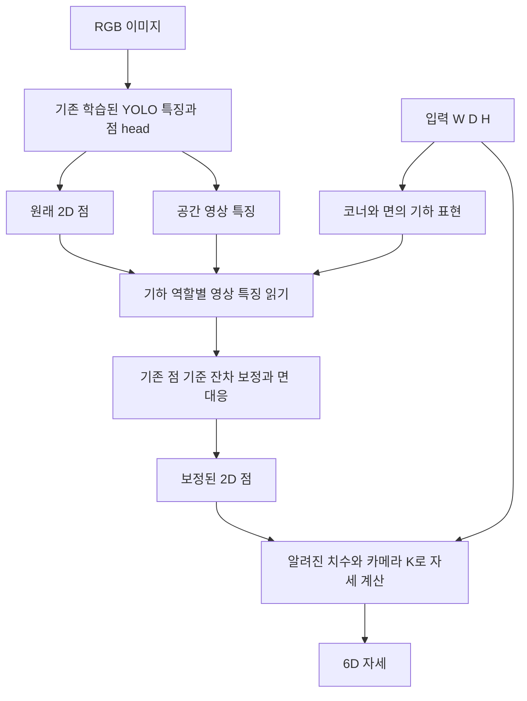

# 팔레트 치수 입력 아키텍처 — 논문 기여 후보 설계

> **2026-09-11 후속:** 사용자가 새 자산 일반화 검증을 승인하여 아래 아이디어 중 동결 YOLO+치수·기하 잔차 보정의 제한된 실험을 완료했다. [실제 새 자산 비교 결과](unseen-dimensions-screen.md)를 최신 상태로 본다. 물리 역할 선택과 전체6D 공동 학습까지 구현한 것은 아니다. 아래의 미실행 표기는 최초 작성 당시 상태다.

> **원문 확인 전 작성한 별도의 잠정안이다. 사용자의 원래 웹 대화 설계나 승인된 실행 계획이 아니다.** 원문에 요청된 치수 입력·공동 대칭 로스와 실제 진행 상태는 [공유 대화 대조 기록](shared-dimension-symmetry-review.md)을 우선한다.

2026-09-11. 사용자 목표: “여러 파렛크 종류 치수 입력으로받기”, “논문에서의 기여로 아키텍쳐 파렛트기반으로 하고싶어서”.

**상태: 기존 구현·결과 확인과 설계 정리 완료. 아래 새 구조의 코드 구현·학습·성능 검증은 아직 하지 않았다.**

## 논문에서 답할 질문

이미지와 알려진 외형 치수 W/D/H를 입력받는 하나의 모델이, 학습 때 보지 못한 팔레트 종류에서도 물리적 면·코너 대응을 유지해 키포인트와 6D 자세를 개선하는가?

치수는 사용자가 알고 제공하는 값이다. 추론에서 GT 자세·GT 박스·정답 코너·정답 면 방향은 받지 않는다. 카메라 K는 보정된 입력으로 둔다. 여러 개가 동시에 검출되면 치수와 검출 객체의 연결이 별도로 필요하다. 첫 실험은 기존과 같은 단일 대상 객체 계약으로 제한한다.

## 기존에 어디까지 했나

[진행 상태 확인](dimension-input-status.md)의 두 경로를 구분한다.

- S1은 이미 치수를 넣어 앞면 W/D 방향을 분류했다. 클린 스타트 합성 DEV에서 S0 85.5254%→S1 90.4141% balanced accuracy였지만, 최종 점 좌표를 치수로 개선하는 전체 YOLO 구조는 아니었다.
- 로컬 v5/v6는 치수 조건화를 새 점/선/자세 head와 공동 solver까지 연결하고 실제 학습했다. 그러나 새 점 head의 정확도가 원래 YOLO보다 크게 낮아 채택하지 않았다.
- LC/translation 로스는 별도 경로다. 손실에 치수를 쓴 것과 추론 신경망이 치수를 입력받는 것을 구분한다.

## 첫 아키텍처 후보

기존 점 head의 가중치와 기본 출력을 초기 상태에서 정확히 보존한다. 새 잔차 출력층은0으로 초기화해 시작 시 원래 모델과 좌표가 같도록 한다. 이것은 초기 보존일 뿐 학습 후 비악화 보장이 아니다. v6처럼 완성된 점 예측을 버리고 새 점 head를 처음부터 학습하지 않는다.

단순 치수 벡터 concat을 반드시 대조군으로 둔다. 후보 구조에서는 입력 치수로 코너의 상대 위치, 위/아래 면과 W/D 면의 연결을 표현해 영상 특징을 읽는 위치·역할에 영향을 주도록 한다. 원본 점 주변만 고집하지 않고 검출 ROI의 공간 특징도 읽는다. 차별화 여부를 확인할 대상은 이 기하 역할 표현이며, attention/FiLM 연산 자체를 새 기여로 부르지 않는다.

물리적 팔레트 구조와 외형 cuboid를 구분한다. 얇은 높이와 상·하부 구조는 대상 분포에서 확인해야 한다. 포크 구멍은 팔레트마다 개수·위치·진입 방향이 다르므로 W/D/H만으로 정확한 위치를 계산할 수 없다. 첫 구조에 고정 “구멍2개”를 강제하지 않는다. 삽입면/개구부 표현을 추가하려면 별도의 관측 및 역할 감독이 필요하다. **현재의 코너·면 그래프만으로 팔레트 전용 독창성이 확립된 것은 아니다.**

대칭적으로 구분되지 않는 면은 여러 가설을 유지할 수 있지만, 가설 평균이 존재하지 않는 중간 자세를 만들지 않도록 한다. 대칭 계약은 실제 물체에 허용된 C1/C2만 적용하며, W=D라는 이유만으로 물리적 C4 대칭을 선언하지 않는다. 치수를 넣는 것만으로 관측 불가능한 앞뒤 방향이 결정된다고 가정하지 않는다.

## 로스의 위치

기존 YOLO 점·검출 손실을 기본 감독으로 유지한다. v6의 전체 공동 손실을 그대로 옮기지 않는다. 첫 비교에서는 원래 점과 보정 점의 실제 좌표 정확도를 같은 GT 정의로 평가한다. 별도 면 대응 감독을 쓰면 한 객체의 코너·면·자세에 하나의 일관된 역할 배정을 적용한다.

물리 3D 관계를 감독하려면 입력 치수에서 생성한 X_i(W,D,H), 예측 자세 R/t, 카메라 K의 투영과 2D 관측 사이의 관계를 사용한다. 이는 일반적인 재투영/기하 감독이고 그 자체를 새로운 로스로 주장하지 않는다. 예측점과 예측자세가 함께 틀려도 자기 일관성이 좋아질 수 있으므로 GT 점 손실을 대신하게 하지 않는다. 이런 항을 추가하는 효과는 아키텍처 효과와 별도 대조에서 확인해야 한다.

첫 구현 전에 확정할 세부 계약: 데이터별 metric 단위와 축 순서, 카메라 기준 코너 ID↔물체 기준 역할의 대응, 기하 변환 증강 후 K, 관측/비관측 GT 정의, 잔차 제한과 보조 손실 계수. 결과를 본 뒤 계수·조건별 규칙을 반복 조정하지 않는다.

## 최소 비교와 진행 기준

| 군 | 치수 사용 위치 | 답할 질문 |
|---|---|---|
| A 기존 YOLO의 동일 예산 추가 학습 | 최종 PnP에만 | 실제 기준선 대비 개선되는가 |
| B 동일 잔차 head·치수 벡터 concat | 신경망+PnP | 단순 치수 입력으로 충분한가 |
| C 기하 역할을 사용한 후보 구조 | 특징 읽기·대응+PnP | 새 구조가 B보다 나은가 |
| D C에서 기하 관계를 제거한 학습 대조 | 치수 입력은 유지 | 관계 구조의 추가 효과인가 |

치수 shuffle/다른 치수 입력의 추론 진단도 수행하되 **PnP 치수는 맞는 값으로 유지**한 실험을 먼저 둔다. 그래야 잘못된 치수로 PnP 스케일이 틀어지는 현상을 신경망의 치수 활용 증거로 오인하지 않는다. 실제 치수 측정 오차가 들어오는 운용 민감도는 별도 표로 보고한다.

동일 데이터·초기 가중치·배치·업데이트 예산·최종 체크포인트와3시드를 사용한다. 단순 치수 concat B를 못 넘으면 새 관계 구조의 기여가 지지되지 않는다. 현재 모델의 정상점 정확도가 희생되면 평균 개선만으로 채택하지 않는다. 성능·악화 허용 수치 및 학습 예산은 실행 전에 별도 protocol로 동결해야 한다. 이 설계 문서는 아직 동결된 실행 protocol이 아니다.

점 오차뿐 아니라 W/D 역할 정확도, translation/depth/rotation, 큰 오류, 검출 실패, 가림/잘림, 실행시간을 함께 본다. 주 지표의 승격 기준을 미리 고정하고, 실패 시 같은 실사에 새 gate/손실을 맞추는 반복은 하지 않는다.

## 일반화와 논문 기여의 조건

같은 CAD의 치수를 squash한 이미지는 “다른 물리적 팔레트 구조”의 증거가 아니다. 새 팔레트 종류를 주장하려면 CAD 자산/물리 인스턴스와 촬영 세션을 분리해야 한다. 앞단 YOLO도 이미 본 자산이면 뒷단만 새 자산 분리해 놓고 전체 모델의 미지 자산 일반화라고 부르지 않는다.

기존 실사 DEV와 V44의 같은2CAD 새 장면은 각각 탐색과 장면 일반화 범위다. 이들만으로 이번 목표의 최종 논문 기여를 입증할 수 없다. 실행 전 실제 사용 가능한 새 자산·치수 분포·평가 분리의 감사를 먼저 해야 한다.

## 확인한 관련 연구와 중복 가능성

아래는 관련성 확인이며 포괄적 신규성 인증은 아니다. 각 논문의 서로 다른 평가 지표를 우리 수치와 직접 비교하지 않는다.

- [Front Face Shot, IEEE Access 2025](https://ieeexplore.ieee.org/document/10870115/): 팔레트 앞면의 영상 구조를 이용한6D 자세 추정과 학습하지 않은 외관 대응을 이미 다룬다. 따라서 “앞면으로 뒤를 복원한다”만으로 독창성을 주장할 수 없다.
- [Hypergraph and Knowledge-Enhanced Pallet Pose, 2026](https://nyaspubs.onlinelibrary.wiley.com/doi/abs/10.1111/nyas.70219): 출판사 초록에서 E자형 팔레트의 키포인트 관계, 구조 사전지식과 불확실성 기반 자세 추정을 명시한다. “팔레트 그래프+기하 제약”만으로 차별화되지 않는다. 이번 확인은 초록 범위이며 치수 입력/다종 일반화의 세부 유무는 전문 비교가 필요하다.
- [GPV-Pose, 2022](https://arxiv.org/abs/2203.07918): category-level pose/size와 geometry-guided voting 선행 연구다. RGB-D/관측 입력 조건을 우리 RGB+known-dimensions와 맞춰 해석해야 한다.
- [Linear-Covariance Loss, ICCV2023](https://openaccess.thecvf.com/content/ICCV2023/html/Liu_Linear-Covariance_Loss_for_End-to-End_Learning_of_6D_Pose_Estimation_ICCV_2023_paper.html): 대응점 손실에 최종 자세의 영향을 고려하는 원리가 이미 있다. 기존 LC 유도항을 팔레트에 붙였다는 이유만으로 새로운 손실이라고 부르지 않는다.

잠정 기여 후보는 “입력 치수 변화와 부분 관측에도 물리적 면·코너 대응을 유지하는 구조가, 실제로 보지 못한 팔레트에서 단순 치수 결합과 기존 YOLO를 넘는다”이다. **아직 검증된 기여가 아닌, 검증할 가설이다.**
