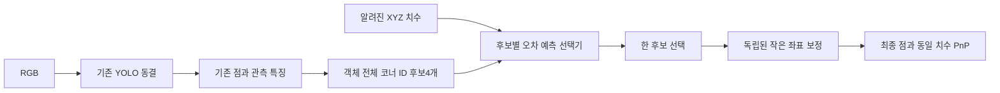

# 코너 대응 선택과 작은 보정 분리 — 실제 검증

2026-09-11. **본 팔레트 종류의 새 장면에서는 평균 개선이 재현됐지만, 처음 보는 종류에서 안정적인 추가 개선은 실패했다.** 사용자가 승인한 순서 선택+보정 구조를 구현하고, 발견한 손실·학습 대상 연결 문제까지 대조했다. 이번 결과를 보편적인 아키텍처 불가능성이나 논문용 안정적 개선으로 확대하지 않는다.

[HTML·이미지 보고서](../../../../data/pallet/results/pallet_role_selection_v2/index.html) · [최종 수치](../../../../data/pallet/results/pallet_role_selection_v2/foreground_matched/SUMMARY.json) · [실행 코드](../../../../scripts/research/pallet_role_selection_v2/README.md)

## 최종 비교: GT 대응 감독을 수정한 뒤 새로 만든576관측

평균·P90은 모든 군에 공통인 검출 프레임의8개 코너 오차다. 본 종류 **216/288**, 새 종류 **208/288**가 검출·매칭됐다. ±는3시드 표준편차. 주 지표는 실패를 이미지 대각선 오차로 포함한 전체 프레임 정규화 오차다.

| 방법 | 본 종류 평균 px | 새 종류 평균 px | 새 종류 주 지표↓ | 새 종류 P90 px | 이동 오차 cm |
|---|---|---|---|---|---|
| 기존 YOLO | 23.916 | 25.140 | 0.302299 | 31.65 | 4.123 |
| 규칙 기반 ID 재정렬 | 18.286 | 21.506 | 0.298608 | 24.09 | 4.123 |
| 대상 연결 수정 전 | 21.116 ± 0.655 | 25.992 ± 1.290 | 0.303505 | 118.30 | 3.335 |
| 점 보정만 · 대상 연결 수정 | 22.495 ± 0.064 | 23.736 ± 0.176 | 0.300925 | 32.26 | 3.917 |
| 순서 선택 + 보정 · 대상 연결 수정 | 17.823 ± 2.958 | 24.396 ± 1.386 | 0.301972 | 45.23 | 3.814 |

- 본 종류: 기존 **23.916→17.823px**, 평균 **25.48% 감소**. 직접 점 보정22.495px보다도 세 시드 모두 좋았다. 새 장면 그룹 bootstrap의 C−직접보정 주 지표 구간은 **[-0.0096634, -0.0006608]**로0미만이다. 이는 사전 주 목표인 새 종류 일반화와 별도의 조건부 결과다.
- 새 종류: 기존 **25.140→24.396px**, 평균 **2.96% 감소**지만, **직접 점 보정23.736px보다 나빴다.** 검출 실패 포함 주 지표에서는1시드 개선·2시드 악화다. 원시 픽셀 평균과 정규화 주 지표는 crop 해상도에 따라 가중치가 달라 결론의 부호도 다를 수 있다.
- 새 종류 C−기존 주 지표95%구간은 **[-0.0061007, 0.0060590]**로0을 포함한다. 사전 안정성 기준은 통과하지 못했다.
- 새 종류는 scene_2.usd/scene_3.usd, 본 종류는 scene.usd/scene_1.usd다. 새 종류는 해당 YOLO와 이번 보정 학습에 없지만 과거 다른 연구 풀에는 있었다. 두 메시·12장면 그룹에 대한 합성 결과이며 독립 실사/임의 새 종류 일반화 신뢰구간이 아니다.
- 이동 오차는 각 시드의 PnP 이동 오차 중앙값을 평균낸 진단이다. 물리적 방향 의미가 확정된 회전 정확도·완전한6D 자세 성능은 이번에 입증하지 않았다. 규칙 재정렬은 좌표 집합을 바꾸지 않으므로 큰 ID 오차 감소가 그대로 물리 자세 개선을 뜻하지 않는다.

| 시드 | 본 종류 px | 새 종류 px | 새 종류 주 지표 개선 | 유익/유해 순서 변경 | 좋음→큰 오류 · 전체 종류 |
|---|---|---|---|---|---|
| 1 | 16.496 | 22.865 | +0.665% | 8/6 | 3 |
| 2 | 15.761 | 24.760 | -0.050% | 7/7 | 5 |
| 3 | 21.212 | 25.564 | -0.291% | 6/7 | 6 |

유익/유해 순서 변경은 새 종류 검출 프레임에서 작은 보정 전 순서 선택만의 효과다. 새 종류에서 선택을 바꾼13~14개 중6~7개가 잘못된 방향이었다. 마지막 열은 본/새 종류 전체에서 기존10px이하가20px초과로 바뀐 수다. 평균이 좋아진 경우도 정상 프레임 보호가 보장되지 않는다.

## 실제로 바뀐 아키텍처

추가한 두 학습 모듈을 기존 YOLO 출력 경로에 연결했다. Backbone·검출 head는 동결했고, 전 네트워크 재학습은 아니다. 후보마다 점 좌표·점 특징·가시성 값을 같은 순서로 재배치하고 중심점8은 유지한다. 후보의 좌표를 평균내지 않고 하나를 선택하며, 선택 후 보정은 각 좌표±16px다. 초기에는 기존 순서와 원래 점을 정확히 보존한다.

네 후보는 **카메라 기준 코너 ID가 잘못 배정됐을 가능성**이며, 실제 팔레트를90도 돌려도 같다는 C4 대칭 가정이 아니다. 물리적인 전면 의미를 식별하도록 새로 정의한6D head도 아니다. 선택기와 보정기는 입력을 공유하지만 학습 파라미터를 공유하지 않는다. hard argmin을 통과하는 gradient 대신 각각의 감독을 사용한다. gradient surgery를 사용하지 않았으며, 두 분기의 직접적인 gradient 충돌이 이번 실패의 원인이라는 설명은 맞지 않는다.

최종25.48% 조건부 개선은 순서 선택 구조와 후보별 보정 감독을 함께 적용한 방법의 결과다. 최종 GT 대응 수정 단계에서 치수 제거군이나 선택만 학습하는 군을 다시 훈련하지 않았으므로, 이를 치수 입력 단독의 기여라고 부르지 않는다. 처음4군 대조와 최종 두 군 대조의 범위를 구분한다.

추론에는 RGB에서 얻은 점/특징과 알려진 치수만 들어간다. GT 박스·GT 점·정답 후보 번호를 넣지 않는다. 학습에서는 실제 GT를 이용해 후보 오차와 가장 좋은 후보의 보정량을 감독한다. 이것은 정답 감독 학습이며 pseudo-label selftraining이 아니다. Hough/선 분기는 이번 코너 대응 원인 실험에 포함하지 않았다.

## 확인한 두 실험 구성 문제와 수정

1. **손실과 목표의 불일치.** 최초 선택기는 평균적으로 낮은 오차 후보를 고르는 것이 목적이었으나 Huber 회귀는 조건부 평균 오차 추정과 같지 않다. 제곱오차로 바꾸고 좌표 보정 가중치는 정확히 고정해 대조했다. 학습의 큰 수정 가능 사례193개 중 실제 고친 수는7/14/14→36/27/25개로 늘었다. 그러나 새 장면에서는 시드마다 이득과 손해가 달랐다. 손실이 일부 원인이지만 단독 해법은 아니었다.
2. **학습 후보와 GT 객체 연결.** 처음에는 가장 높은 점수 후보 전부에 코너 감독을 줬다. 그중136/1536개는 GT 박스 IoU<.5였다. GT IoU≥.5인1400개에만 코너 감독을 주도록 수정하고, 직접 보정과 선택+보정을 동일 예산으로 다시 학습했다. 이 과정에서 confidence 기준은 쓰지 않았다. 평가의 검출 실패와 기존 GT는 그대로 유지했다. 최종 표가 이 수정을 반영한 비교다.

두 수정마다 다음 평가를 보기 전에 protocol을 저장하고 새 장면576개를 따로 만들었다. 아래 표는 **서로 다른 평가셋**이므로 행 사이 수치를 개선량으로 계산하면 안 된다.

| 단계별 별도 평가 | YOLO px | 직접 보정 px | 당시 선택+보정 px |
|---|---|---|---|
| 1차 새 장면 | 30.938 | 30.609 | 33.813 |
| 손실 대조 새 장면 | 33.303 | 32.240 | 33.243 |

총21개 체크포인트·25,200업데이트, 새 합성 관측1,728개를 생성했다. 첫4군×3시드 비교, 선택 손실만 바꾼3시드, GT 대상 연결을 수정한2군×3시드다. 한 데이터셋에 가중치·임계값을 반복 맞추는 탐색은 하지 않았다.

## 해결된 것과 남은 것

| 항목 | 현재 판단 |
|---|---|
| ±64px로 큰 ID 이동을 못 하던 표현 제한 | 순서 후보를 통해 큰 이동을 표현할 수 있게 수정·검사 |
| 선택과 보정의 직접 gradient 충돌 | 파라미터 분리, 선택만/B와 C의 보정 제거 출력이 정확히 같음 |
| 평균 오차 선택 목적과 Huber 회귀 차이 | 제곱오차 대조 완료; 학습 내 개선, 새 장면 안정성 미해결 |
| GT와 다른 객체 후보에 코너 감독 | 학습의 GT 박스 대응으로 수정; 원본 GT는 수정하지 않음 |
| 본 종류의 새 시점 대응 | 조건부 평균 개선은3시드 재현 |
| 새 종류에서의 후보 선택 신뢰성 | 유해 순서 변경과 시드 변동이 남음 |
| 검출 실패 | 동결 검출기 공유로 개선하지 못함 |
| 실제 새로운 팔레트·촬영 세션 | 데이터 미확보, 평가하지 않음 |

따라서 “두 모듈이 공존할 수 없다”는 결론은 아니다. **본 종류에서 쓰일 수 있는 조건부 효과는 있고, 새 종류의 올바른 순서 선택이 남은 병목이다.** 다만 어느 입력 특징이 부족한지, 학습량/구조 중 무엇이 지배적인지는 이번 결과만으로 단정할 수 없다. 단순히 gradient 수술이나 보정 cap 확대로 해결된다고도 말할 수 없다.

## 이미지와 다음 판단

그림은 모두 실제 모델 추론이며 초록GT·분홍예측이다. 시드1의 개선/악화 예를 명시적으로 선택해 설명했고 체크포인트 선정에는 쓰지 않았다.

이번 구조의 사전 안정성 기준은 실패로 종료한다. 같은 후보 점수·전환 임계값 탐색을 추가하지 않는다. 다음 설계 판단은 camera-facing 면적 기준 ID와 고정 물리 역할을 구분하고, 새 종류에서도 관측 가능한 역할 증거를 학습하는 데 초점을 둬야 한다. 현재의 단순 cuboid ID 재배치만으로 팔레트 전용 논문 신규성과 안정적인 실제6D 개선을 주장하기는 어렵다. 그 이후의 새 구조·새 실사 학습은 이번 완료 범위에 포함하지 않는다.

## 재현

`FINAL_AUDIT.json`에서 새 장면 중복 없음, 동일 검출 평가 모집단, 모델 출력 재현, 지표 독립 재계산, 작은 보정 범위, GT 재투영과 이전 결과 보존을 검사했다. GPU는 기존 프로세스 전용 라이브러리 경로를 사용했고 재부팅하지 않았다. 실행시간은1차 `SUMMARY.json`의 CPU2스레드 보정 분기 진단이며 최종 전체 네트워크 지연을 측정한 것은 아니다.
