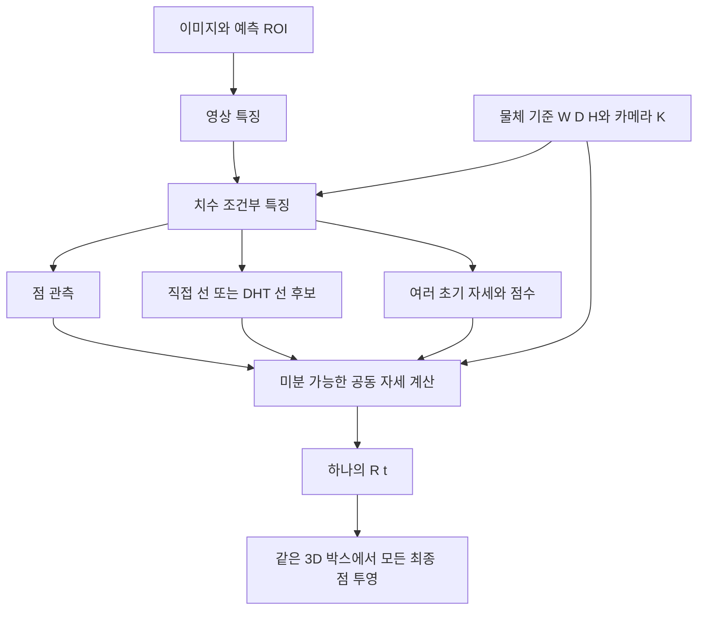

# 공유 대화 원문 확인 — 치수 입력과 공동 대칭 로스

> 후속 실행 완료: [치수 × 대칭 네 군 결과](dimension-symmetry-2x2-results.md). 아래의 “완료 기록을 찾지 못함”은 원문 대조 당시 상태다. 이후 기존 YOLO 출력층을 학습하는 네 군·3시드 시험을 실행했으며, 전체 네트워크 학습과는 구분한다.

2026-09-11 확인. **원문과 기존 실행을 대조한 기록이며 새 학습 결과가 아니다.**

원문: [DeepHough 아키텍처 분석](https://chatgpt.com/share/6aa14d97-b5f0-83ee-aac2-f4ee15020c46). 공개 페이지를 HTTP 200으로 받아 사용자 메시지와 최종 답변 본문을 확인했다. 공유 페이지의 코드 검증 주장은 로컬 성능 검증과 구분한다.

## 사용자가 원래 요청한 것

**이미지와 알려진 팔레트 치수 W/D/H를 입력받고, 실제로 동등한 대칭 배치를 정답으로 인정하는 점·선·자세 아키텍처**다. Translation/LC 로스나 앞면 방향 분류기만을 요청한 것이 아니었다.

핵심 손실은 다음과 같다. 가중치와 보조 항은 구현별로 다르지만, 대칭 선택의 단위는 동일해야 한다.

```math
L = L_{det}+L_{center}+
\min_{g\in G_{pallet}}\left[
\lambda_p L_{point}(g)+\lambda_l L_{line}(g)+\lambda_R L_{pose}(g)+L_{aux}(g)
\right]
```

- 한 객체의 모든 코너·모서리·자세와 관련 감독이 **같은 대칭 g**를 공유한다. 점마다 또는 손실마다 따로 유리한 배치를 고르면 안 된다.
- 임의의 점 순열이 아니라 실제 물체에서 허용되는 C1/C2/C4만 사용한다. 중심점은 고정하고 모서리 연결을 유지한다.
- W=D 또는 사방 포크 진입 가능만으로 90도 물리 대칭을 선언하지 않는다. 고정 물체 좌표계의 W/D를 GT 시점에 따라 바꾸지도 않는다.
- 학습에서 GT로 손실을 계산하는 대칭 선택을 추론 시 GT 사용으로 옮기지 않는다.

## 원문에서 발전한 두 단계

먼저 치수 입력과 대칭 학습의 효과를 분리하는 네 비교군을 제안했다.

| 군 | 신경망에 치수 입력 | 학습에서 유효 대칭 허용 |
|---|---|---|
| A | 없음 | 없음 |
| B | 없음 | 있음 |
| C | 있음 | 없음 |
| D | 있음 | 있음 |

네 군 모두 최종 기하 계산에는 올바른 치수를 사용하고, 평가에서도 같은 유효 대칭을 허용해야 한다. 그래야 평가 규칙이 느슨해진 효과와 실제 학습 개선을 구분할 수 있다. 백본·초기 가중치·데이터·학습 예산도 맞춰야 한다.

이후 원문의 v5 제안은 다음과 같은 공동 자세 구조로 구체화됐다.



v5의 점 전용/직접 선/Hough 비교는 모두 치수·대칭을 갖추고 **선의 추가 효과**를 묻는다. 앞의 네 군 비교와 답하는 질문이 다르다. 원문은 이후 실제 구현 방향을 구체화했으므로, 네 군 비교만이 대화의 최종 설계였다고 해석해서도 안 된다.

## 로컬에서 확인한 상태

| 항목 | 확인한 상태 | 해석 |
|---|---|---|
| 원문 v5 ZIP의 정확한 재현 | 문서만 전달, 코어 패키지 누락 기록 | 원문이 주장한 72개 검사를 여기서 재현했다고 할 수 없음 |
| 로컬 v5/v6 공동 구조 | 별도 구현 및 실제 학습 완료 | 아예 시작하지 않은 아이디어는 아님 |
| v6 학습 | 3개 군 × 3시드, 총 18,000 업데이트 | 모든 군이 치수 입력과 공동 대칭 로스를 사용 |
| v6 Hough의 추가 효과 | 점 전용 대비 주 지표 +0.95% / −7.94% / −5.85%, 모든 시드 P90 악화 | 해당 구조·예산에서 안정적 개선 미확인 |
| v6 실사 평가 | 합성 기준 미통과로 미실행 | 실사 개선을 주장할 수 없음 |
| 치수 유무 × 대칭 학습 유무 네 군 | 검색한 코드·프로토콜·결과에서 완료 기록을 찾지 못함 | 두 요소의 독립 효과와 상호작용은 분리 검증되지 않음 |
| C4 학습 검증 | 감사된 학습 집합에 유효 C4 표본 없음 | 모든 팔레트 대칭에 일반화했다고 할 수 없음 |

v6는 기존 YOLO 점 출력을 유지하는 보정기가 아니라 새 점/자세 head를 학습했다. 번호를 제외한 공간 배치 진단에서 기존 YOLO 평균 4.18px에 비해 새 Hough 군은 30.88/27.47/32.14px였다. 따라서 새 점 전용 모델보다 일부 좋아졌다는 사실만으로 기존 모델을 개선했다고 볼 수 없다. 이 진단은 배포 성능 지표가 아니다.

## 지금 내릴 판단과 재개 순서

1. **원래 의도를 정정한다.** 요청한 것은 치수 조건화와 객체 전체의 대칭 일관성이다. 원문 확인 전에 작성한 잔차 구조 제안은 별도의 잠정안이다.
2. **해당 로스는 이미 로컬 공동 모델에 구현·학습됐다.** 다만 실패 원인을 치수 또는 대칭 로스 하나로 분리하지 못했다. 대칭 로스는 동등한 배치의 번호 벌점을 줄이지만, 잘못 검출한 코너 위치나 선 경계를 자동으로 고치지 않는다.
3. **재개할 우선 실험은 강한 점 기준선을 보존한 네 군 비교다.** 원문에 있던 질문을 작은 통제 실험으로 먼저 해결하고, 이 조건을 맞춘 점 전용/직접 선/DHT 비교로 진행한다. 학습 전에 객체 좌표계의 GT 변환, 실제 대칭, 치수 단위와 데이터 분리를 확정해야 한다. 이 문서는 새 실행 프로토콜 동결이나 성능 보장이 아니다.

치수 입력 또는 대칭 로스 자체가 새로운 논문 기여라는 결론은 내리지 않는다. 여러 팔레트에서의 일반화와 기존 강한 모델 대비 개선을 별도로 입증해야 한다.

## 로컬 근거

- [외부 v5 누락 기록](../../../data/pallet/results/pallet_point_line_v5/BLOCKED_MISSING_BUNDLE.json)
- [로컬 v5 판정](../../../data/pallet/results/pallet_point_line_v5_local/VERDICT.json)
- [v6 실제 완료 기록](../../../data/pallet/results/pallet_point_line_decisive_v6/PIPELINE_COMPLETION.json)
- [v6 결과와 실패 진단](../../../data/pallet/results/pallet_point_line_decisive_v6/INTERPRETATION_KO.md)
- [v6 치수 조건부 head](../../../scripts/research/pallet_point_line_decisive_v6/plpose_local/heads.py)
- [v6 공동 대칭 손실](../../../scripts/research/pallet_point_line_decisive_v6/plpose_local/losses.py)
- [모든 군에 같은 손실을 적용하는 학습 코드](../../../scripts/research/pallet_point_line_decisive_v6/cli_train.py)
