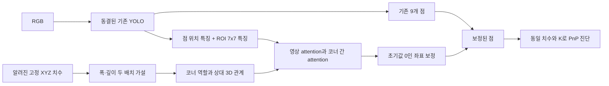

# 새 팔레트 치수·기하 구조 검증 — 2026-09-11

**결론: 이번 기하 관계 보정 구조의 안정적인 추가 이득은 확인되지 않았다.** 단순 치수 결합과 기하 관계 구조 모두 기존 YOLO를 일관되게 넘지 못했다. 이는 고정 YOLO 뒤의 이번 보정 모듈·학습 예산에 대한 결과이며, 치수 입력 아키텍처 전체의 불가능성 판정은 아니다.

[대화형 HTML 보고서](../../../../data/pallet/results/pallet_unseen_dimensions_v1/index.html) · [수치 원본](../../../../data/pallet/results/pallet_unseen_dimensions_v1/SUMMARY.json) · [실행 코드](../../../../scripts/research/pallet_unseen_dimensions_v1/README.md)

## 무엇을 새로 검증했나

기존 YOLO가 학습한 자산은 scene.usd, scene_1.usd, EUR GLB, block GLB 네 종류다. P0/TEX는 기록상 모두 scene.usd다. 이번 학습에는 앞의 두 USD만 사용하고, **해당 YOLO가 보지 않은 scene_2.usd와 scene_3.usd**를 평가했다. 이 두 자산은 다른 과거 연구 풀에는 존재하므로, 프로젝트 전체에서 미개봉인 논문 FINAL 데이터라고 부르지 않는다.

같은 렌더러·카메라·크기·조명 분포로 본 자산과 새 자산을 함께 평가했다. 이미지 2,304개: 학습1,536 / 본 자산 검증192 / 평가576(본 자산288 + 새 자산288). 데이터와 조건을 결과 전에 동결했다. 검증192개로 체크포인트를 고르지 않고 최종 업데이트를 사용했다. 그룹별 크기 변형은 다양화이며 새 구조로 세지 않았다.

## 구조와 비교의 범위

A는 점·영상 특징만, B는 동일 구조에 단순 치수 결합, C는 코너 역할과 상대 기하를 attention에 추가, D는 C에서 상대 관계를 제거한 대조군이다. 각 모델57,560개 파라미터를 할당했지만 입력을 끈 분기의 실효 자유도까지 같다고 주장하지 않는다. 출력이0으로 시작해 모든 군이 초기 YOLO 점을 정확히 보존했다. 이후 동일한 초기 상태·배치 순서로4군×3시드×1,200업데이트=14,400업데이트를 수행했다. 각 좌표 보정은±64px로 제한했다.

**실제 학습한 것은 추가 보정 모듈이다. YOLO backbone·검출 head 전체 재학습, Hough 분기, 물리적 면 분류 감독은 이번 실험에 없다.** C의 관계 분기 gradient와 초기 보존 검사를 통과했다. 이 cuboid 관계 자체가 팔레트 논문 신규성을 뜻하지는 않는다.

## 비교 결과

아래 평균·P90은 동일하게 검출·매칭된 프레임의8코너 오차다. 평균의±는3시드 표준편차이며 신뢰구간이 아니다. 주 지표는 **검출 실패를 이미지 대각선 오차로 포함**한 전체 프레임 정규화 오차다. 실패를 표에서 숨기지 않는다.

| 방법 | 본 자산 평균 px | 새 자산 평균 px | 새 자산 주 지표↓ | 새 자산 P90 px | 이동 오차 중앙값 cm |
|---|---|---|---|---|---|
| 기존 YOLO | 26.851 | 30.156 | 0.343557 | 153.80 | 3.488 |
| A 점 보정 | 26.813 ± 0.448 | 30.174 ± 0.492 | 0.343551 | 149.98 | 3.193 |
| B 단순 치수 결합 | 26.740 ± 0.441 | 30.132 ± 0.374 | 0.343519 | 150.68 | 3.178 |
| C 기하 관계 | 26.767 ± 0.427 | 30.202 ± 0.384 | 0.343581 | 149.97 | 3.250 |
| D 관계 제거 | 26.850 ± 0.403 | 30.273 ± 0.415 | 0.343646 | 149.58 | 3.299 |

- 본 자산 검출·매칭: **207/288**, 새 자산: **197/288**. 동결 검출기를 공유하므로 모든 군이 같다.
- 새 자산 기존 YOLO의 점 오차 중앙값은 **5.367px**, 평균은 **30.156px**다. 큰 코너 대응 오류가 평균을 끌어올린다.
- C 대 B 주 지표 개선률: **-0.0212%, -0.0370%, +0.0045%**. 사전 기준인 모든 시드2% 개선에 미달했다.
- C−B 정규화 오차 차이의 장면 그룹 bootstrap95%구간: **[-0.0002772, 0.0004953]**.0을 포함한다.12개 장면 그룹에 대한 구간이며 두 메시 밖의 자산 모집단 일반화 신뢰구간은 아니다.
- 이동 오차는 각 시드의 중앙값을 평균낸 진단이다. GT를 넣지 않은 두 cuboid 대응 가설 PnP에 동일한 올바른 치수를 사용했다. **물리적 의미가 확정된 회전 정확도와 완전한6D 성능은 입증하지 않았다.**
- 이 표는 새 렌더링 평가셋이다. 이전 실사5px·8px 또는 합성5.05px 표와 숫자만 직접 비교하지 않는다.

### 새 자산 조건별 점 오차

| 방법 | 깨끗함 px | 가림판 px | 이미지25% 잘림 px |
|---|---|---|---|
| 기존 YOLO | 22.365 | 34.669 | 35.755 |
| A 점 보정 | 22.587 | 34.927 | 35.330 |
| B 단순 치수 결합 | 22.508 | 34.797 | 35.405 |
| C 기하 관계 | 22.573 | 34.917 | 35.439 |
| D 관계 제거 | 22.611 | 35.020 | 35.525 |

가림판은 평가에서 물체 픽셀 평균31.1%를 가렸다. 잘림192개 중 실제 화면 밖 코너가 있는 프레임은123개다. 모든 crop 프레임이 실제 팔레트를 자른다고 분류하지 않는다.

### 치수 민감도와 보정 모듈 실행시간

| 방법 | 올바른 치수 px | 치수 섞기 px | 치수5% 잡음 px | CPU 보정 p50 ms |
|---|---|---|---|---|
| B 단순 치수 결합 | 30.132 | 30.150 | 30.137 | 0.575 |
| C 기하 관계 | 30.202 | 30.121 | 30.189 | 0.566 |
| D 관계 제거 | 30.273 | 30.186 | 30.268 | 0.569 |

신경망 입력 치수만 다른 장면 그룹의 치수로 바꾸거나 독립 로그정규5% 잡음을 넣었다. PnP에는 계속 올바른 치수를 사용해 신경망 효과와 solver의 스케일 오류를 섞지 않았다. 실행시간은 CPU2스레드·batch1·고정 특징 입력의 모듈만이며, GPU 전체 YOLO 지연이나 실시간 배포 성능이 아니다. 표의 지연은 시드별 p50의 평균이다.

## 안 된 이유: 확인과 추정을 구분

1. **검출 실패는 보정 모듈로 해결되지 않는다.** 새 자산91/288프레임이 검출·매칭 기준에 실패했다. 본 자산도81/288프레임이 실패해, 새 메시 효과뿐 아니라 렌더링·시점 난도가 함께 있다. 따라서 현재 화면에서 치수 head만 바꿔 전체 성능을 크게 개선하는 데 구조적 한계가 있다.
2. **큰 오류에는 코너 ID 대응 문제가 있다.** 새 자산197검출 프레임 중28개는 네 가지 수평 코너 역할 배치 중 정답을 보고 고른 배치가 원래 배치보다 좋았다. 그 oracle 평균은 **8.684px**다. 완전히 자유로운 점 매칭 oracle은 **8.316px**다. 둘 다 실제 모델 성능이 아니고,90도 재배치를 물체의 물리적 C4 대칭으로 인정한 것도 아니다.
3. **작은 보정 경로로 큰 ID 이동을 맡긴 한계가 확인됐다.** 정답 보정 방향을 직접 주어도 각 좌표±64px 범위에서 가능한 최저 평균은 **14.787px**다. 이는 표현 범위의 하한 진단이지 더 좋은 학습 결과가 아니다. cap을 키우면 자동 해결된다는 증거도 아니다.
4. **기존 GT의 좌표 계산은 맞지만 ID 선택은 경계에서 민감하다.** 모든 GT가 기존 camera-facing-v4 규칙의 재정렬에서 자기 자신으로 돌아왔고,3D 재투영·GT PnP 이동 재현도 통과했다. 반면 GT에 독립1px 잡음을100회 더한 진단에서는 새 자산 검출 프레임에서 평균 **5.80%**가 다른 ID 순서로 재정렬됐다. 이는 기록된 GT가 틀렸다는 뜻이 아니라, 면의 투영 면적에 따른 ID 정의가 작은 변화에 불연속적으로 바뀔 수 있다는 뜻이다.
5. **단순 재정렬도 완전한 해법은 아니다.** 예측점만 기존 규칙으로 재정렬하면 평균 **30.156→24.173px**로 좋아졌지만, 원래10px이하였던2개 프레임이20px초과로 나빠졌다. 사후 후처리 진단이며 아키텍처 기여로 세지 않는다.

해석: 기하 attention에 학습 신호가 전달되지 않는 것이 주된 원인이라는 증거는 없다. 현재 근거는 **검출·코너 역할 선택·미세 좌표 보정을 구분해야 한다**는 쪽이다. 다만 oracle만으로 학습 가능한 역할 판별기가 존재한다고 증명되지는 않는다. gradient surgery는 이산 ID 변경이나 보정 표현 범위를 직접 바꾸지 않는다.

## 다음 판단과 논문 기여

이번 C의 관계 가중치·보정 cap을 같은 평가셋에 맞춰 다시 탐색하는 작업은 진행하지 않았다. 이 결과를 논문에서 안정적인 개선의 증거로 사용하기 어렵다. 현재의 현실적인 다음 구조는 기존 점 좌표를 보존하면서 **코너 대응 가설을 별도로 선택·유지하고, 선택 후 작은 잔차를 보정하는 방식**이다. camera-facing 면적 경계의 GT 역할 변화를 먼저 정의해야 하며, W/D/H만으로 관측 불가능한 면까지 결정할 수 있다고 가정하면 안 된다. 이번에 그 구조를 새로 학습한 것은 아니다.

논문용으로 확대하기 전에는 (1) 고정 물리 역할과 카메라 기준 ID를 분리한 감독 계약, (2) 기존 단순 치수 분류/결합 대비 역할 선택 효과, (3) 충분한 검출 커버리지와 학습에서 제외한 실제 새 팔레트·촬영 세션을 확보해야 한다. 새 실사 경로와 실측 치수는 사용자에게 확인 중이며 현재 실사 독립 평가는 수행하지 않았다. 추가 분석 몇 번이면 논문 기여가 확정된다고 말할 근거는 없다.

## 재현과 검증

`PROTOCOL.json`, `TRAIN_LOCK.json`, `DATA_AUDIT.json`, `PREFLIGHT.json`, `POSE_GT_AUDIT.json`, `AUDIT.json`을 저장했다. 데이터 분리·동일 초기화·모델 입력에 GT 없음·실제 공개 YOLO 출력과 캐시 일치·점 예측 재현·지표 독립 재계산을 확인했다. GPU는 프로세스 전용 NVIDIA580.173.02 경로로 사용했으며 재부팅하지 않았다. 실행시간 표는 CPU2스레드 보정 모듈만 측정했고 전체 카메라→결과 지연으로 주장하지 않는다.
