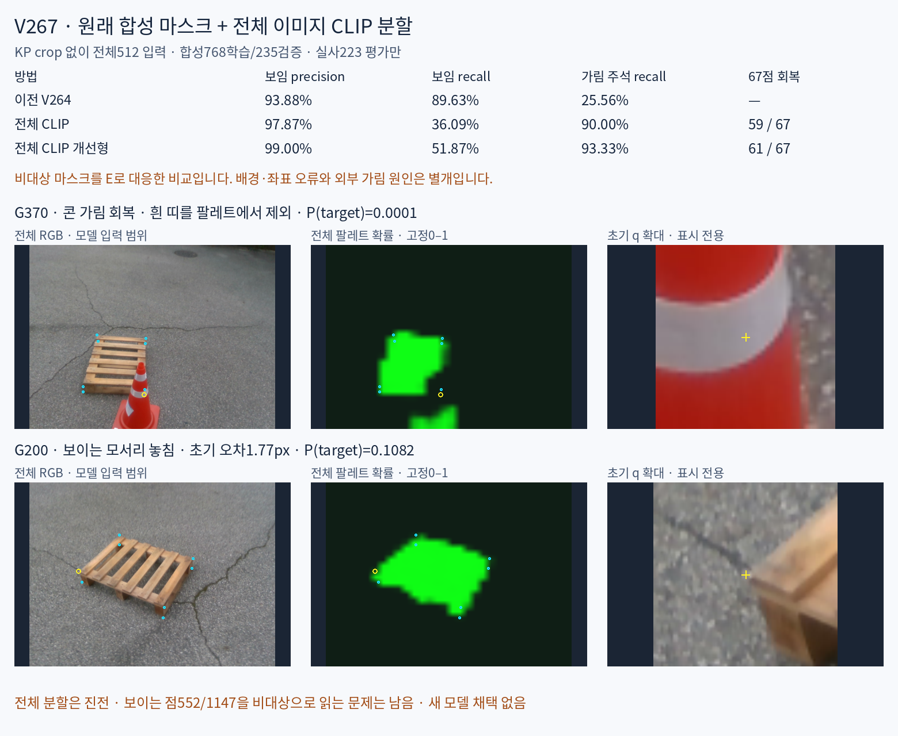
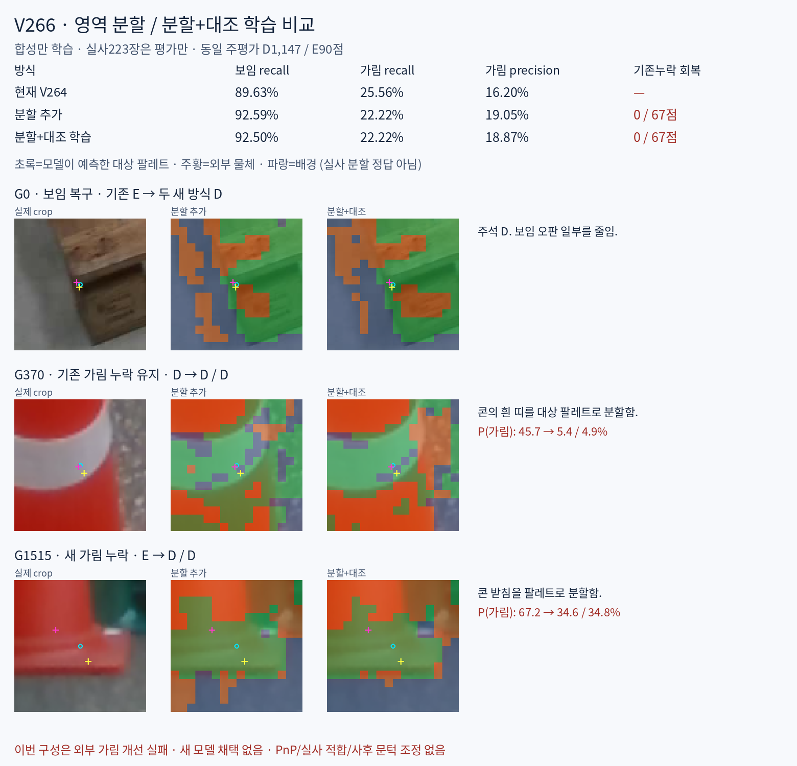
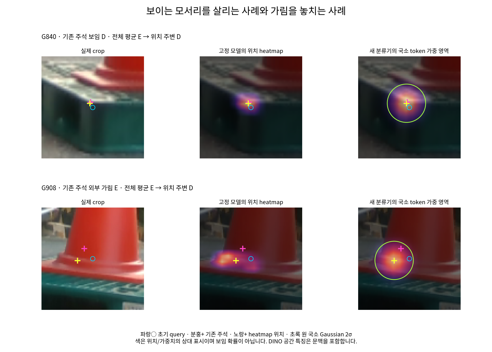
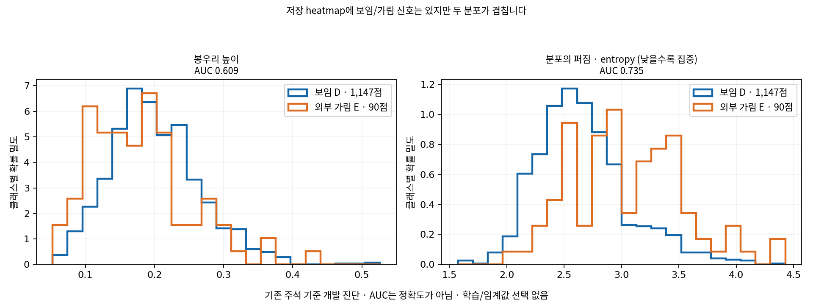
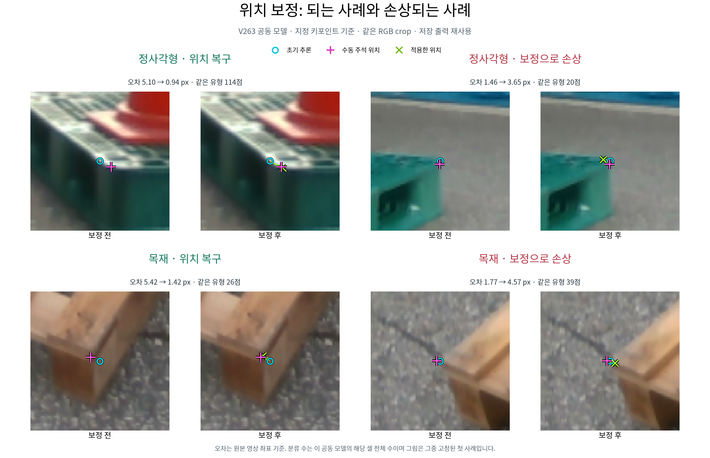
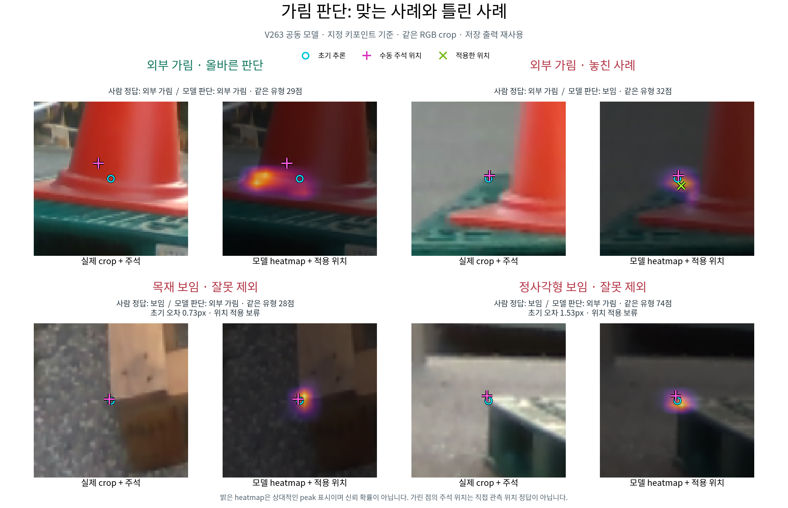
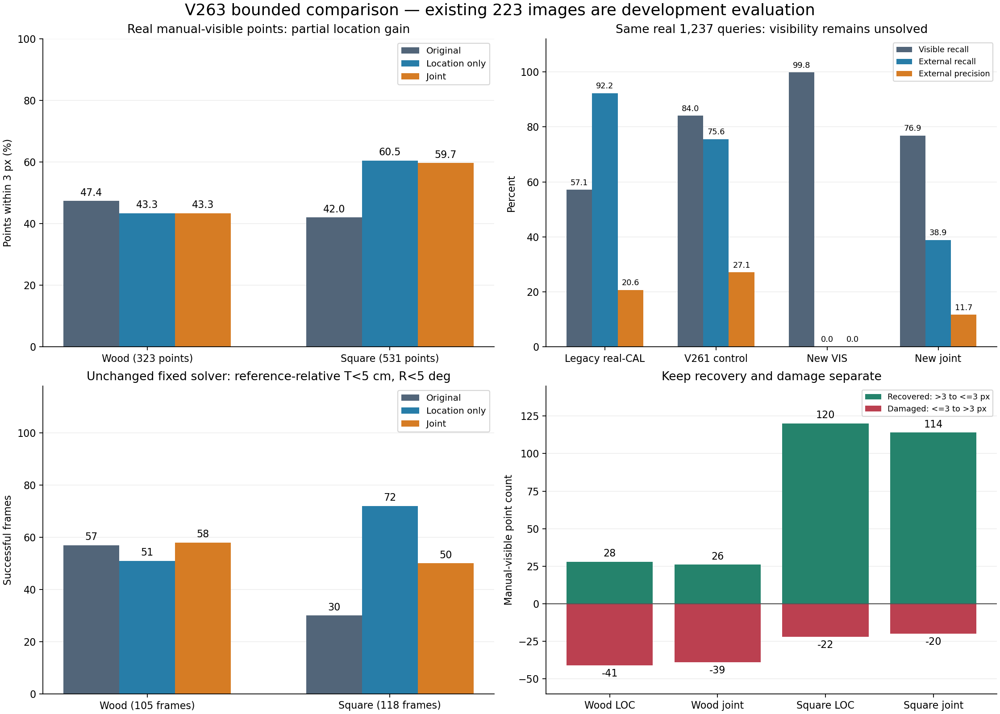

## V267 — 원래 합성 마스크의 전체 이미지 CLIP 분할 비교 완료

**콘을 제외하는 분할은 진전했지만 보이는 모서리를 놓쳐 새 판별기로 채택하지 않았습니다.** 전체 RGB를 처음부터512×512로 입력하고 사용자 원래 RGB/M4 학습768·검증235장만 사용했습니다. KP crop 없이 지도부터 저장한 뒤 초기 q를 읽으며, 실사223장은 평가에만 사용했습니다.

개선형의 외부 가림 recall은 V264의25.56→93.33%(누락67점 중61점 회복·새 누락0), 보임 recall은89.63→51.87%입니다. 보임 precision99.00%는595/601선택점이고 전체 정확도가 아닙니다. 비대상 마스크를 E에 대응한 proxy라 배경과 실제 외부 물체를 직접 구분한 것은 아닙니다. 일반 CLIP과 공식 CLIP Surgery의 **영상 구조 변경**을 같은 head·1000업데이트로 비교했으며 text feature surgery/zero-shot pipeline은 실행하지 않았습니다.

[결과·목재/정사각형 혼동행렬·재현](_docs/experiments/pallet-keypoint-visibility/V267_FULL_IMAGE_CLIP_VISIBLE_MASK/README_KO.md) · [실사104사례](_docs/experiments/pallet-keypoint-visibility/V267_FULL_IMAGE_CLIP_VISIBLE_MASK/artifacts/V267_FULL_IMAGE_CLIP_VISIBLE_MASK/evaluation_v2/INDEX_KO.html) · [합성 원본 RGB/M4 대조](_docs/experiments/pallet-keypoint-visibility/V267_FULL_IMAGE_CLIP_VISIBLE_MASK/artifacts/V267_FULL_IMAGE_CLIP_VISIBLE_MASK/syn_mask_diagnostic_v1/INDEX_KO.html) · [보임 누락 경계 진단](_docs/experiments/pallet-keypoint-visibility/V267_FULL_IMAGE_CLIP_VISIBLE_MASK/artifacts/V267_FULL_IMAGE_CLIP_VISIBLE_MASK/mask_boundary_diagnostic_v1/INDEX_KO.html)



## V266 범위 정정 — 전체 이미지 CLIP 분할은 미검증

V266은 KP crop의 DINO 특징을 이용한 실험입니다. 사용자가 뜻한 전체 이미지 기반 분할과 달랐으며, 그 제안이 실패했다는 근거가 아닙니다. 3종 owner GT도 별도 진단용 합성 자료의 것으로, 사용자의 원래 visible-pallet mask와 구분해야 합니다. 원래 팔레트 마스크만으로 전체 이미지의 대상/비대상 이진 분할을 학습할 수 있습니다. 기존 수치 보존, 새 학습0입니다.

[정정 상세·GT 출처·원래 마스크 활용](_docs/experiments/pallet-keypoint-visibility/V266_FULL_IMAGE_SCOPE_CORRECTION/README_KO.md)

## V266 — 영역 분할·대조 학습 비교 완료

**이번 구성은 외부 가림 개선에 실패했습니다.** 현재 방식 / 분할 추가 / 분할+대조 학습의 보임 recall은 89.63 / 92.59 / 92.50%, 외부 가림 recall은 25.56 / 22.22 / 22.22%입니다. 두 새 방식 모두 기존 가림 누락 67점 회복 0점, 새 누락 3점입니다. 새 모델은 채택하지 않았습니다.

합성만으로 두 추가 모듈을 각각 1,000회 학습하고 고정한 뒤, 실사 223장은 평가에만 사용했습니다. 콘의 흰 띠·받침을 팔레트로 분할하는 전이 문제와, 합성에서 분할이 맞아도 최종 가림 판단을 놓치는 문제를 구분했습니다. 학습 조건·체크포인트·전체 표·실제 97사례·합성 정답 대조·CPU 재현 자료를 포함합니다. 실사 223장은 반복 개발 평가 자료입니다.

[전체 결과·재현](_docs/experiments/pallet-keypoint-visibility/V266_SEGMENTATION_CONTRASTIVE/README_KO.md) · [외부 가림 90점 전체](_docs/experiments/pallet-keypoint-visibility/V266_SEGMENTATION_CONTRASTIVE/artifacts/V266_SEGMENTATION_CONTRASTIVE/evaluation_v1/INDEX_KO.html) · [합성 정답 대조](_docs/experiments/pallet-keypoint-visibility/V266_SEGMENTATION_CONTRASTIVE/artifacts/V266_SEGMENTATION_CONTRASTIVE/syn_visual_v1/INDEX_KO.html)



## V265 — 가림 누락67점 진단·보임 조건 위치 보정

누락67점은 참조 crop 밖5, crop 안 참조≤3px10,3–6px15,6px 초과37점입니다. 숨은 E 좌표는 직접 보이는 위치 정답이 아니므로 거리 구간과 실제 crop 해석을 분리했습니다. 콘의 띠·경계·받침 및 주변 구조 반응이 반복됩니다.

**보임이 별도로 확인된 점의 보정 후보 용도가 더 맞습니다.** 정사각형 수동D에서 원시 제안의≤3px가223→352/531점, 중앙값3.68→2.23px입니다. 목재153→136/323점은 개선되지 않았습니다. 사후 humanD 가상 비교이며 새 승인 게이트/배포 성능은 아닙니다. 새 학습·모델 추론·PnP·threshold/라벨 변경0입니다.

[전체 진단·재현](_docs/experiments/pallet-keypoint-visibility/V265_EXTERNAL_MISS_LOCATION_DIAGNOSIS/README_KO.md) · [누락67점 전체 crop](_docs/experiments/pallet-keypoint-visibility/V265_EXTERNAL_MISS_LOCATION_DIAGNOSIS/artifacts/V265_EXTERNAL_MISS_LOCATION_DIAGNOSIS/all67_gallery_v1/INDEX_KO.html) · [대표12개 실제 crop](_docs/experiments/pallet-keypoint-visibility/V265_EXTERNAL_MISS_LOCATION_DIAGNOSIS/artifacts/V265_EXTERNAL_MISS_LOCATION_DIAGNOSIS/diagnosis_v1/INDEX_KO.html)

## V264 — Heatmap 위치 주변 특징의 합성 학습 비교 완료

위치 모델을 고정하고 전체 평균/heatmap 주변 분류기를 동일 조건으로 각1,000회 학습했습니다. 실사223장은 이번 학습·설정 선택에 사용하지 않았습니다. **보임 recall56.2→89.6%로 개선됐지만 외부 가림 recall78.9→25.6%, F121.4→19.8%로 악화해 채택하지 않았습니다.**

[전체 결과·실제 가중 영역·재현](_docs/experiments/pallet-keypoint-visibility/V264_HEATMAP_LOCAL_VISIBILITY/README_KO.md) · [학습 전 조건](_docs/experiments/pallet-keypoint-visibility/V264_HEATMAP_LOCAL_VISIBILITY/artifacts/V264_HEATMAP_LOCAL_VISIBILITY/PROTOCOL_BEFORE_FIT.json) · [고정16셀 실제 crop](_docs/experiments/pallet-keypoint-visibility/V264_HEATMAP_LOCAL_VISIBILITY/artifacts/V264_HEATMAP_LOCAL_VISIBILITY/evaluation_v1/INDEX_KO.html)



## V263 — Heatmap을 가림 판단에 쓰는 방법과 저장 출력 진단

현재 VIS head는 crop 전체 특징의 평균을 읽으며 heatmap이 찾은 위치 주변을 직접 읽지 않습니다. **heatmap으로 위치를 찾고 그 주변 특징과 맥락으로 D/E를 판단하는 방식**은 다음 개선 가설이며 아직 구현·검증하지 않았습니다. 현재 softmax heatmap은 가려져도 봉우리가 생겨 보임 확률로 쓸 수 없습니다.

기존 PRIMARY 주석 D 1,147/E 90점의 저장 출력만 재집계했습니다. 높은 봉우리로 보임을 구분한 AUC는 0.609, 낮은 분포 entropy는 전체 0.735·목재 0.721·정사각형 0.776입니다. AUC는 정확도가 아니며, 반복 개발 평가의 진단입니다. 새 학습·추론·PnP·임계값 탐색은 없습니다.

사용자 시각 검토: G996은 주석 E/모델 D의 불일치로, native 대응과 주석을 재검토해야 합니다. G981·G200은 1.46→3.65px·1.77→4.57px로 3px 기준을 넘었으며 큰 시각적 실패라고 단정하지 않습니다. 기존 주석·지표는 유지합니다.

[분포와 설명 HTML](_docs/experiments/pallet-keypoint-visibility/V263_SPATIAL_LOCALIZATION/artifacts/V263_ROOT_SPATIAL_LOCALIZATION/heatmap_visibility_diagnostic_v1/INDEX_KO.html) · [전체 수치·입력 SHA](_docs/experiments/pallet-keypoint-visibility/V263_SPATIAL_LOCALIZATION/artifacts/V263_ROOT_SPATIAL_LOCALIZATION/heatmap_visibility_diagnostic_v1/RESULTS.json) · [1,237점 특징 CSV](_docs/experiments/pallet-keypoint-visibility/V263_SPATIAL_LOCALIZATION/artifacts/V263_ROOT_SPATIAL_LOCALIZATION/heatmap_visibility_diagnostic_v1/PRIMARY1237_FEATURES.csv) · [재현 코드](_docs/experiments/pallet-keypoint-visibility/V263_SPATIAL_LOCALIZATION/artifacts/V263_ROOT_SPATIAL_LOCALIZATION/diagnose_saved_heatmap_visibility.py)



## V263 — 되는 사례와 실패 사례 실사 시각화

저장된 공동 모델 출력으로 위치 복구·보정 손상·가림 정답·오답을 나란히 비교했습니다. 새 학습·추론·문턱 변경은 없습니다. 파랑 원은 초기 추론, 분홍 +는 수동 주석, 녹색 ×는 적용 위치입니다. 그림의 오차는 원본 영상 px입니다.

[확대·성공/실패 필터 HTML](_docs/experiments/pallet-keypoint-visibility/V263_SPATIAL_LOCALIZATION/artifacts/V263_ROOT_SPATIAL_LOCALIZATION/visual_success_failure_v1/INDEX_KO.html) · [사례별 수치와 출처](_docs/experiments/pallet-keypoint-visibility/V263_SPATIAL_LOCALIZATION/artifacts/V263_ROOT_SPATIAL_LOCALIZATION/visual_success_failure_v1/CASE_SUMMARY.json)





목재에서는 초기 오차0.73px인 보이는 점을 외부 가림으로 부릅니다. 위치를 복구하는 사례와 정확한 점을 옮겨 손상시키는 사례가 함께 있으며, heatmap peak만으로 지정 native 점의 직접 보임을 확인하지 못합니다. Heatmap 색은 보정된 확률이 아닙니다.

## V263 — 공간 위치 보정과 가림 비교 완료

합성만으로4설정·각1,000업데이트를 실행하고 설정을 동결한 뒤 기존223장을 개발 평가했습니다. **가림 판별은 개선되지 않았고 새 모델은 채택하지 않았습니다. 위치 보정은 정사각형에서 개선됐지만 목재 손상이 남습니다.**

| 동일 평가 | 원래 | 위치 전용 | 공동 모델 |
|---|---:|---:|---:|
| 목재 수동 보임점3px 이내 /323 |153|140|140|
| 정사각형 수동 보임점3px 이내 /531 |223|321|317|
| 목재 고정 후단 참조상대 성공 /105 |57|51|58|
| 정사각형 고정 후단 참조상대 성공 /118 |30|72|50|

공동 모델의 외부가림은35/90점(E precision11.67%, recall38.89%)으로 V261 CONTROL의68/90점(27.09%/75.56%)보다 낮았습니다. 가림 전용은0/90점입니다. 공동 위치 보정은 전체 수동 보임854점에서 복구140·손상59이며, 원오차≤3px 보임376점에서도102점을 E로 오판했습니다. 고정 후단은 기존 solver·C2/C4 참조 계약을 재생한 별도 진단이며 독립6D 정답 평가가 아닙니다.

[전체 표와 실제 crop](_docs/experiments/pallet-keypoint-visibility/V263_SPATIAL_LOCALIZATION/artifacts/V263_ROOT_SPATIAL_LOCALIZATION/ROOT_READOUT_KO.html) · [가림·위치 상세 보고](_docs/experiments/pallet-keypoint-visibility/V263_SPATIAL_LOCALIZATION/artifacts/V263_CURRENT_EVALUATION_A/PORTABLE_CURRENT_REPORT_KO.md) · [고정 후단 전체 통계](_docs/experiments/pallet-keypoint-visibility/V263_SPATIAL_LOCALIZATION/artifacts/V263_CURRENT_UTILITY_B/current223_utility_v1/REPORT_KO.md) · [재현 안내](_docs/experiments/pallet-keypoint-visibility/V263_SPATIAL_LOCALIZATION/artifacts/V263_SPATIAL_HEAD_C/RUN_GUIDE_KO.md) · [전체 파일과 대형특징 제외 manifest](_docs/experiments/pallet-keypoint-visibility/V263_SPATIAL_LOCALIZATION/RESULTS_PACKAGE_MANIFEST.json)



223장 외에9월6일20영상의 실사1,505장 ZIP이 있습니다. 현재223장·기존학습851장과 encoded SHA 중복0이나 점별 D/E 정답이 없어 이번 실험에는 편입하지 않았습니다. [추가 실사 조사](_docs/experiments/pallet-keypoint-visibility/V263_SPATIAL_LOCALIZATION/ADDITIONAL_REAL_DATA_INVENTORY.json). 현재223장은 반복 개발 자료이며 이번 제한된4설정 비교를 마쳤습니다.

## V263 — 공간 위치 보정 비교 실행 중 · 추가 실사 자료 확인

사용자가 V262의 최소 후속 계획 실행을 새로 요청했습니다. 합성에서 최대4설정·seed17·각1000업데이트로 제한하고 현재223장은 개발 평가에만 사용합니다. 이 게시 단계에는 새 학습 성능 결과가 없습니다.

| 추가 자료 | 확인 내용 | 독립 가림 검증 준비도 |
|---|---|---|
| 기존 주석 중 현재223장 밖215장 | 목재20·기존 플라스틱194·정사각형1 | 과거 개발 자료 |
| green851와194/290/51장 ZIP | 세 ZIP의 모든 이미지가851장에 중복,851장은 과거 증강 학습 사용 | 미사용 검증 아님 |
| 9월6일 원본 추출1505장·20영상 | encoded SHA 기준 current223/green851 중복0 | 점별 D/E 정답 없음·과거 노출 미확인 |

[정확한 경로·중복·한계](_docs/experiments/pallet-keypoint-visibility/V263_SPATIAL_LOCALIZATION/ADDITIONAL_REAL_DATA_INVENTORY.json) · [확인 표 HTML](_docs/experiments/pallet-keypoint-visibility/V263_SPATIAL_LOCALIZATION/ADDITIONAL_REAL_DATA_READOUT_KO.html) · [고정 실험 조건](_docs/experiments/pallet-keypoint-visibility/V263_SPATIAL_LOCALIZATION/PROSPECTIVE_EXECUTION_POLICY_V2.json) · [읽기 전용 확인 코드](_docs/experiments/pallet-keypoint-visibility/V263_SPATIAL_LOCALIZATION/audit_other_real_data.py)

## V262 — 문헌·공식 GitHub 검토 (새 실험 없음)

OVD와 지정 코너 가시성의 차이, 위치 분포·관측 적합성, 대칭·후보 생성/선택, 합성→실사 전이를 관련 논문·공식 코드와 대조했습니다. [조사와 최소 후속 설계](_docs/experiments/pallet-keypoint-visibility/V262_LITERATURE_REVIEW_ONLY/README_KO.md) — V261 결과·학습 상태는 그대로이며 새 학습/PnP 실행은 없습니다.

## V261 — 마지막 공개 실사 추가 비교 완료

공개 실사 추가 전후 현재 동일 query 1,237점에서 보임 정답 964→959 /1,147, 외부 가림 정답 68→68 /90입니다. 전체 개선을 확인하지 못했으며 추가 학습·문턱 탐색을 종료합니다.

[상세 결과·재현](_docs/experiments/pallet-keypoint-visibility/V261_FINAL_PUBLIC_REAL_COMPARISON/README_KO.md) · [시각화](_docs/experiments/pallet-keypoint-visibility/V261_FINAL_PUBLIC_REAL_COMPARISON/ROOT_READOUT_KO.html) · [고정 실제 crop 12개](_docs/experiments/pallet-keypoint-visibility/V261_FINAL_PUBLIC_REAL_COMPARISON/artifacts/V261_ROOT_FINAL_PUBLIC_REAL_COMPARISON/final_current_crop_gallery_v1/GALLERY.html)

> [V259: 공개 depth point teacher pilot](_docs/experiments/pallet-keypoint-visibility/V259_PUBLIC_DEPTH_POINT_TEACHER_PILOT/README_KO.md) — 공개 2프레임의 D/E/U 교사 라벨을 점검했습니다. 모델 정확도 결과가 아니며 학습 0회입니다. 최신 모델 비교는 V256입니다.

> [V257：공개 pallet 보정값·mesh 형식 확인](_docs/experiments/pallet-keypoint-visibility/V257_PUBLIC_GEOMETRY_FORMAT/README_KO.md) — 공식 K·OBJ 원본과 독립 검산을 보존했습니다. 새 학습·정확도 평가 0이며, native 대응·투영·point 가림 라벨은 아직 미확정입니다. 모델 비교는 아래 V256 링크에 있습니다.

> [V256：새 합성 가림 데이터의 동일 모델 비교](_docs/experiments/pallet-keypoint-visibility/V256_MATCHED_NATIVE_DATA_PAIR/README_KO.md) — 동일 모델·초기값·1,000회 학습으로 새 합성 데이터 추가 효과를 비교했습니다. 합성 가림 recall은 증가했지만 precision·FIT 대조 패턴은 악화했고 공개 YCB 가림은 두 모델 모두 0/57입니다. 모델 채택은 하지 않았습니다.

> [V255：8개 점별 3D 가림 대조 생성](_docs/experiments/pallet-keypoint-visibility/V255_ALL_NATIVE_SOURCE_FIT_INTERVENTIONS/README_KO.md) — 86개 합성 원본·688개 점별 시도·1,892개 실제 장면과 독립 검산 및 원 crop 시각화를 모두 공개합니다. 모델 성능 개선은 아직 입증되지 않았습니다.

> [V254：저장된 동일 query 가림 대조 반응](_docs/experiments/pallet-keypoint-visibility/V254_SAVED_SOURCE_COUNTERFACTUAL_RESPONSE/README_KO.md) — 새 학습 없이 저장된 세 모델의 같은 초기 좌표 BEFORE·COVER·SHAM 반응과 누락을 검산합니다. 현재 평가 데이터와 PnP는 사용하지 않았습니다.

> [V253：저장 오판·참조 점수·Source FIT crop 진단](_docs/experiments/pallet-keypoint-visibility/V253_SAVED_FAILURE_SOURCE_FIT_CROP_AUDIT/README_KO.md) — 새 학습 없이 저장 점수의 오판 전이와 참조 분포를 검산하고, 고정 규칙으로 선택한 Source FIT crop을 공개합니다. 현재 평가 데이터와 PnP는 사용하지 않았습니다.

> [V252：참조 특징에서 직접 판정하는 head의 SOURCE 비교](_docs/experiments/pallet-keypoint-visibility/V252_DIRECT_REFERENCE_HEAD_SOURCE_FIT/README_KO.md) — 합성·공개 실사 FIT으로 direct head 두 개를 각각 1,000회 학습하고, 두 checkpoint를 봉인한 뒤 SOURCE DEV를 평가했습니다. 실제 팔레트 전이는 별도 검증 대상입니다.

> [V251：동결 core와 참조 residual의 SOURCE 학습 비교](_docs/experiments/pallet-keypoint-visibility/V251_FROZEN_CORE_REFERENCE_RESIDUAL_SOURCE_FIT/README_KO.md) — 합성·공개 실사 FIT으로 참조 head와 대조군을 각각 1,000회 학습하고, 두 checkpoint를 봉인한 뒤 SOURCE DEV를 평가했습니다. 실제 팔레트 전이는 별도 검증 대상입니다.

> [V250：정답 ID 없이 주변 q8으로 참조를 선택한 SOURCE 진단](_docs/experiments/pallet-keypoint-visibility/V250_INPUT_ONLY_REFERENCE_SELECTOR/README_KO.md) — 정답 라벨을 읽기 전에 1,521행의 참조 선택과 세 특징 점수를 봉인했습니다. SOURCE 진단이며 새 배포 모델·팔레트 정확도가 아닙니다.

<!-- V249 actual SOURCE oracle-reference diagnostic -->
## 2026-10-25 · V249 대상 RGB 참조 진단

[전체 결과·원 점수·독립 검산·공개 CPU 재현](_docs/experiments/pallet-keypoint-visibility/V249_SOURCE_RGB_REFERENCE_ORACLE_DIAGNOSTIC/README_KO.md)

정답 물체 RGB 참조의 중심 특징 점수 차이는 SOURCE AUROC0.9837(오차≤3px 0.9919)이지만 teacher-ID oracle입니다. 기존 V248 head의 같은 SOURCE 순위는 약0.53이며, 배포 참조 선택·팔레트 전이는 미해결입니다. 새 분류기 학습·현재 평가·PnP는 없습니다.

---

<!-- V248 actual SOURCE results -->
## 2026-10-25 · V248 공개 픽셀 보조학습 실제 결과

[결과·코드·혼동행렬·실제 crop·재현 검산](_docs/experiments/pallet-keypoint-visibility/V248_PUBLIC_PIXEL_AUX_ACTUAL_RESULTS/README_KO.md)

AUX 내부 DEV는 보임319/320·가림128/128이지만 기존 YCB 가림은 양군 모두0/57입니다. SOURCE 채택 기준 실패로 모델 채택·새 current/v61 평가·PnP는 없습니다.

---

## 팔레트 가림: V247 공개 TRAIN 동결 SAM 진단

[보고서·고정 사례·원 query readout·코드·검산](_docs/experiments/pallet-keypoint-visibility/V247_FROZEN_SAM_PUBLIC_TRAIN_DIAGNOSTIC/README_KO.md). 기존 SAM2.1과 원 q8 minmax prompt로 공개 TRAIN44프레임/352query의 segmentation proposal 근거를 기록했습니다. mask support/outside는 native D/E/SELF 정답이나 실사 성능 개선을 뜻하지 않으며, 새 학습·현재 평가 추론·PnP는0입니다. 이전 기록은 아래에 보존합니다.

## 팔레트 가림: V246 공개 Pallox 원 query 조건부 근거 감사

[보고서·고정 SOURCE 사례·코드·검산](_docs/experiments/pallet-keypoint-visibility/V246_PUBLIC_PALLOX_SAME_QUERY_AUDIT/README_KO.md). 기존 공개 TRAIN44프레임/352원 query를 보존하고, 선택22쌍의 기존 조건부 인증으로 같은 픽셀 근거를 진단했습니다. 새 학습·새 모델·현재 평가 추론은0이며 native gold나 실사 성능 개선을 뜻하지 않습니다. 이전 기록은 아래에 보존합니다.

## 팔레트 가림: V245 공개 SOURCE 장면 대조 결과

[보고서·고정 사례·코드·독립 검산](_docs/experiments/pallet-keypoint-visibility/V245_SCENE_CF_SOURCE_TRIAL/README_KO.md). 같은 원 장면의 COVER/ADJACENT_SHAM을 추가한 고정 SOURCE 학습 1,000회를 완료했습니다. 파이프라인 검산은 통과했으나 사전 성능 기준은 통과하지 못했으며 모델은 채택하지 않았습니다. current/held 새 추론·PnP는0입니다. 이전 기록은 아래에 보존합니다.

## 팔레트 가림: V242 실제 데이터 검산·V244 동결 모델 진단

[최신 결과·시각화·코드·검증 명령](_docs/experiments/pallet-keypoint-visibility/V244_SCENE_DATA_AND_FROZEN_BEHAVIOR/README_KO.md). 같은 원 장면에서 가림 대조 입력5,406개를 시도했고5,367개가 교사 조건을 통과했습니다. 기존 모델 내부 점수와 옛 학습 쌍 동작도 추가 진단했습니다. 새 학습·현재 평가셋 새 사용·PnP는0이며 성능 개선 완료를 뜻하지 않습니다. 이전 기록은 아래에 보존합니다.

## 팔레트 가림 실험: V241 준비 자료 추가

[최신 진행 상태·코드·데이터 목록·실패 기록](_docs/experiments/pallet-keypoint-visibility/V241_SCENE_CONSISTENT_CF_PREPARATION/README_KO.md). V241은 원 장면과 crop·문맥을 일치시키는 계산 및 출처 준비까지 완료했습니다. 실제 데이터 생성·학습·새 성능 결과는 아직 없습니다. [최근 완료한 학습 결과와 시각화](_docs/experiments/pallet-keypoint-visibility/V240_CANONICAL_CONTEXT_ACTUAL_RESULTS/README_KO.md)는 아래에 보존합니다.

## 팔레트 가림 실험 최신 실제 결과: V239–V240

[모델·특징·로그·지표·실제 crop·CPU 재검산](_docs/experiments/pallet-keypoint-visibility/V240_CANONICAL_CONTEXT_ACTUAL_RESULTS/README_KO.md). 공통 특징으로 local/context 두 모델을 각각 1,000회 학습했습니다. 공개 YCB-V SOURCE 내부 DEV 가림은 0/57→1/57이며 사전 기준 미달로 미채택입니다. 현재223 새 평가·PnP는 없습니다.

## 팔레트 가림 실험 최신 공개: V237–V239

[상태표·실제 crop·진단 CSV·코드·검증 기록](_docs/experiments/pallet-keypoint-visibility/V239_SOURCE_CONTEXT_INPUTS_AND_PREPARATION/README_KO.md). 초기 query 입력 7,617개의 RGB/valid 일치를 확인했습니다. V238은 학습 전 특징 검증에서 중단됐고, V239는 공통 특징 생성과 두 모델 비교 코드를 준비한 단계입니다. 새 V238/V239 학습 성능은 없습니다. 현재223 새 사용·PnP는 0입니다.

## 팔레트 가림 실험 최신 공개: V234–V236

[진단·실제 학습·표·이미지·재검산 안내](_docs/experiments/pallet-keypoint-visibility/V236_SOURCE_DIAGNOSIS_AND_PAIRED_TRAINING/README_KO.md). 같은 점을 덮는 COVER와 옆에 두는 SHAM 5,367쌍으로 고정 head를 학습했으나 공개 실사 내부 DEV 가림은 0/57로 미채택입니다. 코드·작은 모델·훈련로그·행별 출력·실제 성공/실패 crop·전체 장면을 포함합니다. 현재223 평가를 이번 학습·선택·추론에 사용하지 않았습니다.

## 팔레트 가림 실험 최신 공개: V233

[실제 실행·결과·검증·crop 모음](_docs/experiments/pallet-keypoint-visibility/V233_SOURCE_CROP_ENCODER_ADAPTATION/README_KO.md). 고정 encoder와 마지막 qkv 적응을 같은 SOURCE에서 비교했습니다. 순개선0pp, 공개 실사 DEV 가림 recall0%로 미채택입니다. 현재223 평가에 새 학습·문턱 선택·추론은 하지 않았습니다. 코드·모델2개·행별 예측·검산 도구와 실패 기록을 포함합니다.

[V231: 기존 head·라벨·Pallox·특징 cache 경로 점검 원본 추가. 새 학습·성능 개선 결과 없음. V229 실사 비교와 V230 표·실제 crop·검산 코드로 연결.](_docs/experiments/pallet-keypoint-visibility/V231_EXISTING_HEAD_DATA_CACHE_AUDIT/PORTABLE_REPORT_KO.md)

[V230: 공개 YCB8,000점의 q/r 관측·원라벨 재현. 기준점과 crop 중심의 차이·실제6crop·기존 BCE 학습 경로·검산 자료 공개. 새 모델 성능 개선 결과 아님.](_docs/experiments/pallet-keypoint-visibility/V230_YCB_QUERY_OBSERVATION/PORTABLE_REPORT_KO.md)

[V229: 90%대 SOURCE 후보를 실사에 고정 평가. 보임 recall83.26%·외부 가림30.00%로 채택하지 않음. 원1784출력·목재/정사각형 CM/P/R/U·성공/실패8crop·재검산 코드 공개.](_docs/experiments/pallet-keypoint-visibility/V229_FIXED_CONTEXT_REAL/PORTABLE_REPORT_KO.md)

[V227: 공개 SOURCE에서 고정 읽기 대 학습 attention; attention 추가 효과 미확인. 원 특징·두 head·736출력·실제 crop·학습 없는 검산기 공개, 새 실사 개선 아님.](_docs/experiments/pallet-keypoint-visibility/V227_CONTEXT_READ_SOURCE_PROBE/PORTABLE_REPORT_KO.md)

[V226: 공개 원 query368개 reference 정합; 가림37/44 crop안, 좌표·역할·문맥 혼재 확인. 새학습/실사개선 결과 아님.](_docs/experiments/pallet-keypoint-visibility/V226_REFERENCE_ALIGNMENT/PORTABLE_REPORT_KO.md)

[V225: 원 query crop15장·장면분리 점검; 독립 분리 후보 FIT의 가림 weak8개, 새학습/성능개선 결과 아님](_docs/experiments/pallet-keypoint-visibility/V225_DATA_AND_CROP_REVIEW/PORTABLE_REPORT_KO.md)

[V224: 새 학습 없이 원 초기 query 약라벨 연결·현재 loss 경로 점검; 성능 개선 결과 아님](_docs/experiments/pallet-keypoint-visibility/V224_DATA_TARGET_READINESS/PORTABLE_REPORT_KO.md)

V223 점·부위 출력 분리 실험/표/crop/QA를 추가했습니다. SOURCE 공동개선 미확인, 현재223 새추론·모델채택0입니다. [최신 실험 인덱스](_docs/experiments/pallet-keypoint-visibility/EXPERIMENT_INDEX_THROUGH_V223_KO.md).

V222 공개 SOURCE 대조학습·실패 결과·crop·코드/QA를 추가했습니다. SOURCE 일반화 개선 미확인, 현재223 새추론·모델채택0입니다. [최신 실험 인덱스](_docs/experiments/pallet-keypoint-visibility/EXPERIMENT_INDEX_THROUGH_V222_KO.md).

[V221 검토 대조·중복 시도와 남은 과제](_docs/experiments/pallet-keypoint-visibility/EXPERIMENT_INDEX_THROUGH_V221_KO.md)

최신 모델은 보이는 점 보존이 늘었지만 외부 가림 검출은 함께 좋아지지 않았습니다. 첨부 V193 조언과 현재 계약·데이터·실험 이력을 대조한 결과이며 이번 새 학습·실사 추론은 없습니다.

---

[V220 현재 실사 고정 비교·실패 진단](_docs/experiments/pallet-keypoint-visibility/EXPERIMENT_INDEX_THROUGH_V220_KO.md)

C65는 보이는 점 보존이 늘었지만 외부 가림 검출은 악화했습니다. 같은 원래 query의 혼동행렬·precision/recall·보류율·목재/정사각형·3px 이하 실패·실제12crop을 공개합니다. SOURCE 학습·두 모델은 V219 기록에 보존했습니다.

---

[V219 공개 실사 약한 부재 감독 실제 학습·결과](_docs/experiments/pallet-keypoint-visibility/EXPERIMENT_INDEX_THROUGH_V219_KO.md)

C64/C65 두 SOURCE 모델·코드·로그·저장 출력·혼동행렬·실제 crop을 공개했습니다. 작은 SOURCE DEV에서 보이는 부재 오삭제는 감소했고 외부 가림 recall은 동일했습니다. 현재 평가에서의 개선은 아직 측정하지 않았습니다.

---

## V218 공개 SOURCE intended-part/query 약타깃 구성

finite-part weak9 제어쌍과 별도 GT-query RGB360장을 만들고, 두 관찰자 nominal weak D19/E8 및 crop-support 확인 후보57(FIT45/DEV12)를 원장·그림으로 공개했습니다. ROI는 타깃 전용이고 native/물리점 gold나 새 모델 개선이 아닙니다. 새 학습0, 최신 실사 비교는 V213 그대로입니다.

- [V218까지 실험·데이터·그림·CSV](_docs/experiments/pallet-keypoint-visibility/EXPERIMENT_INDEX_THROUGH_V218_KO.md)

## V217 공개 SOURCE 실제 GT 대응 진단

공개 실사12장·15GT후보의 mask/depth와 원96query를 실제 대조했습니다. 다른 물체 query·native 부위 역할 차이·가시 proxy의 한계를 원 crop 그림과 CSV로 공개했습니다. 새 모델 개선 주장은 없으며 최신 실사 모델 비교는 V213입니다.

- [V217까지 실험·결과·원 crop 그림·CSV](_docs/experiments/pallet-keypoint-visibility/EXPERIMENT_INDEX_THROUGH_V217_KO.md)

## V216 공개 SOURCE 실사 검토

공개 실사 12장·96점의 두 독립 관찰과 실제 crop 대조를 공개했습니다. 기계 D 합의11개에서 같은 feature가 모호한2개를 보류해 약한 팔레트 부위 보임9개가 남았습니다. 외부 가림 확정0개이며 새 학습/모델 성능 개선 주장은 없습니다. 원 query/U와 SOURCE FIT/DEV 분리를 유지합니다.

- [V216까지 실험·결과·이미지·CSV 인덱스](_docs/experiments/pallet-keypoint-visibility/EXPERIMENT_INDEX_THROUGH_V216_KO.md)

# 팔레트 가림 판정 최신 기록 · V214–V215

이번에는 새 학습 없이 영상·조건 입력 의존도를 검사하고 공개 SOURCE TRAIN12프레임의 원96 query crop을 확인했다. C63은 조건 branch를 제거해도 학습 입력의 판정이 같았고, RGB127에서는 두 모델 모두 전부 가림으로 답했다. 공개 실사에는 query가 다른 물체·손잡이 주변에 모이는 사례가 있어 대상 부위와의 대응을 별도 감독해야 한다. 모델 성능 개선·채택·문제 해결은 아직 없다. 최신 실사 비교는 V213이다.

- [전체 최신 인덱스](_docs/experiments/pallet-keypoint-visibility/EXPERIMENT_INDEX_THROUGH_V215_KO.md)
- [입력 의존도 표·시각화](_docs/experiments/pallet-keypoint-visibility/archive/task-2/pallet-keypoint-visibility/query_visibility_source_train_modality_reliance_diagnosis_20261025_v214/PORTABLE_REPORT_KO.md)
- [공개 실사12frame과 원query 관찰](_docs/experiments/pallet-keypoint-visibility/archive/task-2/pallet-keypoint-visibility/query_visibility_public_train_visible_part_coverage_expansion_20261025_v215/PORTABLE_REPORT_KO.md)

아래 이전 README를 그대로 보존한다.

---

# 팔레트 가림 판정 최신 기록 · V213

공개 실사와 합성으로 학습한 두 head의 고정 실사 비교를 공개했다. C63은 보이는 점 recall73.50%, 외부 가림 recall21.11%로 기존 실사 학습 모델(57.11%/92.22%)의 외부 가림 성능에 못 미친다. 같은 합성 HOLDOUT의 외부 가림 recall76.92%와 차이가 크다. 좌표/PnP를 바꾸거나 현재 평가셋으로 학습·문턱을 조정하지 않았다. 새 가중치2개·저장 예측26개·전체 혼동행렬·precision/recall·보류율·실제 고정crop·실패 기록을 포함한다. 문제는 아직 해결되지 않았고 모델 채택도 없다.

- [최신 인덱스와 비교표](_docs/experiments/pallet-keypoint-visibility/EXPERIMENT_INDEX_THROUGH_V213_KO.md)
- [실사 결과와 시각화](_docs/experiments/pallet-keypoint-visibility/archive/task-2/pallet-keypoint-visibility/query_visibility_dense_point_heads_frozen_real_benchmark_20261025_v213/PORTABLE_REPORT_KO.md)
- [학습·합성 HOLDOUT·실사 차이](_docs/experiments/pallet-keypoint-visibility/archive/task-2/pallet-keypoint-visibility/query_visibility_dense_point_heads_frozen_real_benchmark_20261025_v213/ROOT_SOURCE_TRAIN_HOLDOUT_REAL_GAP_KO.md)

아래 이전 README 내용은 그대로 보존한다.

---

# V209–V211 · SOURCE point 정합·학습 준비 진단 게시

[최신 SOURCE V211 통합 인덱스](_docs/experiments/pallet-keypoint-visibility/EXPERIMENT_INDEX_THROUGH_V211_KO.md) · [고정8 source control gallery](_docs/experiments/pallet-keypoint-visibility/archive/task-2/pallet-keypoint-visibility/query_visibility_source_train_native_point_control_alignment_20261025_v209/fixed8_source_native_point_visual_v1/PORTABLE_GALLERY_KO.md) · [V211 저장 point3520 조회](_docs/experiments/pallet-keypoint-visibility/archive/task-2/pallet-keypoint-visibility/query_visibility_dense_source_native_point_teacher_20261025_v211/PORTABLE_REPORT_KO.md)

원82 point/alpha 대응, source110 base의 point D2957/E123/SELF440, image와 BEFORE query-anchor 분리, 코드·실패·CSV·PNG를 보존한다. 새 학습·실사 성능 개선·모델 채택 결과가 아니며 최신 실사 비교는 V203이다. 아래 기존 README는 바이트 그대로다.

---

# V207 + V208 · SOURCE 제어·판정 정의 진전 게시

[최신 V208 통합 인덱스](_docs/experiments/pallet-keypoint-visibility/EXPERIMENT_INDEX_THROUGH_V208_KO.md) · [V207 제어 gallery](_docs/experiments/pallet-keypoint-visibility/archive/task-2/pallet-keypoint-visibility/query_visibility_source_train_witness_conditioned_controls_20261025_v207/raw96_weak_witness_control_pilot_v1/PORTABLE_GALLERY_KO.md) · [V208 source point/region 진단](_docs/experiments/pallet-keypoint-visibility/archive/task-2/pallet-keypoint-visibility/query_visibility_source_train_native_point_state_grounding_20261025_v208/PORTABLE_REPORT_KO.md)

18쌍/62실패와 저장 point D·region U123/328을 포함해 방법·시도·검증·한계를 보존한다. post-sampler weak control과 합성 내부 point 상태는 실사 native gold·학습 성공이 아니다. 최신 실제 실사 비교 V203은 그대로이며 모델 개선·전체 해결을 주장하지 않는다.

---

# V206 · 8 source visible-part weak witness 게시

[최신 실험 인덱스](_docs/experiments/pallet-keypoint-visibility/EXPERIMENT_INDEX_THROUGH_V206_KO.md) · [독립 weak ROI·시각근거·한계](_docs/experiments/pallet-keypoint-visibility/archive/task-2/pallet-keypoint-visibility/query_visibility_source_train_visible_part_witness_20261025_v206/PORTABLE_REPORT_KO.md)

기존 공개 TRAIN3프레임·고정8 원query의 visible-part weak witness를 보존한다. q/L/native는 그대로이며 ROI는 교정q·native gold·모델/학습 성공이 아니다. V205 결과와 strict join은 유지하고 fit admission·전체 해결을 주장하지 않는다.

---

# V205 공개 TRAIN native 의미 관찰 pilot 게시

[최신 실험 인덱스](_docs/experiments/pallet-keypoint-visibility/EXPERIMENT_INDEX_THROUGH_V205_KO.md) · [원본 프리뷰·약관찰·합의와 한계](_docs/experiments/pallet-keypoint-visibility/archive/task-2/pallet-keypoint-visibility/query_visibility_public_train_native_visibility_annotation_pilot_20261025_v205/PORTABLE_REPORT_KO.md)

기존 공개 TRAIN6프레임48슬롯 원본·crop96·독립 약관찰 및 합의/불일치 표를 보존한다. 관찰 합의만으로 fit admission·native gold·모델 개선·전체 해결을 주장하지 않는다.

---

# V204 공개 SOURCE TRAIN 감독·입력 진단 게시

[최신 실험 인덱스](_docs/experiments/pallet-keypoint-visibility/EXPERIMENT_INDEX_THROUGH_V204_KO.md) · [출처·라벨·입력 대응과 한계](_docs/experiments/pallet-keypoint-visibility/archive/task-2/pallet-keypoint-visibility/query_visibility_source_train_intervention_query_alignment_20261025_v204/PORTABLE_REPORT_KO.md)

공개 TRAIN 데이터 계보·감독 권한·입력 편집의 저장 증거를 보존한다. 새 학습·모델 선택·native gold·전체 해결을 주장하지 않는다.

---

# V203 spatial q8 고정 실사 비교 게시

[최신 실험 인덱스](_docs/experiments/pallet-keypoint-visibility/EXPERIMENT_INDEX_THROUGH_V203_KO.md) · [실사 비교·한계](_docs/experiments/pallet-keypoint-visibility/archive/task-2/pallet-keypoint-visibility/query_visibility_spatial_q8_heads_frozen_real_benchmark_20261025_v203/PORTABLE_REPORT_KO.md)

원 초기8점 공간 조건과 matched control 두 고정 source head의 동일 실사 평가 기록이다. 결과·실패·권한·한계를 보존하며 새 학습이나 모델 채택·전체 해결을 자동 주장하지 않는다.

---

# V202 spatial q8 source 대조 학습 게시

[최신 실험 인덱스](_docs/experiments/pallet-keypoint-visibility/EXPERIMENT_INDEX_THROUGH_V202_KO.md) · [TRAIN 대응·한계](_docs/experiments/pallet-keypoint-visibility/archive/task-2/pallet-keypoint-visibility/query_visibility_spatial_q8_nominal_grouped_source_training_20261025_v202/PORTABLE_REPORT_KO.md)

원 초기8점 공간 조건과 matched control 두 source head 각4000 학습의 기록이다. 실제 성능·한계는 보고서에 보존하며 실사 개선·채택·전체 해결을 자동 주장하지 않는다.

---

# V201 TRAIN 대응 진단 게시

[최신 실험 인덱스](_docs/experiments/pallet-keypoint-visibility/EXPERIMENT_INDEX_THROUGH_V201_KO.md) · [TRAIN 대응·한계](_docs/experiments/pallet-keypoint-visibility/archive/task-2/pallet-keypoint-visibility/query_visibility_train_native_end_q8_correspondence_20261025_v201/PORTABLE_REPORT_KO.md)

원 query와 감독 finite-end를 분리한 source metadata 기록이며 새 모델·학습·성능 개선이나 채택을 뜻하지 않는다.

---

# V200 동결 native 조건 head 실사 비교

[최신 실험 인덱스](_docs/experiments/pallet-keypoint-visibility/EXPERIMENT_INDEX_THROUGH_V200_KO.md) · [V200 결과·코드·같은68 gallery](_docs/experiments/pallet-keypoint-visibility/archive/task-2/pallet-keypoint-visibility/query_visibility_native_heads_frozen_real_benchmark_20261024_v200/PORTABLE_REPORT_KO.md)

같은 원query 실사1237(D1147/E90)에서 새 native C58/C59는 이전 C57보다 D/E 정답 수가 모두 적었습니다. 두팔 모두 고정 평가했고 새 winner·threshold·학습자료 선택, 채택·실패원인 확정·freshblind 일반화·전체 목표 해결을 주장하지 않습니다. Source 학습은 이전 V199의 합성+허용공개실사이며 이번V200은 평가만 수행했습니다.4새 저장 예측은 바이트만 보존하고 weights·원input/SAM/feature/target cache는 제외합니다.

---

# V199 source-only native 조건부 대조 학습 기록

[최신 실험 인덱스](_docs/experiments/pallet-keypoint-visibility/EXPERIMENT_INDEX_THROUGH_V199_KO.md) · [V199 원문·방법·출력·한계](_docs/experiments/pallet-keypoint-visibility/archive/task-2/pallet-keypoint-visibility/query_visibility_native_conditioned_grouped_source_training_20261024_v199/PORTABLE_REPORT_KO.md)

새 RAW 두팔은 각116407parameter·8000step으로 고정됐습니다. Source TRAIN327은 두팔 모두 맞혔지만, weak 합성-only HOLDOUT45는 D28/30씩·E5/15 대4/15이며 native-ID 개선을 입증하지 못했습니다.6base·real-end HOLDOUT0·weak authority·기존 노출된 설계 한계를 보존하며 물리 gold·freshblind·실사 개선·선택·채택·전체 목표 해결을 주장하지 않습니다. Source freeze의 신규 실사 결과 미열람은 V200 새 metric에 한정되며 과거 실사 평가 노출을 부정하지 않습니다. 정확2개 자체 checkpoint와24저장 출력은 바이트만 보존하고 input/target/외부모델은 제외합니다.

---

# V198 nativeID·originalq8 입력 계약 코드 검토

[최신 실험 인덱스](_docs/experiments/pallet-keypoint-visibility/EXPERIMENT_INDEX_THROUGH_V198_KO.md) · [V198 원문·독립 검토·한계](_docs/experiments/pallet-keypoint-visibility/archive/task-2/pallet-keypoint-visibility/query_visibility_native_query_conditioning_feasibility_20261024_v198/PORTABLE_REPORT_KO.md)

이 추가 기록은 nativeID 저장·forward 여부와 원q8 문맥의 증강량 누출 위험, native prior 및 비선형 대조의 의미를 코드만으로 검토합니다. 새 모델·학습·추론·점수·라벨·실사 개선·물리 native gold·인과 효과·선택·채택·전체 목표 해결을 주장하지 않습니다. 별도 V199 진행은 이 V198의 성능 결과가 아닙니다. 모든 배열·가중치를 제외하고 원문·실패·가상 검사를 보존합니다.

---

# V197 TRAIN-only saved target/input correspondence records update

[최신 실험 인덱스](_docs/experiments/pallet-keypoint-visibility/EXPERIMENT_INDEX_THROUGH_V197_KO.md) · [V197 원문·그림·표·실패기록](_docs/experiments/pallet-keypoint-visibility/archive/task-2/pallet-keypoint-visibility/query_visibility_train_only_target_contract_readout_20261024_v197/PORTABLE_REPORT_KO.md)

이 추가 기록은 TRAIN109개 source metadata와 예측 오류로 선택하지 않은 고정12묶음288행·원입력U24·약한 표적36개/UNKNOWN252개 및 full-context36그림의 입력-표적 대응 진단입니다. 새 학습·추론·점수·라벨·실사 성능개선·원인 확정·native 물리 정답·모델 선택·채택이나 전체 목표 해결을 뜻하지 않습니다. 원본 배열은 제외하고 원문·표·그림·한계를 보존합니다.

---

# V196 saved source-HOLDOUT diagnostic records update

[최신 실험 인덱스](_docs/experiments/pallet-keypoint-visibility/EXPERIMENT_INDEX_THROUGH_V196_KO.md) · [V196 원문·그림·표·실패기록](_docs/experiments/pallet-keypoint-visibility/archive/task-2/pallet-keypoint-visibility/query_visibility_grouped_source_holdout_target_readout_20261024_v196/PORTABLE_REPORT_KO.md)

이 추가 기록은 학습에서 뺀 source의 저장된360행·15대조·315UNKNOWN 및 약한 표적 대응·시각·코드 검토입니다. 새 학습·추론·실사 성능개선·원인 확정·모델 선택·채택이나 전체 목표 해결을 뜻하지 않습니다. 원본 배열은 제외하고 원문·표·그림·한계를 보존합니다.

---

# V195 frozen grouped direct-end real comparison and fixed68 review update

[최신 실험 인덱스](_docs/experiments/pallet-keypoint-visibility/EXPERIMENT_INDEX_THROUGH_V195_KO.md) · [V195 원문·그림·표·실패기록](_docs/experiments/pallet-keypoint-visibility/archive/task-2/pallet-keypoint-visibility/query_visibility_grouped_direct_end_heads_frozen_real_benchmark_20261024_v195/PORTABLE_REPORT_KO.md)

이 추가 기록은 고정된 8모델의 동일 실사 평가와 같은68그림·표·UNKNOWN·실패·검산입니다. 반복 노출된 평가이며 새 blind 검증·인과 분리·일반화·모델 채택이나 전체 목표 해결을 뜻하지 않습니다. 새 예측4개만 포함하고 자체 head·raw입력·SAM·feature·외부가중치는 제외합니다.

---

# V194 source-only grouped paired fit and source TRAIN/HOLDOUT records update

[최신 실험 인덱스](_docs/experiments/pallet-keypoint-visibility/EXPERIMENT_INDEX_THROUGH_V194_KO.md) · [V194 원문·그림·표·실패기록](_docs/experiments/pallet-keypoint-visibility/archive/task-2/pallet-keypoint-visibility/query_visibility_source_group_split_direct_end_training_20261024_v194/PORTABLE_REPORT_KO.md)

이 추가 기록은 공개 source 그룹 분할을 고정한 두 head 학습과 source TRAIN/HOLDOUT 저장 결과·UNKNOWN·실패·검산입니다. 실사 개선·새 blind 검증·일반화·모델 채택이나 전체 목표 해결을 뜻하지 않습니다. 지정된 자체 head와 저장 출력만 포함하고 raw 입력 배열과 외부 가중치는 제외합니다.

---

# V193 source-only finite-end weak control-data records update

[최신 실험 인덱스](_docs/experiments/pallet-keypoint-visibility/EXPERIMENT_INDEX_THROUGH_V193_KO.md) · [V193 원문·그림·표·실패기록](_docs/experiments/pallet-keypoint-visibility/archive/task-2/pallet-keypoint-visibility/query_visibility_source_end_pairs_opposite_sham_20261024_v193/PORTABLE_REPORT_KO.md)

이 추가 기록은 공개 source의 고정 finite-end 약한 의미 관찰과 반대쪽 SHAM 픽셀 대조 자료·UNKNOWN·실패·검산입니다. 새 모델 학습·실사 평가·성능 개선·채택이나 전체 목표 해결을 뜻하지 않습니다. 원본 배열은 제외하고 검토용 그림과 원래 근거 경로를 보존합니다.

---

# V192 source-only metadata diagnosis records update

[최신 실험 인덱스](_docs/experiments/pallet-keypoint-visibility/EXPERIMENT_INDEX_THROUGH_V192_KO.md) · [V192 원문·그림·표·실패기록](_docs/experiments/pallet-keypoint-visibility/archive/task-2/pallet-keypoint-visibility/query_visibility_source_direct_end_coverage_audit_20261024_v192/PORTABLE_REPORT_KO.md)

이 추가 기록은 공개 source metadata 진단과 bbox만으로 계산한 가상 반대쪽 SHAM 구성 가능성입니다. 새 영상·라벨·학습·실사 평가·모델 개선·채택이나 전체 목표 해결을 뜻하지 않습니다.

---

# V191 frozen real evaluation records update

[최신 실험 인덱스](_docs/experiments/pallet-keypoint-visibility/EXPERIMENT_INDEX_THROUGH_V191_KO.md) · [V191 원문·그림·표·실패기록](_docs/experiments/pallet-keypoint-visibility/archive/task-2/pallet-keypoint-visibility/query_visibility_direct_end_heads_frozen_real_benchmark_20261024_v191/PORTABLE_REPORT_KO.md)

이 추가 기록은 반복 노출된 고정 실사 평가와68개 선택 gallery의 비교 기록입니다. 새 독립 검증·학습·모델 채택이나 전체 가림 목표 해결을 뜻하지 않습니다.

---

# V190 sampled-domain source records update

[최신 실험 인덱스](_docs/experiments/pallet-keypoint-visibility/EXPERIMENT_INDEX_THROUGH_V190_KO.md) · [V190 원문·그림·표·실패기록](_docs/experiments/pallet-keypoint-visibility/archive/task-2/pallet-keypoint-visibility/query_visibility_direct_end_paired_source_training_20261024_v190/PORTABLE_REPORT_KO.md)

이 추가 기록은 source 진단이며 모델 채택이나 전체 가림 목표 해결을 뜻하지 않습니다.

---

# V189 sampled-domain source records update

[최신 실험 인덱스](_docs/experiments/pallet-keypoint-visibility/EXPERIMENT_INDEX_THROUGH_V189_KO.md) · [V189 원문·그림·표·실패기록](_docs/experiments/pallet-keypoint-visibility/archive/task-2/pallet-keypoint-visibility/query_visibility_sampled_domain_direct_end_20261024_v189/PORTABLE_REPORT_KO.md)

이 추가 기록은 source 진단이며 모델 채택이나 전체 가림 목표 해결을 뜻하지 않습니다.

---

# V188 direct-end source controls update

[최신 실험 인덱스](_docs/experiments/pallet-keypoint-visibility/EXPERIMENT_INDEX_THROUGH_V188_KO.md) · [V188 원문·그림·표·실패기록](_docs/experiments/pallet-keypoint-visibility/archive/task-2/pallet-keypoint-visibility/query_visibility_direct_end_local_counterfactual_20261024_v188/PORTABLE_REPORT_KO.md)

이 추가 기록은 source 진단이며 모델 채택이나 전체 가림 목표 해결을 뜻하지 않습니다.

---

# V187 source correspondence update

[최신 실험 인덱스](_docs/experiments/pallet-keypoint-visibility/EXPERIMENT_INDEX_THROUGH_V187_KO.md) · [V187 원문·그림·표·실패기록](_docs/experiments/pallet-keypoint-visibility/archive/task-2/pallet-keypoint-visibility/query_visibility_source_selected_part_correspondence_20261024_v187/PORTABLE_REPORT_KO.md)

이 추가 기록은 source 진단이며 모델 채택이나 전체 가림 목표 해결을 뜻하지 않습니다.

---

## 2026-10-24 초기 키포인트 crop의 보임·외부가림 실험

[전체 방법·결과·실패·검산·시각화](_docs/experiments/pallet-keypoint-visibility/README.md) · [전체 실험 목차](_docs/experiments/pallet-keypoint-visibility/EXPERIMENT_INDEX_KO.md)

허용된 V63–V186 기록과 초기 v60/v61/v62 관련 자료를 공개합니다. 최신 실제 비교는 보임 회복과 외부가림 손상이 함께 나타나 새 모델을 채택하지 않았습니다. 최신 공개 source 등록 진단도 모델 성공 결과와 구분합니다. 전체 목표는 미해결이며, 완료한 후속 실험도 같은 위치에 계속 게시합니다.


[전체 이미지16,727개 파일 목록](_docs/experiments/pallet-keypoint-visibility/REVIEW_IMAGE_CATALOG_KO.md) · [게시 완료·검산 기록](_docs/experiments/pallet-keypoint-visibility/publication/MAIN_PUBLICATION_RECEIPT_20261024.json)

# B·I 조건부 국소 관측 실험 — 완료

[전체 보고서와192장 갤러리](_docs/experiments/pallet_bi_conditioned_observation_v1/README.md)

같은 정보·후단에서 B/I 조건의 추가 가치는 미확보. 6fit·전체 평가·독립 검산을 공개했습니다.

## B 관측 계약·H1 제한적 변경 실험

[보고서](_docs/experiments/pallet_observation_contract_h1_v1/REPORT_KO.md) · [전체 표](_docs/experiments/pallet_observation_contract_h1_v1/FULL_RESULTS.md) · [192장 갤러리](_docs/experiments/pallet_observation_contract_h1_v1/gallery/index.html)

no-B/guard 미채택. 3seed·전체 분모·실패·조건부 미실행을 보존한 연구 기록입니다.

## 2026-10-18 고정 후보의 위험 감독·지지 정보·RGB 대조

[전체 결과와 대표 그림](_docs/experiments/pallet_risk_information_v1/README.md) · [한국어 보고서](_docs/experiments/pallet_risk_information_v1/REPORT_KO.md) · [전체192장 갤러리](_docs/experiments/pallet_risk_information_v1/gallery/index.html) · [독립 검산과 한계](_docs/experiments/pallet_risk_information_v1/VERIFICATION.json)

같은 D1 후보에서 연속 회귀·실패 Pareto 순위·양쪽 family 정보와 ZERO 대조·국소 RGB와 NULL 대조를 비교합니다. 모든 seed와192/49/143/별도 CAL46의 회복·손상·극단값을 보존하며, 운영 기본값과 논문은 변경하지 않습니다. GitHub에서는 HTML이 실행되지 않으므로 갤러리는 자산과 함께 내려받아 로컬에서 열 수 있습니다.

## 2026-10-16 상태별 진단 및 연구 브랜치 main 통합

[최신 상태별 진단·전체 결과](_docs/experiments/pallet_statewise_correspondence_diagnosis_v1/REPORT_KO.md) · [실제 8사례 과정 갤러리](_docs/experiments/pallet_statewise_correspondence_diagnosis_v1/gallery/index.html) · [브랜치 통합·보존 검산](_docs/experiments/pallet_main_branch_integration_20261016_v1/README_KO.md)

모든 로컬 연구 브랜치와 origin 연구 브랜치의 코드·결과를 main에 통합했습니다. GitHub가 거부한 100MB 초과 캐시 2개는 [원본 Release](https://github.com/CanelE452/pallet-6d-pose/releases/tag/pallet-point-line-v4-cache-20261016-v1)에 해시와 함께 보존하고, 해당 과거 커밋은 패키징을 바꾼 동등 커밋으로 연결했습니다. 아래 과거 기록의 당시 브랜치 상태는 역사적 설명입니다. 기존 운영 코드·모델 기본값을 교체하지 않았고, 기존 노트의 이전 경로와 정리된 새 경로를 함께 보존했습니다.

## 2026-10-15 가시성 상태·실제 선·PnP 실험 기록

[최신 Markdown 보고서](_docs/experiments/pallet_visibility_curriculum_20261013_v1/publication_20261015_v1/REPORT_KO.md) · [자료 다운로드·검증](_docs/experiments/pallet_visibility_curriculum_20261013_v1/publication_20261015_v1/DOWNLOADS.md)

S/B/I/O/T/U 정의, 전체 192장 비교, 실제 이미지와 선 보정 과정, 새 v29 구현 및 미완료 평가를 정리했습니다. 기본 e는 유지하며, v29는 CAL 관측 32/46장 이후 재개 대기 상태의 기록입니다. 큰 원시 결과와 입력·코드 스냅샷은 같은 저장소 Release 자료로 연결합니다.

## 2026-10-06 공동 후보 A/B/C 실행과 실제 개정 원고

[전체 결과·행별 근거·재개 명령](_docs/experiments/pallet_joint_action_handoff_20261006_v1/README_KO.md) · [주장과 증거 범위](_docs/experiments/pallet_joint_action_handoff_20261006_v1/CLAIM_EVIDENCE_KO.md) · [개정 본문 PDF](_docs/experiments/pallet_joint_action_handoff_20261006_v1/paper_updated/main.pdf) · [탐색적 A 결과를 포함한 보충 PDF](_docs/experiments/pallet_joint_action_handoff_20261006_v1/paper_updated/supplement.pdf).

[확인] 원시 YOLO 점에서 시작하는 고정 기하 후보의 oracle 여지, 세 seed의 독립/공동 선택과 같은 예산의 GEO/PERM 학습을 구분해 보고해. 기존 N3 수치와 반복 사용 DEV319의 한계를 유지하고, 전체 참고문헌·원고와 동일 장치의 최종 PnP 포함 runtime을 실제 검산해. B 취득 패킷과 평가 CLI는 완성했지만 실제 독립 물리 가림 pair는 0개라 `BLOCKED_DATA`야. 별도 작업 branch의 결과이며 main 반영을 의미하지 않아.

이 기록의 연구 브랜치는 2026-10-16 main에 통합했습니다.

## 2026-10-06 잔여 근거 인계 연결·재집계·원고 반영

[최신 연결 검산·결과·이미지](_docs/experiments/pallet_remaining_evidence_connection_20261006_v1/README_KO.md) · [최신 전체 원고](_docs/experiments/pallet_remaining_evidence_connection_20261006_v1/paper_updated/manuscript_ko.md) · [보충 원고](_docs/experiments/pallet_remaining_evidence_connection_20261006_v1/paper_updated/supplement_ko.md). 원영상8,910프레임·정사각형119주석을 검산하고 기존12장·제외5ID를 연결했습니다. 명령32구간·후속72좌표의 별도 기술/민감도 표를 추가했으며, 원120/24·정지 잡음·독립 실측T/R의 미완료x는 유지합니다.

# Pallet 6D Pose Estimation — Geometry-aware Self-Training

팔레트 6D 포즈 추정을 위한 기하학적 제약 기반 준지도 도메인 적응 프레임워크.

## 2026-10-06 최신 검수·원고 결과와 전체 비교 이미지

**[완료 결과·표·이미지·원시 근거 확인](_docs/experiments/pallet_paper_review_20261006_v1/README_KO.md)** — YOLO·DOPE·ResNet N3의 검산된 결과, 최신 가림·가시성·정사각형 집계, 기존 비교군과 비용, 리프터 8,910프레임 출력 및 12장 PnP 보조 참조 결과를 연결했습니다.

- [현재 결과가 반영된 원고 Markdown](_docs/experiments/pallet_combined_closeout_20261003_v1/pnp_assisted_lifter_20261006_v1/paper_updated/manuscript_ko.md) · [보충 자료와 전체 12장 이미지](_docs/experiments/pallet_combined_closeout_20261003_v1/pnp_assisted_lifter_20261006_v1/paper_updated/supplement_ko.md)
- [리프터 12장·96점 상세 결과](_docs/experiments/pallet_combined_closeout_20261003_v1/pnp_assisted_lifter_20261006_v1/CLOSEOUT_KO.md) · [원고 반영과 검산 영수증](_docs/experiments/pallet_combined_closeout_20261003_v1/pnp_assisted_lifter_20261006_v1/PAPER_INTEGRATION_RECEIPT.json)

Base는 RGB 입력이며 N3 보정기가 이미지 특징·초기 코너·박스·치수를 받고 대칭 감독을 사용합니다. 리프터 소규모 패널은 중앙값 소폭 악화, P90·PCK 개선의 혼합 결과입니다. 원래 120장/반복24장 전체 평가, 정지 잡음, 독립 물리 위치·회전 참조는 이번 완료 결과로 처리하지 않았습니다. 아래 이전 날짜의 보고서는 각 당시의 상태를 보존한 기록입니다.


## 2026-10-03 N3 비리프터 결과·이미지·원고 반영

**[YOLO·DOPE·ResNet 결과와 실제 영상 보기](_docs/experiments/pallet_n3_static_closeout_v1/README.md)** — 세 기반 N3의 이미지 특징+치수 입력·대칭 감독, 3 seed 결과, N0/N1 6D 보완, 불확실성, 가림·정사각형 평가, 비용을 정리했습니다. 테스트43개·표 숫자1,676개 검산을 통과했습니다. 개선·악화와 남은 사람 검수/독립 참조를 함께 공개합니다.

- [상세 보고서](_docs/experiments/pallet_n3_static_closeout_v1/FINAL_REPORT_KO.md) · [결과 반영 국문 v3](_docs/experiments/pallet_n3_static_closeout_v1/manuscript_ko_v3_static_closeout.md)
- [표·LaTeX 조각](_docs/experiments/pallet_n3_static_closeout_v1/generated_tables/) · [원시 수치·해시](_docs/experiments/pallet_n3_static_closeout_v1/evidence/README.md) · [남은 x](_docs/experiments/pallet_n3_static_closeout_v1/REMAINING_X.md)


## 2026-10-01 이미지·치수 특징을 추가한 실제 T/R 비교

**RGB 한 장·팔레트 실제 W/H/D·기존 보정 K**를 사용해 고정 DINO 이미지 특징385개를 추가한 656차원 모델 네 개를 학습했습니다. 312회 objective 호출·84회 승인 반복으로 모두 수렴했습니다. 합성 VAL에서 세 seed 모두 T 중앙값은 기준1.674594cm보다 낮은 **1.653925 / 1.658631 / 1.657582cm**가 됐습니다. 다만 seed1의 R 중앙값 **0.613334°**는 기준과 같아 **43/45 통과·전체 실패**입니다. 직전의 seed3 T 미달은 해소됐지만 seed1 R 조건이 미달했습니다. 이번 모델의 실사 평가는 실행하지 않았으며, **안정적인 T·R 공동 개선은 아직 미달성**입니다.

- [상세 결과·그래프·합성 VAL RGB 6장·치수·24개 추정 자세 패널](_docs/experiments/pallet_pose_signed_axes_visual_20261001_v1/REPORT_KO.md)
- [전체8,192행 T/R·W/H/D·선택 후보](_docs/experiments/pallet_pose_signed_axes_visual_20261001_v1/SOURCE_VAL_METRICS.csv) · [고정45조건](_docs/experiments/pallet_pose_signed_axes_visual_20261001_v1/SOURCE_VAL_CHECKS.csv) · [최종 파라미터4개](_docs/experiments/pallet_pose_signed_axes_visual_20261001_v1/model_parameters/)
- [TRAIN 독립 검산](_docs/experiments/pallet_pose_signed_axes_visual_20261001_v1/TRAIN_CONVERGENCE_KO.md) · [VAL 입력 검산](_docs/experiments/pallet_pose_signed_axes_visual_20261001_v1/SOURCE_VAL_APPEARANCE_VERIFICATION_KO.md) · [VAL 선택·오차 검산](_docs/experiments/pallet_pose_signed_axes_visual_20261001_v1/SOURCE_VAL_VERIFICATION_KO.md)
- [반사 padding 제외 입력 검산](_docs/experiments/pallet_pose_dino_native_inputs_20261001_v1/REPORT_KO.md) · [실행 기록](_docs/experiments/pallet_pose_signed_axes_visual_20261001_v1/EXECUTION_KO.md)

## 2026-10-01 자세 후보 위치의 RGB 특징 검증 (이전 입력 감사)

이 입력 감사 단계에서는 고정 DINO로 TRAIN 2,598행의 RGB 특징을 만들고 유효 자세 후보 20,776개를 독립 검산했으며 **새 선택기 학습·T/R 평가는 0회**였습니다. 원본 영상 밖 반사 padding에도 특징을 읽는 위치가 있음을 확인했습니다. 이후 원본 영역으로 제한한 입력을 검산하고 실제4fits를 수행한 결과는 위 후속 보고서에 있습니다.

- [입력 감사·합성 TRAIN RGB 6장·각 팔레트 치수](_docs/experiments/pallet_pose_dino_input_audit_20261001_v1/REPORT_KO.md)
- [전체 입력 검산](_docs/experiments/pallet_pose_dino_input_audit_20261001_v1/INPUT_VERIFICATION_KO.md) · [padding 진단](_docs/experiments/pallet_pose_dino_input_audit_20261001_v1/PADDING_SUPPORT_AUDIT.json) · [선행 방법과 한계](_docs/experiments/pallet_pose_dino_input_audit_20261001_v1/PRIOR_METHODS_KO.md)

## 2026-10-01 과소예측 비용을 높인 후속 검증

입력은 **RGB 한 장·팔레트 치수·기존 카메라 보정 K**로 유지했습니다. 실제보다 오차를 낮게 예측할 때의 회귀 비용을 고정 2배로 높여 네 모델을 학습했고 **160회 호출·57회 승인 반복**으로 모두 수렴했습니다. 합성 검증은 여전히 **43/45 통과·전체 실패**입니다. seed 3의 T 중앙값은 직전 **1.682087cm → 1.679494cm**로 줄었지만 기준 **1.674594cm**에는 못 미쳤습니다. 개선 가능한 선택도 줄었으며, **T·R의 안정적 공동 개선은 미달성**입니다. 이번 실사 평가는 실행하지 않았습니다.

- [상세 결과·전체 그래프·실제 RGB 6장과 치수 110×11×130cm](_docs/experiments/pallet_pose_signed_axes_asymmetric_20261001_v1/REPORT_KO.md)
- [고정 2:1 비용 설계](_docs/experiments/pallet_pose_signed_axes_asymmetric_20261001_v1/DESIGN_KO.md) · [학습 파라미터 4개](_docs/experiments/pallet_pose_signed_axes_asymmetric_20261001_v1/model_parameters/)
- [학습 독립 검산](_docs/experiments/pallet_pose_signed_axes_asymmetric_20261001_v1/TRAIN_CONVERGENCE_KO.md) · [합성·선택 변화 검산](_docs/experiments/pallet_pose_signed_axes_asymmetric_20261001_v1/SOURCE_VAL_VERIFICATION_KO.md)
- [전체 합성 결과 8,192행](_docs/experiments/pallet_pose_signed_axes_asymmetric_20261001_v1/SOURCE_VAL_FRAME_RESULTS.csv) · [실행 및 검산기 형식 오류 수정 기록](_docs/experiments/pallet_pose_signed_axes_asymmetric_20261001_v1/EXECUTION_KO.md)

## 2026-10-01 이미지·치수의 방향 입력을 추가한 실제 학습 결과

입력은 **RGB 한 장·팔레트 치수·기존 카메라 보정 K**입니다. 고정된 잔차 방향 18개를 추가한 271차원 모델 네 개를 실제 학습했고, **187회 호출·60회 승인 반복**으로 모두 수렴했습니다. 학습 손실은 줄었지만 합성 VAL은 **43/45 통과**로 전체 실패입니다. seed 3의 T 중앙값 **1.682087cm**가 기준 **1.674594cm**보다 커서 이번 실사 평가는 실행하지 않았습니다. **안정적인 T·R 공동 개선은 아직 달성하지 못했습니다.**

- [상세 결과·그래프·실제 RGB 6장과 물리 치수 110×11×130cm](_docs/experiments/pallet_pose_signed_axes_direction_20261001_v1/REPORT_KO.md)
- [네 모델 최종 파라미터](_docs/experiments/pallet_pose_signed_axes_direction_20261001_v1/model_parameters/) · [합성 전체 8,192행](_docs/experiments/pallet_pose_signed_axes_direction_20261001_v1/SOURCE_VAL_FRAME_RESULTS.csv)
- [독립 학습 검산](_docs/experiments/pallet_pose_signed_axes_direction_20261001_v1/TRAIN_CONVERGENCE_KO.md) · [독립 합성 검산](_docs/experiments/pallet_pose_signed_axes_direction_20261001_v1/SOURCE_VAL_VERIFICATION_KO.md)
- [고정 선택의 변화와 실패 진단](_docs/experiments/pallet_pose_signed_axes_direction_20261001_v1/SOURCE_FIXED_CHOICE_DIAGNOSTIC_KO.md) · [실행 기록](_docs/experiments/pallet_pose_signed_axes_direction_20261001_v1/EXECUTION_KO.md)

## 2026-10-01 이미지·치수에서 얻는 잔차 방향 입력 진단

입력은 **RGB 이미지 한 장·팔레트 치수·기존 카메라 보정 K**입니다. 기존 점별 오차 크기에 방향 성분 18개를 추가할 근거를 TRAIN 2,598장에서 검사했습니다. 기존 253차원 입력에 18개를 붙였을 때 수치 rank는 R0 **200→218**, 세 UNION 모델 **203→221**로 증가했습니다. 기존 열공간 밖에 남는 방향 성분 비율은 **18.97% / 42.26% / 43.34% / 43.62%**입니다. 이는 입력의 선형 비중복 진단이며, **T·R 개선 결과는 아닙니다. 이번 신규 학습·VAL 성능 평가·실사 평가는 모두 0회**이고 안정적 공동 개선 목표는 미달성입니다.

- [상세 진단·그래프·실제 TRAIN RGB 6장과 각 팔레트 치수](_docs/experiments/pallet_pose_residual_direction_audit_20261001_v1/REPORT_KO.md)
- [독립 수치 검산](_docs/experiments/pallet_pose_residual_direction_audit_20261001_v1/VERIFICATION_KO.md) · [입력 구성과 사전 기준](_docs/experiments/pallet_pose_residual_direction_audit_20261001_v1/DESIGN_KO.md)
- [실행 중 접근 검사 오류와 보존 파일의 복구 기록](_docs/experiments/pallet_pose_residual_direction_audit_20261001_v1/EXECUTION_KO.md)

## 2026-10-01 T/R 개선 방향 감독을 추가한 결과

입력은 **RGB 이미지 한 장·팔레트 치수·기존 카메라 보정 K**입니다. T/R 변화 회귀에 개선·악화 부호를 학습하는 항을 추가했고, 네 모델 모두 수렴 검산을 통과했습니다. 총 **185회 호출·60회 반복**을 사용했으나 합성 VAL은 여전히 **43/45 통과**입니다. seed 3의 T 중앙값은 기준 **1.674594cm**보다 큰 **1.683872cm**이며 직전 **1.682087cm**보다도 증가했습니다. **안정적인 T·R 공동 개선은 미달성**이고, 사전 기준에 따라 이번 실사 평가는 실행하지 않았습니다.

- [상세 결과·그래프·실제 RGB 6장과 치수 110×11×130cm](_docs/experiments/pallet_pose_signed_axes_sign_20261001_v1/REPORT_KO.md)
- [단일 손실 변경의 사전 설계](_docs/experiments/pallet_pose_signed_axes_sign_20261001_v1/DESIGN_KO.md)
- [독립 학습 검산](_docs/experiments/pallet_pose_signed_axes_sign_20261001_v1/TRAIN_CONVERGENCE_KO.md) · [합성 결과 검산](_docs/experiments/pallet_pose_signed_axes_sign_20261001_v1/SOURCE_VAL_VERIFICATION_KO.md)
- [실제 선택의 실패 진단](_docs/experiments/pallet_pose_signed_axes_sign_20261001_v1/SOURCE_TRANSFER_DIAGNOSTIC_KO.md) · [네 모델 파라미터](_docs/experiments/pallet_pose_signed_axes_sign_20261001_v1/model_parameters/)
- [이번 실사 평가 미실행 확인](_docs/experiments/pallet_pose_signed_axes_sign_20261001_v1/REAL_EVALUATION_NOT_RUN_KO.md)

## 2026-10-01 Newton으로 수렴 문제 해결, 합성 성능 기준은 미달

동일한 T/R 두 축 회귀에서 최적화 계산만 Newton 방식으로 바꿨습니다. 네 모델 모두 수렴 인증을 받았으며 총 **528회 호출·94회 반복**을 사용했습니다. 합성 VAL은 **43/45 통과**로, seed 3의 T 중앙값이 기준 **1.674594cm → 1.682087cm**로 증가해 전체 조건을 충족하지 못했습니다. 실사 평가는 진행하지 않았고 **안정적 T·R 공동 개선 목표는 아직 미달성**입니다. 입력은 RGB 한 장·팔레트 치수·기존 K로 동일합니다.

- [상세 결과·학습 및 T/R 그래프·실제 RGB와 치수](_docs/experiments/pallet_pose_signed_axes_newton_20261001_v1/REPORT_KO.md)
- [solver만 변경한 사전 설계](_docs/experiments/pallet_pose_signed_axes_newton_20261001_v1/DESIGN_KO.md)
- [독립 수렴 검산](_docs/experiments/pallet_pose_signed_axes_newton_20261001_v1/TRAIN_CONVERGENCE_KO.md) · [합성 성능 검산](_docs/experiments/pallet_pose_signed_axes_newton_20261001_v1/SOURCE_VAL_VERIFICATION_KO.md)
- [네 모델 파라미터](_docs/experiments/pallet_pose_signed_axes_newton_20261001_v1/model_parameters/) · [실사 평가 미실행 확인](_docs/experiments/pallet_pose_signed_axes_newton_20261001_v1/REAL_EVALUATION_NOT_RUN_KO.md)

## 2026-10-01 T/R 변화 회귀의 수렴 단계 점검

기존 자세 대비 T·R 변화를 직접 학습하는 두 출력 회귀를 구현했습니다. 첫 R0_ONLY 학습은 고정된 **1,000회 반복·1,108회 목적함수 호출**에서 수렴하지 못했습니다. 수렴 오차 상한은 **1.81×10⁻⁴**로 기준 **1×10⁻⁶**을 넘었으며, 나머지 세 모델과 합성 VAL·실사 평가는 실행하지 않았습니다. **이 방법의 T/R 개선 효과는 아직 측정하지 못했습니다.** 실제 실사 평가까지 완료한 직전 RBF 모델도 아래와 같이 안정적 개선 미달성입니다.

- [실행 결과·학습 그래프·실제 입력 이미지와 치수](_docs/experiments/pallet_pose_signed_axes_20261001_v1/REPORT_KO.md)
- [학습 전 고정한 설계와 판정 기준](_docs/experiments/pallet_pose_signed_axes_20261001_v1/DESIGN_KO.md)
- [수렴 실패의 독립 수치 검산](_docs/experiments/pallet_pose_signed_axes_20261001_v1/REJECTED_FIT_VERIFICATION_KO.md)
- [후속 학습·평가 미실행 확인](_docs/experiments/pallet_pose_signed_axes_20261001_v1/EVALUATION_NOT_RUN_KO.md)

## 2026-10-01 고정 비선형 특징을 추가한 선택기 검증

입력은 **RGB 이미지 한 장과 팔레트 치수**, 기존 카메라 보정 K입니다. 학습 데이터에서만 고정한 RBF 특징 64개를 추가해 선택기 4개를 학습했습니다. 합성 검증은 **45/45 통과**했지만 실사 안정성은 **2/5 통과**입니다. 자연 가림 99장에서 세 seed 모두 중앙값 T **12.403cm**, R **5.218°**로 기존 R0와 같았습니다. **T·R의 안정적인 동시 개선은 아직 미달성입니다.**

- [상세 결과·실제 RGB 6장·치수·자세 투영 비교·그래프](_docs/experiments/pallet_pose_anchor_rbf_20261001_v1/REPORT_KO.md)
- [13개 모델×실사 173장 전체 결과 2,249행](_docs/experiments/pallet_pose_anchor_rbf_20261001_v1/REAL_FRAME_RESULTS.csv)
- [실제 네 선택기의 최종 파라미터](_docs/experiments/pallet_pose_anchor_rbf_20261001_v1/model_parameters/)
- [독립 검산과 공개 파일 검증](_docs/experiments/pallet_pose_anchor_rbf_20261001_v1/PUBLIC_REVIEW_KO.md)

## 2026-10-01 큰 pose 오류의 학습 비용을 반영한 선택기 검증

입력은 **RGB 이미지 한 장과 팔레트 치수**, 기존 카메라 보정 K입니다. 학습 시 R0보다 큰 T/R 오류에 비용을 더한 선택기 4개는 합성 검증 **45/45 통과** 후 실사 173장 전체를 평가했습니다. 자연 가림 99장의 세 seed 중앙값 평균은 R0 대비 T **12.403→12.081cm**, R **5.218→5.224°**입니다. 실사 안정성 조건은 **2/5 통과**로, **T·R의 안정적인 동시 개선은 아직 미달성입니다.**

- [상세 결과·실제 예측 이미지·치수·학습 및 T/R 그래프](_docs/experiments/pallet_pose_anchor_risk_20261001_v1/REPORT_KO.md)
- [13개 모델×실사 173장 전체 결과 2,249행](_docs/experiments/pallet_pose_anchor_risk_20261001_v1/REAL_FRAME_RESULTS.csv)
- [실제 네 선택기의 최종 파라미터](_docs/experiments/pallet_pose_anchor_risk_20261001_v1/model_parameters/)

## 2026-10-01 R0와의 관계를 입력한 선택기 검증

기존 특징에 R0 기준 후보와의 차이 및 기준 후보 여부를 추가한 189차원 선택기 4개를 실제 학습했습니다. 합성 VAL의 검증은 38/45에서 **43/45 통과**로 나아졌지만, seed 3의 T P90 조건 두 개가 실패했습니다. **실사 T·R의 안정적인 동시 개선은 아직 미달성입니다.**

- [상세 결과·T/R 비교·학습 그래프·이미지와 치수](_docs/experiments/pallet_pose_anchor_context_20261001_v1/REPORT_KO.md)
- [전체 8192개 source 결과](_docs/experiments/pallet_pose_anchor_context_20261001_v1/SOURCE_VAL_FRAME_RESULTS.csv)
- [실제 네 모델의 최종 파라미터](_docs/experiments/pallet_pose_anchor_context_20261001_v1/model_parameters/)

## 2026-10-01 R0 양축 보존 타깃의 실제 학습

R0보다 T와 R을 모두 악화시키지 않는 후보로 학습 정답을 제한했습니다. 참조를 보는 실사 진단은 원래5개 기준을 모두 통과했지만, 새로 학습한 선택기4개는 합성 VAL에서38/45 통과·7개 실패였습니다. **실제 모델의 안정적인 T·R 동시 개선은 아직 미달성입니다.**

- [전체 결과·이미지와 치수·실제 학습 그래프](_docs/experiments/pallet_pose_pareto_anchor_20261001_v1/REPORT_KO.md)
- [실제 네 선택기의 최종 파라미터](_docs/experiments/pallet_pose_pareto_anchor_20261001_v1/model_parameters/)
- [합성 VAL 전체8192행](_docs/experiments/pallet_pose_pareto_anchor_20261001_v1/SOURCE_VAL_FRAME_RESULTS.csv)

## 2026-10-01 실제 이미지·치수와 후보 개선 가능성

입력은 **RGB 이미지 한 장과 팔레트 치수**이며 기존 카메라 보정 K를 유지합니다. 참조를 이용해 기존 후보를 고르는 진단에서, 현재 학습 비용을 완벽하게 최소화해도 자연 가림 T P90이129.60cm로 원래 허용 한계126.49cm를 넘었습니다. **실제 모델의 안정적인 T·R 동시 개선은 아직 달성하지 못했습니다.**

- [상세 수치·실제 RGB6장·치수·후보 투영 이미지](_docs/experiments/pallet_pose_real_union_feasibility_20261001_v1/REPORT_KO.md)
- [두 진단×3seed×173장 전체 CSV](_docs/experiments/pallet_pose_real_union_feasibility_20261001_v1/FRAME_RESULTS.csv)
- [독립 수치 검증과 판정 한계](_docs/experiments/pallet_pose_real_union_feasibility_20261001_v1/VERIFICATION_KO.md)

## 2026-10-01 후보 쌍별 감독 구조 검증

같은94특징·네 후보에서 W/D 비교와 원본/보정 결과 비교를 함께 학습했습니다. 신규3개 fit은 수렴했지만 합성 검증45개 조건 중16개가 실패했습니다. TRAIN에서도 쌍별 정확도의 작은 개선이 최종 후보 선택으로 이어지지 않았습니다. **실사 T·R의 안정적 동시 개선은 아직 달성하지 못했습니다.**

- [직전 학습 결과·구조도·전체 T/R 그래프](_docs/experiments/pallet_pose_selector_pairwise_20261001_v1/REPORT_KO.md)
- [독립 TRAIN 수렴·최종 선택 검증](_docs/experiments/pallet_pose_selector_pairwise_20261001_v1/TRAIN_CONVERGENCE_KO.md)
- [source VAL1024장×8모델 전체 CSV](_docs/experiments/pallet_pose_selector_pairwise_20261001_v1/SOURCE_VAL_FRAME_RESULTS.csv)

## 2026-10-01 선택기 수렴 통제와 실패 원인 검증

입력은 **이미지 한 장과 팔레트 치수**이며 기존 카메라 보정 정보를 유지합니다. 선택기4개를 실제 학습해 수렴을 확인했지만, 합성 검증45개 조건 중4개가 실패했습니다. **실사 T·R의 안정적 동시 개선은 아직 달성하지 못했습니다.** 아래에 전체 수치·그래프·학습 파라미터와 독립 검증을 공개합니다.

- [직전 수렴 통제 결과·인증·T/R 그래프](_docs/experiments/pallet_pose_selector_convergence_20261001_v1/REPORT_KO.md)
- [후보 선택·학습 목적함수·검출 데이터의 실패 원인](_docs/experiments/pallet_pose_selector_objective_audit_20261001_v1/REPORT_KO.md)
- [source VAL1024장×8모델 전체 결과 CSV](_docs/experiments/pallet_pose_selector_convergence_20261001_v1/SOURCE_VAL_FRAME_RESULTS.csv)
- [실제 최종 선택기4개의 파라미터](_docs/experiments/pallet_pose_selector_convergence_20261001_v1/model_parameters/)

## 2026-10-01 원래 pose와 보정 pose의 공동 선택 검증

**실사 T·R의 안정적 동시 개선은 아직 달성하지 못했습니다.** 원래 R0 후보를 보존하면서 보정 모델의 후보를 함께 고르는 방법을 합성 데이터로 검증합니다. 상세 보고서는 합성 정답으로 고르는 진단적 가능성, 실제 학습한 선택기의 검증 결과, 기존 실사 결과를 구분하고 전체 수치·이미지·실행 기록을 제공합니다.

- [직전 선택기 검증 결과·현재 T/R 상태·이미지](_docs/experiments/pallet_pose_union_selection_20261001_v1/REPORT_KO.md)
- [합성 데이터의 좌표계·대칭성·기하 오류 감사](_docs/experiments/pallet_pose_union_selection_20261001_v1/SOURCE_CONTRACT_KO.md)
- [캐시 재현 검사와 실행 순서 수정 이력](_docs/experiments/pallet_pose_union_selection_20261001_v1/RUNTIME_AND_SOURCE_METHOD_KO.md)
- [새 선택기 6개의 실제 학습 파라미터 JSON](_docs/experiments/pallet_pose_union_selection_20261001_v1/model_parameters/)

## 2026-10-01 T·R 안정적 개선 대조 실험

같은 251장·학습량에서 단일 촬영과 여러 촬영의 데이터 구성을 비교하고, 각 군을 3개 seed로 반복했습니다. **6회 학습은 완료됐지만 T·R의 안정적인 동시 개선에는 실패했습니다.** 아래 보고서에 T·R 중앙값·P90·실패 수, 사전 안정성 기준 판정과 모든 자연 가림 사례를 공개합니다.

- [상세 결과·판정·그래프](_docs/experiments/pallet_pose_stable_improvement_20261001_v1/REPORT_KO.md)
- [자연 가림 99장 전체 비교](_docs/experiments/pallet_pose_stable_improvement_20261001_v1/GALLERY_NATURAL99.md)
- [프레임별 전체 수치 CSV](_docs/experiments/pallet_pose_stable_improvement_20261001_v1/FRAME_RESULTS.csv)
- [실행 계약과 입력 제외 이력](_docs/experiments/pallet_pose_stable_improvement_20261001_v1/PROTOCOL_EFFECTIVE.json)
- [현재 개선 상태·검출 오류 이미지·후보 선택의 한계](_docs/experiments/pallet_pose_joint_recovery_20261001_v1/REPORT_KO.md)

## 2026-09-30 clean→가림 pose 진단

현재 natural99·clean29의 동일 T/R 평가, 실제 입력 이미지와 보정 전후 비교, 지시문 이행 검증을 함께 공개합니다. 새 학습은 0회이며 아래 결과는 반복 사용 DEV의 진단입니다.

- [상세 결과 보고서와 그래프](_docs/experiments/pallet_pose_diagnosis_20260930_v1/REPORT_KO.md)
- [자연 가림 99장 전체 이미지 비교](_docs/experiments/pallet_pose_diagnosis_20260930_v1/GALLERY_NATURAL99.md)
- [입력·모델·평가 계약](_docs/experiments/pallet_pose_diagnosis_20260930_v1/INPUTS_AND_METHOD_KO.md)
- [누락 보완·검증 및 남은 한계](_docs/experiments/pallet_pose_diagnosis_20260930_v1/REVIEW_CORRECTIONS_KO.md)
- [전체 문서·수치·재현 안내](_docs/experiments/pallet_pose_diagnosis_20260930_v1/README.md)

**3단계 파이프라인:**
1. Isaac Sim 합성 데이터 생성 + DOPE 학습
2. Geometric Filter + Pseudo-label 생성
3. Fine-tuning + Self-Training 반복

## Pre-trained Weights

학습된 weight 는 Hugging Face Hub 에 공개되어 있습니다 — `weights/` 폴더는 이 repo 에 포함되지 않으니 아래에서 다운로드하세요.

**Repo:** [`CanelE452/pallet-pose-dope-weights`](https://huggingface.co/CanelE452/pallet-pose-dope-weights)

```
파일                                                      설명                          NN <20px
─────────────────────────────────────────────────────────────────────────────────────────────────
mixed_v8/final_net_epoch_0060.pth                         Synthetic-only baseline       18.9%
v8_ablation_C_coord_edge/final_net_epoch_0065.pth         Loss ablation BEST            38.4%
                                                          (coord + edge log-ratio)
f5_noapril_ransac_loo_realonly/final_net_epoch_0096.pth   Self-training BEST (F5)       60.5%  ★
                                                          (RANSAC + LOO filter)
```

다운로드:
```bash
pip install huggingface_hub
python -c "
from huggingface_hub import snapshot_download
snapshot_download(
    repo_id='CanelE452/pallet-pose-dope-weights',
    local_dir='weights',
)"
```

또는 개별 파일:
```bash
python -c "
from huggingface_hub import hf_hub_download
hf_hub_download(
    repo_id='CanelE452/pallet-pose-dope-weights',
    filename='f5_noapril_ransac_loo_realonly/final_net_epoch_0096.pth',
    local_dir='weights',
)"
```

## Quick Start

```bash
# 환경 설정
conda create -n pallet-pose python=3.10
conda activate pallet-pose
pip install -r requirements.txt

# Weight 다운로드 (위 섹션 참조)

# Step 1: 합성 데이터 생성 (Isaac Sim 필요)
bash scripts/data_prep/isaac_sim/generate_all.sh

# Step 1: DOPE 학습
bash scripts/train_dope.sh

# Step 1: Fine-tune (기존 weight에서 이어서)
bash scripts/train_dope.sh --finetune

# 평가 (synthetic val)
python scripts/data_prep/eval/evaluate_on_val.py \
    --weights weights/misc/f5_noapril_ransac_loo_realonly/final_net_epoch_0096.pth \
    --val_dir data/pallet/training_data/val
```

## 디렉토리 구조

```
FoundationPose/
├── config/
│   ├── default.yaml                  # 전체 설정 (모델, 학습, 카메라, 팔레트 스펙)
│   └── stage3_selftrain.yaml         # Self-training 하이퍼파라미터
├── scripts/
│   ├── data_prep/
│   │   ├── isaac_sim/                # Isaac Sim 합성 데이터 파이프라인
│   │   │   ├── gen_replicator_data.py    메인 생성 스크립트
│   │   │   ├── generate_all.sh           배치 생성 (64프레임/배치, 자동 재시작)
│   │   │   ├── sdg_config.py             설정 상수
│   │   │   ├── sdg_scene.py              씬 조립 (warehouse, 조명, 배경)
│   │   │   ├── sdg_distractors.py        적재물/디스트랙터 배치
│   │   │   ├── sdg_usd_xform.py          USD 에셋 조작
│   │   │   ├── sdg_math.py               좌표 변환, 카메라 매트릭스
│   │   │   └── sdg_annotation.py         NDDS JSON 생성
│   │   ├── blender/                  # Blender 렌더링 파이프라인 (대안)
│   │   ├── evaluate_on_val.py        # 평가 (PCK@3/5/10px, PnP Reproj)
│   │   ├── visualize_annotations.py  # GT keypoint overlay 시각화
│   │   ├── visualize_inference.py    # 추론 결과 시각화 (belief map + keypoint)
│   │   ├── merge_and_validate.py     # 배치 병합 + JSON 검증
│   │   └── verify_keypoints.py       # 키포인트 기하 검증
│   ├── self_training/                # Self-Training 파이프라인
│   │   ├── self_train.py                 메인 루프
│   │   ├── geometric_filter.py           3단계 기하 필터
│   │   ├── pnp_solver.py                 EPnP + RANSAC
│   │   ├── augmentations.py              Weak/Strong augmentation
│   │   └── metrics.py                    6D 포즈 메트릭
│   ├── dope/
│   │   └── run_dope_live.py          # 실시간 추론 (RealSense D435i, native)
│   ├── train_dope.sh                 # DOPE 학습 스크립트 (config 기반)
│   └── launch_tensorboard.py         # TensorBoard 실행
├── Deep_Object_Pose/                 # DOPE 구현 (VGG-19 backbone)
│   ├── train/train.py                    학습 루프
│   ├── common/models.py                  네트워크 정의
│   └── common/utils.py                   데이터 로더 (CleanVisiiDopeLoader)
├── data/pallet/
│   ├── training_data/
│   │   ├── train/                    # 병합된 학습 데이터 (NDDS 포맷)
│   │   └── val/                      # 검증 데이터
│   ├── real_data/                    # 실제 이미지 (~1924장, RealSense D435i)
│   ├── hdri/                         # HDRI 배경 (5종 산업 환경)
│   └── models_usd/                   # USD 팔레트 모델 (4종)
├── weights/
│   ├── pallet_category/              # Pretrain weight (ep60)
│   ├── pallet_v11/                   # Fine-tune weight (ep91)
│   └── pallet_v11_far/              # 원거리 보강 weight (ep121) ← 최신
└── _docs/                            # 연구 설계 문서
```

## 환경 설정

### 필수 요구사항

- Python 3.10+
- NVIDIA GPU (CUDA 11.8+, 8GB+ VRAM)
- conda

### Python 환경

```bash
conda create -n pallet-pose python=3.10
conda activate pallet-pose
pip install -r requirements.txt
```

주요 패키지: PyTorch 2.1.1+cu118, albumentations, opencv, open3d, trimesh

### Isaac Sim (합성 데이터 생성 시 필요)

- **버전**: Isaac Sim 4.5.0
- Isaac Sim 내장 Python으로 실행 (conda 환경 아님)
- 필수 환경변수:
  ```bash
  export OMNI_KIT_ACCEPT_EULA=YES
  export CUDA_MODULE_LOADING=LAZY
  export PYTHONUNBUFFERED=1
  ```

### 플랫폼별 주의사항

| 항목 | Windows | Ubuntu |
|------|---------|--------|
| `config/default.yaml` → `paths.python_exe` | `C:/Users/.../python.exe` | conda python 경로로 변경 |
| `train.workers` | `0` (필수) | `4` 이상 가능 |
| `generate_all.sh` 프로세스 정리 | `wmic`/`taskkill` | `pgrep`/`kill` |
| Isaac Sim | standalone 설치 | standalone 설치 |

## 설정 파일

### `config/default.yaml` — 전체 설정

모든 학습/평가 파라미터를 관리하는 단일 설정 파일.

```yaml
model:
  input_size: 448               # 네트워크 입력 해상도
  num_keypoints: 9              # 8 cuboid corners + 1 centroid

train:
  pretrain:                     # scratch 학습
    epochs: 60, batch_size: 4, lr: 1e-4
  finetune:                     # fine-tune
    epochs: 91, batch_size: 4, lr: 5e-5
  sigma: 4.0                   # belief map Gaussian std (>=2 유지)
  workers: 0                   # Windows: 0, Ubuntu: 4+

pallet:
  width: 1.1                   # KS T-11 규격 (meters)
  depth: 1.1
  height: 0.15

camera:                         # RealSense D435i 내부 파라미터
  fx: 615, fy: 615, cx: 320, cy: 240
```

### `config/stage3_selftrain.yaml` — Self-Training

```yaml
geometric_filter:
  tau_reproj: 5.0               # Reproj error 임계값 (px)
  tau_ratio_min/max: [0.5, 2.0] # 변 길이 비율
  min_keypoints: 5              # PnP 최소 keypoint 수
```

## 파이프라인 상세

### Step 1: 합성 데이터 생성

Isaac Sim Replicator로 NDDS 포맷 합성 이미지 생성.

```bash
# 단일 실행
python scripts/data_prep/isaac_sim/gen_replicator_data.py \
    --renderer PathTracing \
    --num_frames 100 \
    --output_dir data/pallet/training_data/test \
    --seed 42 \
    --hdri_dir data/pallet/hdri

# 배치 실행 (64프레임/배치, 자동 재시작)
bash scripts/data_prep/isaac_sim/generate_all.sh
```

**현재 데이터 구성:**
- 기존 근거리 2000장 + v11 리프터 시점 2000장 + 원거리 2000장 = **6000장 train**
- val 1500장

**카메라 3모드** (리프터 마운트 60%, 높은 시점 25%, 바닥 레벨 15%):
- Mode A: h=0.2~0.5m, dist=1.5~8.0m (리프터 포크 마스트)
- Mode B: h=0.5~1.2m, dist=1.0~6.0m (운전석/점검)
- Mode C: h=0.05~0.3m, dist=1.0~5.0m (바닥 레벨)

### Step 1: DOPE 학습

```bash
# Scratch 학습 (60 epochs)
bash scripts/train_dope.sh

# Fine-tune (기존 weight에서 이어서)
bash scripts/train_dope.sh --finetune

# 특정 weight에서 fine-tune
bash scripts/train_dope.sh --finetune --net_path weights/custom/net.pth
```

`train_dope.sh`는 `config/default.yaml`에서 모든 설정을 읽음.

### Step 2-3: Self-Training

```bash
python scripts/self_training/self_train.py \
    --config config/stage3_selftrain.yaml
```

3단계 Geometric Filter:
- A: Augmentation Consistency (약한 aug 간 keypoint 일관성)
- B: 변 길이 일관성 (대각 변 비율 0.5~2.0)
- C: 물리적 크기 규격 비율 (팔레트 1.1m 기준)

### 평가

```bash
python scripts/data_prep/evaluate_on_val.py \
    --weights weights/misc/pallet_v11_far/final_net_epoch_0121.pth \
    --val_dir data/pallet/training_data/val \
    --output_dir data/pallet/eval_results/latest
```

**메트릭:**
- PCK@3/5/10px — keypoint 정확도
- PnP 성공률 — 6D 포즈 복원 가능 비율
- Reproj error — PnP 재투영 오차 (px)

### 시각화

```bash
# GT annotation overlay
python scripts/data_prep/visualize_annotations.py \
    --data_dir data/pallet/training_data/val

# 추론 결과 시각화 (belief map + keypoint + cuboid)
python scripts/data_prep/visualize_inference.py \
    --weights weights/misc/pallet_v11_far/final_net_epoch_0121.pth \
    --num_syn 10 --num_real 10
```

## 현재 학습 결과

| 메트릭 | Pretrain (ep60, 2K) | v11 (ep91, 4K) | v11_far (ep121, 6K) |
|--------|---------------------|----------------|---------------------|
| PCK@3px | 48.2% | 51.5% | **56.6%** |
| PCK@5px | 52.9% | 55.7% | **59.7%** |
| PCK@10px | 58.2% | 60.6% | **63.8%** |
| PnP 성공률 | 78% | 84.5% | 82.5% |
| Reproj mean | 182px | 140px | **110px** |
| Real kps 평균 | ~3.5/9 | 4.4/9 | **6.3/9** |

**Best weight**: `weights/misc/pallet_v11_far/final_net_epoch_0121.pth`

## 실시간 추론 (RealSense D435i)

Intel RealSense SDK + pyrealsense2 만 있으면 native 로 실행 가능 (Docker 불필요).

```bash
# 1. RealSense SDK 설치 (한 번만, Windows installer)
#    https://www.intelrealsense.com/sdk-2/

# 2. Python 바인딩
conda activate pallet-pose
pip install pyrealsense2

# 3. 카메라 USB 연결 후 실행
python scripts/dope/run_dope_live.py \
    --realsense \
    --weights weights/misc/f5_noapril_ransac_loo_realonly/final_net_epoch_0096.pth
```

키 조작: `q`=종료, `s`=프레임 저장, `b`=belief map 토글, belief 클릭 → keypoint 자동 threshold 튜닝

## Gotchas

- **sigma=4.0 유지** — sigma<1은 gradient vanishing 발생
- **Isaac Sim ~2분/프레임** — 메모리 누수로 64프레임마다 자동 재시작
- **Windows workers=0** — multiprocessing fork 미지원, config에서 설정
- **밝기 skip**: mean<40 또는 mean>240이면 프레임 폐기
- **조명 범위**: DomeLight 2000-3500, Main light 100K-300K (과다 밝기 방지)
- **ORIENTATION_OVERRIDES 수정 금지** — 팔레트 모델별 보정 값 (검증 완료)

## 연구 문서

현재 논문 실험 표:

- `_docs/paper/final/generated/` — 최종 논문 표 (Table 1~4 + diagnostic)
- `_docs/archive/paper_pre_final_20260903/legacy_paper_outputs/evaluation_tables/` — SUPERSEDED 옛 템플릿
- `_docs/archive/paper_support_20260830/` — 표 밖의 이전 support 문서 보관본

아래 `_docs/method/`·`_docs/preprocessing/` 문서는 과거 세대 참고자료이며 현재
paper contract나 keypoint convention을 정의하지 않는다:

- `method/overview.md` — 전체 파이프라인 설계
- `method/step1_synthetic_data.md` — 합성 데이터 생성 가이드
- `method/step2_geometric_filter.md` — Geometric Filter 설계
- `preprocessing/keypoint_definition.md` — legacy Y=UP 키포인트 기록
- `survey/survey-6d-pose-estimation.md` — 6D Pose 분야 서베이


2026-10-15 후속 기록: [실제 경계선과 native 변의 잘못된 연결 원인, 보정 전·후 사진](./_docs/experiments/pallet_visibility_curriculum_20261013_v1/publication_followup_20261015_v2/REPORT_KO.md). CAL 세 사례 진단과 진행 중인 전체 평가를 구분해 기록했습니다.


최근 상태별 B/I 실험과 실제 이미지·과정·산점도: [2026-10-16 공개 자료 목록](_docs/experiments/pallet_publication_closeout_20261016_v1/README_KO.md).
